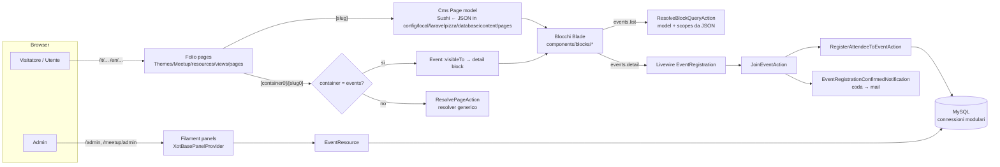

# Architecture

> Audit del 2026-11-05. Ricostruita dal codice, non dalla documentazione.

## Vista d'insieme

## Strati

| Strato | Dove | Note |
|---|---|---|
| Routing pubblico | Folio: `Themes/Meetup/resources/views/pages/` | 3 catch-all (`index`, `[slug]`, `[container0]/[slug0]`) + auth + profile. Locale via mcamara (`/{locale}/…`) |
| Contenuto | JSON → Sushi (`Modules/Cms/app/Models/Page.php`, trait `SushiToJsons`) | Pagine e sezioni (header/footer) |
| Presentazione | Blocchi Blade nel tema, layout `x-layouts.app/main/guest/auth` | Tailwind 4 + Alpine |
| Dominio | `Modules/Meetup`: modelli `Event`, `Venue`, `Performer`, `Sponsor`, `EventUser` (pivot), Action Spatie | Unico modulo di dominio |
| Admin | Filament 5: un pannello per modulo (`{module}::admin` su `/{module}/admin`) + pannello `admin` | Discovery automatica di Resource, Page e Widget |
| Infrastruttura condivisa | Xot, User, Tenant, Cms, UI, Lang, Media, Notify, Activity, Job, Geo, Gdpr, Seo, Rating, AI | Moduli comuni ad altri progetti Laraxot (vedi `gitmodules.ini`), qui importati come directory |
| Dati | Una connessione per modulo (`meetup`, `user`, …) creata da `TenantServiceProvider::registerDB()` come **copia** della default | Implicazione: le transazioni vanno aperte sulla connessione del modello (vedi S-04) |

## Valutazione

**Punti di forza**
- Convenzioni forti e documentate (XotBase, Action, una tabella una migrazione, file SVG, localizzazione), applicate in modo coerente in Meetup.
- Separazione netta tra admin (Filament) e front-office (Folio + CMS).
- Modello `Event` allineato a schema.org (`event_status`, `event_attendance_mode`) con JSON-LD.

**Criticità**
1. **Squilibrio dominio/infrastruttura.** Meetup ha 10 modelli e 1 Resource; i moduli infrastrutturali superano le 6.000 classi PHP. Ogni bug o upgrade nei moduli condivisi pesa su un prodotto il cui dominio è piccolo. AI e Rating non sono nemmeno in `modules_statuses.json`.
2. **Resolver CMS troppo generico** (`ResolvePageAction`): indovina il modello dall'URL e bypassa scope e soft delete. È una scelta di flessibilità che diventa un rischio di sicurezza (S-02).
3. **Logica nelle view.** I blocchi `events/list` e `events/detail` eseguono query Eloquent e calcolano lo stato. Le Action esistono, ma la view ha ancora fallback propri con regole duplicate.
4. **Connessioni modulari e transazioni.** Con N connessioni verso lo stesso DB, `DB::transaction()` non copre i modelli di modulo. Era sbagliato in tutte le Action del Meetup (corretto in questo ciclo).
5. **Documentazione e codice divergono.** Laravel 12 dichiarato, 13 nel lock; PHP 8.2/8.3 dichiarato, 8.4 richiesto; AD-6 dice "niente Fortify" ma esiste `app/Providers/FortifyServiceProvider.php` (non registrato, codice morto).
6. **Nessun enforcement dei confini tra moduli** (deptrac/PHPArkitect assenti, come riconosce già lo Spine AD-4).

## Dipendenze tra moduli (osservate)

- `Meetup` → `User` (User model, ruoli), `Activity` (trait `HasEvents`, `HasSnapshots`), `Xot` (BaseModel, `belongsToManyX`, factory), `Gdpr` (consensi in `RegisterWithGdprAction`).
- `Cms` → `Meetup` (stringhe hardcoded `Modules\Meetup\Models\Event` in `ResolvePageAction`): dipendenza inversa da un modulo condiviso verso il dominio.
- Tema `Meetup` → `Cms`, `Meetup`, `User`, `Gdpr` (widget di login e registrazione).
