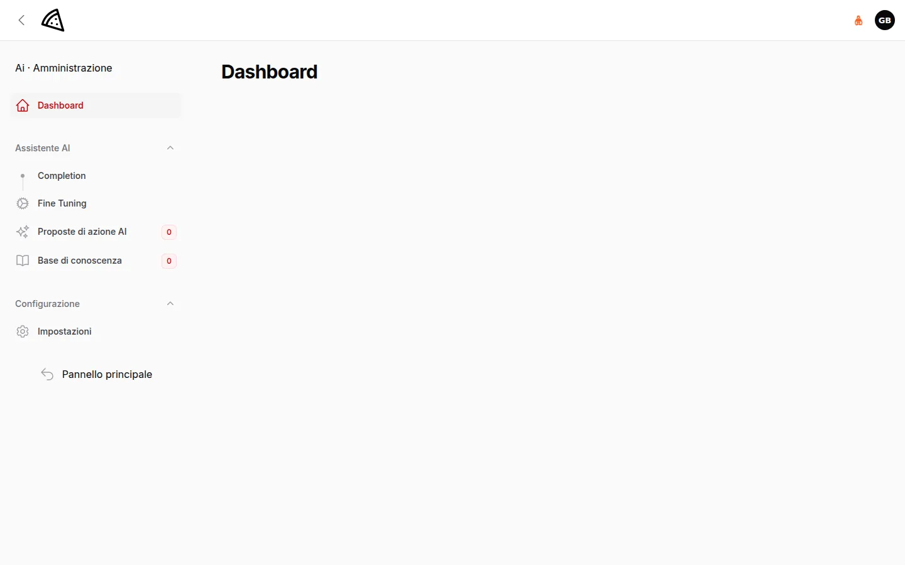
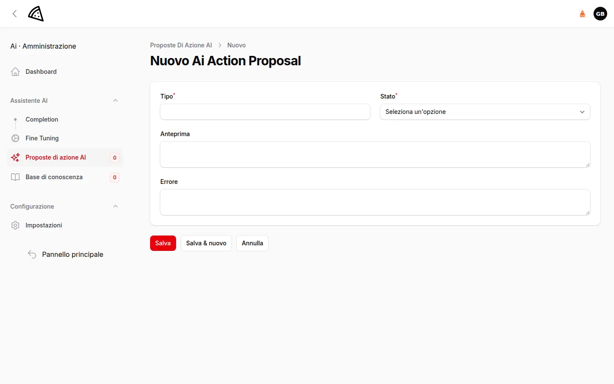
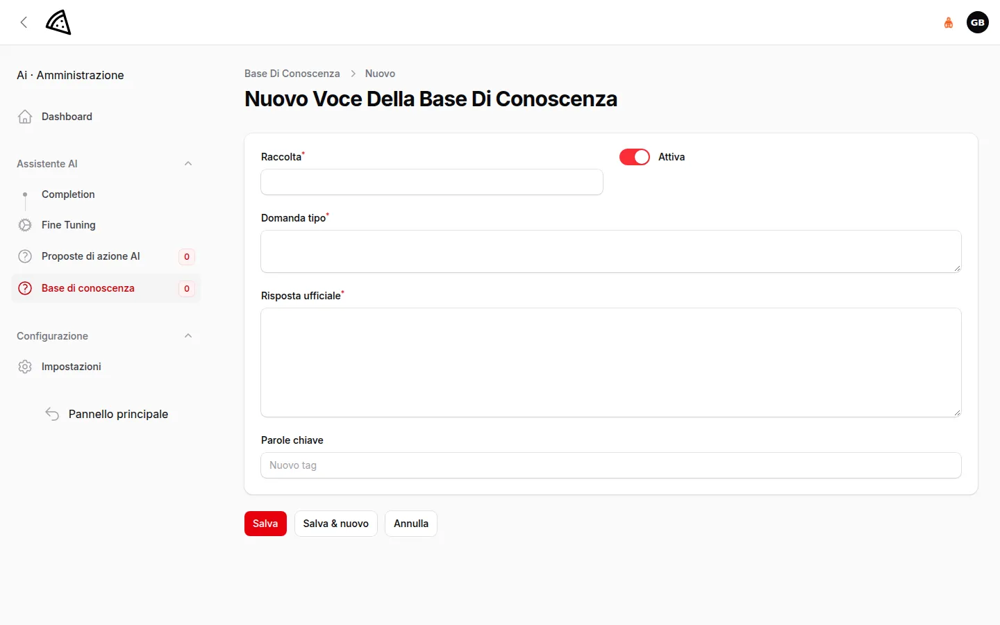
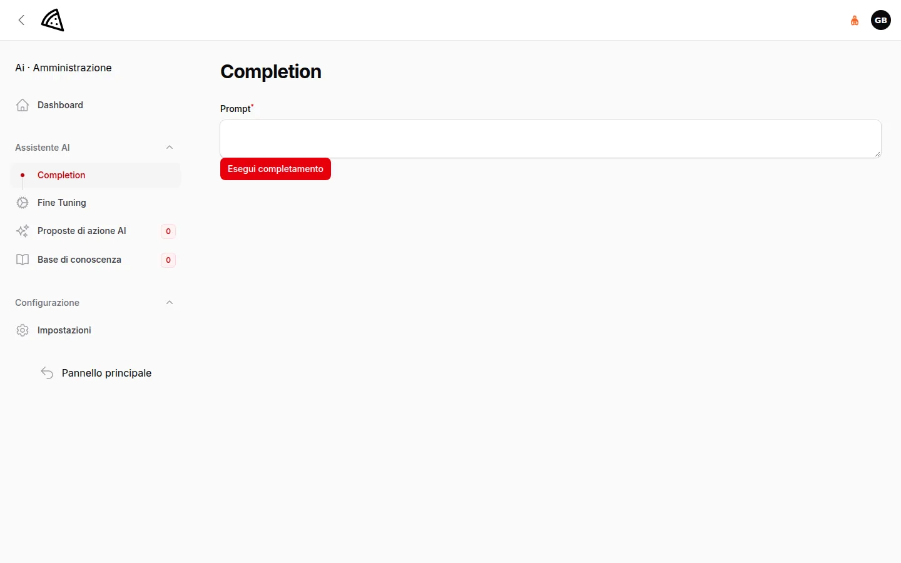
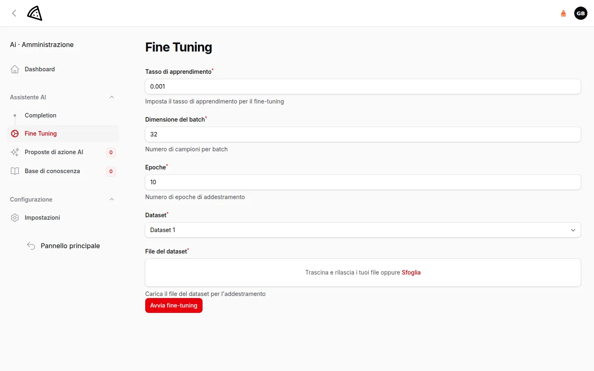

# Manuale utente — AI

Il modulo **AI** espone il pannello Filament `ai/admin` (etichetta «Ai · Amministrazione»). Non ha pagine di front office: tutto ciò che si documenta qui sta nel pannello.

> **Fonte degli screenshot.** Catture reali del 2026-11-25 fatte con `bashscripts/tools/docs/manual-screenshots.mjs AI` sull'istanza di prova isolata (`127.0.0.1:8091`, database usa-e-getta, utente sintetico super-admin). Manifest: [screenshots.json](screenshots.json). Ogni cattura è stata aperta e controllata a vista: stile applicato, nessuna pagina d'errore.
>
> **Dati.** Nessun dato di esempio: le tabelle della prova sono vuote e mostrano «Nessun risultato». Non compaiono dati reali di utenti.

## Route del pannello

Verificate con `php artisan route:list --path=ai/admin` (solo le pagine con GET documentate qui):

| Pagina | Percorso | Screenshot |
|---|---|---|
| Login | `/ai/admin/login` | [ai-login](assets/ai-login.webp) |
| Dashboard | `/ai/admin` | [ai-dashboard](assets/ai-dashboard.webp) |
| Proposte di azione: elenco | `/ai/admin/ai-action-proposals` | [ai-proposals-list](assets/ai-proposals-list.webp) |
| Proposte di azione: nuova | `/ai/admin/ai-action-proposals/create` | [ai-proposals-create](assets/ai-proposals-create.webp) |
| Base di conoscenza: elenco | `/ai/admin/ai-knowledge-entries` | [ai-knowledge-list](assets/ai-knowledge-list.webp) |
| Base di conoscenza: nuova voce | `/ai/admin/ai-knowledge-entries/create` | [ai-knowledge-create](assets/ai-knowledge-create.webp) |
| Completion | `/ai/admin/completion` | [ai-completion](assets/ai-completion.webp) |
| Fine-tuning | `/ai/admin/fine-tuning` | [ai-fine-tuning](assets/ai-fine-tuning.webp) |
| Impostazioni | `/ai/admin/setting` | [ai-setting](assets/ai-setting.webp) |

Le rotte di modifica e visualizzazione (`.../{record}`, `.../{record}/edit`) esistono nel codice ma non sono state fotografate: nella prova non c'erano record.

## Accesso

Il login è quello standard di Filament sul percorso `/ai/admin/login`: campi Email e Password, opzione «Ricordami», link «Hai smarrito la password?».

Nella prova l'accesso è stato verificato solo con un account super-admin sintetico. Le regole di permesso per ruolo non sono state verificate e non sono descritte qui.

## Navigazione

La barra laterale raggruppa le voci così (gruppo «Assistente AI» e «Configurazione»):

- **Assistente AI**: Completion, Fine Tuning, Proposte di azione AI, Base di conoscenza.
- **Configurazione**: Impostazioni.
- In fondo: «Pannello principale» per tornare al pannello generale.

La voce «Dashboard» è in cima alla barra laterale, sopra il gruppo «Assistente AI» (vedi «Difetti noti», punto 2).

## Dashboard

La pagina ha solo il titolo «Dashboard» e nessun contenuto: la classe `Modules\AI\Filament\Pages\Dashboard` estende `XotBaseDashboard` (quindi la dashboard standard di Filament) e non ha widget registrati.

## Proposte di azione AI

Le proposte sono azioni che l'assistente propone e che un utente deve confermare o annullare (le etichette degli stati vengono da `AiActionProposalStatusEnum`).

Colonne dell'elenco (`AiActionProposalsTable.php`): `id`, «Conversazione» (`thread.public_id`), «Tipo», «Stato», «Creata il». La colonna «Anteprima» è nascosta di default.

Stati previsti: In attesa, Annullata, Confermata, Eseguita, Fallita. Le azioni di riga «Conferma» e «Annulla» compaiono solo negli stati che le consentono (`canBeConfirmed()`, `canBeCancelled()`); non sono state provate perché la lista è vuota.

Form di creazione (`AiActionProposalForm.php`): «Tipo» (obbligatorio), «Stato» (obbligatorio, a scelta fra gli stati sopra), «Anteprima» (testo libero), «Errore» (testo libero).

## Base di conoscenza

È il testo ufficiale da cui l'assistente risponde: le risposte si scrivono e si correggono qui.

Colonne dell'elenco (`AiKnowledgeEntriesTable.php`): `id`, «Raccolta», «Domanda», «Attiva», «Aggiornata il». La colonna «Risposta» è nascosta di default.

Form di creazione (`AiKnowledgeEntryForm.php`):

| Campo | Obbligatorio | Note |
|---|---|---|
| Raccolta | sì | massimo 255 caratteri; identifica il progetto o il cliente |
| Attiva | no | attiva di default |
| Domanda tipo | sì | testo |
| Risposta ufficiale | sì | testo, 6 righe |
| Parole chiave | no | campo a tag |

## Completion

Pagina con un solo campo, «Prompt» (obbligatorio), e il pulsante «Esegui completamento». Il pulsante invia il testo a un servizio LLM esterno (`CompletionAction`): nella documentazione non è stato premuto, quindi la risposta del modello non è descritta.

## Fine-tuning

Campi del form (`Modules/AI/app/Filament/Pages/FineTuning.php`):

| Campo | Default | Vincoli |
|---|---|---|
| Tasso di apprendimento | 0.001 | obbligatorio, numero, minimo 0 |
| Dimensione del batch | 32 | obbligatorio, numero, minimo 1 |
| Epoche | 10 | obbligatorio, numero, minimo 1 |
| Dataset | Dataset 1 | obbligatorio; scelte «Dataset 1», «Dataset 2» |
| File del dataset | — | obbligatorio, caricamento file |

Il pulsante «Avvia fine-tuning» invia i dati e il file all'endpoint configurato in `ai.backend_api.fine_tuning_url` (servizio esterno). Non è stato premuto. Esito atteso: notifica di successo o di errore.

## Impostazioni

Pagina `SettingPage.php` (`/ai/admin/setting`). Campi del form, come da codice: modello per completion e chat (`model`, `chat_model`), temperatura (`temperature`, `chat_temperature`), `max_tokens`, `timeout`, `retry_attempts`, `openai_base_url`, `free_models_only`, provider e modelli per visione e assistente (`vision_providers`, `vision_models`, `vision_timeout`, `image_model`, `assistant_providers`, `assistant_models`, `assistant_timeout`).

La chiave API OpenAI non è un campo del form: resta in `.env` (`services.openai.api_key`), come dichiarato nel docblock di `SettingPage.php`.

Nella cattura il form mostra, dall'alto: **Modello di completion** (GPT-3.5 Turbo Instruct) e **Modello chat** (GPT-4o Mini) come menu a tendina; **Temperatura delle previsioni** (0.7) e **delle bozze** (0.6), con il testo d'aiuto «da 0 (deterministico) a 2»; **Token massimi per previsione** (1500); **Timeout richieste** (30 s); **Tentativi per richiesta** (3); **Indirizzo base delle API** (`https://api.openai.com/v1`, con l'avviso che la chiave API resta nel file `.env`); l'interruttore **Solo modelli gratuiti** (attivo); poi i provider e i modelli per le immagini (tag `groq`, `openrouter`; tabella chiave/valore con «Aggiungi riga»), il timeout immagini, il modello per modificare immagini e gli stessi tre gruppi per l'assistente. In fondo il pulsante **Salva**, non premuto durante la cattura. Nel form non compare alcuna chiave segreta. I valori mostrati sono i predefiniti dell'istanza di prova.

## Difetti noti

1. **Dashboard vuota.** Nessun widget né contenuto. Resta inoltre nel modulo la vista `resources/views/filament/pages/dashboard.blade.php` (solo `<x-filament::page>` vuoto), che la classe `Dashboard` non usa più da quando estende `XotBaseDashboard`: da rimuovere o tornare a usare. Evidenza: [ai-dashboard](assets/ai-dashboard.webp).
2. **Gruppo grezzo per la Dashboard (corretto da un'altra modifica nella stessa sessione).** La sidebar mostrava la chiave «.navigation» (poi «dashboard.navigation»): `GetTransKeyAction` per `Modules\AI\Filament\Pages\Dashboard` restituiva `ai::` e il runtime di Xot scriveva nei file di lingua un segnaposto con il nome della chiave. Ora `Dashboard` estende `XotBaseDashboard`: la voce è in cima alla barra laterale, senza gruppo, e la route è `/ai/admin` (prima `/ai/admin/dashboard`, ora 404). Evidenza: [ai-dashboard](assets/ai-dashboard.webp). Restano nel `lang/it/` del modulo un file spurio `.php` (nome vuoto, con `profile`, `logout` e `.navigation`) creato dalla scrittura automatica di Xot (`AutoLabelAction.php`): da non committare. Cambio di percorso non ancora coperto dal resto della documentazione: cercare `ai/admin/dashboard` prima di pubblicare.
3. **Impostazioni: falso positivo dello strumento di cattura (risolto).** La regex dei campi «segreti» di `bashscripts/tools/docs/manual-screenshots.mjs` conteneva `token`, quindi `form.max_tokens` (numero di token massimi, non un segreto) faceva fallire la cattura. Ora `token` non vale se seguito da `s` e i campi numerici sono esclusi: la pagina è stata fotografata. Nella stessa cattura il testo d'aiuto «Casualita'» (apostrofo al posto di «à») è stato corretto in `lang/it/setting.php`.
4. **Titoli in maiuscole.** Il titolo delle pagine applica il title case all'italiano: «Nuovo Voce Della Base Di Conoscenza», «Proposte Di Azione AI». Evidenza: [ai-knowledge-create](assets/ai-knowledge-create.webp), [ai-proposals-list](assets/ai-proposals-list.webp). Causa probabile in Xot (`Str::title` sul titolo della pagina), non nel modulo.
5. **Doppio pulsante «Nuovo» nelle liste.** Compare sia come «+ Nuovo» in testata sia come «Nuovo» nella toolbar. Comportamento condiviso da tutte le liste Xot (`HasXotTable::getTableHeaderActions` e `XotBaseListRecords::getHeaderActions`), non specifico di AI.
6. **Etichette di form e tabelle.** Corrette in questa sessione aggiungendo `lang/it/ai_action_proposal_form.php`, `lang/it/ai_knowledge_entry_form.php`, `lang/it/ai_knowledge_entries.php` e sistemando i segnaposto di `ai_action_proposals.php`, `ai_action_proposal.php`, `completion.php`, `fine_tuning.php`. Resta un problema di fondo in Xot: `Modules/Xot/app/Actions/Filament/AutoLabelAction.php` (righe 68–90) scrive a runtime nei file di lingua segnaposto per le chiavi mancanti (il nome del campo, es. `type`, `create`), e riapplica l'etichetta solo se la chiave esiste già. Dopo le correzioni i file sono stati riscritti dal runtime con nuove chiavi segnaposto (`fine_tuning.php`, `ai_knowledge_entries.php`, `ai_action_proposal.php`): da controllare prima di ogni commit.
7. **Commento del form Base di conoscenza non allineato.** Il docblock di `AiKnowledgeEntryForm.php` dice che le etichette vengono da `ai::ai_knowledge_entry.fields.*`, ma la chiave effettiva è `ai::ai_knowledge_entry_form` (verificato con `GetTransKeyAction`). Non modificato: è un commento, e il file PHP non è stato toccato.
8. **Pulsanti che chiamano servizi esterni.** «Esegui completamento» e «Avvia fine-tuning» inviano dati a servizi LLM/backend esterni. Non sono stati premuti durante la documentazione; il loro comportamento reale non è verificato qui.

## Fonti

- `laravel/Modules/AI/app/Filament/Resources/AiActionProposalResource.php` e relativi `Schemas/` e `Tables/`
- `laravel/Modules/AI/app/Filament/Resources/AiKnowledgeEntryResource.php` e relativi `Schemas/` e `Tables/`
- `laravel/Modules/AI/app/Filament/Pages/` (Completion, FineTuning, SettingPage, Dashboard)
- `laravel/Modules/AI/lang/it/` (etichette)
- `php artisan route:list --path=ai/admin --json`
- Screenshot e manifest in `assets/` e [screenshots.json](screenshots.json)
