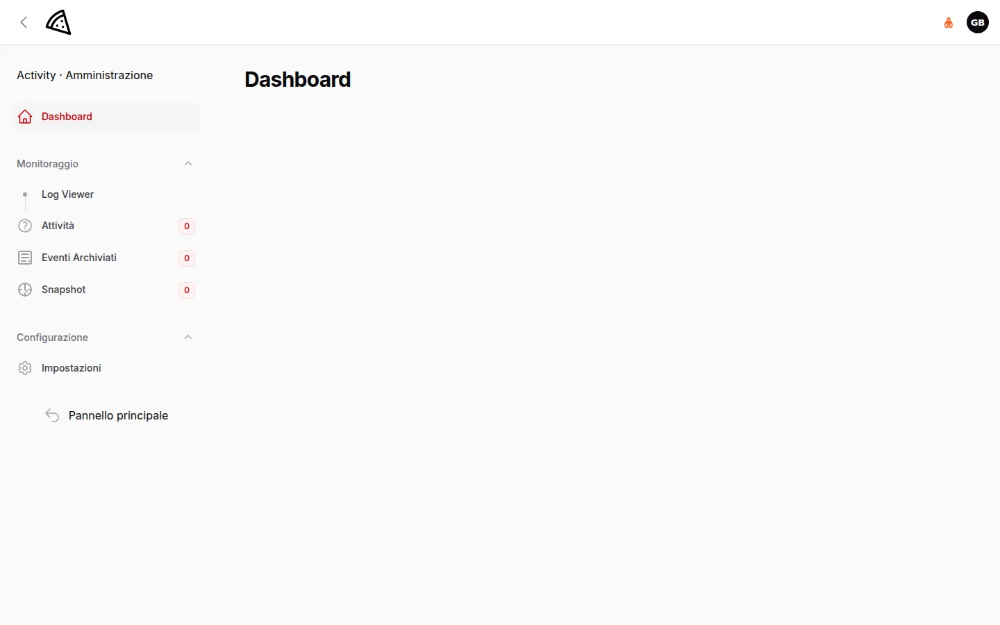
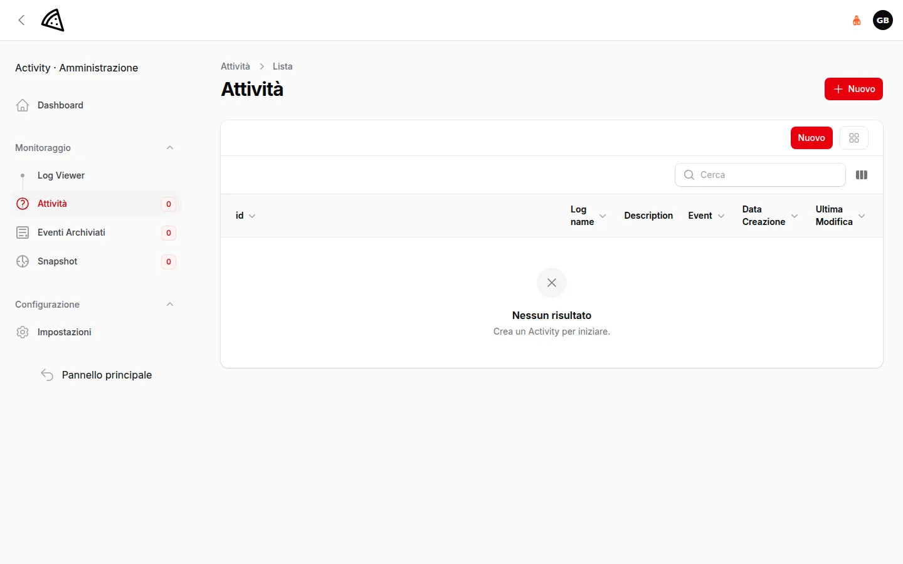
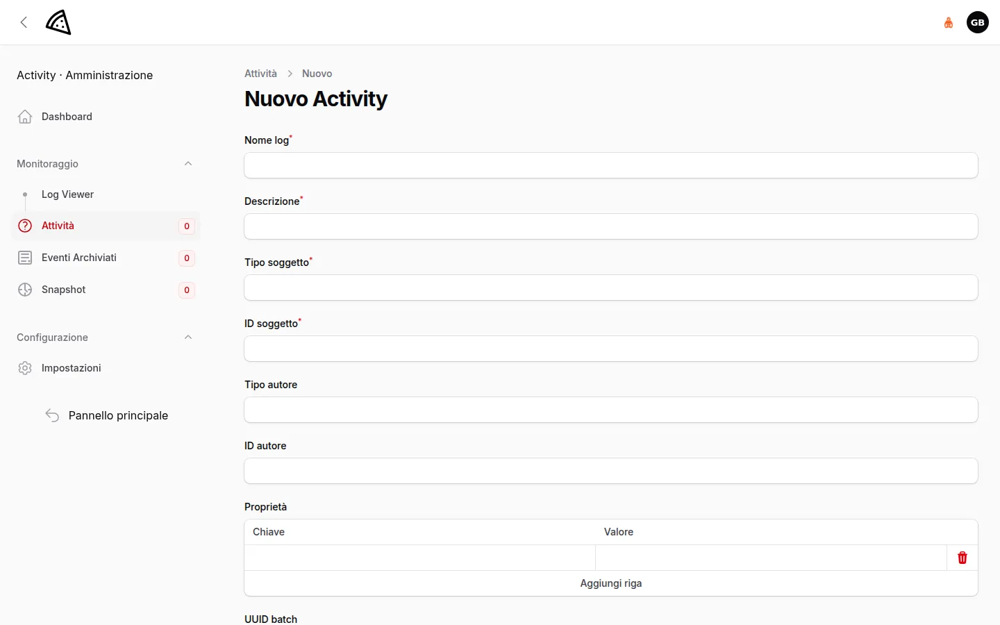
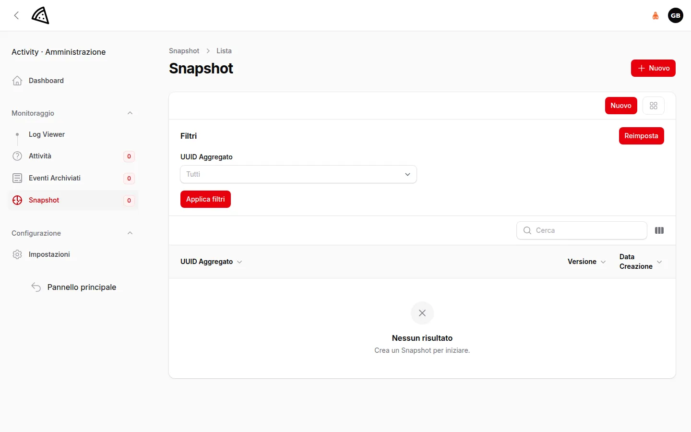
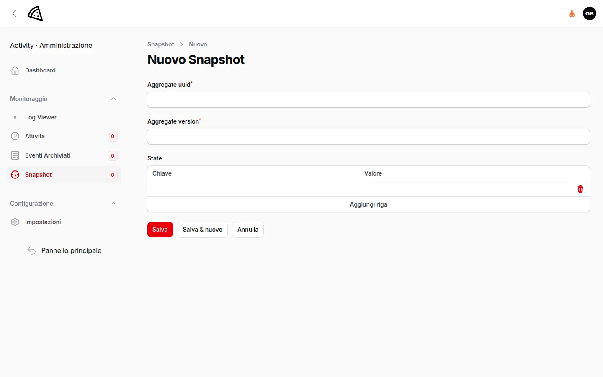
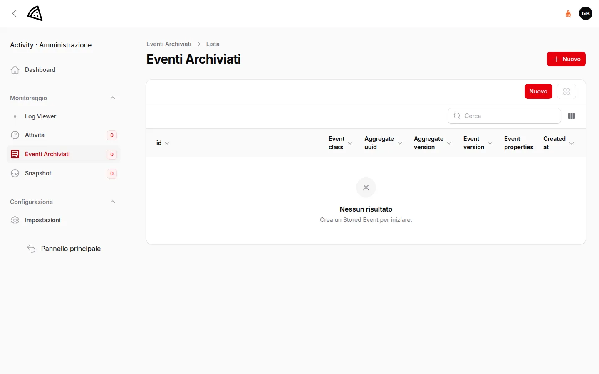
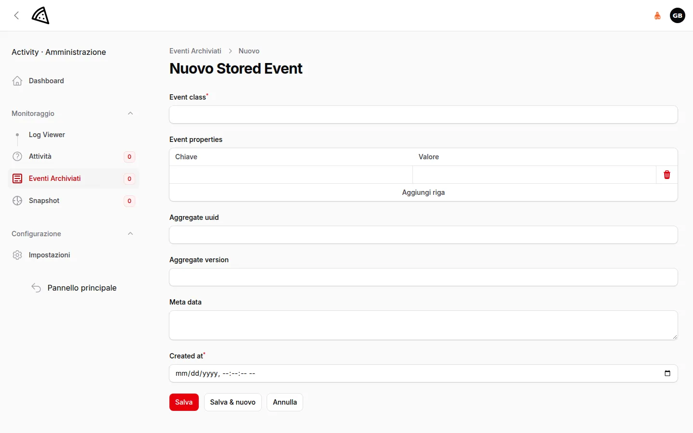
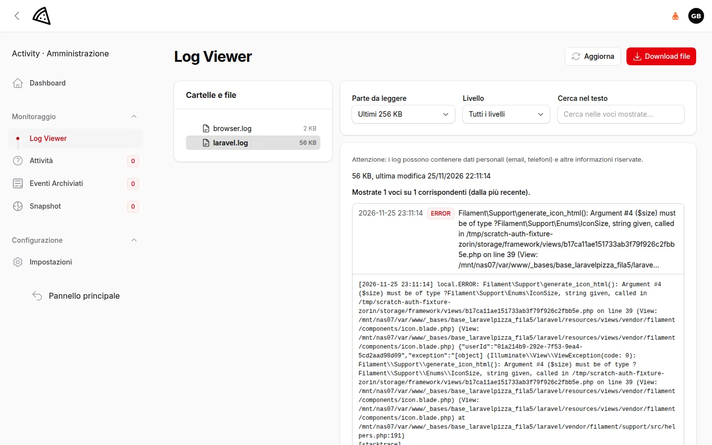
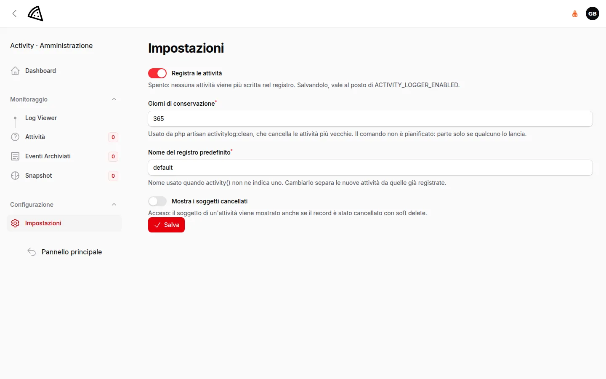

# Manuale utente — Pannello Activity

Questo manuale descrive il pannello di amministrazione del modulo **Activity**, raggiungibile su `/activity/admin`. Ogni screenshot è una cattura reale della pagina, fatta il 2026-11-25 su un'istanza di prova isolata con database vuoto (nessun dato reale). Le liste mostrano «Nessun risultato» perché non ci sono righe: non sono stati inseriti dati di esempio.

## Scopo

Il pannello permette di consultare e gestire il registro delle attività (audit log), gli eventi archiviati dell'event sourcing e gli snapshot degli aggregati, e di controllare log applicativi e impostazioni del modulo.

## Accesso

Pagina di accesso: `/activity/admin/login`. Campi: **Email**, **Password**; opzione **Ricordami**; link **Hai smarrito la password?** (rotte `password-reset/request` e `password-reset/reset`).

Dopo l'accesso la barra laterale mostra due gruppi:

- **Monitoraggio**: Log Viewer, Attività, Eventi Archiviati, Snapshot.
- **Configurazione**: Impostazioni.

Il link **Pannello principale** in fondo alla barra riporta al pannello generale. Le voci Attività, Eventi Archiviati e Snapshot mostrano un contatore di righe a fianco.

Attori verificabili dal codice: l'accesso richiede un utente autenticato del pannello `activity` (middleware `Filament\Http\Middleware\Authenticate` in tutte le rotte). I permessi per singola risorsa non sono documentati in questo manuale perché non sono stati verificati.

## Dashboard

Route: `/activity/admin`.

Nella cattura la dashboard mostra solo il titolo «Dashboard» e nessun widget.

## Attività (log delle attività)

Route: `/activity/admin/activities`, nuova attività: `/activity/admin/activities/create`. Sorgente: `app/Filament/Resources/ActivityResource/`.

### Lista

Colonne (da `Tables/ActivitiesTable.php`): **id**, **Log name**, **Description**, **Event**, **Data Creazione**, **Ultima Modifica**. Le colonne **subject_type**, **subject_id**, **causer_type**, **causer_id**, **properties** e **batch_uuid** sono nascoste di default e attivabili dal selettore colonne. Pulsanti: **Nuovo**, ricerca **Cerca**.

### Nuovo Activity

Campi (da `Schemas/ActivityForm.php` e `lang/it/activity_form.php`):

| Campo | Obbligatorio | Vincoli |
|---|---|---|
| Nome log | sì | max 255 |
| Descrizione | sì | max 255 |
| Tipo soggetto | sì | max 255 |
| ID soggetto | sì | numerico |
| Tipo autore | no | max 255 |
| ID autore | no | numerico |
| Proprietà | no | coppie Chiave / Valore |
| UUID batch | no | max 36 |

## Snapshot

Route: `/activity/admin/snapshots`, nuovo: `/activity/admin/snapshots/create`. Sorgente: `app/Filament/Resources/SnapshotResource/`.

### Lista

Filtro **UUID Aggregato** (menu a tendina, valore iniziale «Tutti») con pulsanti **Applica filtri** e **Reimposta**. Colonne: **UUID Aggregato**, **Versione**, **Data Creazione**.

### Nuovo Snapshot

Campi (da `Schemas/SnapshotForm.php`): **Aggregate uuid** (obbligatorio), **Aggregate version** (obbligatorio), **State** (coppie Chiave / Valore). Pulsanti: **Salva**, **Salva & nuovo**, **Annulla**.

## Eventi Archiviati (stored events)

Route: `/activity/admin/stored-events`, nuovo: `/activity/admin/stored-events/create`. Sorgente: `app/Filament/Resources/StoredEventResource/`.

### Lista

Colonne: **id**, **Event class**, **Aggregate uuid**, **Aggregate version**, **Event version**, **Event properties**, **Created at**.

### Nuovo Stored Event

Campi (da `Schemas/StoredEventForm.php`): **Event class** (obbligatorio, max 255), **Event properties** (coppie Chiave / Valore), **Aggregate uuid** (max 36), **Aggregate version** (numerico), **Meta data** (testo libero), **Created at** (obbligatorio, data e ora).

## Log Viewer

Route: `/activity/admin/log-viewer`. Sorgente: `app/Filament/Pages/LogViewer.php`.

- Colonna sinistra: elenco di file di log (nella prova `browser.log` e `laravel.log`).
- Filtri: **Parte da leggere** (predefinito «Ultimi 256 KB»), **Livello** (predefinito «Tutti i livelli»), **Cerca nel testo** (filtra solo le voci mostrate).
- Pulsanti: **Aggiorna**, **Download file**.
- Avviso in pagina: i log possono contenere dati personali (email, telefoni) e altre informazioni riservate.

## Impostazioni

Route: `/activity/admin/setting`. Sorgente: `app/Filament/Pages/SettingPage.php`, etichette in `lang/it/setting.php`.

| Voce | Valore nella prova | Cosa fa (come scritto in pagina) |
|---|---|---|
| Registra le attività | attivo | Se spento, nessuna attività viene scritta nel registro. Salvando, sostituisce `ACTIVITY_LOGGER_ENABLED`. |
| Giorni di conservazione | 365 | Usato da `php artisan activitylog:clean`, che cancella le attività più vecchie. Il comando non è pianificato: parte solo se qualcuno lo lancia. |
| Nome del registro predefinito | default | Usato quando `activity()` non indica un nome. Cambiarlo separa le nuove attività da quelle già registrate. |
| Mostra i soggetti cancellati | disattivo | Mostra il soggetto di un'attività anche se il record è stato cancellato con soft delete. |

Pulsante: **Salva**.

## Difetti noti

Ogni voce è verificata da screenshot o da codice letto.

1. **Etichette in inglese non tradotte nei form e nelle liste di Eventi Archiviati e Snapshot.** Nelle schermate compaiono «Event class», «Aggregate uuid», «Aggregate version», «Event version», «Event properties», «Created at», «Meta data», «State», oltre a intestazioni di lista come «id», «Description», «Event», «Log name». Causa: i campi in `StoredEventForm.php` (righe 22-27), `SnapshotForm.php` (righe 20-26), `ActivitiesTable.php` (righe 31-48) non hanno una chiave di traduzione. **Non corretto**: richiede chiavi in più file di lingua, quindi è fuori dal perimetro di questa modifica.
2. **Errore di tipo nel log di prova.** Nel `laravel.log` dell'istanza di prova compare una voce `ERROR` del 2026-11-25 23:11:14 (ora locale): `Filament\Support\generate_icon_html(): Argument #4 ($size) must be of type ?Filament\Support\Enums\IconSize, string given`, richiamata da `resources/views/vendor/filament/components/icon.blade.php`. Il timestamp coincide con la finestra della cattura (22:10-22:12 UTC), ma tutte le pagine catturate hanno risposto HTTP 200 e nessuna mostra un errore. La causa è un componente `<x-filament::icon>` che riceve `size` come stringa; il chiamante non è stato individuato nel codice del modulo. **Non corretto**: non è nel modulo Activity.
3. **Dashboard vuota.** Nella cattura non compare alcun widget. Non è stato verificato se è atteso o se i widget non sono registrati in `app/Filament/Pages/Dashboard.php`.
4. **Il manuale PDF precedente** (`manuale-utente.pdf`) non è aggiornato: non è stato rigenerato in questa modifica.

Modifica applicata durante la verifica: le etichette del form Attività (`lang/it/activity_form.php`) mostravano le chiavi grezze («batch_uuid», «log_name», «subject_type», ecc.); ora sono in italiano («UUID batch», «Nome log», «Tipo soggetto», ecc.). Il form è nello screenshot «Nuovo Activity».

## Fonti verificabili

- Route: `php artisan route:list --path=activity/admin`.
- Pagine: `app/Filament/Pages/` (Dashboard, LogViewer, SettingPage, ListLogActivities).
- Risorse e form: `app/Filament/Resources/` (ActivityResource, SnapshotResource, StoredEventResource).
- Traduzioni: `lang/it/activity_form.php`, `lang/it/setting.php`.
- Screenshot e metadati di cattura: `docs/manuals/screenshots.json` e `docs/manuals/assets/`.
