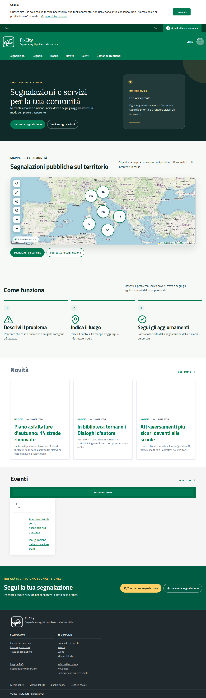

> Screenshot reale del front office FixCity, verificato il 23 novembre 2026. Per questo modulo è una superficie condivisa: il manuale non attribuisce al modulo una UI propria se non documentata dalle fonti.

# Manuale d'uso per attori

## Scopo

Activity registra attivita', eventi e snapshot e offre risorse Filament e consultazione dei log. L'accesso alle risorse e' espresso da permessi granulari; il log viewer ha una regola separata.

## Attori e capacita'

| Attore | Capacita' verificata | Verifica |
|---|---|---|
| Ospite | N/A verificato. | Le policy richiedono un `UserContract`; il log viewer rifiuta un utente non compatibile. |
| Utente normale autenticato | Puo' eseguire ogni azione per cui possiede il relativo permesso (`activity.*`, `stored_event.*`, `snapshot.*`); senza permesso N/A verificato. | [ActivityPolicy](../app/Models/Policies/ActivityPolicy.php#L15-L65), [StoredEventPolicy](../app/Models/Policies/StoredEventPolicy.php), [SnapshotPolicy](../app/Models/Policies/SnapshotPolicy.php). |
| Utente in gruppo/ruolo | Capacita' determinate dai permessi assegnati; il solo gruppo/ruolo non prova accesso. | Le policy chiamano `hasPermissionTo(...)`; [ActivityPolicy](../app/Models/Policies/ActivityPolicy.php#L15-L65). |
| Admin | N/A verificato per un ruolo generico `admin`. Il ruolo `activity::admin` ha bypass dichiarato nella policy base, ma le policy concrete consultate estendono `UserBasePolicy`: bypass effettivo non verificato. | [ActivityBasePolicy](../app/Models/Policies/ActivityBasePolicy.php#L14-L25). |
| Super-admin | Accesso ai log verificato; per le risorse Activity resta verificato solo dove la policy concreta concede il permesso. | [AuthorizeLogAccessAction](../app/Actions/Log/AuthorizeLogAccessAction.php#L22-L32); [ActivityPolicy](../app/Models/Policies/ActivityPolicy.php#L10-L18). |
| Operatore/moderatore | N/A verificato, salvo assegnazione esplicita dei permessi sopra indicati. | Non emerge un ruolo speciale nelle policy owner. |

## Flussi principali

1. Un utente autenticato tenta l'azione sulla risorsa Activity, StoredEvent o Snapshot.
2. La policy verifica il permesso dell'azione: visualizzazione, creazione, modifica, cancellazione, ripristino o cancellazione forzata.
3. Per il log viewer, `AuthorizeLogAccessAction` concede a super-admin o a chi ha `log.viewAny`.
4. Se `log.viewAny` non esiste nel database, il log viewer nega senza errore.

## Prerequisiti

- Utente autenticato compatibile con `UserContract`.
- Permessi Spatie assegnati con i nomi esatti usati dalle policy.
- Pannello Activity/risorsa o log viewer registrato e configurato.

## Limiti e casi non supportati

- Il ruolo generico `admin` non e' una prova di accesso.
- Il bypass `activity::admin` e' dichiarato nella base ma non e' dimostrato per le policy concrete.
- Non e' verificata alcuna capacita' per ospiti, moderatori o operatori senza permessi.

## Riferimenti owner

- [architecture](architecture.md)
- [security](security.md)
- [ActivityPolicy](../app/Models/Policies/ActivityPolicy.php)
- [ActivityBasePolicy](../app/Models/Policies/ActivityBasePolicy.php)
- [AuthorizeLogAccessAction](../app/Actions/Log/AuthorizeLogAccessAction.php)
- [test policy](../tests/Unit/ActivityPolicyTest.php)

