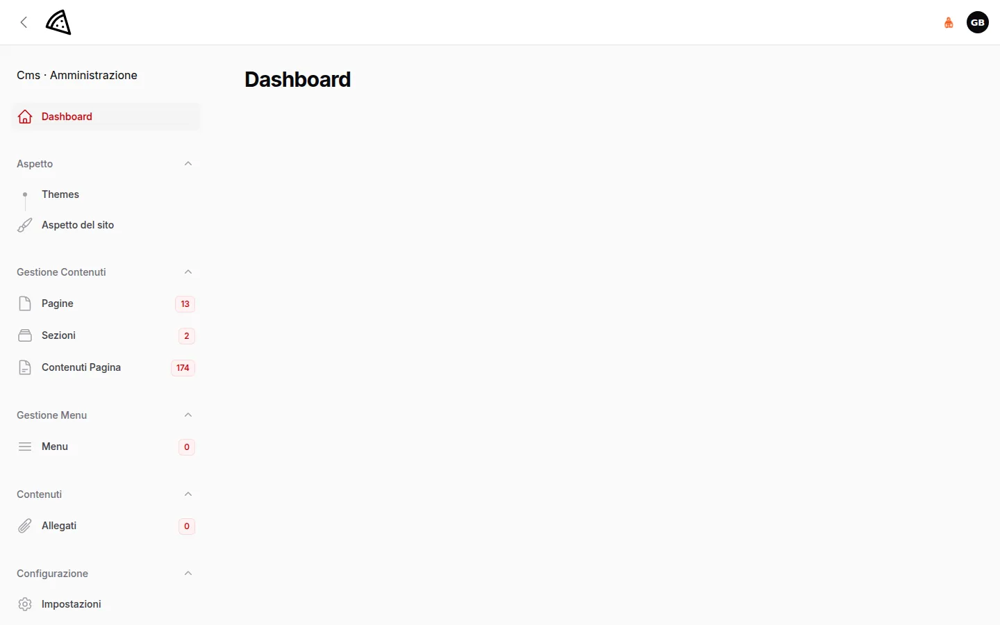
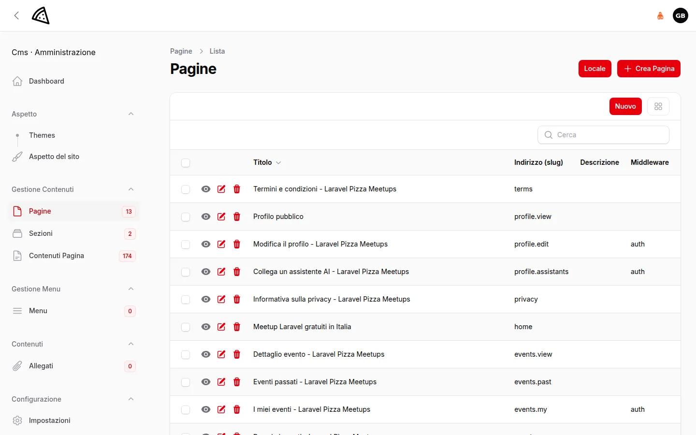
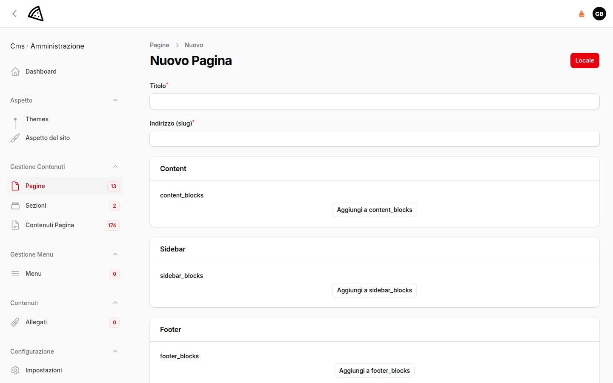
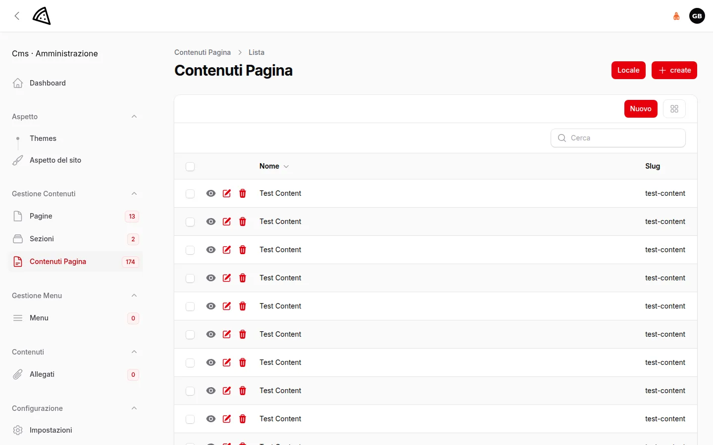
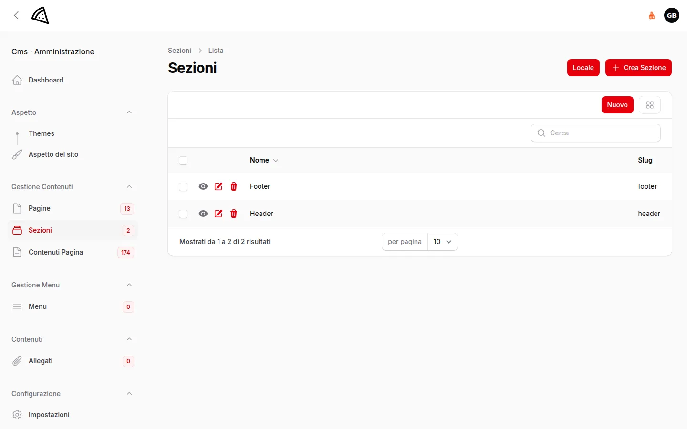
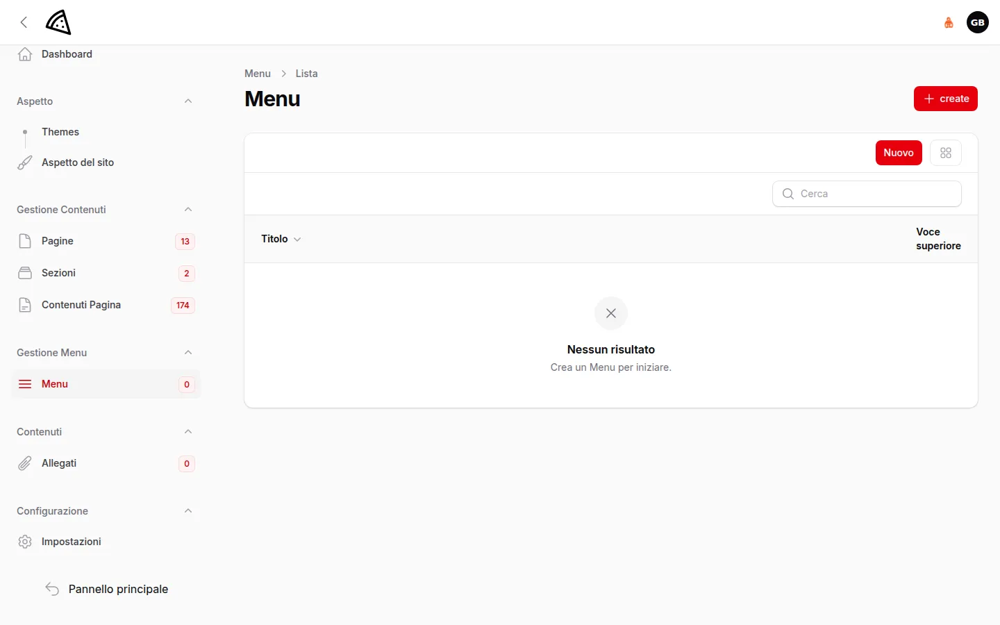
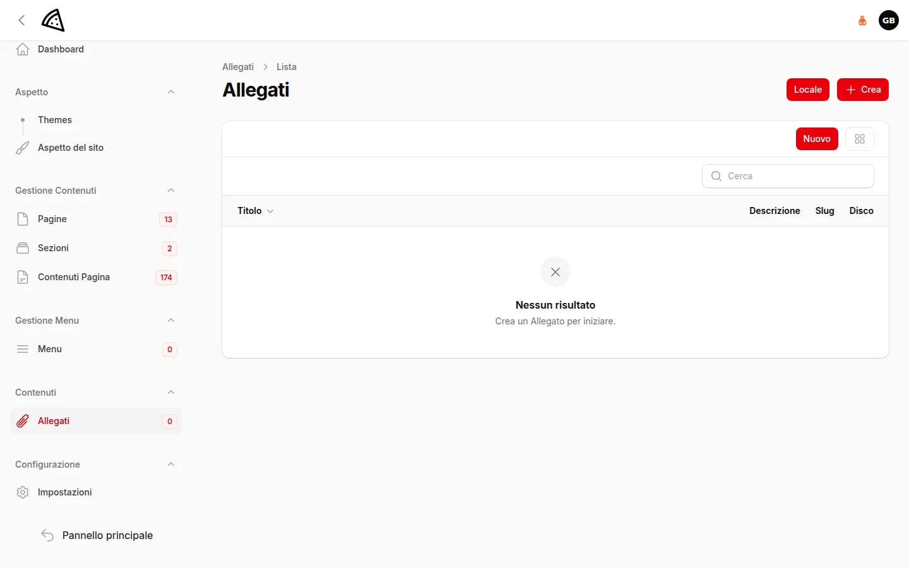
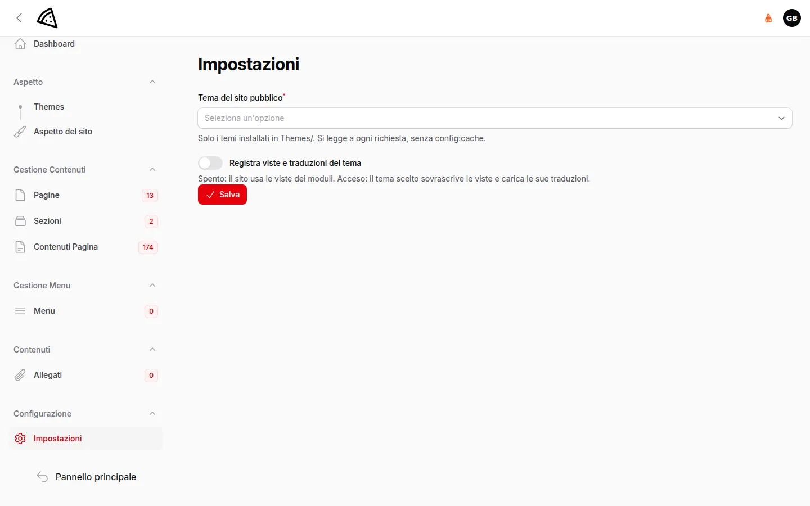
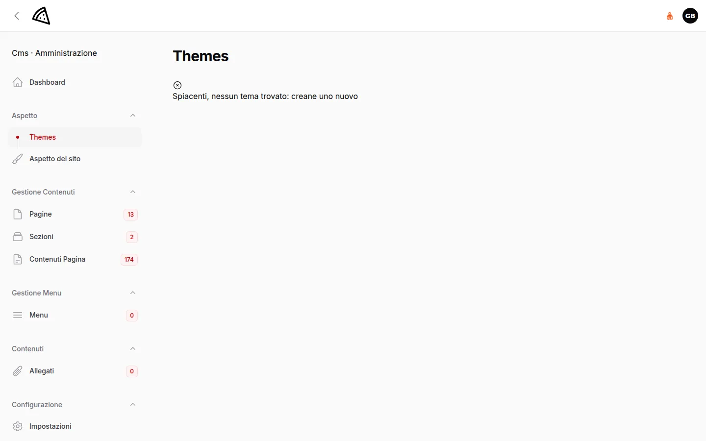

> Questo manuale documenta il **pannello di gestione** del modulo Cms (`cms/admin`).
> Il front office (pagine pubbliche) è documentato nel manuale del tema Meetup e
> non è trattato qui. Screenshot presi il 2026-11-25 dall'istanza di prova isolata
> (database usa-e-getta con dati sintetici), non dal sito reale.

## Scopo

Il pannello Cms serve a gestire i contenuti del sito pubblico: pagine, sezioni,
blocchi di contenuto, menu, allegati e tema attivo. È un pannello Filament separato
dal pannello principale (`cms::admin`), registrato da
`laravel/Modules/Cms/app/Providers/Filament/AdminPanelProvider.php`, che abilita il
plugin di traduzione (locali `it` ed `en`) e poi estende `XotBasePanelProvider`.

## Accesso

- Indirizzo: `/cms/admin` (login: `/cms/admin/login`).
- Login con email e password. La pagina di login contiene i campi **Email** e
  **Password**, il link **Hai smarrito la password?** e il pulsante **Accedi**
  (con «Ricordami» e «Mostra password»). Fonte: `cms-admin-login`.
- Le pagine interne richiedono un utente autenticato; le route sono quelle elencate
  da `php artisan route:list --path=cms/admin`.

## Navigazione

La barra laterale (gruppi reali, fonte: `cms-admin-dashboard`):

| Gruppo | Voci |
|---|---|
| Aspetto | Themes, Aspetto del sito (cluster `Appearance`: Breadcrumb, Footer, Headernav) |
| Gestione Contenuti | Pagine, Sezioni, Contenuti Pagina |
| Gestione Menu | Menu |
| Contenuti | Allegati |
| Configurazione | Impostazioni |

Il pulsante **Pannello principale** in basso riporta al pannello generale.
Il badge accanto a ogni voce mostra il numero di record.

**Dashboard.** Mostra il titolo «Dashboard» e la navigazione, senza widget visibili
nello screenshot. Non ci sono statistiche da leggere in questa pagina.

## Pagine

Route: `cms/admin/pages`, `cms/admin/pages/create`, `cms/admin/pages/{record}/edit`.
Risorsa: `app/Filament/Resources/PageResource.php`.

**Lista.** Colonne reali: **Titolo**, **Indirizzo (slug)**, **Descrizione**,
**Middleware** (per le pagine protette compare `auth`). Azioni di riga: visualizza,
modifica, elimina. Ricerca in alto a destra. Fonte: `cms-admin-pages` (13 pagine nel
database di prova).

**Creazione.** Campi: **Titolo** (obbligatorio), **Indirizzo (slug)** (obbligatorio),
poi tre blocchi di contenuto con pulsanti «Aggiungi a …»: **Content**, **Sidebar**,
**Footer**. Fonte: `cms-admin-pages-create`.

Difetto segnalato in questa schermata: le etichette dei tre blocchi escono grezze
(`content_blocks`, `sidebar_blocks`, `footer_blocks`) sia nel titolo di sezione sia
nei pulsanti. Vedi «Difetti noti».

## Contenuti Pagina

Route: `cms/admin/page-contents`, `…/create`, `…/{record}`, `…/{record}/edit`.
Risorsa: `app/Filament/Resources/PageContentResource.php`.

**Lista.** Colonne: **Nome**, **Slug**. Fonte: `cms-admin-page-contents`.
Nel database di prova compaiono 174 righe tutte chiamate «Test Content» con slug
`test-content`: sono residui di test, non dati di esempio e non contenuti reali.

## Sezioni

Route: `cms/admin/sections`, `…/create`, `…/{record}` (vista), `…/{record}/edit`.
Risorsa: `app/Filament/Resources/SectionResource.php`.

**Lista.** Colonne: **Nome**, **Slug**. Paginazione «per pagina 10». Nel database di
prova ci sono due sezioni: **Footer** (slug `footer`) e **Header** (slug `header`).
Fonte: `cms-admin-sections`.

## Menu

Route: `cms/admin/menus`, `…/create`, `…/{record}/edit`.
Risorsa: `app/Filament/Resources/MenuResource.php`.

**Lista.** Colonne: **Titolo**, **Voce superiore**. Con zero record la lista mostra
«Nessun risultato — Crea un Menu per iniziare». Fonte: `cms-admin-menus` (nel
database di prova non ci sono menu).

## Allegati

Route: `cms/admin/attachments`, `…/create`, `…/{record}/edit`.
Risorsa: `app/Filament/Resources/AttachmentResource.php`.

**Lista.** Colonne: **Titolo**, **Descrizione**, **Slug**, **Disco**, con pulsante
**Crea** in alto. Con zero record: «Nessun risultato — Crea un Allegato per
iniziare». Fonte: `cms-admin-attachments` (nessun allegato nel database di prova).
Il form di creazione non è stato fotografato: i campi previsti (File, Titolo, Slug)
sono quelli in `lang/it/attachment.php`, non verificati a schermo.

## Impostazioni

Route: `cms/admin/setting`. Pagina: `app/Filament/Pages/SettingPage.php`.

Campi reali (fonte: `cms-admin-setting`):

- **Tema del sito pubblico** (obbligatorio): menu a tendina, con l'elenco dei temi
  installati in `Themes/` (`ListInstalledThemesAction`). Il valore viene letto a ogni
  richiesta, senza `config:cache`.
- **Registra viste e traduzioni del tema** (interruttore). Spento: il sito usa le
  viste dei moduli. Acceso: il tema scelto sovrascrive le viste e carica le sue
  traduzioni.
- Pulsante **Salva**.

Non è stato aperto il menu a tendina: la schermata mostra solo il segnaposto
«Seleziona un'opzione», quindi non è verificato quali opzioni compaiano.

## Themes

Route: `cms/admin/themes`. Pagina: `app/Filament/Pages/Themes.php`, vista
`resources/views/filament/pages/themes.blade.php`.

Nello screenshot la pagina mostra il messaggio «Spiacenti, nessun tema trovato:
creane uno nuovo», anche se nella cartella `laravel/Themes/` c'è il tema **Meetup**
(verificato con `glob`). Quando funziona, la pagina dovrebbe mostrare una card per
tema con i pulsanti **Attiva** (`changePubTheme`) o **Anteprima** per il tema già
attivo. Vedi «Difetti noti».

## Limiti della documentazione

- Non fotografati: form di creazione/modifica di Sezioni, Menu e Contenuti Pagina;
  viste di dettaglio; cluster **Aspetto del sito** (Breadcrumb, Footer, Headernav).
- Nessun dato reale: i contatori e le liste riflettono un database di prova.
- Nessun `manuale-utente.pdf` in questo modulo.

## Difetti noti

| # | Dove | Evidenza | Stato |
|---|---|---|---|
| 1 | Themes: messaggio «nessun tema trovato» con il tema Meetup presente | `cms-admin-themes`; `Themes::getViewData()` restituisce 1 elemento (verificato in ambiente di prova), ma la vista mostra lo stato vuoto. Causa non identificata. | Aperto |
| 2 | Pagine › Nuova: etichette grezze dei blocchi (`content_blocks`, `sidebar_blocks`, `footer_blocks`) | `cms-admin-pages-create`. Le chiavi esistono in `lang/it/create.php:267-282` e il form usa `PageContentBuilder::make('content_blocks')` in `app/Filament/Resources/PageResource/Schemas/PageForm.php:37-43`; la lookup non le raggiunge. | Aperto |
| 3 | Pagine › Nuova: titolo «Nuovo Pagina» (maschile) | `cms-admin-pages-create`. Il titolo nasce da `lang/it/page.php:162` («Nuovo») + etichetta modello «Pagina». | Aperto, da decidere il genere |
| 4 | Contenuti Pagina: 174 righe «Test Content» nel database di prova | `cms-admin-page-contents`. Dati di test, non difetto del codice. | Solo nota |
| 5 | Dashboard senza widget | `cms-admin-dashboard`. | Osservazione |
| 6 | Doppio pulsante «Nuovo» in cima a ogni lista | Comportamento condiviso di tutte le liste Xot (`HasXotTable::getTableHeaderActions` + `XotBaseListRecords::getHeaderActions`), non specifico di Cms. | Noto, dipende da Xot |

### Corretti in questa revisione (solo `lang/it` e una vista)

- `lang/it/attachments.php`: etichette di campi e azioni erano i placeholder
  inglesi (`title`, `slug`, `create`, …). Ora: Titolo, Descrizione, Slug, Disco,
  Crea, Layout, Visualizza, Modifica, Elimina. Verificato a schermo.
- `lang/it/attachment.php`: etichetta modello `Attachment` → `Allegato` / `Allegati`
  (ora la lista dice «Crea un Allegato»); azione `create` → `Crea`. Verificato.
- `lang/it/page.php`: etichetta modello `Page` → `Pagina` / `Pagine`. Vedi difetto 3.
- `lang/it/page_contents.php`: campo `name` → `Nome`, `slug` → `Slug`, azione
  `create` → `Crea`. Verificato a schermo.
- `resources/views/filament/pages/themes.blade.php`: l'icona vuota era un
  `<x-heroicon-o-x-circle>` senza dimensione (occupava tutta la pagina). Ora
  `<x-filament::icon icon="heroicon-o-x-circle" class="h-16 w-16 …" />`. Verificato:
  icona piccola. Il difetto 1 resta aperto.

## Fonti

- Route: `php artisan route:list --path=cms/admin` (prefisso `cms/admin`).
- Provider: `app/Providers/Filament/AdminPanelProvider.php`,
  `app/Providers/Filament/FrontPanelProvider.php` (pannello `cms::front`, fuori da questo manuale).
- Pagine: `app/Filament/Pages/{Dashboard,SettingPage,Themes}.php`.
- Risorse: `app/Filament/Resources/{Page,PageContent,Section,Menu,Attachment}Resource.php`.
- Screenshot: `assets/cms-admin-*.webp`, elenco e hash in `screenshots.json`.
