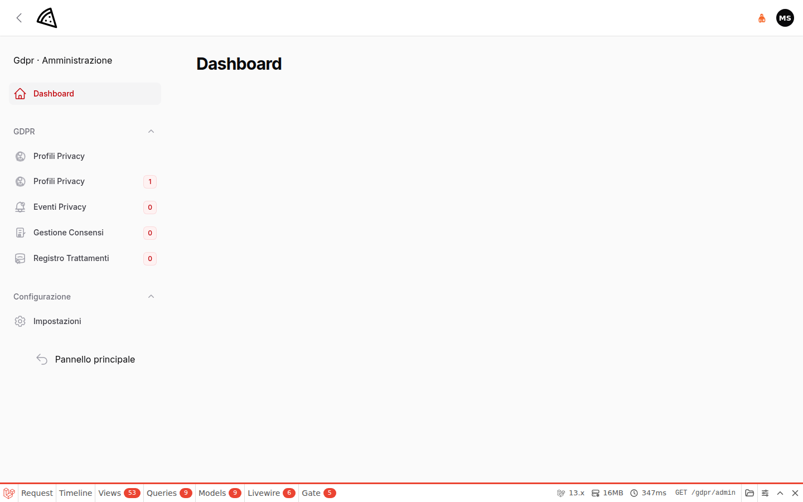

> Screenshot reale del pannello `gdpr/admin`, verificato il 25 novembre 2026.

# Manuale d'uso per attori — Gdpr

## Scopo e perimetro

Il modulo Gdpr gestisce consensi, finalità di trattamento, eventi di consenso,
il banner cookie e il flusso di cancellazione account richiesto dal GDPR.
Il front office non espone una sezione autonoma: le interazioni avvengono nel
banner cookie, nel modulo di registrazione e nella pagina profilo. La gestione
amministrativa avviene nel pannello Filament `gdpr/admin`.

## Attori e capacità effettive

| Attore | Capacità verificabili |
|---|---|
| Ospite | Vede il banner cookie (categoria necessarie sempre attive; analytics e marketing richiedono accettazione esplicita) e, in registrazione, il modulo consensi Gdpr. Non ha consensi persistiti né accesso al pannello. |
| Utente autenticato | Può revocare i consensi dal pannello di profilo (cluster Profile del modulo) e cancellare il proprio account dalla pagina `/{lang}/profile/edit`, che invia `POST /{lang}/account/delete`. |
| Gruppo/ruolo | Il ruolo `<modulo>::admin` abilita l'area amministrativa del pannello `gdpr/admin`; le policy ereditano la base Xot/User. |
| Admin | In `gdpr/admin` gestisce le resource Consensi, Finalità (Treatments), Eventi e Profili, più la pagina Impostazioni. |
| Super-admin | Bypass amministrativo delle policy base e accesso a tutte le schermate del pannello. |
| Operatore | N/A come ruolo specifico: il modulo non dichiara un CRUD operativo per operatori. |

## Flussi operativi

### Banner cookie (front office)

1. Il middleware `InjectCookieBanner` inietta il banner nelle pagine pubbliche.
2. L'ospite sceglie accetta/rifiuta o apre le preferenze; la scelta è persistita
   nel cookie `__cookie_consent` e le categorie non necessarie restano disattive
   fino al consenso.

### Registrazione con consensi

1. Il widget `GdprConsentForm` (e la variante `RegisterWidget`) raccoglie i
   consensi durante la registrazione.
2. `SaveRegistrationConsentsAction` / `CollectGdprConsentsAction` persistono le
   scelte e `ValidateGdprConsentAction` verifica i dati prima del salvataggio.

### Cancellazione account (diritto alla cancellazione)

1. L'utente autenticato apre `/{lang}/profile/edit` e usa il modulo
   "elimina account" (partial `delete-user-form` del tema).
2. La conferma invia `POST /{lang}/account/delete` con `confirm=cancella`.
3. `DeleteAccountAction` autorizza `deleteOwnAccount`, revoca i consensi
   (`RevokeGdprConsentsAction`), esegue la cancellazione lato User
   (`RevokeUserAccessAction`) e registra l'audit trail nel connection `user`.
   La GET sulla stessa route reindirizza alla home localizzata: non esiste una
   pagina di conferma dedicata.

### Backoffice `gdpr/admin`

1. **Dashboard**: vista iniziale del pannello.
2. **Consensi** (`/gdpr/admin/consents`): elenco e CRUD dei consensi registrati.
3. **Finalità** (`/gdpr/admin/treatments`): CRUD delle finalità di trattamento
   (base giuridica, descrizione) a cui i consensi fanno riferimento.
4. **Eventi** (`/gdpr/admin/events`): registro degli eventi di consenso.
5. **Profili** (`/gdpr/admin/profiles`): profili di consenso.
6. **Impostazioni** (`/gdpr/admin/setting`): configurazione del modulo.
7. **Profilo utente** (`/gdpr/admin/profile/*`): il cluster Profile espone al
   singolo utente le proprie consents e profiles.

## Prerequisiti

- Moduli User, Xot e Activity caricati (audit trail e policy di base).
- Utente autenticato per la revoca consensi e la cancellazione account.
- Ruolo `gdpr::admin` o autorizzazioni equivalenti per la gestione Filament.
- Banner cookie e widget registrazione attivi via middleware/registrazione view.

## Limiti

- La route `/{lang}/account/delete` non ha una pagina GET dedicata: la GET
  reindirizza alla home localizzata; l'azione avviene via POST dal profilo.
- Il banner cookie è iniettato solo sulle pagine che passano dal middleware
  `InjectCookieBanner`.
- La disponibilità delle categorie analytics/marketing dipende dalla
  configurazione del cookie-consent del progetto.

## Link a codice/docs

- [ADR cancellazione account](../adr/account-deletion-deactivates-and-keeps-proof.md)
- [ADR banner cookie](../adr/cookie-banner-wired-by-the-module.md)
- [ADR prova dei consensi](../adr/consent-proof-is-append-only.md)
- [Panoramica modulo](../README.md)
- [Azioni](../actions.md)
- [DeleteAccountAction](../../app/Actions/Account/DeleteAccountAction.php)
- [RevokeGdprConsentsAction](../../app/Actions/Consent/RevokeGdprConsentsAction.php)
- [InjectCookieBanner](../../app/Http/Middleware/InjectCookieBanner.php)
- [Rotte web](../../routes/web.php)
- [Resource Consensi](../../app/Filament/Resources/ConsentResource.php)
- [Resource Finalità](../../app/Filament/Resources/TreatmentResource.php)
