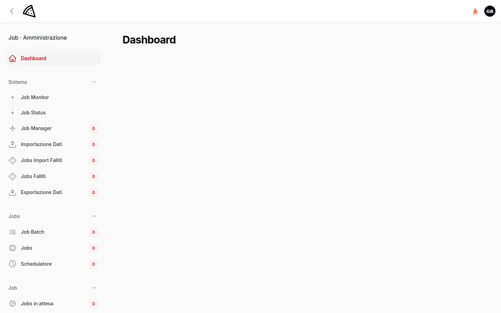
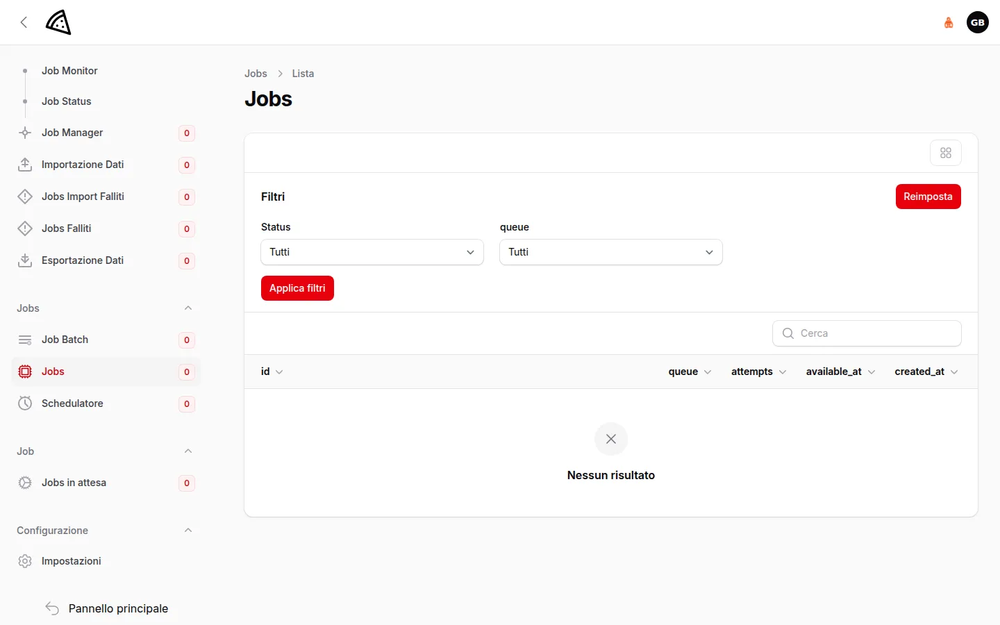
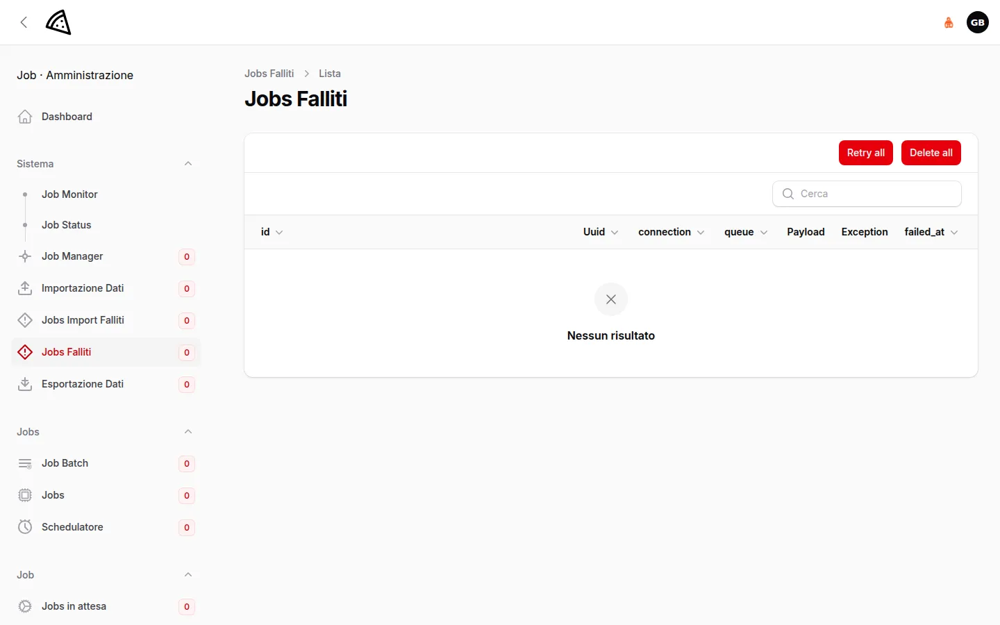
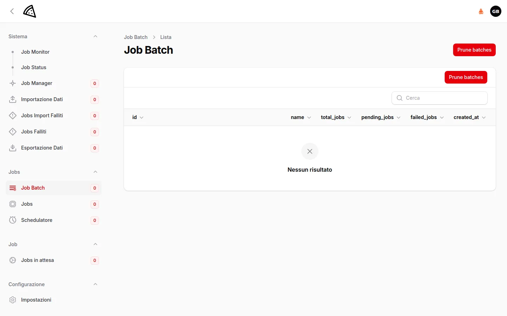
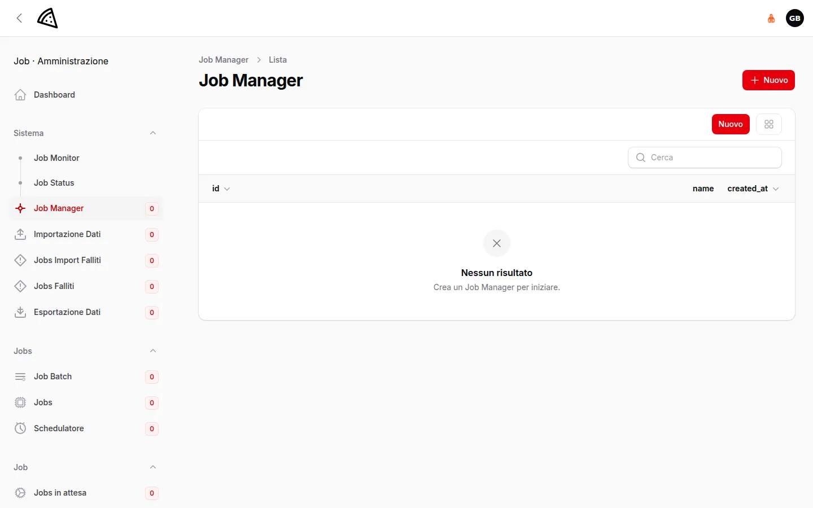
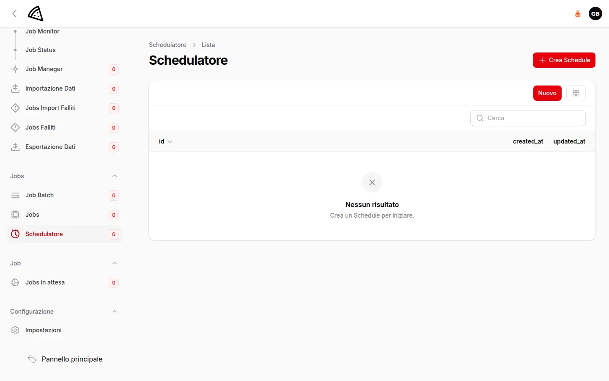
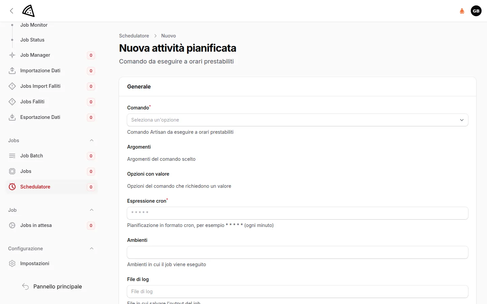
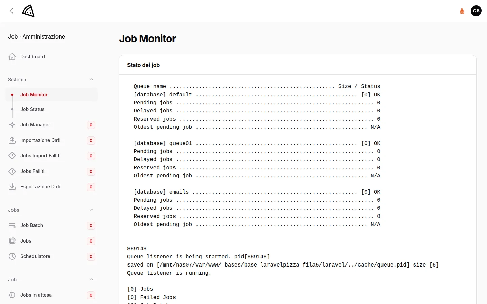
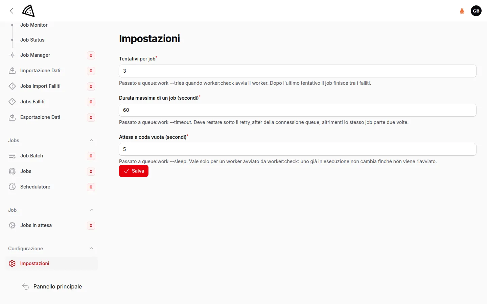

# Modulo Job — pannello `job/admin`

Il pannello di amministrazione del modulo Job raccoglie code, job, job falliti, batch, pianificazioni e impostazioni del worker. Tutte le schermate sotto sono catturate dall'istanza di prova isolata (DB senza dati, utente sintetico super-admin) con `bashscripts/tools/docs/manual-screenshots.mjs`. Le liste sono vuote perché il DB di prova non contiene righe: dove sta scritto «Nessun risultato» è lo stato reale, non un'assenza di funzioni.

## Scopo

Monitorare e gestire le code di job in stile Horizon: stato dei worker, job in coda, job falliti, batch, attività pianificate e impostazioni di `queue:work`.

## Accesso

- Login: `/job/admin/login` (form Filament «Accedi», campi Email e Password, checkbox «Ricordami», link «Hai smarrito la password?»).
- Il pannello è protetto dal middleware Filament `Authenticate` (vedi `php artisan route:list --path=job/admin`).
- Le pagine di monitoraggio e le impostazioni sono riservate al super-admin: `SuperAdminOnlyTrait` in `app/Filament/Widgets/JobStatusWidget.php`.

## Attori

| Attore | Cosa risulta verificato |
|---|---|
| Ospite | Accede alla pagina `job/admin/login` (screenshot `job-admin-login`). Le altre pagine non sono state provate senza login. |
| Super-admin (utente di prova) | Vede tutte le pagine illustrate, incluse Job Monitor e Impostazioni. |
| Altri utenti del pannello | Non verificato: `JobStatusWidget::canView()` (`app/Filament/Widgets/JobStatusWidget.php`) limita il widget ai super-admin, ma non sono state provate altre utenze. |

Matrici di permessi per ogni risorsa: non verificate; dipendono da policy e seeder del modulo.

## Navigazione

Il menu laterale (screenshot `job-admin-dashboard`) ha quattro gruppi:

- **Sistema**: Job Monitor, Job Status.
- **Gruppo senza titolo**: Job Manager, Importazione Dati, Jobs Import Falliti, Jobs Falliti, Esportazione Dati. Ogni voce mostra un contatore.
- **Jobs**: Job Batch, Jobs, Schedulatore.
- **Job**: Jobs in attesa.
- **Configurazione**: Impostazioni.

Il link «Pannello principale» in fondo al menu riporta al pannello generale.

## Pagine

### Login — `job-admin-login`

Form di accesso Filament con logo della pizza, titolo «Accedi», campi Email e Password, pulsante rosso «Accedi».

### Dashboard — `job-admin-dashboard`

La dashboard del pannello non mostra alcun widget: sotto il titolo «Dashboard» non c'è contenuto. In `app/Filament/Pages/Dashboard.php` la classe estende `XotBaseDashboard` e non dichiara widget; la vista `resources/views/filament/pages/dashboard.blade.php` è vuota. Il contenuto visibile è solo il menu con i contatori.

### Jobs — `job-admin-jobs`

Lista dei job in coda (`app/Filament/Resources/JobResource/Tables/JobsTable.php`).

- Filtri: **Status** (Tutti) e **queue** (Tutti), pulsante «Applica filtri» e «Reimposta».
- Ricerca «Cerca».
- Colonne: `id`, `queue`, `attempts`, `available_at`, `created_at`.
- Azioni di riga: `view` (dettaglio) e `delete`.

### Jobs Falliti — `job-admin-failed-jobs`

Lista dei job falliti. Colonne: Uuid, connection, queue, Payload, Exception, failed_at.

Nell'intestazione ci sono due pulsanti: **Retry all** e **Delete all**. Sono azioni che rilanciano o cancellano in blocco i job falliti (`app/Filament/Resources/FailedJobResource/Tables/FailedJobsTable.php`, `retry_all` chiama `queue:retry all`). Non sono stati premuti per il manuale.

### Job Batch — `job-admin-job-batches`

Lista dei batch con colonne `id`, `name`, `total_jobs`, `pending_jobs`, `failed_jobs`, `created_at`. Il pulsante **Prune batches** (`ListJobBatches.php`, azione `prune_batches`, che chiama `queue:prune-batches`) compare due volte: in testata e nella barra della tabella. Non è stato premuto.

### Job Manager — `job-admin-job-managers`

Lista vuota con il messaggio «Crea un Job Manager per iniziare.» Colonne: `id`, `name`, `created_at`. Il pulsante «Nuovo» compare sia in testata sia nella barra della tabella: il doppio pulsante è comportamento condiviso di tutte le liste Xot (`HasXotTable::getTableHeaderActions` + `XotBaseListRecords::getHeaderActions`), non un difetto del modulo.

### Schedulatore — `job-admin-schedules`

Lista delle attività pianificate, vuota («Crea un Schedule per iniziare.»). Colonne: `id`, `created_at`, `updated_at`. In testata il pulsante «Crea Schedule», nella barra della tabella «Nuovo»: due etichette diverse per la stessa azione.

### Nuova attività pianificata — `job-admin-schedules-create`

Form di creazione (`app/Filament/Resources/ScheduleResource/Schemas/ScheduleForm.php`). Campi visibili:

- **Comando** (obbligatorio, select ricercabile dei comandi Artisan).
- **Argomenti** e **Opzioni con valore**: repeater che si popolano dopo la scelta del comando.
- **Espressione cron** (obbligatoria, validata dalla regola `Corn`).
- **Ambienti**, **File di log**, **Webhook prima dell'esecuzione**, **Webhook dopo l'esecuzione**, **Email con l'output**.
- Interruttori: Email in caso di successo, Email in caso di errore, Log in caso di successo, Log in caso di errore, Esegui anche in manutenzione, Senza sovrapposizione, Su un solo server, Esegui in background.

Le etichette italiane sono in `lang/it/schedule_form.php`: prima della correzione mostravano i nomi tecnici dei campi (`command`, `expression`, `webhook_before`…).

### Job Monitor — `job-admin-job-monitor`

Pagina super-admin con la tabella dello stato delle code (`default`, `queue01`, `emails`: pending, delayed, reserved, oldest pending) e il contenuto prodotto dal worker.

**Attenzione:** caricare la pagina avvia un worker (vedi «Difetti noti»).

### Impostazioni — `job-admin-setting`

Tre campi, tutti con testo di aiuto che spiega dove vengono usati (`app/Filament/Pages/SettingPage.php`):

- **Tentativi per job** (valore di esempio 3): passato a `queue:work --tries` da `worker:check`.
- **Durata massima di un job (secondi)** (60): passata a `queue:work --timeout`; deve restare sotto il `retry_after` della connessione.
- **Attesa a coda vuota (secondi)** (5): passata a `queue:work --sleep`; vale solo per un worker avviato da `worker:check`.

Pulsante «Salva».

## Pagine non illustrate

Non sono state catturate queste pagine, per mancanza di dati o per tempo: Job Status, Jobs in attesa, Importazione Dati, Jobs Import Falliti, Esportazione Dati, le pagine di modifica e di creazione delle risorse diverse da Schedulatore. Non sono quindi descritte qui.

## Difetti noti

Ogni difetto è riportato con evidenza (screenshot o file:riga).

1. **Il Job Monitor avvia un worker a ogni caricamento.** `app/Filament/Widgets/JobStatusWidget.php:50-52`: `mount()` chiama `Artisan::call('worker:check')`. Il comando (`app/Console/Commands/WorkerCheck.php`, `handle()`) avvia `queue:work` se non è in esecuzione e scrive il PID in `cache/queue.pid`. Lo screenshot `job-admin-job-monitor` mostra il messaggio «Queue listener is being started. pid[…]». Una GET quindi ha un effetto collaterale sul sistema: va deciso se il watchdog debba stare in una pagina di sola lettura. Non corretto (scelta di design).
2. **Il Job Monitor espone il percorso assoluto del server e il PID.** Stesso screenshot: «saved on [/mnt/nas07/…/cache/queue.pid]» e «pid[…]». Informazione operativa mostrata a tutti i super-admin. Non corretto.
3. **Dashboard senza contenuto.** `app/Filament/Pages/Dashboard.php` non dichiara widget; `resources/views/filament/pages/dashboard.blade.php` è vuota. Screenshot `job-admin-dashboard`. Non corretto: serve una decisione su quali widget mostrare, e `JobStatusWidget` non può essere usato qui perché il suo `mount()` avvia il worker (punto 1).
4. **Etichette grezze nelle liste.** Colonne e filtri mostrano i nomi tecnici (`id`, `queue`, `attempts`, `available_at`, `total_jobs`, `pending_jobs`, `failed_jobs`, `retry_all`, Uuid, connection, Payload, Exception, failed_at). Le chiavi `lang/it/job.php`, `lang/it/job_batch*.php`, `lang/it/failed_job*.php` esistono ma le colonne non le usano tutte. Non corretto per prudenza: le liste sono in più file di lingua duplicati (`lang/it/job_form.php`, `job_fields.php`, `job.php`, `jobs.php`); va scelta la chiave canonica.
5. **Etichette doppie nelle testate.** «Crea Schedule» e «Nuovo» nello stesso schermo; «Prune batches» due volte in Job Batch; «Nuovo» due volte in Job Manager. Il doppio «Nuovo» dipende da Xot (vedi sopra); «Crea Schedule» e «Prune batches» sono propri del modulo. Non corretto.
6. **Azioni distruttive in blocco senza conferma visibile.** «Retry all» e «Delete all» in Jobs Falliti. Verificare nel codice se c'è un `requiresConfirmation()`; non è stato verificato in questo manuale.
7. **Pulizia di file runtime.** Durante la cattura è stato scritto `cache/queue.pid` nella radice del repo (ignorato da git, `.gitignore:146`). Da controllare.

## Fonti

- Route: `cd laravel && php artisan route:list --path=job/admin`
- Pannello: `app/Providers/Filament/AdminPanelProvider.php`
- Pagine: `app/Filament/Pages/` (Dashboard, JobMonitor, JobStatus, SettingPage)
- Risorse: `app/Filament/Resources/` (JobResource, FailedJobResource, JobBatchResource, JobManagerResource, ScheduleResource, JobsWaitingResource, ExportResource, ImportResource, FailedImportRowResource)
- Form Schedulatore: `app/Filament/Resources/ScheduleResource/Schemas/ScheduleForm.php`, `lang/it/schedule_form.php`
- Comando di controllo: `app/Console/Commands/WorkerCheck.php`
- Cattura: `docs/manuals/screenshots.json` e `docs/manuals/assets/*.webp`
