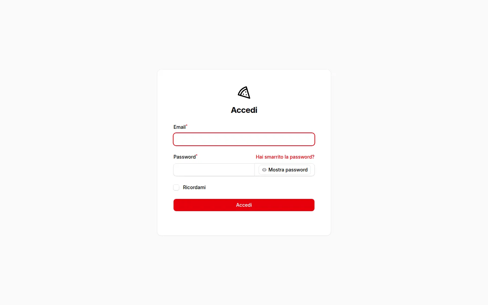
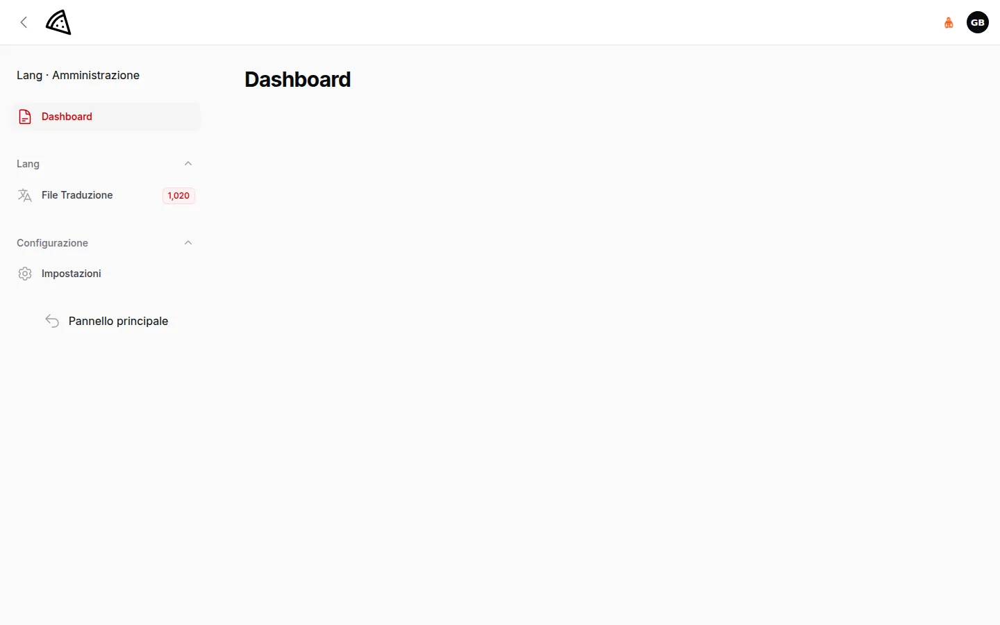
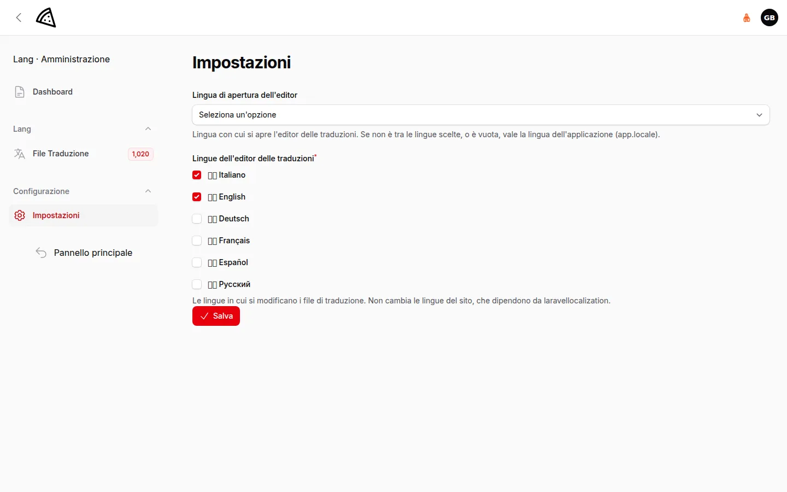
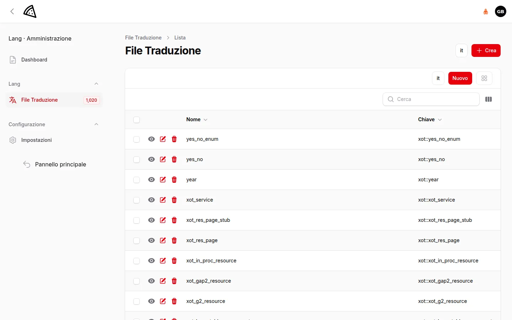
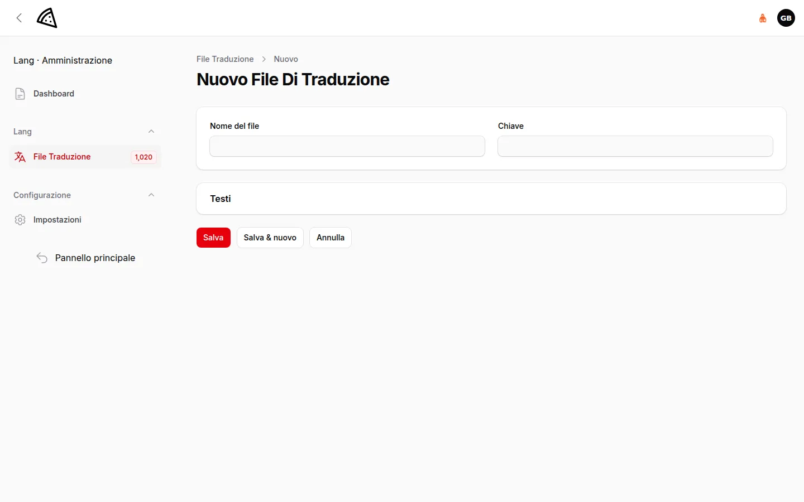
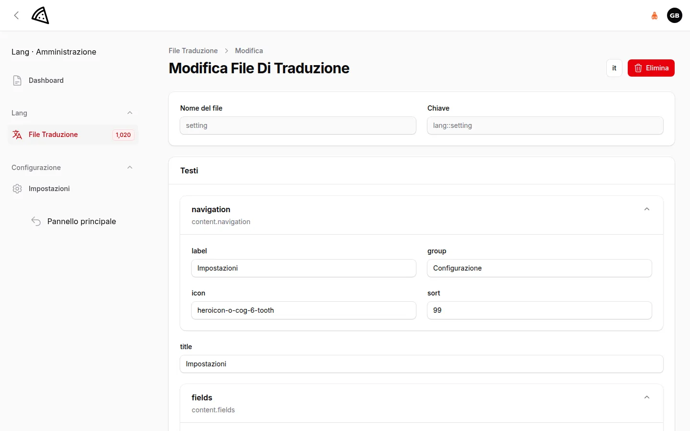

# Manuale utente — Lang

## Scopo

Il modulo **Lang** dà al super-admin un pannello Filament per vedere e modificare i
file di traduzione dei moduli (`Modules/<Modulo>/lang/<lingua>/*.php`) e per scegliere
in quali lingue si modificano. Non c'è nessuna pagina del front office propria del modulo.

Le schermate sono catturate dall'istanza di prova isolata (DB usa-e-getta, utente
sintetico super-admin, dati non reali). Il pannello è `lang::admin`, percorso `/lang/admin`.

## Accesso

- Login: `/lang/admin/login` (screenshot sotto). Il pannello è registrato in
  `app/Providers/Filament/LangBasePanelProvider.php`, che estende `XotBasePanelProvider`
  e aggiunge il plugin `SpatieTranslatablePlugin` con lingue predefinite `en` e `it`.
- Le route reali (`php artisan route:list --path=lang/admin`):

| Route | Pagina |
|---|---|
| `/lang/admin` | Dashboard |
| `/lang/admin/setting` | Impostazioni |
| `/lang/admin/translation-files` | Elenco file di traduzione |
| `/lang/admin/translation-files/create` | Nuovo file di traduzione |
| `/lang/admin/translation-files/{record}/edit` | Modifica file di traduzione (`{record}` = `modulo::file`) |

## Attori

| Attore | Cosa può fare (verificato) |
|---|---|
| Ospite | Nessun accesso: le pagine `/lang/admin/*` richiedono login (`Authenticate` nelle route). |
| Utente autenticato del pannello | Vede Dashboard, elenco e form dei file di traduzione. |
| Super-admin | Accede alle Impostazioni: il docblock di `Modules/Lang/app/Filament/Pages/SettingPage.php` lo dichiara «solo super-admin». Il controllo di ruolo non è stato verificato con un utente non super-admin. |

## Pagine

### Login

Form con Email e Password, link «Hai smarrito la password?», checkbox «Ricordami» e
pulsante «Accedi».

### Dashboard

Nessun contenuto: la vista `Modules/Lang/resources/views/filament/pages/dashboard.blade.php`
è un `<x-filament::page>` vuoto. Nella barra laterale la voce **File Traduzione** mostra un
badge con il numero di file (1.020 nell'istanza di prova). Il badge è il contatore di
`XotBaseResource::getNavigationBadge()` (Xot), non una statistica del modulo.

### Impostazioni

Pagina `SettingPage` (`/lang/admin/setting`), basata su `BaseSettingPage` di Xot. Campi reali
dal codice (`SettingPage::getFormSchema()`):

- **Lingua di apertura dell'editor** (`default_locale`): menu a tendina. Se è vuota o non è tra le
  lingue scelte, vale la lingua dell'applicazione (`app.locale`), come dice il testo d'aiuto.
- **Lingue dell'editor delle traduzioni** (`supported_locales`): lista di caselle, obbligatoria,
  almeno una. Nell'istanza di prova: Italiano, English, Deutsch, Français, Español, Русский.
  Italiano e English erano selezionate.

Il pulsante «Salva» salva `config/{tenant}/lang.php`. Non è stato premuto durante la cattura.

Difetto visibile: le bandierine nelle caselle delle lingue compaiono come riquadri vuoti. Nella
cattura il font emoji non è disponibile: non è stato verificato sul browser di un utente reale.

### File di traduzione: elenco

Pagina `/lang/admin/translation-files`. Dal codice (`TranslationFilesTable::getTableColumns()`):

| Colonna | Note |
|---|---|
| Nome | ricercabile e ordinabile |
| Chiave | ricercabile e ordinabile, testo a capo |
| Percorso | nascosta di default (si può mostrare con la gestione colonne) |

Nell'intestazione: il selettore di lingua (`LocaleSwitcherRefresh`, etichetta con la lingua corrente)
e le azioni standard di Xot.

Le righe vengono da `GetAllTranslationAction`, che legge `Modules/*/lang/<lingua>/*.php` e
produce chiavi nel formato `modulo::file` (es. `lang::setting`). Ogni riga è un file PHP
di traduzione del progetto.

Nella cattura: il badge del menu indica **1.020** file; colonne **Nome** e **Chiave** (formato
`modulo::file`, ad esempio `xot::yes_no`); ogni riga ha le icone di visualizzazione, modifica ed
eliminazione. In alto il selettore di lingua («it») e due pulsanti di creazione («Crea» e
«Nuovo»: comportamento condiviso di tutte le liste Xot).

### File di traduzione: nuovo

Pagina `/lang/admin/translation-files/create`. Campi visibili: **Nome del file** e **Chiave**.
Sezione **Testi** (vuota in creazione: il contenuto arriva dal file esistente). Pulsanti
«Salva», «Salva & nuovo», «Annulla». Il titolo è «Nuovo File Di Traduzione»: l'etichetta
viene da `lang/it/translation_file.php` (corretta in questa sessione, vedi «Difetti noti»).
Non è stato salvato nulla.

### File di traduzione: modifica

Pagina `/lang/admin/translation-files/{record}/edit` (`EditTranslationFile`). Dal codice il form
ha una sezione «Testi» con un campo per ogni testo del file, raggruppati per sotto-array
(`EditTranslationFile::makeFromArray`), e salva con `SaveTransAction` (scrive il file PHP di
traduzione).

Esempio con `lang::setting`: in alto i campi **Nome del file** e **Chiave**, entrambi disabilitati;
poi la sezione **Testi**, con i testi raggruppati per sotto-array (`navigation` con `label`, `group`,
`icon`, `sort`, poi `title`, `fields`, …). In alto a destra il selettore di lingua e il pulsante
**Elimina**, che non è stato premuto. Non è stata salvata alcuna modifica. I sottotitoli dei gruppi
mostrano il percorso grezzo della chiave (`content.navigation`).

## Difetti noti

1. **Titolo in inglese nel create** (corretto): `lang/it/translation_file.php` aveva
   `'label' => 'Translation File'` e `'plural_label' => 'Translation File (Plurale)'`, usati
   per il titolo «Nuovo Translation File». Ora sono «File di traduzione». Prova: screenshot
   `assets/lang-admin-translation-files-create.webp` (titolo «Nuovo File Di Traduzione»).
2. **Bandierine non rese** nelle Impostazioni: riquadri vuoti nello screenshot. Probabile font
   emoji assente nell'ambiente di cattura (da verificare su browser reale). Nessuna modifica.
3. **Dashboard vuota**: `resources/views/filament/pages/dashboard.blade.php` non contiene
   widget. Nessuna modifica (scelta di prodotto).
4. **Elenco e modifica ora illustrati.** Il controllo di cattura (`bashscripts/tools/docs/manual-screenshots.mjs`)
   li rifiutava perché un campo chiamato solo `key` (la chiave del file) sembrava un segreto: era un falso
   positivo dello strumento, corretto restringendo i nomi di campo considerati segreti
   (`api_key`, `token`, `passw…`, ecc.) ed escludendo checkbox e radio.
5. **Effetto collaterale in Xot (fuori dal modulo, non toccato)**:
   `Modules/Xot/app/Filament/Traits/NavigationLabelTrait.php` (`getNavigationSort()`) quando la
   chiave di navigazione manca genera un numero casuale e lo salva con `SaveTransAction`:
   il rendering del pannello può scrivere nei file di traduzione. Riportato, non corretto.

## Fonti

- `Modules/Lang/app/Providers/Filament/LangBasePanelProvider.php`
- `Modules/Lang/app/Filament/Pages/Dashboard.php`, `SettingPage.php`
- `Modules/Lang/app/Filament/Resources/TranslationFileResource.php` e `.../Tables/TranslationFilesTable.php`,
  `.../Schemas/TranslationFileForm.php`, `.../Pages/*.php`
- `Modules/Lang/app/Actions/GetAllTranslationAction.php`
- `Modules/Lang/lang/it/translation_file.php`, `setting.php`
- Route: `php artisan route:list --path=lang/admin` (laravel/)
- Screenshot: `assets/lang-admin-*.webp` (data e sha256 in `screenshots.json`)
