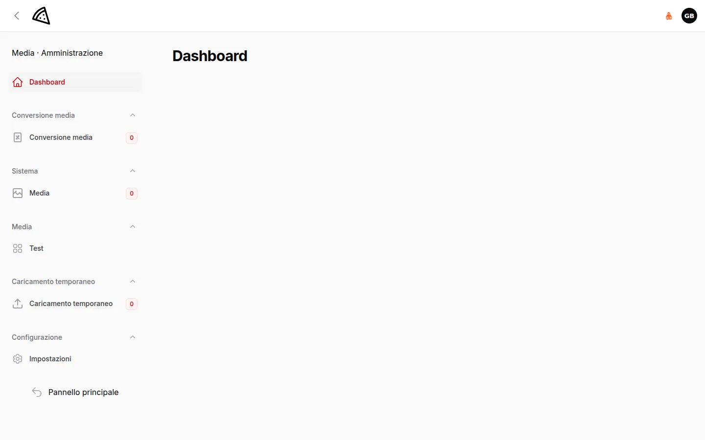
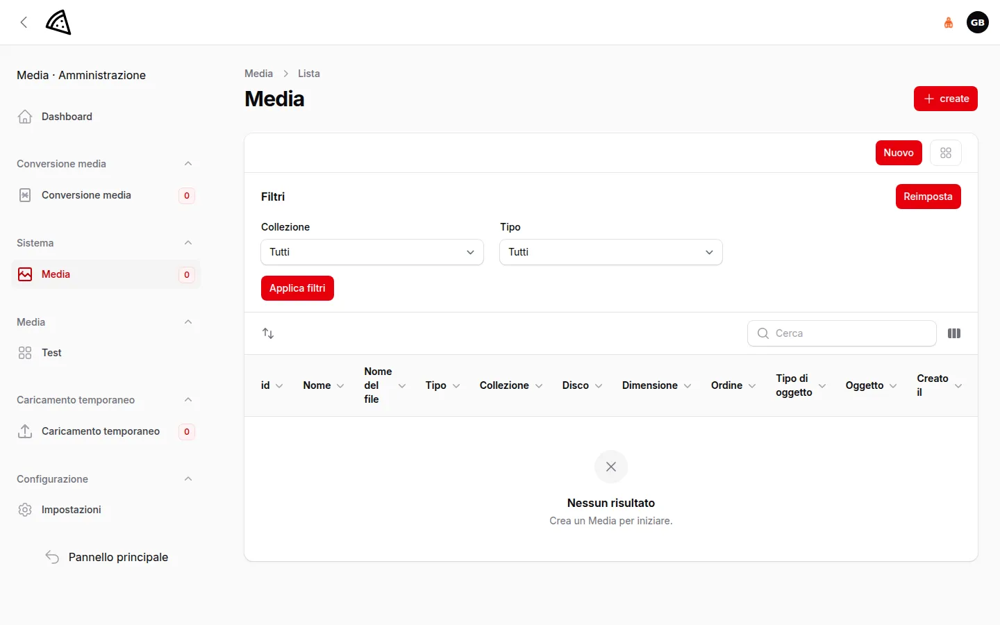
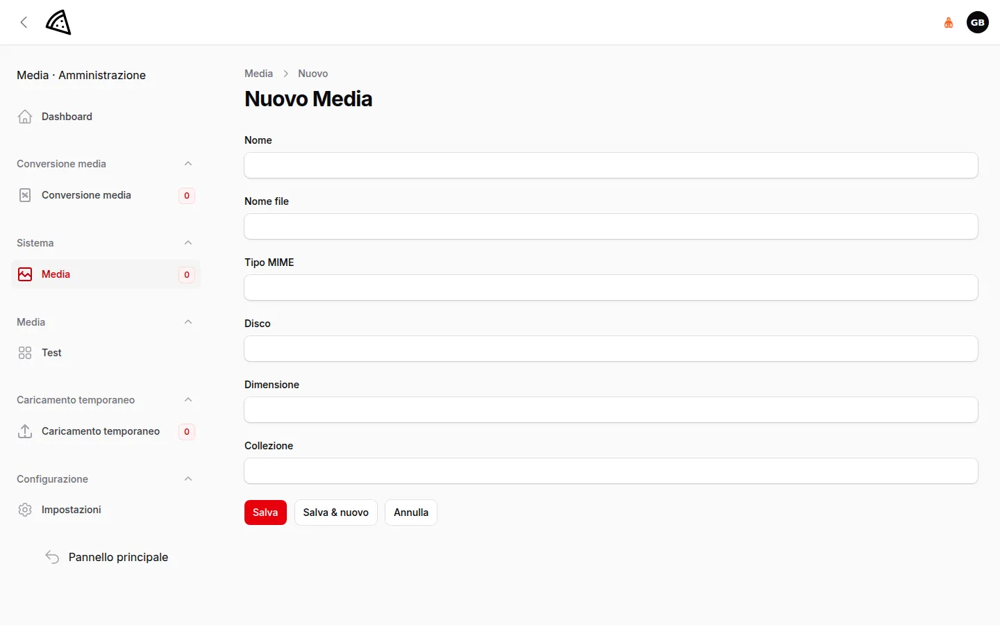
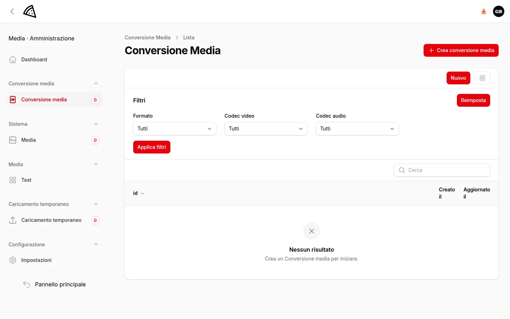
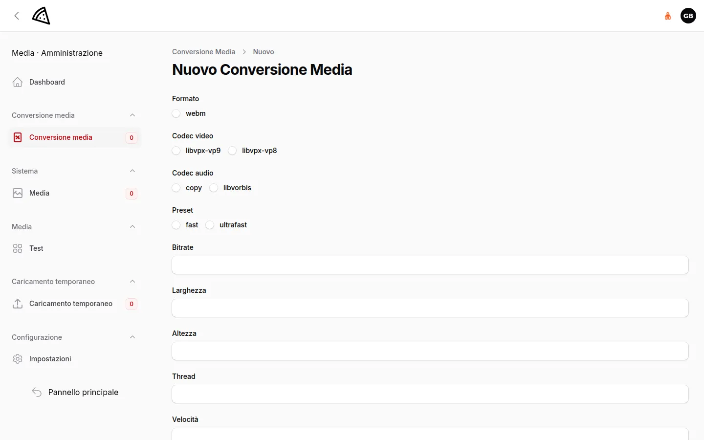
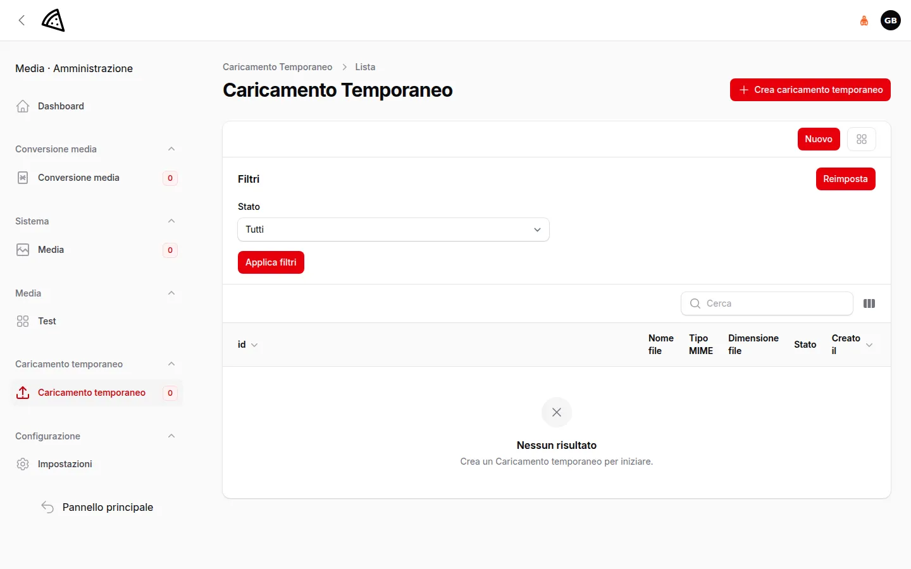
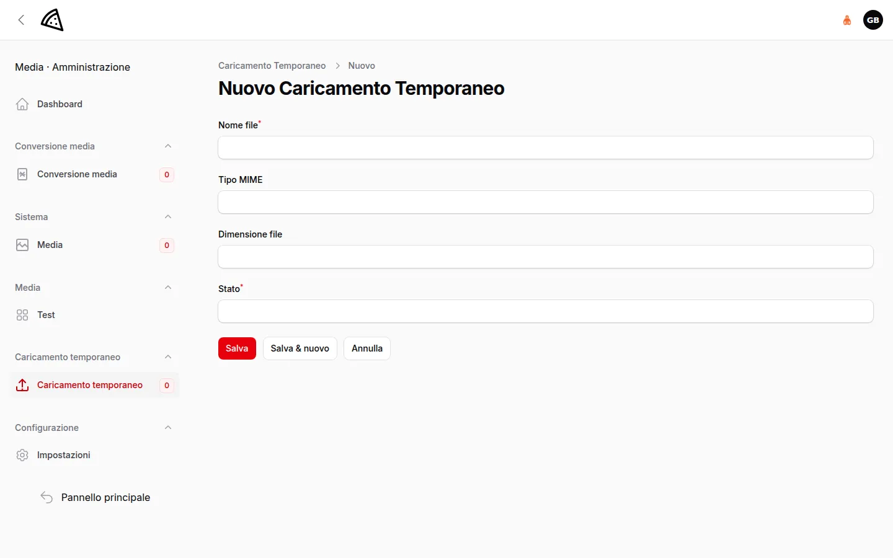
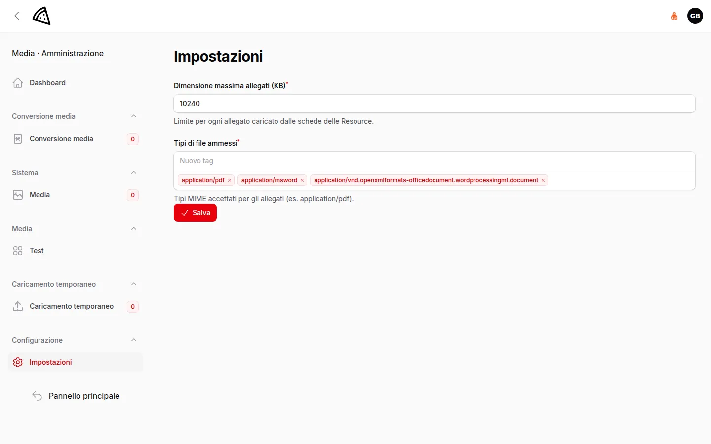
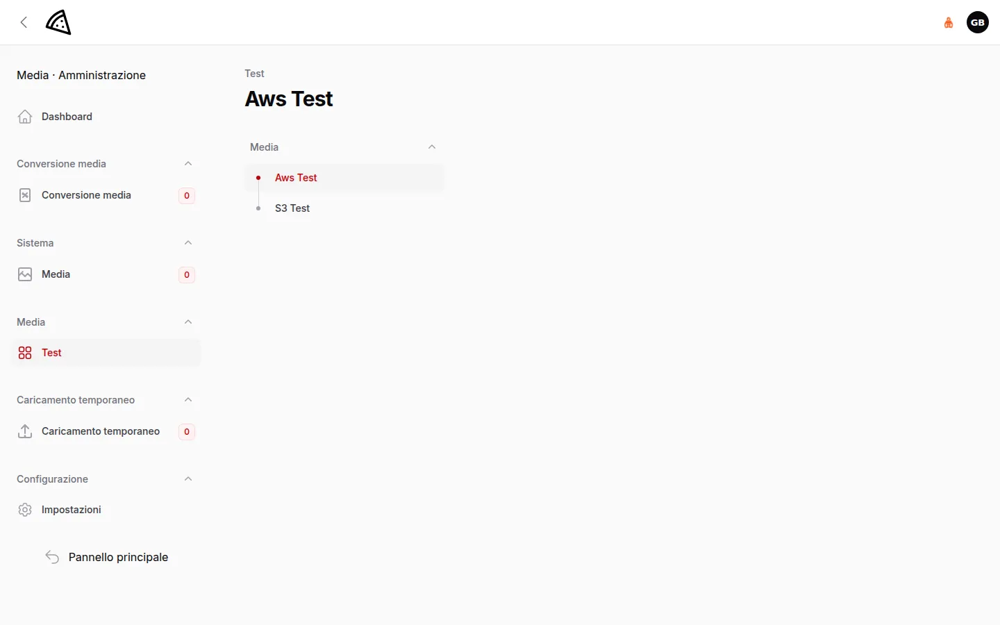
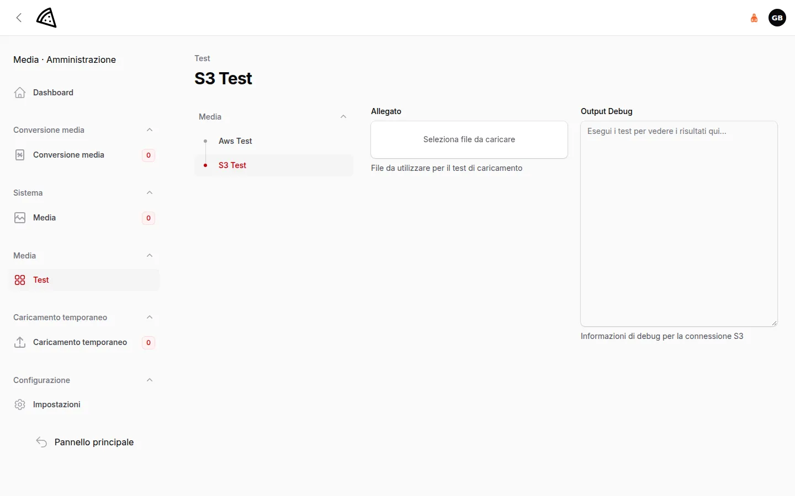

# Manuale d'uso — Media

Media è il pannello Filament `media/admin` per i file del progetto: l'elenco dei media registrati, le richieste di
conversione audio/video, i caricamenti temporanei, le impostazioni degli allegati e due pagine di prova per lo storage
S3/AWS. Questo manuale descrive **solo ciò che si vede nelle catture reali** del pannello.

> **Come sono fatte le immagini.** Sono catture reali, fatte con `bashscripts/tools/docs/manual-screenshots.mjs` su
> un'istanza di prova isolata (database usa-e-getta, utente sintetico con ruolo super-admin), non sull'ambiente di
> sviluppo. Ogni cattura è registrata in `screenshots.json` con data, esito HTTP e impronta sha256. **Le tabelle di prova
> sono vuote**: dove vedi «Nessun risultato» non è un errore, e per lo stesso motivo non si vedono righe né le loro
> azioni. Le catture sono del 25 novembre 2026 e **seguono** la correzione delle etichette inglesi descritta in «Difetti noti».
> Per rifarle: `node bashscripts/tools/docs/manual-screenshots.mjs Media` (istruzioni in `bashscripts/docs/operations/manual-screenshots.md`).

## Accesso

Apri `/media/admin/login`.

La pagina si intitola **Accedi** e ha: **Email** (obbligatoria), **Password** (obbligatoria, con il pulsante «Mostra
password» e il collegamento «Hai smarrito la password?»), la casella **Ricordami** e il pulsante **Accedi**.

## Menu laterale e Dashboard

In alto a sinistra il pannello si presenta come **Media · Amministrazione**. Il menu ha cinque gruppi, ciascuno con una
sola voce:

| Gruppo | Voce | Pagina |
|---|---|---|
| (in cima) | Dashboard | questa pagina |
| Conversione media | Conversione media | elenco delle richieste di conversione |
| Sistema | Media | elenco dei media |
| Media | Test | pagine di prova Aws Test e S3 Test |
| Caricamento temporaneo | Caricamento temporaneo | elenco dei caricamenti temporanei |
| Configurazione | Impostazioni | impostazioni degli allegati |

In fondo il collegamento **Pannello principale**. I numeri accanto alle voci di elenco sono i conteggi delle righe:
nelle catture valgono 0 perché le tabelle sono vuote.

La **Dashboard** mostra soltanto il titolo «Dashboard»: nella cattura non ci sono schede, grafici né altri contenuti
(la classe `Pages/Dashboard.php` è vuota).

## Media (`/media/admin/media`)

Titolo **Media**, briciole di pane «Media › Lista». In cima a destra il pulsante **Nuovo** (ce n'è un secondo dentro la
tabella: è comportamento comune a tutte le liste Xot). Accanto al secondo c'è il pulsante di cambio visualizzazione.

- **Filtri** (con il pulsante **Reimposta**): **Collezione** e **Tipo**, entrambi con valore iniziale «Tutti», più
  **Applica filtri**. Dal codice (`MediaTable.php`) le opzioni sono i valori distinti presenti nelle colonne
  `collection_name` e `mime_type`; con la tabella vuota non ce ne sono.
- Sopra la tabella: un'icona con frecce su/giù (a sinistra), il campo **Cerca** e il selettore delle colonne. Dalle
  chiavi di lingua (`reorderRecords` in `lang/it/medium.php`) l'icona a frecce è il riordino delle righe; non è stata
  provata.
- **Colonne** visibili: **id, Nome, Nome del file, Tipo, Collezione, Disco, Dimensione, Ordine, Tipo di oggetto, Oggetto,
  Creato il**. Dal codice esiste anche **Aggiornato il**, nascosta di default.
- Stato vuoto: «Nessun risultato — Crea un Media per iniziare.».

Azioni di riga (dal codice, `MediaTable.php`; non visibili perché non ci sono righe): visualizza, apri il file in una
nuova scheda, elimina (con conferma), scarica il file, converti (apre in una nuova scheda la pagina
`/media/admin/media/{record}/convert`). Le pagine del resource sono elenco, creazione, modifica `/{record}/edit`,
dettaglio `/{record}` e conversione `/{record}/convert` (`MediaResource::getPages()`).

### Nuovo media

Titolo **Nuovo Media**. Sei campi di testo, **nessuno obbligatorio** (non hanno l'asterisco):

| Campo | Nota |
|---|---|
| **Nome** | testo |
| **Nome file** | testo |
| **Tipo MIME** | testo |
| **Disco** | testo |
| **Dimensione** | numerico (da `MediaForm.php`) |
| **Collezione** | testo |

Pulsanti: **Salva**, **Salva & nuovo**, **Annulla**. Il form **non ha un campo per caricare il file**: si compilano solo i
dati descrittivi della riga.

## Conversione media (`/media/admin/media-converts`)

Titolo **Conversione Media**, briciole «Conversione Media › Lista», pulsante in cima **Crea conversione media**.

- **Filtri**: **Formato**, **Codec video**, **Codec audio** (tutti con «Tutti»), **Applica filtri**, **Reimposta**.
- Campo **Cerca**.
- **Colonne** visibili: **id, Creato il, Aggiornato il**. Nient'altro: la tabella non mostra formato, codec né stato.
- Stato vuoto: «Nessun risultato — Crea un Conversione media per iniziare.».

Azioni di riga (dal codice, `MediaConvertsTable.php`): visualizza, modifica, **convert**. Quest'ultima azzera
`percentage` e accoda `ConvertVideoByMediaConvertAction`. È l'unica azione che avvia un lavoro: non è stata premuta
per la cattura (e con la tabella vuota non c'è nessuna riga su cui premerla).

### Nuova conversione

Titolo **Nuovo Conversione Media** (così nella cattura). Nessun campo obbligatorio. I campi con scelta singola (pulsanti rotondi, nessuno
selezionato all'apertura) hanno queste sole opzioni:

| Campo | Opzioni |
|---|---|
| **Formato** | webm |
| **Codec video** | libvpx-vp9, libvpx-vp8 |
| **Codec audio** | copy, libvorbis |
| **Preset** | fast, ultrafast |

Poi cinque campi di testo: **Bitrate**, **Larghezza** e **Altezza** (numerici), **Thread**, **Velocità**. Subito sotto
**Velocità** la cattura si ferma (altezza 900 px): i pulsanti di salvataggio non sono nell'immagine. Dal codice
(`MediaConvertForm.php`) il form finisce lì.

## Caricamento temporaneo (`/media/admin/temporary-uploads`)

Titolo **Caricamento Temporaneo**, pulsante in cima **Crea caricamento temporaneo**.

- **Filtro** **Stato** (valore «Tutti»), **Applica filtri**, **Reimposta**. Dal codice le opzioni sono gli stati
  presenti nella tabella.
- Campo **Cerca** e selettore delle colonne.
- **Colonne**: **id, Nome file, Tipo MIME, Dimensione file, Stato, Creato il**. Dal codice esiste anche
  **Aggiornato il**, nascosta di default; le colonne Tipo MIME e Dimensione file si possono nascondere con il selettore.
- Stato vuoto: «Nessun risultato — Crea un Caricamento temporaneo per iniziare.».

Azioni di riga e di gruppo (dal codice, `TemporaryUploadsTable.php`): visualizza, modifica, elimina, elimina i selezionati.

### Nuovo caricamento temporaneo

Titolo **Nuovo Caricamento Temporaneo**. Quattro campi di testo:

| Campo | Obbligatorio | Nota |
|---|---|---|
| **Nome file** | sì | massimo 255 caratteri (da `TemporaryUploadForm.php`) |
| **Tipo MIME** | no | massimo 255 caratteri |
| **Dimensione file** | no | numerico, minimo 0 |
| **Stato** | sì | massimo 32 caratteri |

Pulsanti: **Salva**, **Salva & nuovo**, **Annulla**. Come per i media, non c'è un campo di caricamento del file.

## Impostazioni (`/media/admin/setting`)

Titolo **Impostazioni**, due campi obbligatori e il pulsante **Salva**:

- **Dimensione massima allegati (KB)**: nella cattura vale `10240`. Testo d'aiuto: «Limite per ogni allegato caricato
  dalle schede delle Resource.». Dal codice (`SettingPage.php`) è un intero con minimo 1 e massimo pari al limite di
  upload effettivo del server.
- **Tipi di file ammessi**: campo a etichette («Nuovo tag»). Nella cattura contiene `application/pdf`,
  `application/msword` e `application/vnd.openxmlformats-officedocument.wordprocessingml.document`. Testo d'aiuto: «Tipi
  MIME accettati per gli allegati (es. application/pdf).». Dal codice ogni etichetta deve avere la forma `tipo/sottotipo`.

I valori nell'immagine coincidono con i default dichiarati in `MediaConfigData.php` («nulla cambia finché nessuno salva»). La pagina
è riservata ai super-admin (docblock di `SettingPage.php` e `BaseSettingPage.php`, trait `SuperAdminOnlyTrait`).

## Test: Aws Test e S3 Test

Le due pagine stanno nel gruppo di menu **Media › Test** e hanno una navigazione interna con le voci **Aws Test** e
**S3 Test**.

**Aws Test** mostra il titolo e la navigazione interna, e nient'altro: il corpo della pagina è vuoto nella cattura.

**S3 Test** ha due colonne:

- **Allegato**, un campo «Seleziona file da caricare», con il testo d'aiuto «File da utilizzare per il test di
  caricamento»;
- **Output Debug**, una casella di testo grande con il segnaposto «Esegui i test per vedere i risultati qui...» e il
  testo d'aiuto «Informazioni di debug per la connessione S3».

Nella cattura **non compare alcun pulsante** per eseguire i test. Dal codice (`S3Test.php`) la pagina definisce nove
azioni di modulo (`testCredentials`, `testS3Connection`, `testPermissions`, `testBucketPolicy`, `testCloudFront`,
`testFileOperations`, `debugConfig`, `clearResults`, `test01`), per lo più pensate per interrogare S3 e CloudFront:
**non sono state premute** e non si documentano qui perché non si vedono.

## Difetti noti

Con evidenza nelle catture o nel codice.

**Corretti nel codice (file `lang/it`) e verificati nelle catture.** Le immagini mostrano già i testi nuovi (tranne le azioni di riga: le tabelle sono vuote).

| Difetto visibile | Causa | Correzione |
|---|---|---|
| Intestazioni «File name», «Mime type», «File size», «Status» e filtro «Status» in inglese (Caricamento temporaneo) | `lang/it/temporary_uploads.php`: i valori erano uguali al nome del campo | tradotte: Nome file, Tipo MIME, Dimensione file, Stato |
| «Nuovo Temporary Upload», «Nuovo Media Convert», pulsanti «Crea Temporary Upload», «Crea Media Convert» | `label` e `actions.*.label` inglesi in `lang/it/temporary_upload.php` e `lang/it/media_convert.php` (il titolo «Nuovo …» nasce da `label` tramite `getModelLabel()`) | ora «Caricamento temporaneo» / «Conversione media» e «Crea/Modifica/Elimina …» in italiano |
| Icona a punto interrogativo nel menu per «Conversione media» e «Caricamento temporaneo» | `navigation.icon` conteneva il nome della voce, non un'icona, quindi `getNavigationIcon()` ripiega su `heroicon-o-question-mark-circle` | ora `media-convert-animated` e `media-temp-upload-animated` (verificate con `SvgExistsAction`) |
| `plural_label` «Media (Plurale)» | segnaposto in `lang/it/media.php` | ora «Media» |
| Azioni di riga con il nome della chiave (`view_attachment`, `download_attachment`, `convert`) | `lang/it/media.php` e `media_converts.php`; con etichetta uguale al nome `AutoLabelAction` lascia il testo inglese di Filament | ora «Apri il file», «Scarica», «Converti». Non visibile nelle catture (tabelle vuote) |

**Aperti.**

- Intestazione **«id»** in minuscolo in tutte e tre le liste, mentre i file di lingua del modulo dicono `ID`. Causa probabile:
  `IDColumn` (modulo UI) è il frame che `AutoLabelAction` usa per scegliere il file di lingua. Non verificato fino in fondo;
  non è nel modulo Media.
- **Doppio pulsante «Nuovo»** in cima alle liste: comportamento condiviso di tutte le liste Xot (`HasXotTable` e
  `XotBaseListRecords`), non di Media.
- **Dashboard vuota** e **Aws Test con corpo vuoto** (vedi sopra); in **S3 Test** mancano i pulsanti che il codice
  definisce in `getFormActions()`.
- **Menu**: «Conversione media» e «Caricamento temporaneo» sono ciascuno un gruppo con una sola voce dello stesso nome
  (`navigation.group` uguale a `navigation.label`); il gruppo **Media** contiene solo «Test», mentre i media stanno in
  **Sistema**. «Aws Test» e «S3 Test» restano nomi tecnici non tradotti.
- **Form senza caricamento file** (Nuovo media, Nuovo caricamento temporaneo): si può creare una riga a mano, ma nessun
  campo carica un file. Il caricamento passa per altri punti del codice (vedi «Fonti»).
- Il file `lang/it/.php` (nome vuoto, solo le chiavi `profile` e `logout`) è comparso nel modulo durante le catture:
  è generato dal salvataggio automatico delle etichette (`SaveTransAction`) e non appartiene a nessuna classe.
- Il file `manuale-utente.pdf` in questa cartella è di una versione precedente e **non** è stato rigenerato.

## Fonti

Pannello e pagine: `app/Providers/Filament/AdminPanelProvider.php`, `app/Filament/Pages/Dashboard.php`,
`app/Filament/Pages/SettingPage.php`, `app/Filament/Clusters/Test.php`, `app/Filament/Clusters/Test/Pages/AwsTest.php`,
`app/Filament/Clusters/Test/Pages/S3Test.php`.

Resource: `app/Filament/Resources/MediaResource.php` con `Schemas/MediaForm.php` e `Tables/MediaTable.php`;
`TemporaryUploadResource.php` con `Schemas/TemporaryUploadForm.php` e `Tables/TemporaryUploadsTable.php`;
`MediaConvertResource.php` con `Schemas/MediaConvertForm.php` e `Tables/MediaConvertsTable.php`. Impostazioni:
`app/Datas/MediaConfigData.php`.

Allegati ai modelli di altri moduli (nessuna pagina propria nel pannello, solo presenza nel codice):
`app/Actions/AttachMediaAction.php`, `app/Actions/SaveAttachmentsAction.php`,
`app/Filament/RelationManagers/MediaRelationManager.php`, `app/Filament/Actions/AddAttachmentAction.php`.

Testi: `lang/it/media.php`, `media_form.php`, `media_convert.php`, `media_converts.php`, `media_convert_form.php`,
`temporary_upload.php`, `temporary_uploads.php`, `temporary_upload_form.php`. Etichette automatiche:
`Modules/Lang/app/Actions/Filament/AutoLabelAction.php`; titoli e icone di menu:
`Modules/Xot/app/Filament/Traits/NavigationLabelTrait.php`.
