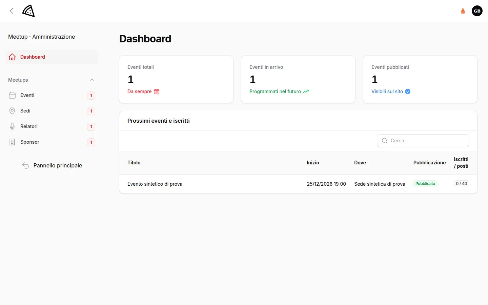
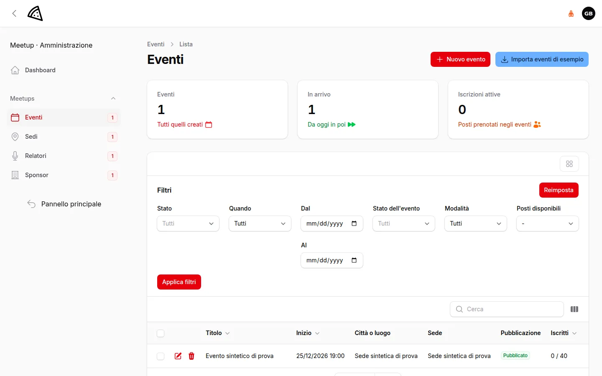
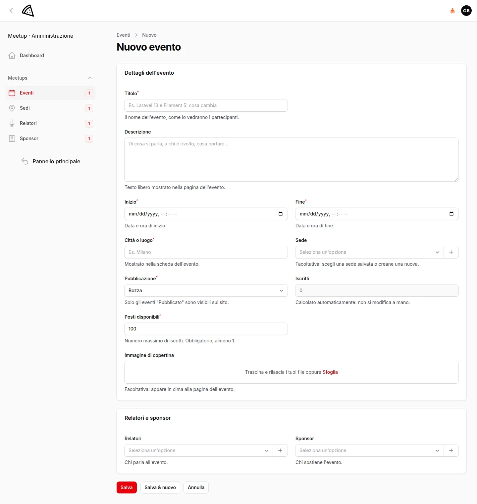
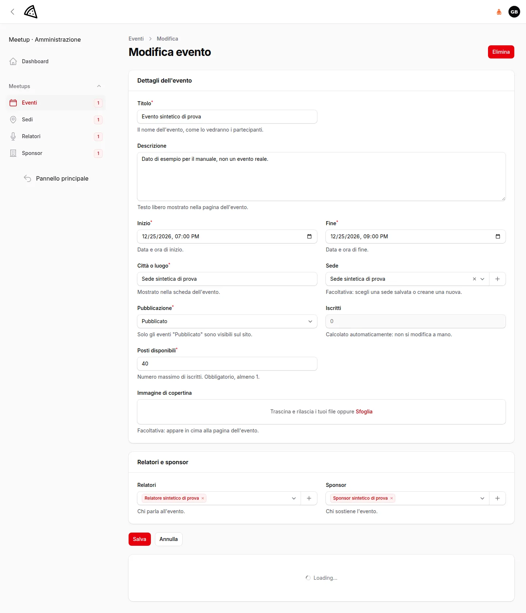
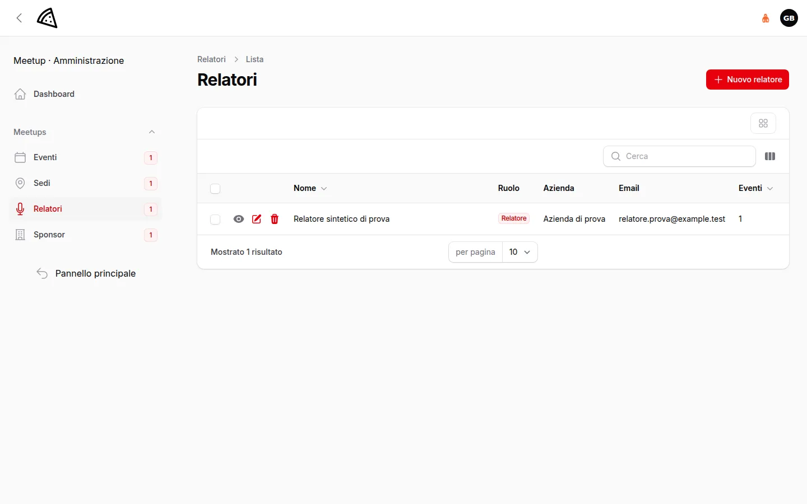
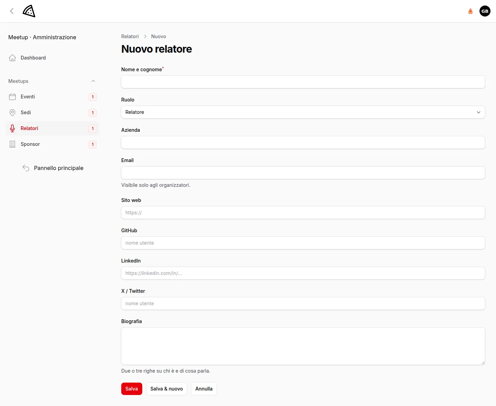
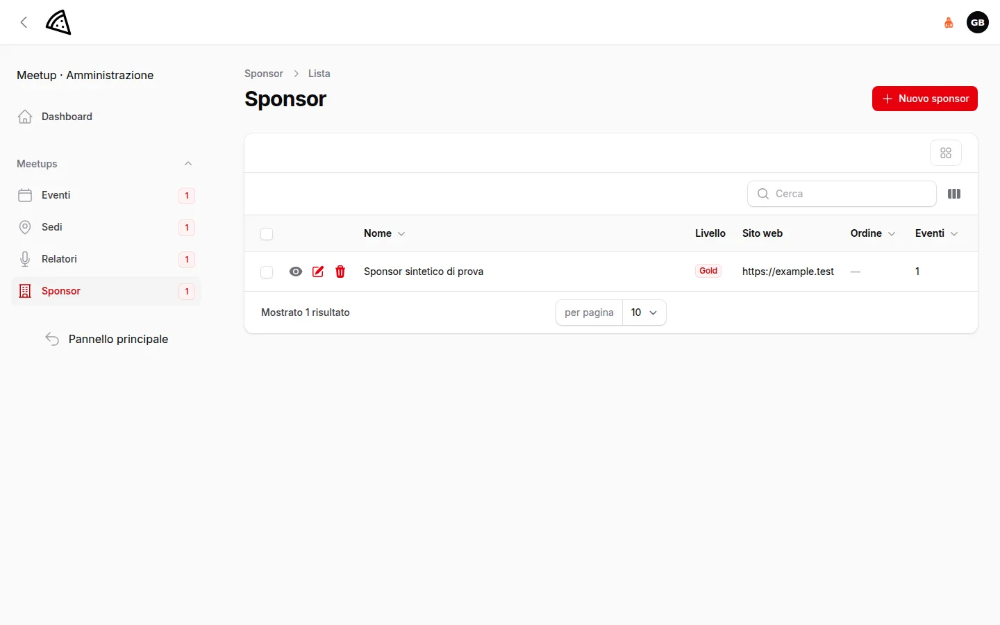
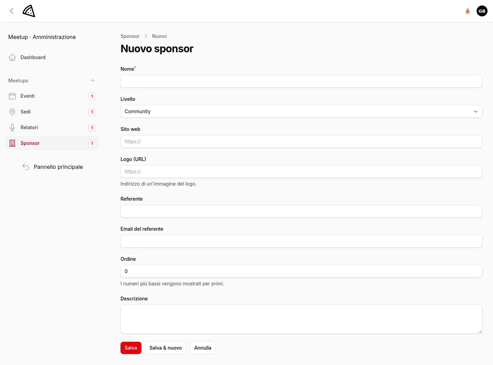
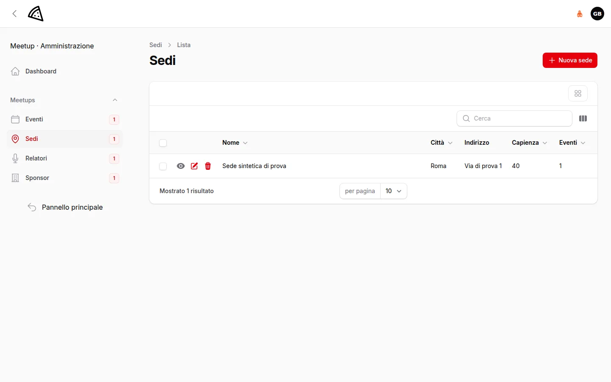
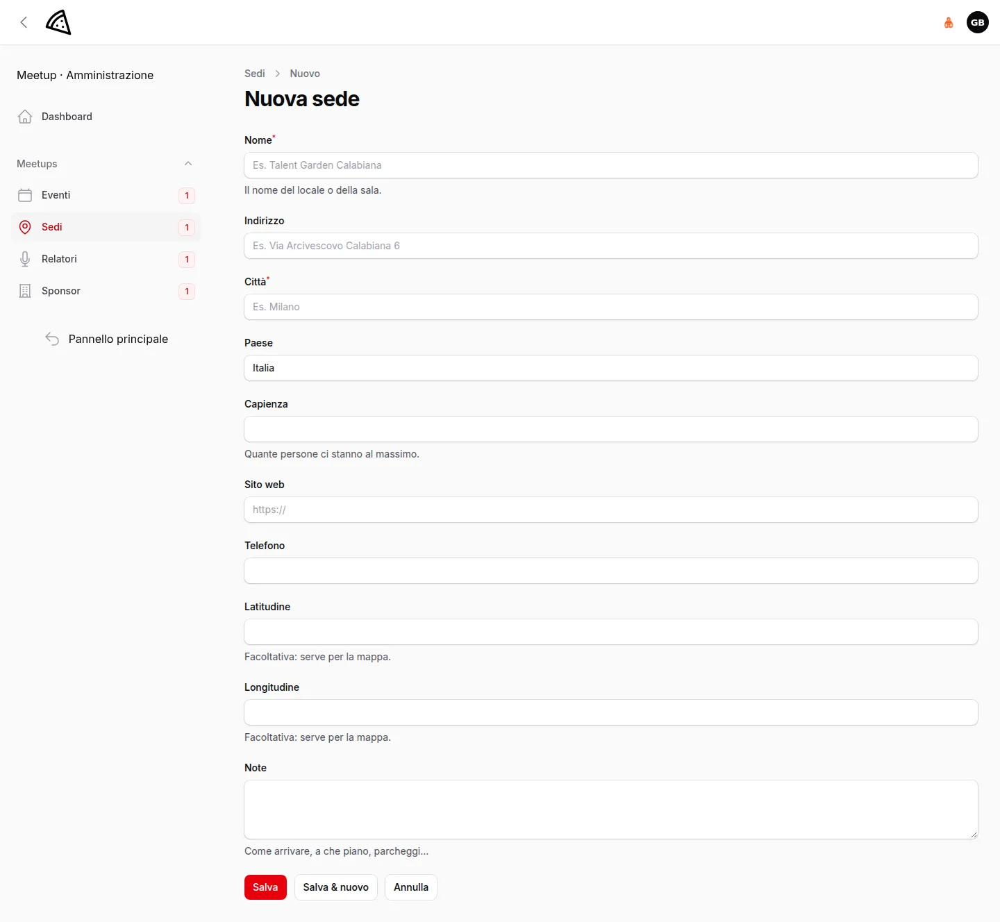

# Pannello Meetup (`/meetup/admin`)

> Screenshot reali catturati il 25 novembre 2026 con
> `bashscripts/tools/docs/manual-screenshots.mjs Meetup` su un'istanza di prova isolata
> (database usa-e-getta). Il manuale descrive solo il **pannello di amministrazione**.
> Le pagine pubbliche (home, elenco eventi, pagine istituzionali) sono nel manuale del tema:
> [`Themes/Meetup/docs/manuals/manuale-utente.md`](../../../../Themes/Meetup/docs/manuals/manuale-utente.md).
> Manifest delle catture: [screenshots.json](screenshots.json).



## Scopo

Il pannello Filament `meetup` gestisce gli eventi della community e le informazioni collegate:
eventi, sedi, relatori e sponsor. Dalla scheda di un evento si vedono anche gli iscritti.
Il pannello è una risorsa del modulo `laravel/Modules/Meetup`; le risorse sono in
`app/Filament/Resources/`.

## Accesso

- Indirizzo: `/meetup/admin` (senza prefisso di lingua). Il login è `/meetup/admin/login`.
- Serve un utente autenticato. Il manuale non verifica quali ruoli possano entrare nel pannello.
- Recupero password: il link «Hai smarrito la password?» porta a `/meetup/admin/password-reset/request`
  (rotta presente in `route:list`, non fotografata).


La pagina di login mostra il titolo «Accedi», i campi **Email** e **Password** (con «Mostra password»),
la casella **Ricordami** e il pulsante **Accedi**.

## Menu e navigazione

Nella barra laterale ci sono la voce **Dashboard** e il gruppo **Meetups** con quattro sezioni,
ognuna con un contatore:

| Voce | Risorsa | Rotta lista |
|---|---|---|
| Eventi | `EventResource` | `/meetup/admin/events` |
| Sedi | `VenueResource` | `/meetup/admin/venues` |
| Relatori | `PerformerResource` | `/meetup/admin/performers` |
| Sponsor | `SponsorResource` | `/meetup/admin/sponsors` |

Il link **Pannello principale** in fondo alla barra torna al pannello generale.
La rotta `/meetup/admin/meetup-dashboard` esiste ma è nascosta dal menu
(`app/Filament/Pages/MeetupDashboard.php`, `$shouldRegisterNavigation = false`): non è stata fotografata.

## Dashboard


- Tre schede: **Eventi totali**, **Eventi in arrivo** (programmati nel futuro) ed **Eventi pubblicati**
  (visibili sul sito).
- Tabella **Prossimi eventi e iscritti** con colonne: Titolo, Inizio, Dove, Pubblicazione, Iscritti / posti,
  e una ricerca.

Widget da `app/Filament/Pages/Dashboard.php`: `MeetupStatsOverviewWidget` e `RecentEventsWidget`.

## Eventi

### Lista — `/meetup/admin/events`



- Intestazione: **Nuovo evento**, **Importa eventi di esempio** (il secondo pulsante compare solo in
  ambiente `local`, vedi `app/Filament/Actions/ImportEventsAction.php`).
- Tre schede: **Eventi**, **In arrivo** (da oggi in poi), **Iscrizioni attive** (posti prenotati).
- Filtri: **Stato**, **Quando**, **Dal**, **Al**, **Stato dell'evento**, **Modalità**, **Posti disponibili**;
  pulsanti **Applica filtri** e **Reimposta**.
- Colonne visibili: Titolo, Inizio, **Città o luogo**, Sede, Pubblicazione (badge), Iscritti (formato
  `iscritti / posti`). Altre colonne (Fine, Stato, Modalità, Lingua, Creato il) sono nascoste di default
  (`app/Filament/Resources/EventResource/Tables/EventsTable.php`).
- Per riga: modifica (matita) ed eliminazione (cestino). L'eliminazione chiede conferma e dichiara
  quante iscrizioni si perdono (`lang/it/event.php`, `delete_confirmation`).

### Nuovo evento — `/meetup/admin/events/create`



Sezione **Dettagli dell'evento**:

| Campo | Obbligatorio | Note dalla schermata e dal codice |
|---|---|---|
| Titolo | sì | max 255 caratteri |
| Descrizione | no | testo libero, mostrato nella pagina dell'evento |
| Inizio | sì | data e ora |
| Fine | sì | data e ora, deve essere dopo l'inizio |
| Città o luogo | sì | testo libero, mostrato nella scheda evento |
| Sede | no | scelta tra le sedi salvate; **+** crea una sede senza uscire dal form |
| Pubblicazione | sì | Bozza (predefinito), Pubblicato, Annullato, In attesa di approvazione. Solo «Pubblicato» è visibile sul sito |
| Iscritti | — | campo disabilitato, si aggiorna da solo (0 alla creazione) |
| Posti disponibili | sì | intero, minimo 1, predefinito 100 |
| Immagine di copertina | no | upload immagine |

Sezione **Relatori e sponsor**: **Relatori** e **Sponsor** (selezione multipla, con **+** per crearne uno nuovo).

Pulsanti: **Salva**, **Salva & nuovo**, **Annulla**.

### Modifica evento — `/meetup/admin/events/{slug}/edit`



La pagina si apre con lo **slug** dell'evento, non con l'id numerico: `Event::getRouteKeyName()` restituisce
`slug` (`app/Models/Event.php`). Con l'id numerico la pagina risponde 404. Lo screenshot usa
l'evento di prova `evento-sintetico-di-prova`.

Il form è quello di creazione, già compilato. In alto a destra c'è **Elimina**.
In fondo alla pagina c'è il gestore **Iscritti** (`RegistrationsRelationManager`: elenco iscritti,
esporta CSV, annulla iscrizione). Nella cattura il gestore risulta ancora in caricamento (vedi «Difetti noti»),
quindi l'elenco iscritti non è illustrato.

## Relatori — `/meetup/admin/performers`

### Lista



Colonne: Nome, Ruolo (badge), Azienda, Email, Eventi (numero di eventi collegati). Ordine predefinito per nome.
Pulsante **Nuovo relatore**.

### Nuovo relatore — `/meetup/admin/performers/create`



Campi: **Nome e cognome** (obbligatorio), **Ruolo** (Relatore predefinito; Presentatore; Moderatore),
**Azienda**, **Email** («Visibile solo agli organizzatori»), **Sito web**, **GitHub**, **LinkedIn**,
**X / Twitter**, **Biografia**.

## Sponsor — `/meetup/admin/sponsors`

### Lista



Colonne: Nome, Livello (badge), Sito web, Ordine, Eventi. Pulsante **Nuovo sponsor**.

### Nuovo sponsor — `/meetup/admin/sponsors/create`



Campi: **Nome** (obbligatorio), **Livello** (Community predefinito; Platinum, Gold, Silver, Bronze),
**Sito web**, **Logo (URL)**, **Referente**, **Email del referente**, **Ordine** (i numeri più bassi
compaiono per primi, predefinito 0), **Descrizione**.

## Sedi — `/meetup/admin/venues`

### Lista



Colonne: Nome, Città, Indirizzo, Capienza, Eventi. Pulsante **Nuova sede**.

### Nuova sede — `/meetup/admin/venues/create`



Campi: **Nome** (obbligatorio), **Indirizzo**, **Città** (obbligatoria), **Paese** (predefinito «Italia»),
**Capienza**, **Sito web**, **Telefono**, **Latitudine** e **Longitudine** («serve per la mappa»), **Note**.

## Dati di esempio

Il database di prova era vuoto. Per illustrare le schede con dati reali sono stati inseriti **solo dati
sintetici** nel database di prova (`claude_scratch_auth_*`), con `php artisan tinker`:

- una sede «Sede sintetica di prova» (Roma, capienza 40);
- un relatore «Relatore sintetico di prova» (email `relatore.prova@example.test`);
- uno sponsor «Sponsor sintetico di prova» (livello Gold);
- un evento «Evento sintetico di prova», pubblicato, 40 posti, tra 30 giorni, con il relatore e lo sponsor.

Nessun dato reale è stato usato o modificato. Le liste vuote («Nessun risultato») non sono illustrate.

## Non illustrato in questo manuale

- Pagina `meetup-dashboard` (nascosta dal menu).
- Recupero password (`/meetup/admin/password-reset/request` e `/reset`).
- Gestore **Iscritti** nella scheda evento (elenco, esportazione CSV, annullamento): nella cattura è rimasto in caricamento.
- Creazione ed eliminazione effettive: le catture sono solo di visualizzazione dei form.
- Tutto ciò che sta sul sito pubblico: vedi il manuale del tema.

## Difetti noti (con evidenza)

1. **Gestore «Iscritti» non caricato nella cattura.** In `assets/events-edit.webp` la sezione in fondo
   alla pagina mostra «Loading…» anche dopo 6 secondi di attesa. Il `laravel.log` dell'istanza di prova non
   registra eccezioni per quella richiesta. La causa non è stata individuata: va verificato a mano che
   l'elenco iscritti si carichi in un browser normale (`app/Filament/Resources/EventResource/RelationManagers/RegistrationsRelationManager.php`).
2. **Intestazione «Città» nella lista eventi.** La colonna mostra il campo `location` (testo libero, es.
   «Sede sintetica di prova»), ma l'intestazione era «Città», mentre il form lo chiama «Città o luogo».
   **Corretto:** `lang/it/events.php` (chiave `fields.location.label`), ora «Città o luogo»; verificato in
   `assets/events-list.webp`.
3. **Voci di traduzione con il nome della chiave.** `lang/it/events.php` contiene `fields.has_capacity` e
   `fields.timing` con valore uguale alla chiave; non sono usate (i filtri usano altre chiavi). Anche
   `lang/it/import_events.php` ha `label`, `icon` e `tooltip` uguali a `import_events`: il pulsante usa
   invece la chiave `meetup::event.event.actions.seed_events.label`. Non visibili nel pannello; non modificati.
4. **Livelli sponsor in inglese.** `lang/it/sponsor_form.php` (`level.options`) ha Platinum, Gold, Silver,
   Bronze, Community: in un'interfaccia italiana. Possibile scelta voluta per i nomi dei livelli; non modificato.
5. **Date nei filtri.** Nei campi «Dal» e «Al» il segnaposto è `mm/dd/yyyy`: dipende dal browser (la cattura
   usa Chrome con locale inglese). Non è un difetto dell'applicazione; annotato per chi usa il browser in italiano.
6. **Pulsante «Nuovo» doppio.** Nelle liste catturate compare un solo pulsante «Nuovo» in alto. Non è stato
   osservato il doppio pulsante segnalato per le liste Xot.

## Rigenerare gli screenshot

```bash
MANUAL_SHOT_SERVE=127.0.0.1:8000 MANUAL_SHOT_EMAIL=... MANUAL_SHOT_PASSWORD=... \
  node bashscripts/tools/docs/manual-screenshots.mjs Meetup
```

Il tool rifiuta le pagine con errore HTTP, redirect al login o pagina senza CSS. La pagina di login è `"auth": false`
e viene catturata per prima. Il manifest è [screenshots.json](screenshots.json).

## Vedi anche

- [Manuale del tema Meetup (front office pubblico)](../../../../Themes/Meetup/docs/manuals/manuale-utente.md)
