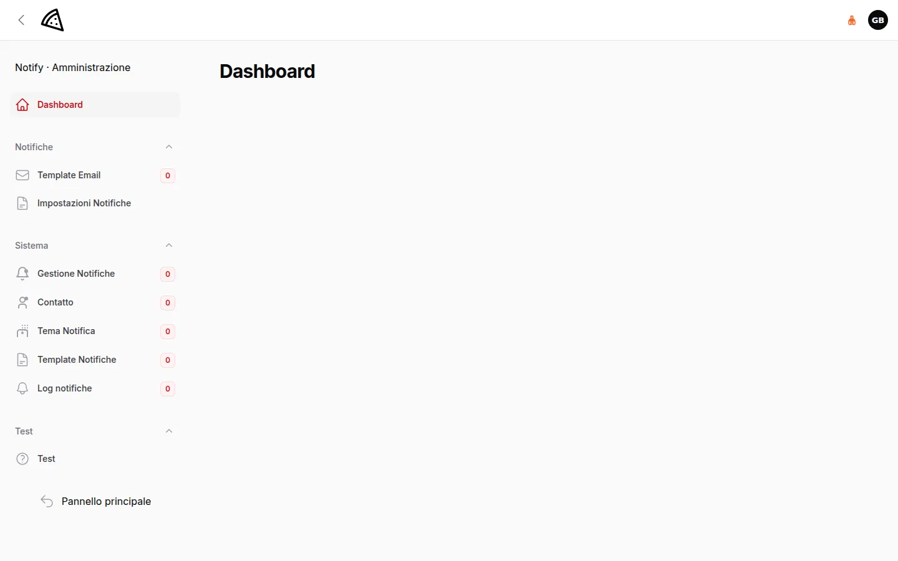
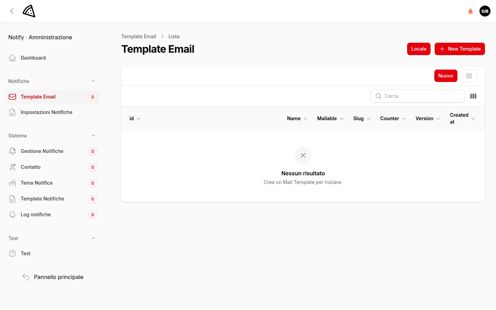
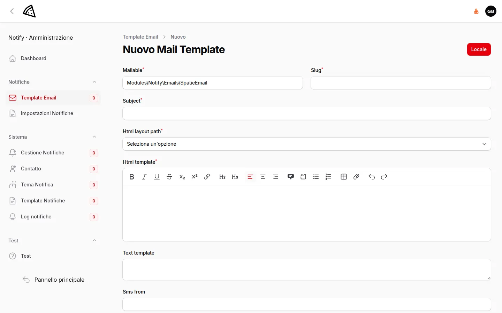
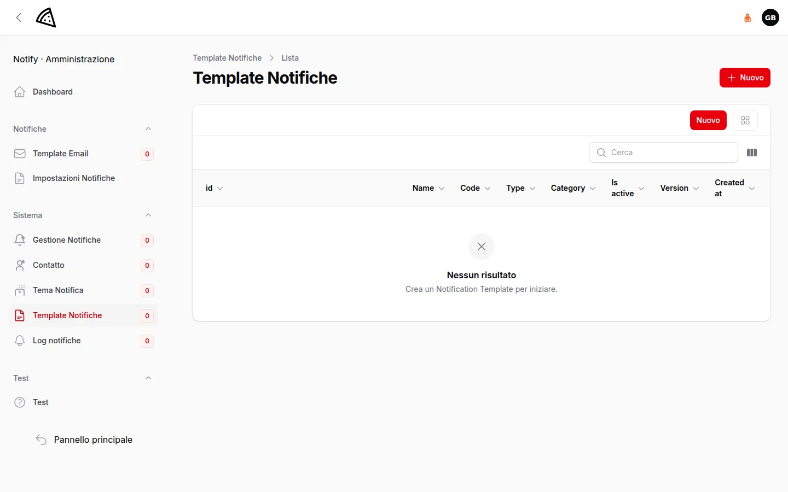
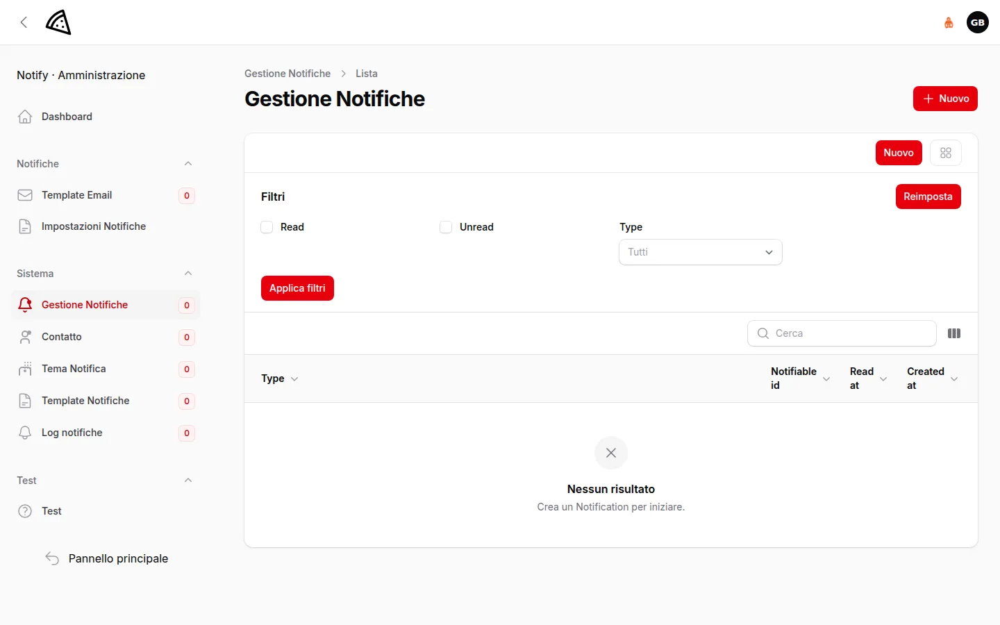
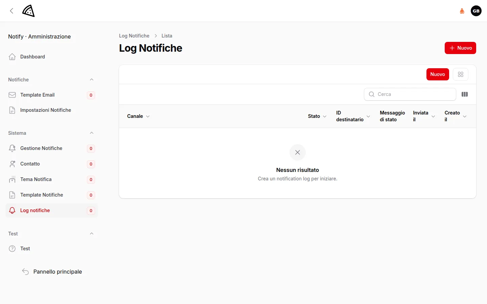
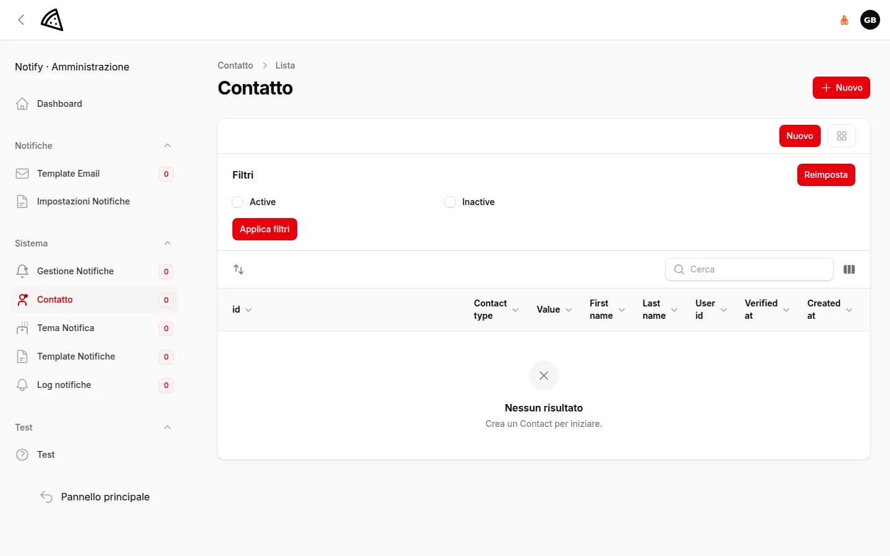
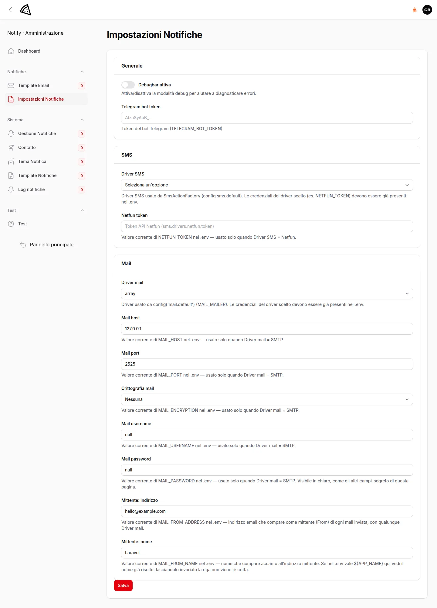
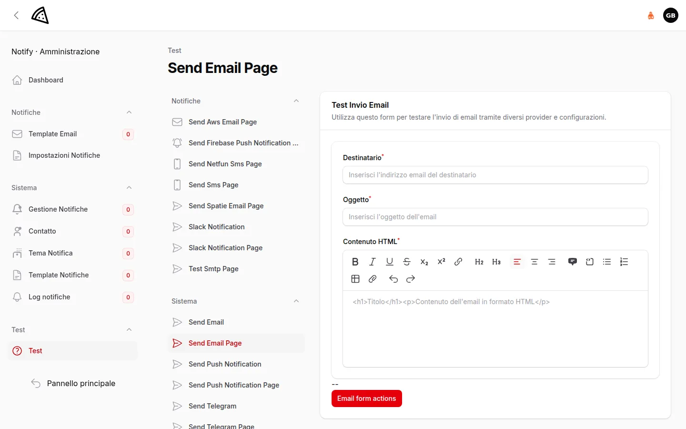

# Manuale utente — Notify (pannello `notify/admin`)

Questo manuale descrive il pannello di amministrazione di Notify. Ogni schermata
è uno screenshot reale catturato dall'istanza di prova isolata (database usa-e-getta,
utente sintetico super-admin), con HTTP 200 e pagina verificata a vista. I dati
delle liste sono vuoti: le liste mostrano «Nessun risultato», e nel manuale non
è documentato alcun contenuto reale.

## Scopo

Notify centralizza le notifiche di sistema, i template di posta e SMS, i contatti
dei destinatari, il log di consegna e le impostazioni dei canali (mail, SMS,
Telegram). Le notifiche sono normalmente inviate da eventi o da chiamate
applicative; il pannello serve a gestire template, contatti, log e configurazione.

## Accesso

- Pannello: `/notify/admin` (login: `/notify/admin/login`).
- Login con email e password; il form offre «Ricordami» e il link «Hai smarrito la password?»
  (rotte `notify/admin/password-reset/request` e `.../reset`).
- Dopo il login il pannello mostra il menu laterale con tre gruppi: **Notifiche**,
  **Sistema** e **Test**.

## Matrice attori

| Attore | Cosa può fare, verificato |
|---|---|
| Ospite | Vede solo la pagina di login e il recupero password. |
| Utente autenticato del pannello | Accesso alle risorse da verificare: le policy base sono in `app/Models/Policies/NotifyBasePolicy.php`, ma in questa passata ho testato solo il super-admin. |
| Super-admin | Accede al gruppo **Test** e alle impostazioni: le pagine di test usano il trait `SuperAdminOnlyTrait` (presente nelle 15 pagine del cluster Test). |

I ruoli effettivi dipendono dalle policy e dai permessi di Xot; questo manuale non
documenta ruoli aggiuntivi che non ho potuto verificare.

## Dashboard

La dashboard (`/notify/admin`) è vuota: mostra il titolo «Dashboard» e nessun
widget. Nel menu laterale i contatori accanto alle voci valgono 0 perché il
database di prova è vuoto.

## Menu e risorse

| Gruppo | Voce | Route lista |
|---|---|---|
| Notifiche | Template Email | `/notify/admin/mail-templates` |
| Notifiche | Impostazioni Notifiche | `/notify/admin/setting` |
| Sistema | Gestione Notifiche | `/notify/admin/notifications` |
| Sistema | Contatto | `/notify/admin/contacts` |
| Sistema | Tema Notifica | `/notify/admin/notify-themes` |
| Sistema | Template Notifiche | `/notify/admin/notification-templates` |
| Sistema | Log notifiche | `/notify/admin/notification-logs` |
| Test | Test (cluster di 15 pagine) | `/notify/admin/test/...` |

Le route sono quelle restituite da `php artisan route:list --path=notify/admin`.

## Template Email

Lista (`/notify/admin/mail-templates`): colonne **id**, **Name**, **Mailable**,
**Slug**, **Counter**, **Version**, **Created at**; ricerca, ordinamento e
selettore colonne. Lista vuota con il testo «Crea un Mail Template per iniziare».

Creazione (`/notify/admin/mail-templates/create`, titolo «Nuovo Mail Template»).
Campi visibili nello screenshot: **Mailable** (precompilato con
`Modules\Notify\Emails\SpatieEmail`), **Slug**, **Subject**, **Html layout path**
(menu a tendina), **Html template** (editor ricco), **Text template**, **Sms from**.
Nel codice (`app/Filament/Resources/MailTemplateResource/Schemas/MailTemplateForm.php`)
sono previsti anche **Name** e **Sms template**, che sotto la piega dello screenshot
non ho fotografato.

## Template Notifiche

Lista (`/notify/admin/notification-templates`): colonne **id**, **Name**, **Code**,
**Type**, **Category**, **Is active**, **Version**, **Created at**. Lista vuota con
il testo «Crea un Notification Template per iniziare».

## Gestione Notifiche

Lista (`/notify/admin/notifications`): filtri **Read**, **Unread** e **Type**
(menu «Tutti»); colonne **Type**, **Notifiable id**, **Read at**, **Created at**.
Lista vuota.

## Log notifiche

Lista (`/notify/admin/notification-logs`): colonne **Canale**, **Stato**, **ID
destinatario**, **Messaggio di stato**, **Inviata il**, **Creato il**. Lista vuota.

## Contatto

Lista (`/notify/admin/contacts`): filtri **Active** e **Inactive**; colonne **id**,
**Contact type**, **Value**, **First name**, **Last name**, **User id**,
**Verified at**, **Created at**. Lista vuota.

## Impostazioni Notifiche

Pagina `/notify/admin/setting` (`app/Filament/Pages/SettingPage.php`). Le sezioni
mostrate nello screenshot sono:

- **Generale**: interruttore «Debugbar attiva» e campo «Telegram bot token».
- **SMS**: menu «Driver SMS» (nessun valore selezionato nella prova) e campo «Netfun token».
- **Mail**: «Driver mail» (valore `array`), «Mail host» (`127.0.0.1`), «Mail port»
  (`2525`), «Crittografia mail» (`Nessuna`), «Mail username» e «Mail password»
  (entrambi con valore `null`), «Mittente: indirizzo» (`hello@example.com`),
  «Mittente: nome» (`Laravel`), pulsante **Salva**.

Nel campo Telegram e Netfun il testo grigio `AIzaSyAuB_...` è un segnaposto
dell'interfaccia, non un valore reale.

Lo screenshot mostra solo i valori presenti nel `.env` di prova. Questa pagina
legge i valori del `.env` tramite `EnvWidget` di Xot: per il design del widget,
vedi **Difetti noti** più sotto.

## Test (cluster)

Il gruppo **Test** contiene 15 pagine di invio prova (email, SMS, push, Telegram,
WhatsApp, Slack, Firebase, Netfun, AWS, SMTP). Sono riservate al super-admin.
Aprire una pagina mostra solo il form: l'invio avviene soltanto con il pulsante del
form (`sendEmail()` in `app/Filament/Clusters/Test/Pages/SendEmailPage.php`
chiama `Mail::to(...)`). Il manuale non include alcun invio.

Esempio: «Send Email Page» (`/notify/admin/test/send-email-page`) con i campi
**Destinatario** (obbligatorio, email), **Oggetto** (obbligatorio) e **Contenuto HTML**
(obbligatorio), più il pulsante del form.

## Pagine non illustrate

- **Anteprima, modifica e vista dei singoli record** (`.../{record}/...`): non fotografate,
  perché le liste di prova sono vuote e non c'è un record da aprire.
- Le pagine di test di Telegram, WhatsApp, SMS, push e Slack non sono fotografate
  in questa passata: non le documento.

## Flussi reali

1. Un evento o un'Action applicativa invoca l'invio di una notifica
   (`app/Actions/SendNotificationAction.php`, `app/Actions/SendNotificationToRecipientAction.php`).
2. Notify seleziona il canale e il provider configurato.
3. I template di posta e notifica si gestiscono dal pannello (sezioni sopra).
4. I webhook provider arrivano sulle rotte API di `routes/api.php`:
   `POST /inbound/{provider}/{token}` e `POST /notify/mailjet/events/{token}`.
   Il token è nel percorso; la verifica del token non è stata testata in questa passata.

## Prerequisiti

- Moduli User e Xot caricati.
- Credenziali del canale impostate nel `.env` (vedi la sezione Impostazioni).
- Queue e worker quando il canale li richiede.
- Ruolo di pannello `notify::admin` o permessi equivalenti.

## Difetti noti

Ogni difetto è verificato su screenshot o su codice letto; il riferimento è indicato.

1. **Impostazioni: valori del `.env` mostrati in chiaro.**
   `app/Filament/Pages/SettingPage.php` (blocco `$only`, righe 61-78) passa a `EnvWidget` anche
   `mail_password`, `telegram_bot_token` e `netfun_token`. Il widget mostra in chiaro
   qualunque valore abbia il `.env`: se la password SMTP o un token fosse valorizzato,
   comparirebbe nella pagina. Nella prova il valore era `null` (vedi screenshot), e la
   pagina dichiara «Visibile in chiaro» sotto il campo password. Da correggere nel design
   del widget (maschera o omissione dei valori segreti).
2. **Etichetta grezza nel form di test.** Nel form di «Send Email Page» il pulsante
   azione mostra la chiave non tradotta «Email form actions» (`SendEmailPage.php`,
   `getEmailFormActions()`, riga 97); da localizzare.
3. **Trattino «--» vuoto nel form di test.** `resources/views/filament/pages/send-email.blade.php`
   riga 17 mostra `{{ $error_message ?? '--' }}` anche quando non c'è errore; visibile
   sotto il form. Non corretto: va deciso se l'area di errore debba restare vuota.
4. **Testo inglese nell'interfaccia.** Il pulsante «New Template» nella lista Template Email
   è in inglese; le descrizioni delle liste vuote usano i nomi dei modelli in inglese
   («Crea un Mail Template», «Crea un Notification Template», «Crea un notification log»,
   «Crea un Contact»). Non ho trovato la chiave di traduzione nei file `lang/it` di Notify; la fonte resta da verificare.
5. **Chiavi grezze in `lang/it/send_telegram.php`.** Le voci `caption`, `recipient` e
   `body` hanno come etichetta, placeholder e descrizione il nome della chiave.
   Non le ho corrette in questa passata (pagina Telegram non fotografata).
6. **Doppio pulsante «Nuovo» nelle liste.** Comportamento condiviso di tutte le liste
   Xot (`HasXotTable::getTableHeaderActions` e `XotBaseListRecords::getHeaderActions`);
   dipende da Xot, non da Notify.

## Correzioni fatte in questa passata

- `lang/it/send_email.php`: l'etichetta del campo **recipient** passa da `recipient` a
  «Destinatario», con placeholder e descrizione in italiano. Verificato sullo screenshot
  «Send Email Page». Pint e PHPStan sul file: verdi.

## Limiti

- `routes/web.php` non espone pagine Notify pubbliche: l'interfaccia è il pannello Filament.
- Le liste sono vuote nella prova: non ho documentato comportamenti con dati reali.
- Il file `manuale-utente.pdf` non è stato rigenerato: il suo contenuto può non essere
  allineato a questo manuale.

## Link a codice

- Pannello: `app/Providers/Filament/AdminPanelProvider.php`
- Policy base: `app/Models/Policies/NotifyBasePolicy.php`
- Impostazioni: `app/Filament/Pages/SettingPage.php`
- Template mail: `app/Filament/Resources/MailTemplateResource.php`
- Invio: `app/Actions/SendNotificationAction.php`
- Webhook API: `routes/api.php`
