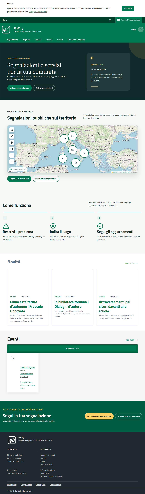

> Screenshot reale del front office FixCity, verificato il 23 novembre 2026. Per questo modulo è una superficie condivisa: il manuale non attribuisce al modulo una UI propria se non documentata dalle fonti.

# Modulo Notify

## Scopo

Notify centralizza notifiche, template, log e canali di consegna (mail, SMS,
push, Telegram, WhatsApp e altri provider presenti nelle Actions). Le notifiche
sono normalmente attivate da eventi o da chiamate applicative, non da una route
web pubblica.

## Matrice attori

| Attore | Accesso o responsabilità verificata |
|---|---|
| Ospite | N/A per la gestione del modulo e dei template. |
| Utente autenticato | Può essere destinatario delle notifiche; la ricezione non implica accesso alla gestione dei canali o dei template. |
| Gruppo/ruolo | Il ruolo di pannello `notify::admin` abilita l'area amministrativa del modulo; le policy ereditano la base User/Xot. |
| Admin | La gestione BO avviene nel pannello Notify tramite Resource per contatti, template, notifiche, log e temi. |
| Super-admin | Bypass amministrativo delle policy base Xot e accesso alle impostazioni del modulo secondo la convenzione dei pannelli. |
| Operatore | N/A come ruolo specifico del modulo. |

## Flussi reali

1. Un evento o un'Action applicativa invoca l'invio di una notifica.
2. Notify costruisce il messaggio e seleziona il canale/provider configurato.
3. I template e i temi vengono gestiti dal pannello `notify::admin`.
4. Le notifiche database sono mostrate nel menu utente del pannello quando non
   sono disabilitate dalla configurazione.
5. Le route API ricevono webhook di posta in ingresso e gli esiti Mailjet;
   autenticazione del destinatario e gestione BO restano separate dai webhook.

## Prerequisiti

- Moduli User e Xot caricati.
- Provider e credenziali del canale configurati dall'applicazione.
- Queue/worker quando il canale o il flusso applicativo li richiede.
- Ruolo `notify::admin` o autorizzazioni equivalenti per la gestione Filament.
- Token/provider validi per gli endpoint webhook.

## Limiti

- `routes/web.php` non espone pagine web Notify autonome: il pannello Filament
  gestisce l'interfaccia.
- I webhook API sono endpoint tecnici per provider, non un'interfaccia per
  ospiti o utenti.
- La disponibilità effettiva di ciascun canale dipende dalla sua configurazione
  e dal provider esterno.

## Link a codice/docs

- [Architettura](architecture.md)
- [Pannello Notify](../app/Providers/Filament/AdminPanelProvider.php)
- [Policy base](../app/Models/Policies/NotifyBasePolicy.php)
- [Invio notifiche](../app/Actions/SendNotificationAction.php)
- [Invio a destinatario](../app/Actions/SendNotificationToRecipientAction.php)
- [Webhook API](../routes/api.php)
- [Resource template mail](../app/Filament/Resources/MailTemplateResource.php)

