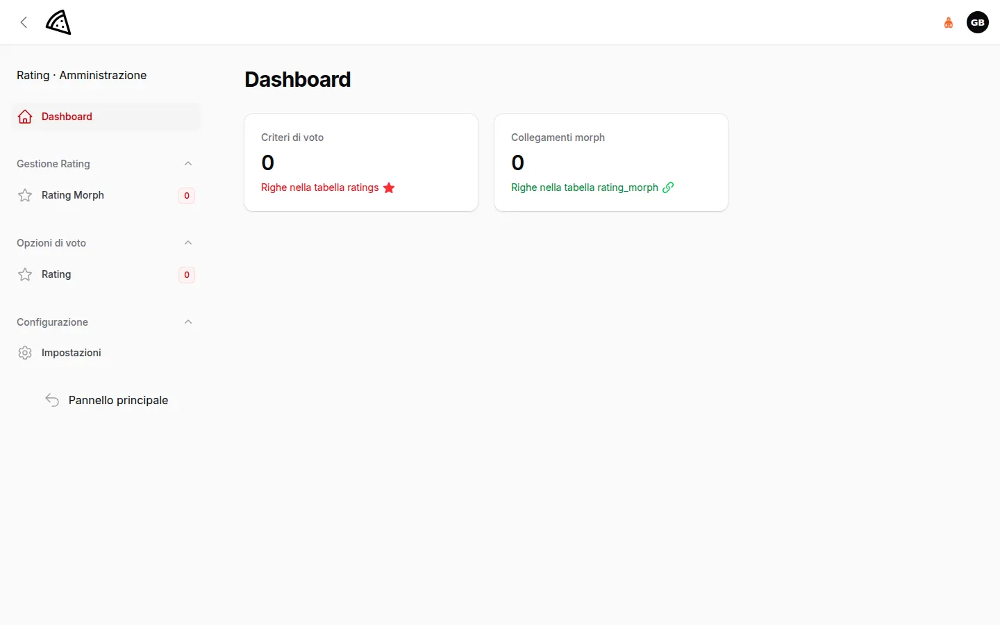
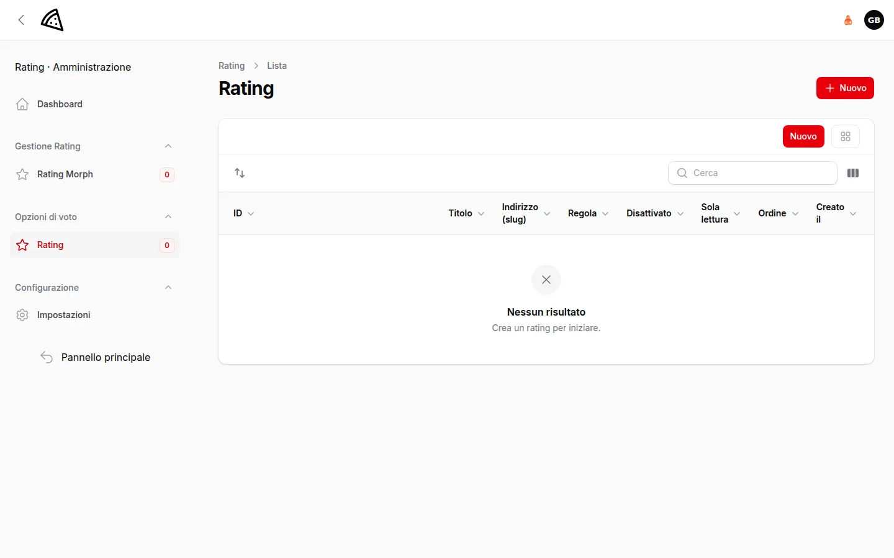
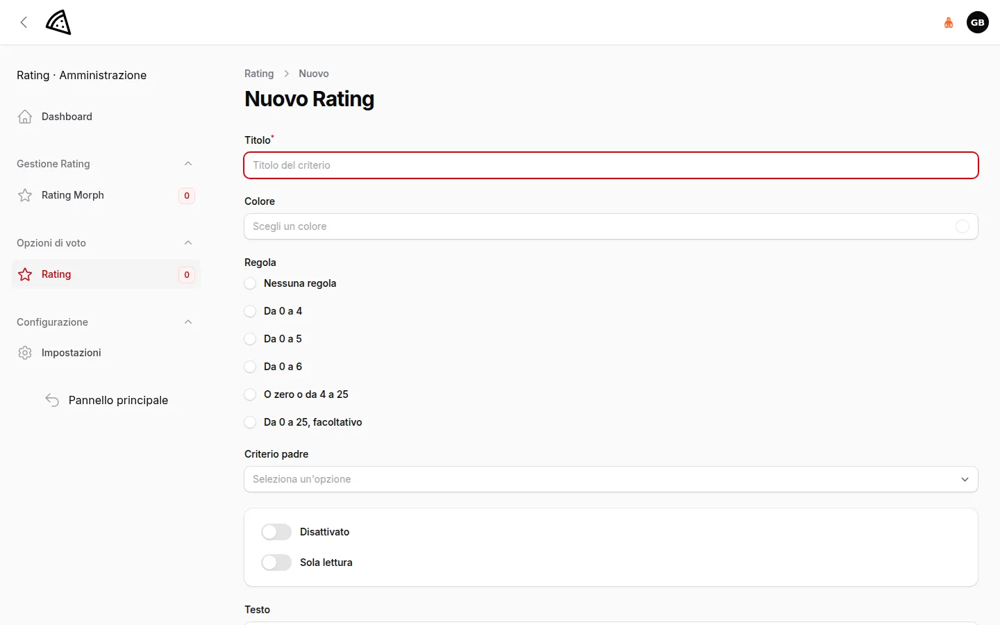
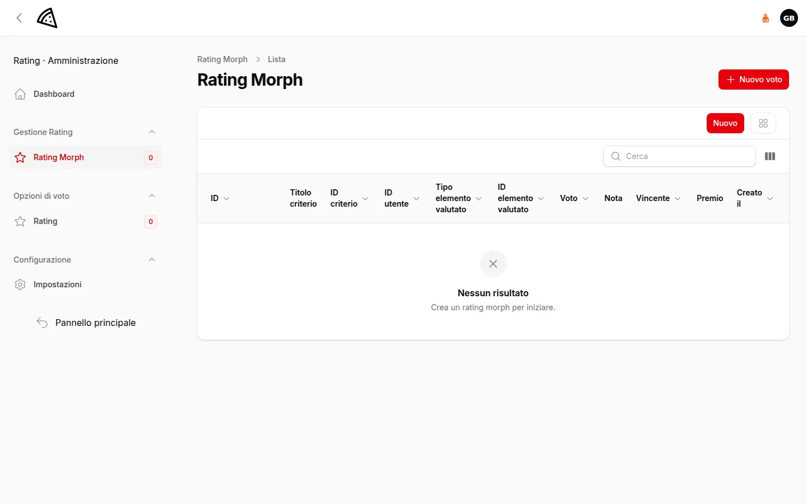
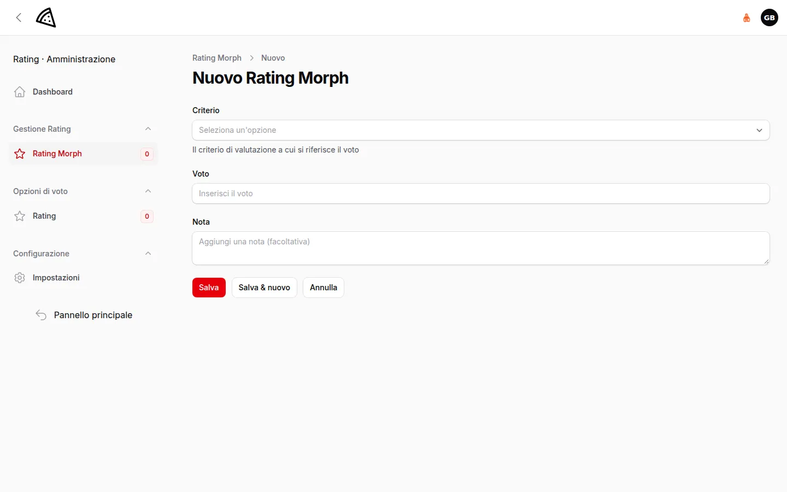
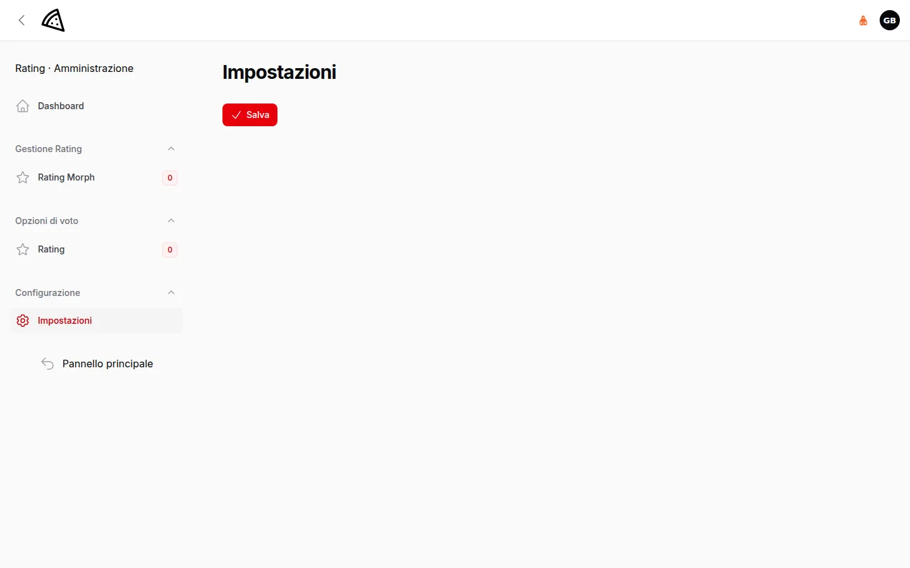

# Manuale d'uso — Rating

Rating gestisce i **criteri di voto** (tabella `ratings`) e i **voti** assegnati dagli utenti a qualunque modello valutabile
(tabella `rating_morph`). L'interfaccia è il pannello Filament `rating/admin`; il modulo non ha pagine di front office.

> **Come sono fatte le immagini.** Sono catture reali del pannello, fatte con `bashscripts/tools/docs/manual-screenshots.mjs`
> su un'istanza di prova isolata (database usa-e-getta, utente sintetico), non sull'ambiente di sviluppo. Ogni cattura è registrata
> in `screenshots.json` con data, esito HTTP e impronta sha256. Le tabelle di prova sono vuote: dove vedi «Nessun risultato» non
> è un errore. Per rifarle: `node bashscripts/tools/docs/manual-screenshots.mjs Rating` (istruzioni in
> `bashscripts/docs/operations/manual-screenshots.md`).

## Accesso

Apri `/rating/admin/login` e accedi con un account abilitato al pannello (ad esempio `super-admin`).

Il menu laterale ha tre gruppi: **Gestione Rating** (Rating Morph), **Opzioni di voto** (Rating) e **Configurazione**
(Impostazioni), più il collegamento «Pannello principale». I numeri accanto alle voci sono i conteggi delle righe.

## Dashboard

Due schede: **Criteri di voto** (righe della tabella `ratings`) e **Collegamenti morph** (righe della tabella `rating_morph`).
Sono contatori: non hanno filtri né azioni.

## Criteri di voto (`/rating/admin/ratings`)

Colonne: **ID, Titolo, Indirizzo (slug), Regola, Disattivato, Sola lettura, Ordine, Creato il**. Hai la ricerca, la scelta delle
colonne visibili e il cambio di visualizzazione della tabella.

### Nuovo criterio

| Campo | Cosa fa |
|---|---|
| **Titolo** (obbligatorio) | Nome con cui il criterio compare nelle valutazioni. |
| **Colore** | Selettore di colore del criterio. |
| **Regola** | Intervallo di voti ammessi: Nessuna regola · Da 0 a 4 · Da 0 a 5 · Da 0 a 6 · O zero o da 4 a 25 · Da 0 a 25, facoltativo. |
| **Criterio padre** | Criterio di livello superiore, se esiste. L'elenco non propone il criterio stesso né i suoi discendenti, così non si creano cicli. |
| **Disattivato** | Un criterio disattivato non è più proposto nelle valutazioni. |
| **Sola lettura** | Un criterio in sola lettura mostra i voti ma non li accetta. |
| **Testo** | Descrizione estesa, in un editor di testo (in fondo alla pagina). |

Le regole sono quelle dell'enum `RuleEnum`.

## Voti (`/rating/admin/rating-morphs`)

Colonne: **ID, Titolo criterio, ID criterio, ID utente, Tipo elemento valutato, ID elemento valutato, Voto, Nota, Vincente, Premio,
Creato il**. Il pulsante in alto è **Nuovo voto**.

### Nuovo voto

Il modulo ha solo tre campi: **Criterio** (a quale criterio si riferisce il voto), **Voto** e **Nota** (facoltativa). Utente,
tipo e identificativo dell'elemento valutato **non** si inseriscono qui: li scrive il contesto che registra il voto
(`BaseRatingMorphForm`). La percentuale non è un campo: è calcolata dai voti (`HasRating`).

## Impostazioni (`/rating/admin/setting`)

La pagina esiste in ogni modulo per uniformità. Per Rating non ci sono ancora valori da cambiare, quindi mostra solo il
pulsante **Salva** (scelta registrata nella story `0101`).

## Cose da sapere

- **Due pulsanti «Nuovo» nelle liste.** Compaiono uno in alto e uno nella barra della tabella: è un comportamento comune a tutte le
  liste dei moduli Xot (`HasXotTable::getTableHeaderActions` e `XotBaseListRecords::getHeaderActions`), non un difetto di Rating.
  Fanno la stessa cosa.
- **Le schede della dashboard citano i nomi delle tabelle** («Righe nella tabella ratings»): testo tecnico, pensato per chi amministra.
- **Solo italiano.** I testi di `rating_morph` e `rating_morphs` esistono solo in `lang/it`.

## Per chi sviluppa

I modelli che ricevono voti usano i trait `HasRating` / `HasRatingsTrait` e, per i «mi piace», `HasLikes`: non hanno interfaccia
in questo pannello.

## Fonti

- `app/Providers/Filament/AdminPanelProvider.php`, `app/Filament/Pages/Dashboard.php`, `app/Filament/Pages/SettingPage.php`
- `app/Filament/Resources/RatingResource.php` e `RatingMorphResource` (`Schemas/BaseRatingForm.php`, `Schemas/BaseRatingMorphForm.php`)
- `app/Enums/RuleEnum.php`, `lang/it/rating_morph_form.php`, `lang/it/rating_morphs.php`
- `docs/rating-panel-dashboard.md`
