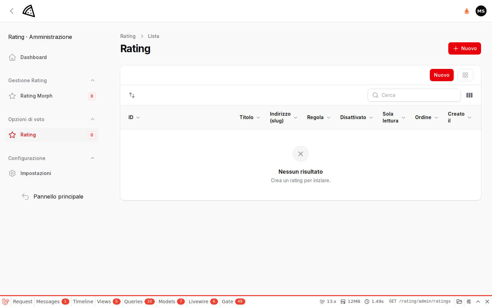
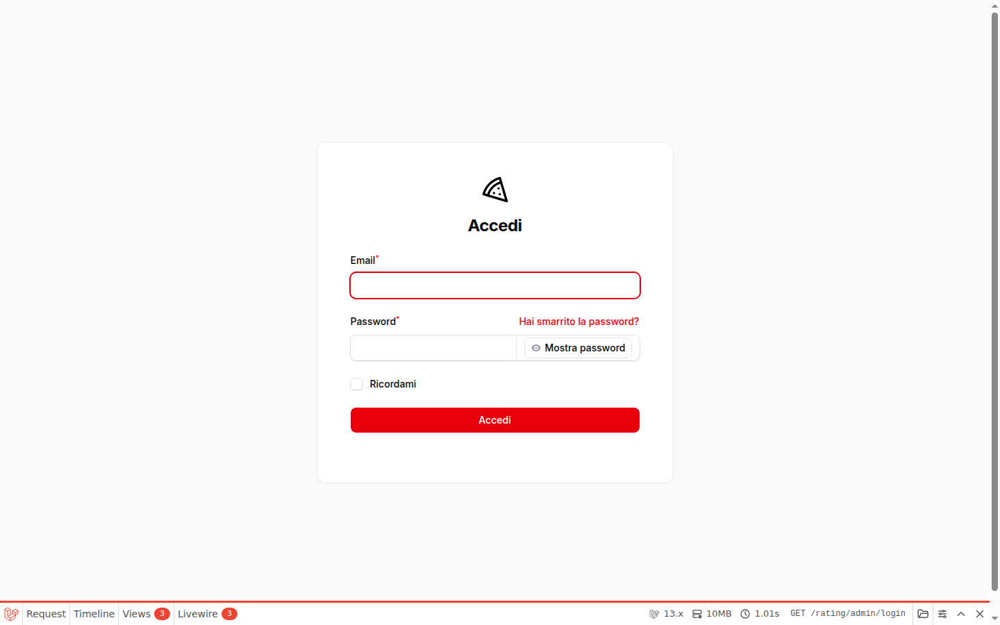
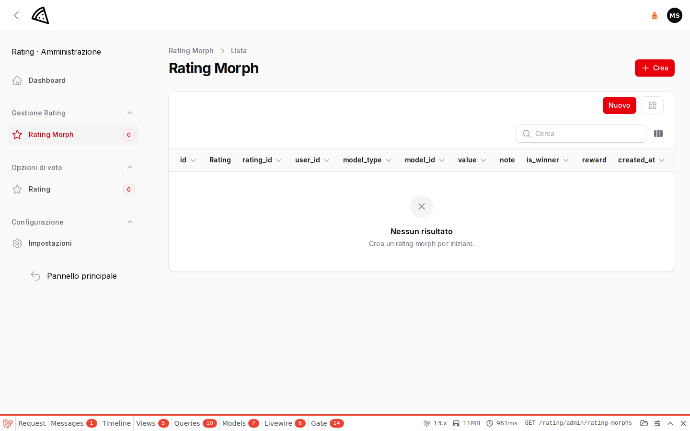
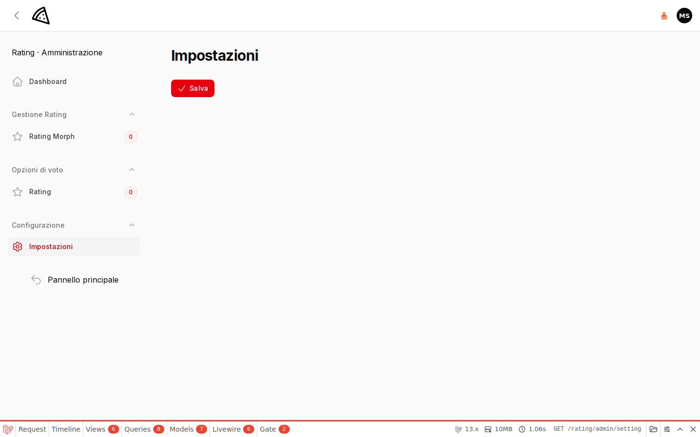
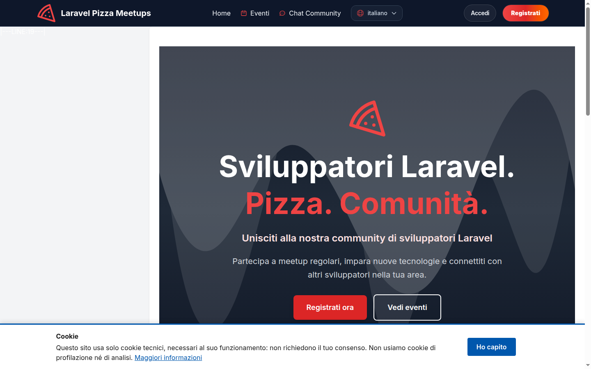

> Screenshot reali del pannello `rating/admin`, catturati in locale il 25 novembre 2026.
> Non si documentano UI inventate: solo route e schermate verificate.

# Manuale d'uso — Rating

## Scopo e perimetro

Rating gestisce **criteri di voto** (`ratings`) e i **collegamenti morph**
(`rating_morph`) verso modelli valutabili. L'interfaccia operativa è il pannello
Filament `rating/admin`. Non espone pagine web pubbliche proprie: il front office
resta del tema (Meetup).

## Accesso

1. Aprire `/rating/admin/login`.
2. Autenticarsi con un account che può accedere al pannello `rating::admin`
   (tipicamente ruolo `super-admin` o policy compatibile User/Xot).
3. Dopo il login: Dashboard, Rating, Rating Morph, Impostazioni.

## Attori

| Attore | Capacità verificabili |
|---|---|
| Ospite | Vede solo la pagina di login del pannello. Nessuna gestione criteri. |
| Utente autenticato senza ruolo pannello | Login fallisce o accesso negato al panel. |
| Admin / super-admin ammessi al panel | CRUD su Rating e Rating Morph; apre Impostazioni; vede Dashboard. |
| Sviluppatore consumer | Integra `HasRating` / `HasRatingsTrait` e RelationManager nei moduli host; non è un attore UI di questo pannello. |

## Flussi reali

### Criteri di voto (`/rating/admin/ratings`)

1. Aprire **Opzioni di voto → Rating**.
2. Usare **Nuovo** / **+ Nuovo** per creare un criterio (titolo, regola, slug, flag).
3. La lista mostra colonne: ID, Titolo, Indirizzo, Regola, Disattivato, Sola lettura, Ordine, Creato il.
4. Stato vuoto verificato: messaggio «Nessun risultato» / «Crea un rating per iniziare».

### Collegamenti morph (`/rating/admin/rating-morphs`)

1. Aprire **Gestione Rating → Rating Morph**.
2. Creare un collegamento tra un criterio e un modello (`model_type` / `model_id`), con value, note, flag winner/reward quando presenti nello schema.
3. Stato vuoto verificato nello screenshot allegato.

### Impostazioni (`/rating/admin/setting`)

Pagina `SettingPage` riservata al super-admin. Lo schema form è **vuoto di proposito**:
la convenzione vive in `BaseSettingPage` + `RatingConfigData` (config tenant), senza
campi esposti. Screenshot: titolo «Impostazioni» e pulsante Salva, senza input.

### Dashboard

Mostra i conteggi criteri e morph (`RatingPanelStatsOverviewWidget`). Non è un
report di business oltre a quei due numeri.

## Prerequisiti

- Moduli User e Xot caricati; Media dichiarato in `module.json` requires.
- Account con accesso al pannello `rating::admin`.
- Tabelle `ratings` e `rating_morph` migrate.

## Limiti (verificati, non inventati)

- Nessuna route FO Rating autonoma.
- Impostazioni senza campi form finché `getFormSchema()` resta `[]`.
- Lo widget `StatsOverview` record-scoped richiede un modello host con rating; non alimenta la Dashboard di pannello.
- Doppia azione «Nuovo» in lista (header Filament + toolbar tabella): comportamento Filament/Xot attuale, non nascosto nel manuale.

## Fonti verificabili

- `app/Providers/Filament/AdminPanelProvider.php` — path `rating/admin`
- `app/Filament/Resources/RatingResource.php` / `RatingMorphResource`
- `app/Filament/Pages/SettingPage.php`, `Dashboard.php`
- `app/Models/Traits/HasRating.php`, `HasRatingsTrait.php`, `HasLikes.php`
- `docs/rating-panel-dashboard.md`
- `docs/adr/0002-rating-morph-options-and-votes-same-pivot.md` (se presente)

## Front office condiviso

Il sito pubblico non è UI Rating; screenshot home solo come contesto tenant:

