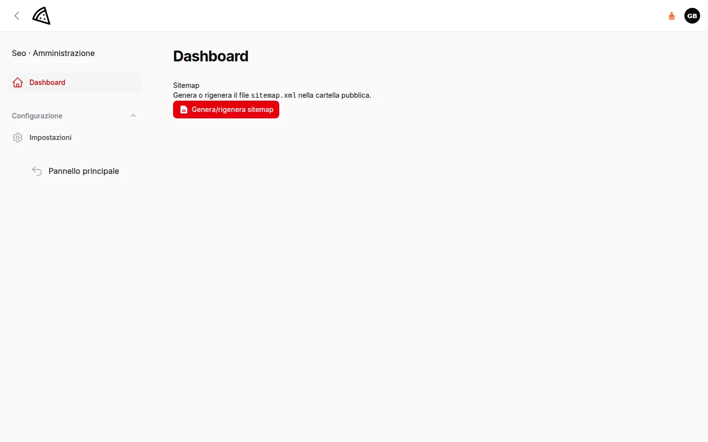
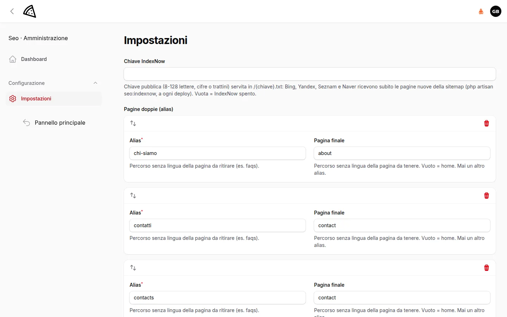

# Manuale d'uso — Seo

Seo rende il sito trovabile: sitemap, `robots.txt`, redirect canonici, metatag della pagina, condivisione social e IndexNow.
Il pannello amministrativo del modulo è Filament `seo/admin` e contiene solo **Dashboard** (generazione della sitemap) e
**Impostazioni** (chiave IndexNow e pagine doppie). Il modulo non ha risorse Filament (liste/creazione) né modelli o migrazioni.

> **Come sono fatte le immagini.** Sono catture reali del pannello, fatte con `bashscripts/tools/docs/manual-screenshots.mjs`
> su un'istanza di prova isolata (database usa-e-getta, utente sintetico `giulia.bianchi@example.test` con ruolo super-admin).
> Ogni cattura è registrata in `screenshots.json` con data, esito HTTP e impronta sha256. Per rifarle:
> `MANUAL_SHOT_SERVE=<host:porta> MANUAL_SHOT_EMAIL=... MANUAL_SHOT_PASSWORD=... node bashscripts/tools/docs/manual-screenshots.mjs Seo`.

## Accesso

Apri `/seo/admin/login` e accedi con un account del pannello (ad esempio `super-admin`).

Dalla pagina di accesso si può chiedere il reset della password («Hai smarrito la password?»): la rotta
`/seo/admin/password-reset/request` è registrata dal pannello, ma non è stata fotografata in questo manuale.

Il menu laterale, nel pannello, ha l'intestazione **Seo · Amministrazione**, la voce **Dashboard**, il gruppo
**Configurazione** con la voce **Impostazioni**, e il collegamento **Pannello principale** in fondo.

## Dashboard (`/seo/admin`)

La dashboard mostra un solo widget, **Sitemap**, con il testo «Genera o rigenera il file `sitemap.xml` nella cartella
pubblica» e il pulsante **Genera/rigenera sitemap**.

Il pulsante **non è stato premuto** durante la cattura, perché scrive davvero il file. Secondo il codice
(`app/Filament/Widgets/GenerateSitemapWidget.php`) il click:

1. costruisce il XML con `BuildSitemapAction` (le pagine pubbliche in tutte le lingue, vedi `docs/architecture.md`);
2. sovrascrive `public_path('sitemap.xml')` senza chiedere conferma;
3. mostra la notifica «Sitemap generata» con il percorso scritto.

Il pannello non mostra una data di ultima generazione: per sapere se il file è aggiornato bisogna guardare il file stesso.

## Impostazioni (`/seo/admin/setting`)

Riservata al **super-admin** (`SuperAdminOnlyTrait`, usato da `BaseSettingPage`): un altro utente non vede la voce di menu né
può aprire la pagina. I valori si salvano in `config/{tenant}/seo.php` (`SeoConfigData`).

| Campo | Cosa fa |
|---|---|
| **Chiave IndexNow** | Chiave pubblica di 8–128 caratteri (lettere, cifre, trattini), servita in `/{chiave}.txt`. Con la chiave, `php artisan seo:indexnow` segnala a Bing, Yandex, Seznam e Naver le pagine nuove della sitemap. Vuota = IndexNow spento. |
| **Pagine doppie (alias)** | Repeater con due campi per riga: **Alias** (obbligatorio, percorso senza lingua da ritirare, es. `faqs`) e **Pagina finale** (percorso da tenere; vuoto = home). |

Nell'istanza di prova la lista mostra tre alias: `chi-siamo` → `about`, `contatti` → `contact`, `contacts` → `contact`.
Non sono dati di esempio inseriti per la cattura: vengono dal file di configurazione del tenant
(`laravel/config/local/laravelpizza/seo.php`, righe 12–14).

Regole di validazione (`pathAliasesRule` in `SettingPage.php`): una riga viene rifiutata se l'alias è vuoto, ripetuto,
punta a se stesso o punta a un altro alias. Il messaggio è «Alcune righe non sono valide…» (`lang/it/setting.php`).

Il pulsante **Salva** non è stato premuto in cattura.

## Difetti noti

- **Corretto: dashboard in errore.** Il blade `generate-sitemap.blade.php` stampava `{{ $this->getActions() }}`, cioè un
  array di `Action`: PHP lanciava `htmlspecialchars(): Argument #1 must be of type string, array given` e Livewire apriva la
  modale d'errore (log: `storage/logs/laravel.log`, vista `generate-sitemap.blade.php`). Ora il blade usa
  `<x-filament::actions :actions="$this->getActions()" />`.
- **Corretto: etichetta del pulsante fissa in italiano.** Il testo «Genera/rigenera sitemap» era scritto nel PHP; ora arriva da
  `seo::generate_sitemap_widget.actions.generate.label` (it ed en). La proprietà `$heading` non era usata dal blade ed è stata tolta.
- **Corretto: conferma prima di scrivere la sitemap.** `GenerateSitemapWidget` ora usa `requiresConfirmation()` e
  messaggi di successo tradotti (`seo::generate_sitemap_widget.messages.success.*`).
- **Aperto: `SocialShareWidget` non è in nessuna pagina del pannello.** `app/Filament/Pages/Dashboard.php` registra
  solo `GenerateSitemapWidget`. Il widget è usato solo come componente Blade `<x-seo::social-share>` nel tema Meetup
  (`Themes/Meetup/resources/views/components/blocks/events/detail.blade.php`).
- **Aperto: `lang/it/redirect_to_canonical_path.php` non è usato.** Nessun file PHP fuori dalla documentazione lo carica, e i valori
  sono segnaposto (`'email'`, `'password'`). Non è stato rimosso perché non è certo che nessun altro lo richiami.

## Limiti della cattura

- Il login è stato fotografato da ospite; le pagine del pannello da utente super-admin sintetico.
- Gli alias mostrati vengono dal file di configurazione del tenant, non da righe inserite per la prova; la chiave IndexNow è vuota.

## Fonti

- `app/Providers/Filament/AdminPanelProvider.php` (pannello `seo`), `app/Filament/Pages/Dashboard.php`, `app/Filament/Pages/SettingPage.php`
- `app/Filament/Widgets/GenerateSitemapWidget.php`, `resources/views/filament/widgets/generate-sitemap.blade.php`
- `lang/it/setting.php`, `lang/it/generate_sitemap_widget.php`, `config/local/laravelpizza/seo.php`
- `Modules/Xot/app/Filament/Pages/BaseSettingPage.php`, `Modules/Xot/app/Filament/Traits/SuperAdminOnlyTrait.php`
- Rotte: `php artisan route:list --path=seo/admin --json` (7 rotte: dashboard, login, logout, reset password x2, setting)
