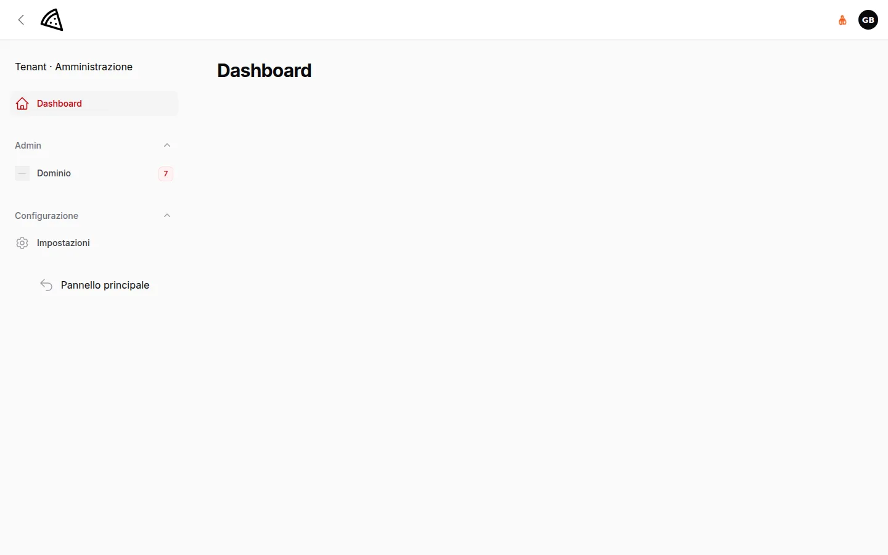
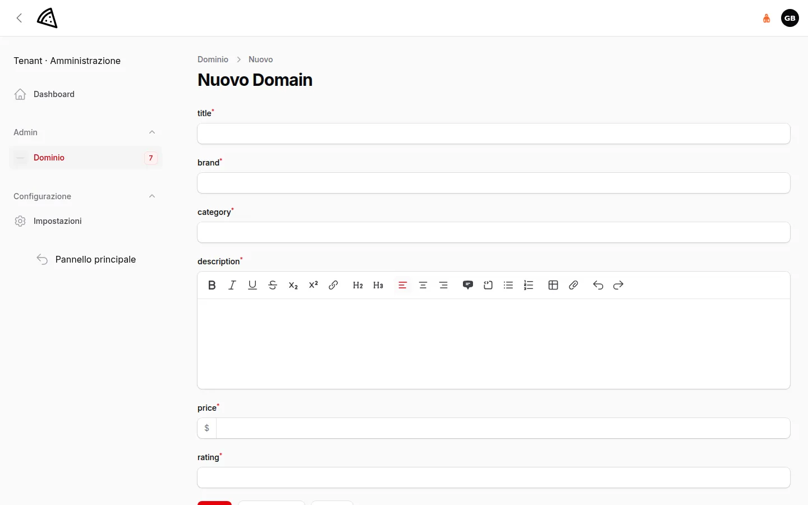
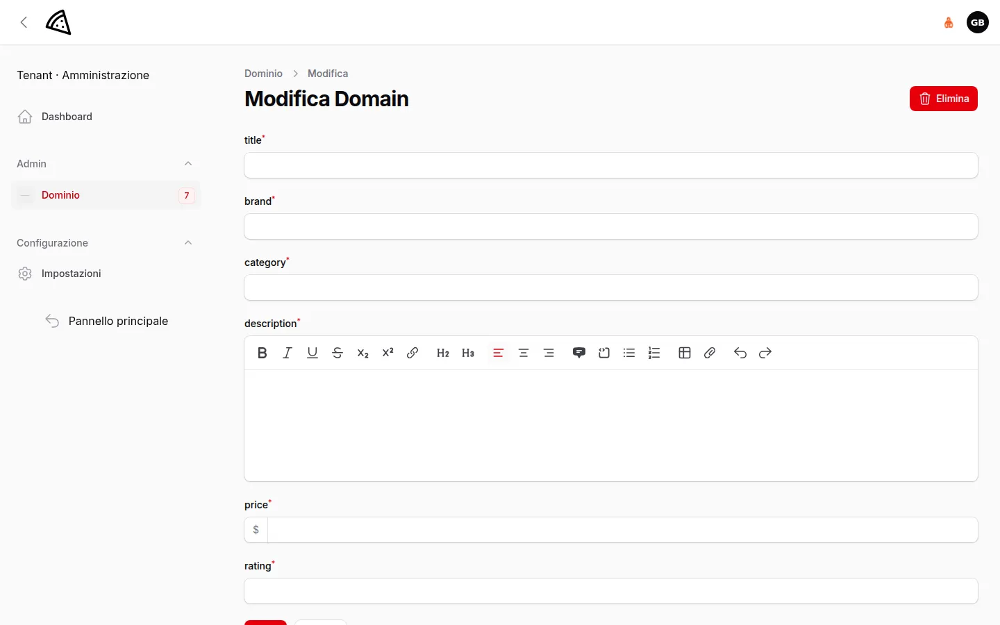
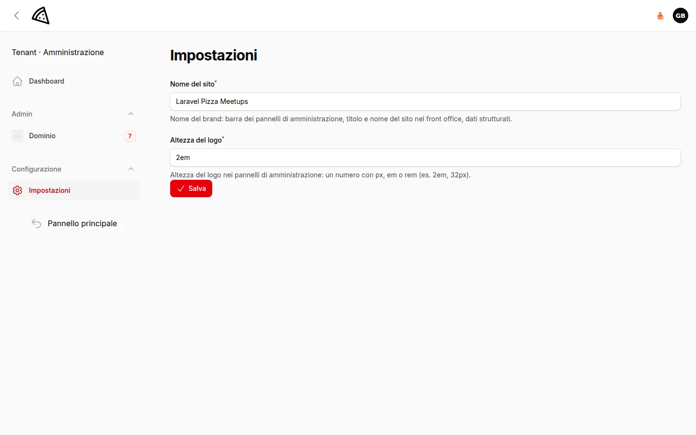

# Manuale utente — Modulo Tenant (pannello `tenant/admin`)

> Ogni schermata di questo manuale è uno screenshot reale catturato dall'istanza di prova
> isolata (dati sintetici, utente di prova super-admin). Gli elementi non verificati sono
> dichiarati come tali. Aggiornato 2026-11-25.

## Scopo

Il modulo Tenant fornisce il pannello di amministrazione `tenant/admin` per l'identità del
sito e per l'elenco dei domini. Il tenant attivo si ricava dal dominio della richiesta
(`APP_URL`), quindi il pannello opera sul tenant che lo ospita.

## Accesso

- Pagina di accesso: `/tenant/admin/login` (pannello Filament `tenant::admin`, provider
  `Modules/Tenant/app/Providers/Filament/AdminPanelProvider.php`).
- Richiede un utente autenticato; le pagine del pannello rispondono 200 solo dopo il login.
- Il pannello mostra il titolo «Tenant · Amministrazione» e due gruppi di menu: **Admin**
  (Dominio) e **Configurazione** (Impostazioni), più il link «Pannello principale».
- La voce «Impostazioni» è riservata ai super-admin (`SettingPage`, vedi
  `Modules/Tenant/app/Filament/Pages/SettingPage.php`); la matrice dei ruoli dipende dalle
  policy Xot/User e non è stata verificata con account diversi dal super-admin di prova.

## Attori

| Attore | Cosa vede | Fonte |
|---|---|---|
| Ospite | Solo la pagina di accesso (`/tenant/admin/login`) | screenshot `login` |
| Utente autenticato | Dashboard, lista e form Domini | screenshot `dashboard`, `domini-crea`, `domini-modifica` |
| Super-admin | Anche Impostazioni | screenshot `impostazioni`; `SettingPage` |

## Pagine

### Accesso

Campi: **Email** (obbligatorio), **Password** (obbligatorio, con «Mostra password»),
**Ricordami**. Link «Hai smarrito la password?» verso
`/tenant/admin/password-reset/request` (route presente in `route:list`, non aperta a mano).

### Dashboard

La dashboard mostra solo il titolo «Dashboard»: il template
`Modules/Tenant/resources/views/filament/pages/dashboard.blade.php` non contiene widget.
Il badge accanto a «Dominio» nel menu riporta il numero di domini elencati.

### Domini (`/tenant/admin/domains`)

Lista, creazione e modifica dei domini. I domini **non sono una tabella del database**: la
risorsa `Domain` è un modello Sushi (`Modules/Tenant/app/Models/Domain.php`) che ricava le
righe da `GetDomainsArrayAction`, cioè dalle cartelle di `config/`. Un dominio è quindi una
cartella di configurazione, non un record salvato dall'utente.

Colonne della lista (da `Tables/DomainsTable.php`): **Name**, ricercabile e ordinabile;
**id** nascosta di default (attivabile dal selettore colonne). Il pulsante «Nuovo» è in alto
a destra; il pulsante «Nuovo» nella barra della tabella è comportamento condiviso di tutte le
liste Xot (`HasXotTable::getTableHeaderActions` + `XotBaseListRecords::getHeaderActions`),
non specifico di questo modulo.

Non illustro la lista: i nomi che mostra derivano dai percorsi di `config/` e includono
segmenti interni e suffissi di host di sviluppo (vedi «Difetti noti», punto 3).

#### Crea dominio (`/tenant/admin/domains/create`)

Campi mostrati dal form (`Schemas/DomainForm.php`): **Title**, **Brand**, **Category**,
**Description** (editor ricco), **Price** (prefisso `$`), **Rating**. Questi campi non
corrispondono al modello `Domain` (che ha `name`, `domain`, `tenant_id`, `is_primary`,
`status`, `verification_token`, `verified_at`): vedi «Difetti noti», punto 1. Il salvataggio
non è stato provato.

#### Modifica dominio (`/tenant/admin/domains/{id}/edit`)

Esempio con la riga `localhost`. Il form mostra gli stessi campi della creazione, **tutti
vuoti**, perché la riga non ha quegli attributi. Il pulsante «Elimina» è presente nell'intestazione
ma **non è stato premuto**: non è verificato cosa cancella su una riga derivata da `config/`.

### Impostazioni (`/tenant/admin/setting`)

Solo super-admin. Campi (`Filament/Pages/SettingPage.php`):

| Campo | Obbligatorio | Regola | Effetto dichiarato nell'aiuto |
|---|---|---|---|
| Nome del sito | sì | max 120 caratteri | nome del brand nei pannelli, titolo del front office |
| Altezza del logo | sì | `px`, `em` o `rem`, es. `2em`, `32px`; max 16 caratteri | altezza del logo nei pannelli |

Il pulsante **Salva** scrive nel file `config/{tenant}/metatag.php` tramite
`TenantConfigData` (`Datas/TenantConfigData.php`). Il valore di prova mostrato è
`Laravel Pizza Meetups` con altezza `2em`. Il salvataggio effettivo non è stato provato.

## Difetti noti

1. **Form Domini non coerente con il modello.** `DomainForm.php` righe 20–37 dichiara
   `title`, `brand`, `category`, `description`, `price`, `rating`: campi di un catalogo
   prodotti, non del modello `Domain`. Evidenza: `domini-crea.webp`, `domini-modifica.webp`.
   Non corretto: richiede di ridisegnare il form, fuori dallo scope di una correzione piccola.
2. **Modifica con campi vuoti.** Su una riga esistente (`localhost`) il form non mostra
   nessun valore. Evidenza: `domini-modifica.webp`.
3. **Lista Domini espone nomi interni.** `GetDomainsArrayAction.php` (metodi `execute()` riga
   23 e `recurse()` riga 42) produce i nomi dai percorsi di `config/`; nell'istanza di prova
   compaiono segmenti come `database` e suffissi `.local`, con nomi di host di sviluppo. La
   pagina è stata rifiutata come illustrazione per questo motivo (nessuno screenshot nel
   manuale). Da decidere: filtrare le cartelle non-tenant o derivare la lista da una tabella.
4. **Titoli in inglese.** Le pagine mostrano «Nuovo Domain» e «Modifica Domain» mentre il
   breadcrumb dice «Dominio». Il titolo viene dall'etichetta del modello (`getModelLabel` di
   Filament, non tradotta); `lang/it/domain.php` riga 125 ha `'label' => 'Domain'`. Non
   corretto: il percorso esatto dell'etichetta non è stato confermato con certezza.
5. **Etichette grezze nel form di modifica.** `lang/it/domain_form.php` ha come valore di ogni
   campo il nome del campo stesso (`'label' => 'title'`, ecc.): il form di modifica mostra
   «title», «brand», «category». Il form di creazione mostra invece i nomi inglesi di default.
   Correzione prevista: testo italiano reale in `lang/it/domain_form.php`; non applicata
   perché i campi stessi sono da ridisegnare (punto 1).
6. **Dashboard vuota.** Solo il titolo; nessun widget (`resources/views/filament/pages/dashboard.blade.php`).
7. **Traduzioni non collegate.** `lang/it/tenant.php` contiene testi di un gestionale
   immobiliare (Edifici, Unità Immobiliari, Inquilini, Contratti) che non compaiono nelle
   pagine del pannello. Non rimosso: da confermare prima.
8. **Pulsante «Nuovo» duplicato** nella lista: comportamento condiviso di Xot, citato una sola
   volta, dipende da Xot.

## Limiti di questo manuale

- Nessun dato reale: l'istanza di prova non ha record di domini salvati.
- Non provati: salvataggio dei form, eliminazione di una riga, permessi per utenti non super-admin.
- La pagina di recupero password è presente nelle route ma non è stata fotografata.

## Fonti

- `laravel/Modules/Tenant/app/Providers/Filament/AdminPanelProvider.php`
- `laravel/Modules/Tenant/app/Filament/Pages/Dashboard.php`, `SettingPage.php`
- `laravel/Modules/Tenant/app/Filament/Resources/DomainResource.php` e relativi `Schemas/`, `Tables/`, `Pages/`
- `laravel/Modules/Tenant/app/Models/Domain.php`, `app/Actions/Domains/GetDomainsArrayAction.php`
- `laravel/Modules/Tenant/app/Datas/TenantConfigData.php`
- `laravel/Modules/Tenant/lang/it/` (`domain.php`, `domain_form.php`, `setting.php`, `tenant.php`)
- `route:list --path=tenant/admin` (9 route)
