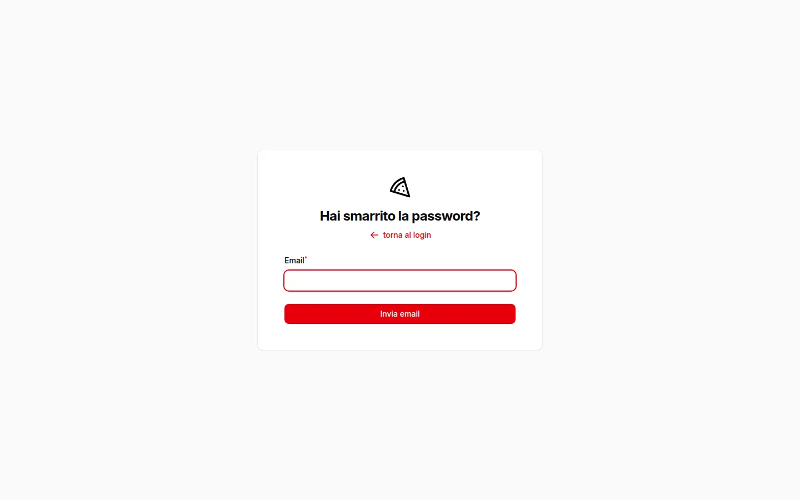
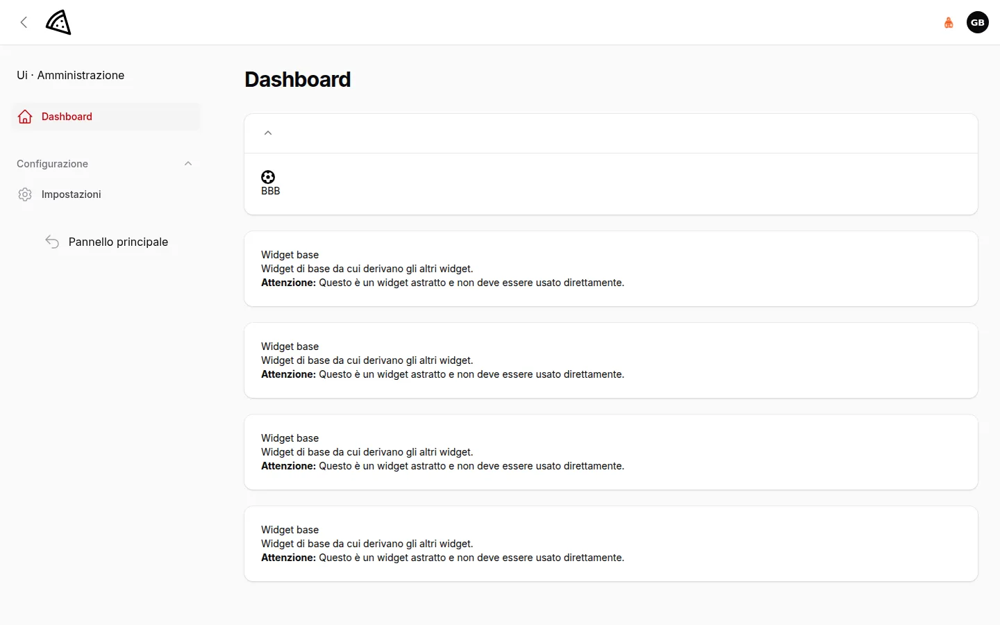
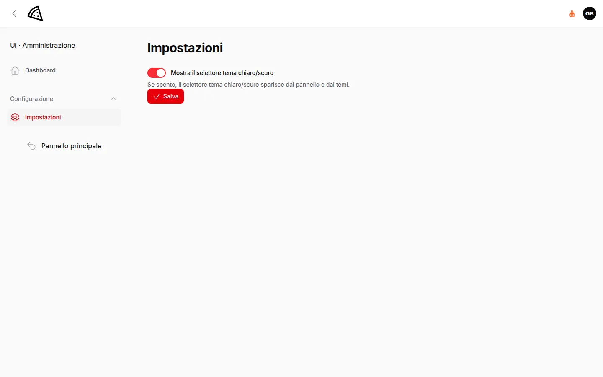
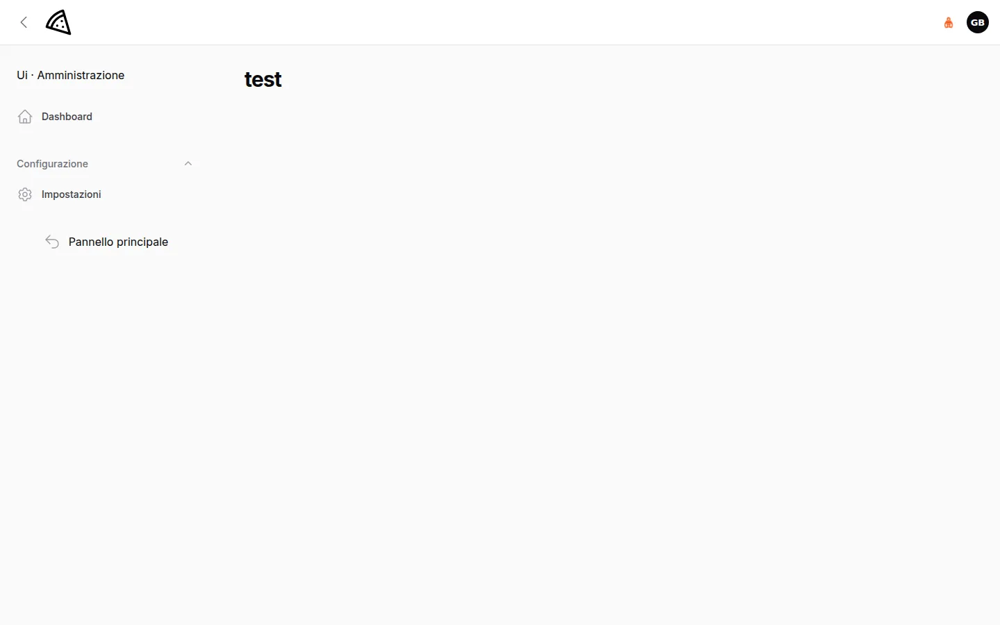

# Manuale d'uso — UI

UI è la libreria condivisa di componenti di interfaccia dell'applicazione (`module.json`: «Sistema di componenti UI
riutilizzabili e design system»). Non è un gestionale: il suo pannello Filament, `/ui/admin`, ha solo la **Dashboard**,
le **Impostazioni** e un cluster **Test** vuoto. Il modulo non ha rotte web né API (`routes/web.php` e `routes/api.php`
sono vuoti). Scopo e confini: [scope-and-boundaries.md](../scope-and-boundaries.md).

> **Come sono fatte le immagini.** Sono catture reali del pannello, fatte con `bashscripts/tools/docs/manual-screenshots.mjs`
> su un'istanza di prova isolata (database usa-e-getta senza dati, utente sintetico), non sull'ambiente di sviluppo.
> Ogni cattura è registrata in [screenshots.json](screenshots.json) con data, esito HTTP e impronta sha256. Per rifarle:
> `node bashscripts/tools/docs/manual-screenshots.mjs UI` (istruzioni in `bashscripts/docs/operations/manual-screenshots.md`).
> Questo manuale descrive solo ciò che le cinque catture mostrano; dove il codice dice di più è citato il file.

## Accesso

Apri `/ui/admin/login`.

La scheda ha il logo, il titolo **Accedi** e questi elementi:

- **Email** (obbligatoria, asterisco rosso); nella cattura ha il bordo rosso;
- **Password** (obbligatoria), con il pulsante **Mostra password**;
- il collegamento **Hai smarrito la password?**;
- la casella **Ricordami**;
- il pulsante **Accedi**.

Non c'è un collegamento di registrazione: nel provider condiviso `->registration()` è commentato
(`Xot/app/Providers/Filament/XotBasePanelProvider.php:89`).

### Chi può entrare

Il pannello ha id `ui::admin`. `BaseUser::canAccessPanel()` (`User/app/Models/BaseUser.php:307-318`) ammette:

- il **super-admin**, sempre;
- chi ha il ruolo `ui::admin` o `ui::operator` (l'operatore entra con i permessi ridotti definiti dalle policy del modulo).

`UiBasePolicy::before()` (`app/Models/Policies/UiBasePolicy.php:27`) concede ogni abilità al super-admin e a `ui::admin`.
La pagina **Impostazioni** è più stretta: la vede solo il super-admin (`SuperAdminOnlyTrait::canAccess()` in
`Xot/app/Filament/Traits/SuperAdminOnlyTrait.php`).

## Recupero della password

Da «Hai smarrito la password?» si apre `/ui/admin/password-reset/request`.

La scheda mostra il titolo **Hai smarrito la password?**, il collegamento **torna al login**, il campo **Email**
(obbligatorio) e il pulsante **Invia email**. La funzione è attiva per `->passwordReset()`
(`XotBasePanelProvider.php:90`). L'invio non è stato provato: la cattura mostra solo il modulo vuoto.

## Com'è fatto il pannello dopo l'accesso

Le tre pagine seguenti hanno la stessa cornice:

- **in alto**: una freccia indietro, il logo, un'icona arancione (non identificata nelle fonti lette) e, a destra,
  l'avatar con le iniziali dell'utente (generato in locale da `InitialsAvatarProvider`, `XotBasePanelProvider.php:94`);
- **menu laterale**: l'intestazione **Ui · Amministrazione**, la voce **Dashboard**, il gruppo richiudibile
  **Configurazione** con la voce **Impostazioni**, e in fondo il collegamento **Pannello principale**.

Il cluster **Test** non compare nel menu (vedi più sotto).

## Dashboard

`/ui/admin`.

Sotto il titolo **Dashboard** la cattura mostra cinque schede, tutte segnaposto di sviluppo e nessun dato reale:

1. una sezione richiudibile (solo la freccia, senza titolo) con un'icona a forma di pallone e il testo **BBB**;
2. quattro schede identiche con il titolo **Widget base**, il testo «Widget di base da cui derivano gli altri widget.»
   e l'avviso **Attenzione:** «Questo è un widget astratto e non deve essere usato direttamente.»

Non ci sono grafici, contatori reali, filtri né azioni. Perché si vede questo è spiegato in «Difetti noti».

## Impostazioni

`/ui/admin/setting`. Solo super-admin.

Un solo campo, più il pulsante **Salva**:

| Campo | Cosa fa |
|---|---|
| **Mostra il selettore tema chiaro/scuro** (interruttore, acceso nella cattura) | Se spento, il selettore tema chiaro/scuro sparisce dal pannello e dai temi (testo di aiuto sotto il campo). |

Il valore è la chiave `dark_mode_switcher_enabled` del file di configurazione del tenant `config/{tenant}/ui.php`
(`app/Datas/UIConfigData.php`); il default è **acceso**, quindi finché nessuno salva non cambia nulla.
`DarkModeSwitcherWidget::canView()` legge questo valore (`app/Filament/Widgets/DarkModeSwitcherWidget.php:62`).
Dopo **Salva** la pagina mostra la notifica «Impostazioni salvate» (`BaseSettingPage::save()`,
`Xot/lang/it/base_setting.php`); questa notifica non è nelle catture.

## Cluster Test

`/ui/admin/test`.

La pagina ha solo il titolo **test** (minuscolo) e il resto è vuoto. Non c'è una voce «Test» nel menu laterale perché
nessuna pagina del modulo è assegnata al cluster `Test` (`app/Filament/Clusters/Test.php`; in `app/` non esiste alcun
`$cluster = Test::class`). Serve oggi solo come segnaposto.

## Difetti noti

| # | Dove | Cosa si vede | Evidenza |
|---|---|---|---|
| 1 | Dashboard | Quattro schede «Widget base … widget astratto» | `app/Filament/Pages/Dashboard.php:47-50` monta quattro `TestWidget`. La vista del widget, per convenzione, dovrebbe chiamarsi `ui::filament.widgets.test`, ma il file è `resources/views/filament/widgets/test-widget.blade.php`; `XotBaseWidget::resolveView()` (`Xot/app/Filament/Widgets/XotBaseWidget.php:233-251`) non trova la vista e lascia quella di base `xot::filament.widgets.base`, il cui testo è in `Xot/lang/it/widgets.php:63-68`. Causa dedotta dal codice, non provata eseguendolo. |
| 2 | Dashboard | La sezione con il pallone dice solo «BBB», senza titolo | `resources/views/filament/widgets/stat-with-icon.blade.php:16` ha il testo `BBB` scritto a mano. `Dashboard.php:46` passa `label` «Unique views» e `value` «192.1k», ma la vista non li stampa. |
| 3 | Dashboard | Dati finti nel pannello di amministrazione | L'ADR-UI-01 «Dashboard UI senza dati finti» (`docs/digests/overflow-history.md:509-516`) è ancora **PROPOSTA** e nessun codice è cambiato. |
| 4 | Cluster Test | Titolo «test» in minuscolo; la voce `navigation.label` dello stesso file dice «Test» | `lang/it/test.php:23` (`'title' => 'test'`) contro `lang/it/test.php:7`. Non corretto qui: la cattura documenta il testo attuale e il file è in modifica da un altro attore. Le stesse righe contengono segnaposto grezzi (`profile`, `logout`) che le catture non mostrano. |

**Già corretto in questa sessione.** La Dashboard andava in `TypeError` perché `stat-with-icon.blade.php` passava
`size="24"` a `<x-filament::icon>`; l'attributo è stato tolto. La cattura `dashboard.webp` è del 25 novembre 2026 alle
22:15 UTC, dopo la correzione, e mostra la pagina senza errori.

## Fonti verificabili

- Catture e provenienza: [screenshots.json](screenshots.json), `assets/*.webp`
- Pannello: [AdminPanelProvider](../../app/Providers/Filament/AdminPanelProvider.php), [Dashboard](../../app/Filament/Pages/Dashboard.php), [SettingPage](../../app/Filament/Pages/SettingPage.php), [cluster Test](../../app/Filament/Clusters/Test.php)
- Configurazione: [UIConfigData](../../app/Datas/UIConfigData.php), [DarkModeSwitcherWidget](../../app/Filament/Widgets/DarkModeSwitcherWidget.php)
- Widget della dashboard: [StatWithIconWidget](../../app/Filament/Widgets/StatWithIconWidget.php), [TestWidget](../../app/Filament/Widgets/TestWidget.php), [vista stat-with-icon](../../resources/views/filament/widgets/stat-with-icon.blade.php)
- Altri documenti del modulo: [filosofia](../philosophy.md), [componenti form](../form-components.md), [colonne tabella](../table-columns.md), [widget](../widgets.md), [blocchi e CMS](../blocks-and-cms.md)
