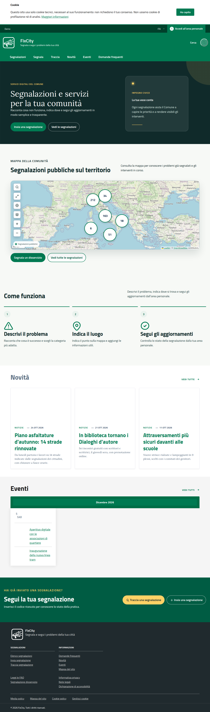

> Screenshot reale del front office FixCity, verificato il 23 novembre 2026. Per questo modulo è una superficie condivisa: il manuale non attribuisce al modulo una UI propria se non documentata dalle fonti.

# Manuale d'uso per attori — UI

## Scopo e perimetro

UI fornisce componenti Blade, tema/chrome Filament, tabelle, blocchi, icone,
widget e dati di presentazione. Legge alcuni dati dell'utente autenticato e
preferenze UI, ma non è il modulo che decide identità, ruoli o autorizzazioni.

## Attori e capacità effettive

| Attore | Capacità nel modulo UI |
|---|---|
| Ospite | Può ricevere la resa UI pubblica. `GetUserDataAction` restituisce `null` in assenza di autenticazione; non viene quindi attribuito un profilo UI autenticato. |
| Utente autenticato | La UI può mostrare nome, email, avatar, primo ruolo e permessi restituiti dall'azione dati utente. Può usare le preferenze esposte dal tema, come il cambio modalità scura quando abilitato. |
| Utente in gruppo/ruolo | N/A come capacità di dominio: la UI può rappresentare il contesto, ma non concede il ruolo o i permessi. |
| Admin | N/A come amministrazione applicativa. Il ruolo `ui::admin` supera la policy del modulo UI, quando una risorsa UI lo richiede. |
| Super-admin | Supera la policy UI e può accedere alla pagina impostazioni UI riservata al super-admin. |
| Operatore/moderatore | N/A: UI non definisce un set operativo uniforme per questi ruoli. |

## Flussi operativi

### Resa e dati contestuali

La UI rende componenti riusabili e, per un utente autenticato, può recuperare i
dati essenziali del profilo e dei permessi. Per un ospite il dato utente è
assente. La visibilità delle azioni deve comunque essere accompagnata da Gate,
policy o controllo del modulo proprietario.

### Impostazioni

Le impostazioni UI sono per tenant e includono la preferenza disponibile nella
configurazione installata, come `dark_mode_switcher_enabled`. La pagina di
impostazione del modulo è riservata al super-admin; modificarla non equivale a
modificare i permessi applicativi.

## Prerequisiti

- rendering del tema/pannello che registra i componenti UI;
- autenticazione per i dati personali e i permessi dell'utente;
- configurazione tenant per le preferenze UI contestuali;
- autorizzazione della policy per eventuali risorse o impostazioni UI.

## Limiti e casi N/A

- UI non autentica, non assegna ruoli e non decide il CRUD delle risorse.
- La presenza di un controllo visuale non prova che l'azione backend sia
  autorizzata; la policy del modulo proprietario resta decisiva.
- Gruppi, admin, operatori e moderatori non ricevono capacità di dominio da UI.
- Il modulo UI non possiede il dominio Geo; i relativi flussi restano fuori da
  questo manuale.

## Fonti verificabili

- `app/Actions/GetUserDataAction.php` — dati restituiti per ospite e
  autenticato.
- `app/Datas/UIConfigData.php` — configurazione UI per tenant.
- `app/Models/Policies/UiBasePolicy.php` — bypass `super-admin` e `ui::admin`.
- `app/Filament/Pages/SettingPage.php` — pagina impostazioni riservata.
- `app/Filament/Widgets/DarkModeSwitcherWidget.php` e componenti Blade — resa
  e preferenze UI.
- `app/Providers/UIServiceProvider.php` — registrazione dei componenti e
  perimetro del modulo.

