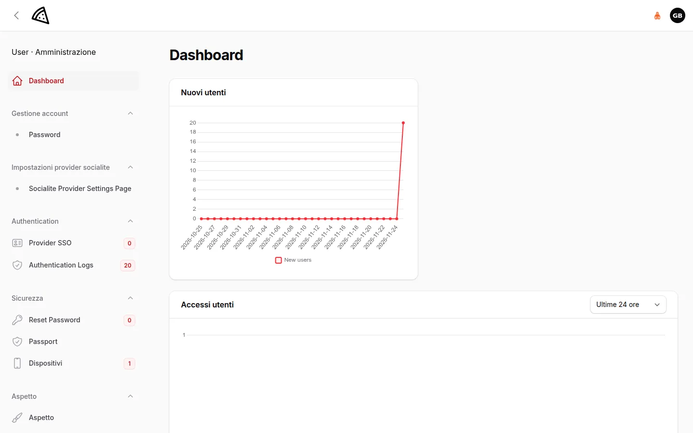
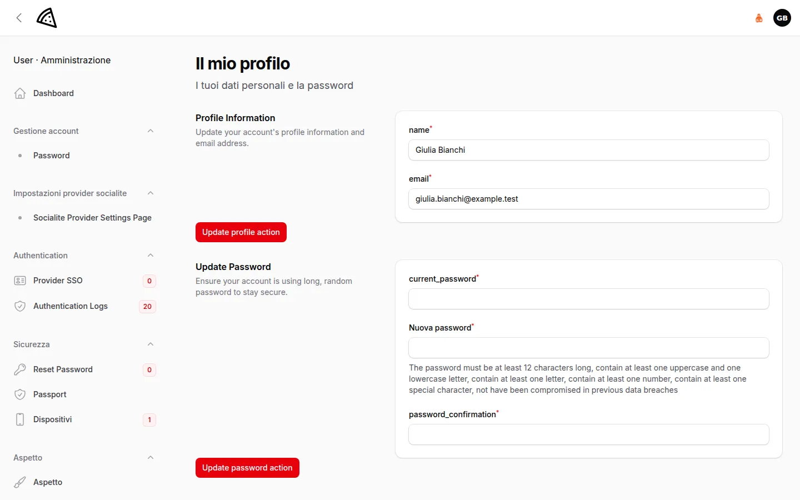
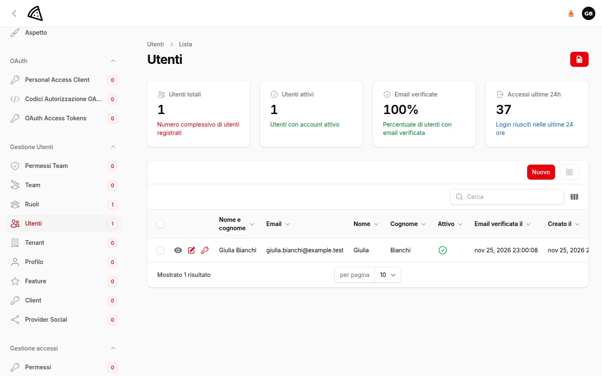
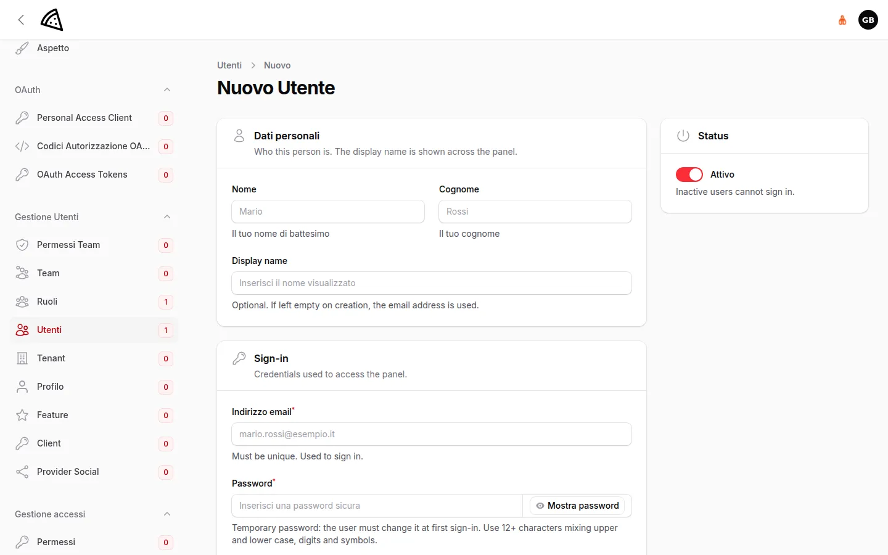
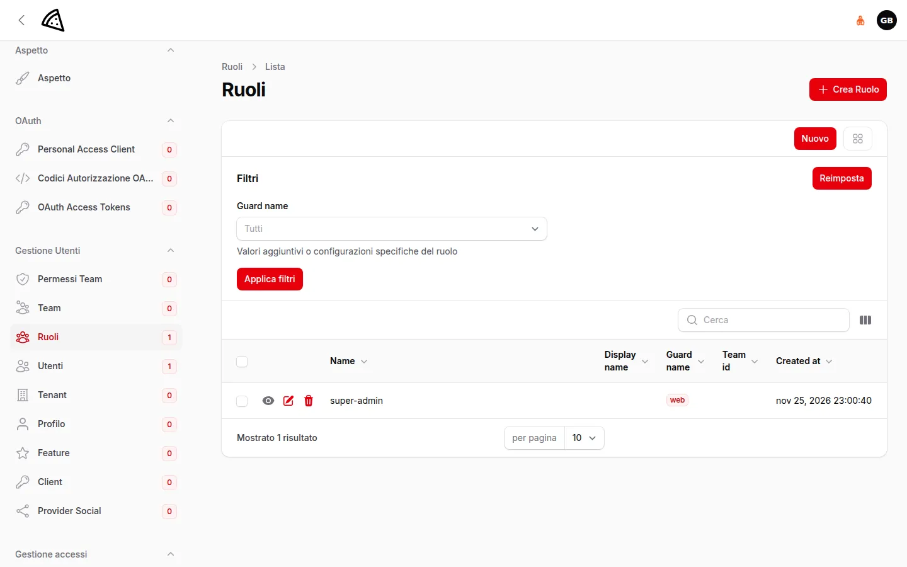
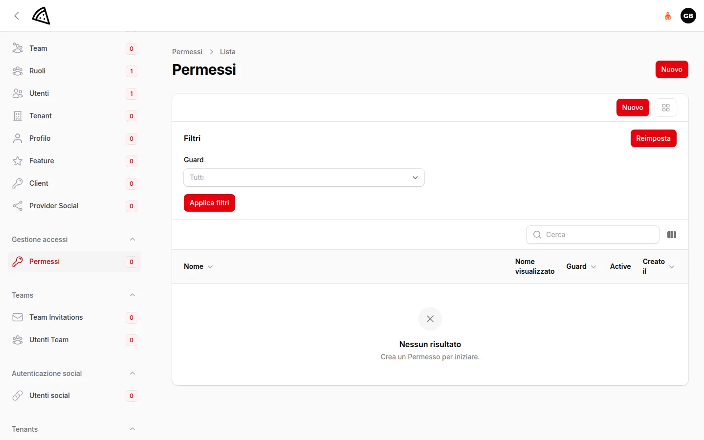
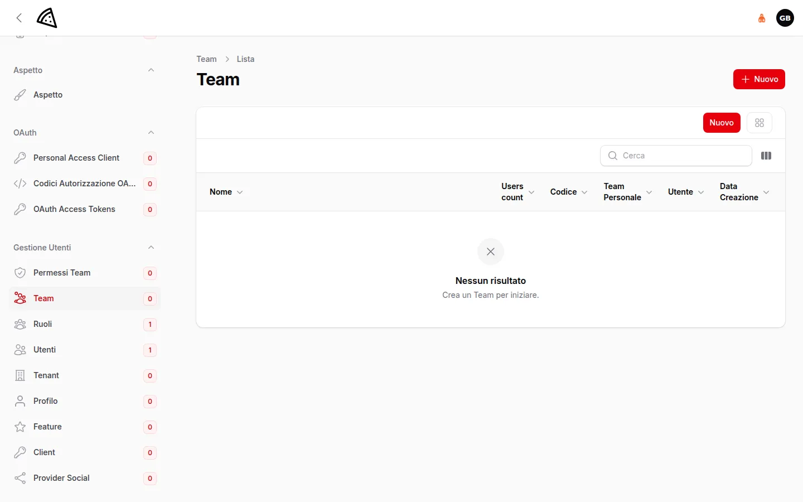
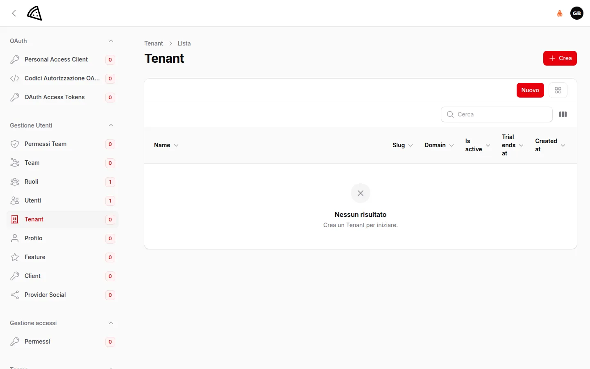
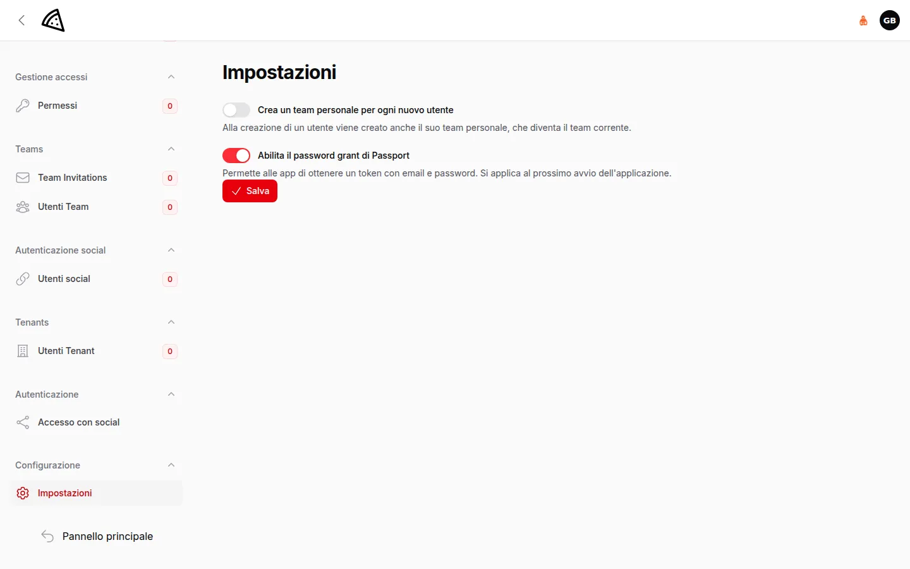

# Manuale utente — modulo User

Pannello di amministrazione: `/user/admin` (login: `/user/admin/login`).
Tutte le immagini sono screenshot reali catturati dall'istanza di prova
isolata con lo strumento `bashscripts/tools/docs/manual-screenshots.mjs`
(data e sha256 in `screenshots.json`). Il pannello è in italiano; alcune
etichette sono ancora in inglese, vedi «Difetti noti».

## Dati di esempio

Le immagini mostrano il database di prova: un utente sintetico
(`giulia.bianchi@example.test`, nome fittizio, ruolo `super-admin`) e i
ruoli seedati. Le tabelle Permessi, Team e Tenant sono vuote («Nessun
risultato»). Nessun dato reale compare nelle immagini.

## Scopo e accesso

Il modulo User gestisce utenti, ruoli, permessi, team, tenant e le
impostazioni del pannello `user/admin`. Per entrare serve un account con
accesso al pannello; l'accesso è negato agli account non autorizzati.

## Accesso

Pagina: `/user/admin/login`. Campi: **Email** (obbligatorio),
**Password** (obbligatorio) con pulsante **Mostra password**, checkbox
**Ricordami**, link **Hai smarrito la password?**, pulsante **Accedi**.

## Dashboard

Pagina: `/user/admin`. La barra laterale raggruppa le voci in: Gestione
account (Password), Impostazioni provider socialite, Authentication
(Provider SSO, Authentication Logs), Sicurezza (Reset Password, Passport,
Dispositivi), Aspetto, OAuth, Gestione Utenti (Permessi Team, Team, Ruoli,
Utenti, Tenant, Profilo, Feature, Client, Provider Social), Gestione accessi
(Permessi), Teams (Team Invitations, Utenti Team), Autenticazione social,
Tenants (Utenti Tenant), Autenticazione (Accesso con social) e
Configurazione (Impostazioni). Accanto alle voci compaiono contatori (es.
Authentication Logs 20, Dispositivi 1, Utenti 1, Ruoli 1).

Widget visibili: **Nuovi utenti** (grafico a linea per giorno, legenda
«New users») e **Accessi utenti** con il filtro **Ultime 24 ore**.

## Il mio profilo

Pagina: `/user/admin/my-profile-page`, voce **Profilo**.

- Sezione *Profile Information*: campi **name** ed **email**, pulsante
  «Update profile action».
- Sezione *Update Password*: campi **current_password**, **Nuova password**
  (obbligatorio), **password_confirmation**, pulsante «Update password action».
  Sotto il campo nuova password compare la regola: almeno 12 caratteri, una
  maiuscola, una minuscola, un numero, un simbolo, e non compromessa in data
  breach.

Le etichette *Profile Information*, *Update Password* e la regola della
password sono testo fisso in inglese (`app/Filament/Pages/MyProfilePage.php`,
righe 59 e 78; `app/Datas/PasswordData.php`, `getHelperText`).

## Utenti

Pagina lista: `/user/admin/users`.

In alto quattro schede riassuntive: **Utenti totali**, **Utenti attivi**, **Email verificate**
(percentuale) e **Accessi ultime 24h**. Nella prova l'unico utente è quello sintetico di
prova; i 37 accessi sono i login fatti dalle catture.
Colonne visibili nella cattura: **Nome e cognome, Email, Nome, Cognome, Attivo** (icona),
**Email verificata il, Creato il**. Dal codice
(`app/Filament/Resources/UserResource/Tables/BaseUsersTable.php`, righe 42–56) la tabella
ne prevede altre (OTP, Lingua, Team corrente, Tipo, Stato, Scadenza password, Aggiornato
il), alcune nascoste per default (`isToggledHiddenByDefault`) e attivabili dal selettore
colonne. Ogni riga ha le icone di visualizzazione e modifica e un'icona a forma di chiave.

Pagina creazione: `/user/admin/users/create`.

Campi reali del form (`app/Filament/Resources/UserResource/Schemas/UserForm.php`):

- *Dati personali*: **Nome**, **Cognome**, **Display name** (opzionale).
- *Sign-in*: **Indirizzo email** (obbligatorio, unico), **Password**
  obbligatoria con pulsante **Mostra password**; la password è temporanea
  e l'utente deve cambiarla al primo accesso.
- *Status*: interruttore **Attivo**, acceso per default; con l'utente
  inattivo il sign-in è negato.

## Ruoli

Pagina: `/user/admin/roles`, pulsante **Crea Ruolo**. Colonne: Name,
Display name, Guard name, Team id, Created at. Filtro: **Guard name**. La
lista mostra il ruolo seedato `super-admin` (guard `web`).

Creazione: `/user/admin/roles/create`; modifica: `/user/admin/roles/{id}/edit`.
Non sono stati aperti né modificati ruoli per la cattura.

## Permessi

Pagina: `/user/admin/permissions`. Colonne: Nome, Nome visualizzato, Guard,
Active, Creato il. Filtro: **Guard**. Nella prova la lista è vuota
(«Crea un Permesso per iniziare»).

## Team

Pagina: `/user/admin/teams`, pulsante **Nuovo**. Colonne: Nome, Users count,
Codice, Team Personale, Utente, Data Creazione. Nella prova la lista è vuota.

## Tenant

Pagina: `/user/admin/tenants`, pulsante **Crea**. Colonne: Name, Slug, Domain,
Is active, Trial ends at, Created at. Nella prova la lista è vuota.

## Impostazioni

Pagina: `/user/admin/setting`, voce **Impostazioni** (gruppo Configurazione).
Interruttori e pulsante **Salva**:

- «Crea un team personale per ogni nuovo utente» (nella prova: spento);
  etichetta da `lang/it/setting.php`, riga 17.
- «Abilita il password grant di Passport» (nella prova: acceso). Il testo
  dichiara che la modifica si applica al prossimo avvio dell'applicazione.

## Difetti noti

1. **Etichetta grezza «new_password» (corretta).** La pagina profilo
   mostrava il nome della chiave invece di un'etichetta. Causa:
   `lang/it/password.php` riga 84 aveva come valore il nome del campo
   (placeholder). Corretto in «Nuova password». Prova: screenshot
   `user-admin-my-profile.webp` catturato prima e dopo la correzione.
2. **Etichette grezze nel profilo.** Nella cattura delle 22:21
   `name`, `email`, `current_password` e `password_confirmation` compaiono
   come chiavi. Nella cattura delle 22:19 risultavano «Name», «Email»,
   «Current password». Altri file `lang/it` del modulo sono stati modificati
   da un'altra sessione dopo la prima cattura: la causa non è stata
   accertata. Non modificato.
3. **Testi fissi in inglese.** `MyProfilePage.php` righe 59 e 78 (sezioni),
   la regola password in `PasswordData::getHelperText` e i testi
   «Temporary password…» (`UserForm.php`, riga 75) e «Inactive users cannot
   sign in.» (`UserForm.php`, riga 106). Da tradurre in `lang/it`.
4. **Intestazioni in inglese.** Team («Users count», «Team Personale»),
   Tenant («Is active», «Trial ends at», «Created at») e Permessi («Active»).
5. **Pulsanti profilo in inglese.** «Update profile action» e «Update password
   action» compaiono nella pagina profilo; la fonte non è stata individuata
   nel modulo User.
6. **Voci di menu in inglese.** «Socialite Provider Settings Page» e «Provider
   SSO» nella barra laterale.
7. **Doppio pulsante «Nuovo»** in cima alle liste: comportamento condiviso di
   tutte le liste Xot (`HasXotTable::getTableHeaderActions` e
   `XotBaseListRecords::getHeaderActions`), non specifico di User.

## Fonti verificabili

- `screenshots.json` (pagine, data, HTTP, sha256 della cattura).
- `app/Filament/Pages/MyProfilePage.php`, `app/Datas/PasswordData.php`.
- `app/Filament/Resources/UserResource/Schemas/UserForm.php`.
- `app/Filament/Resources/UserResource/Tables/BaseUsersTable.php`.
- `lang/it/password.php`, `lang/it/setting.php`.
- Route: `php artisan route:list --path=user/admin`.
