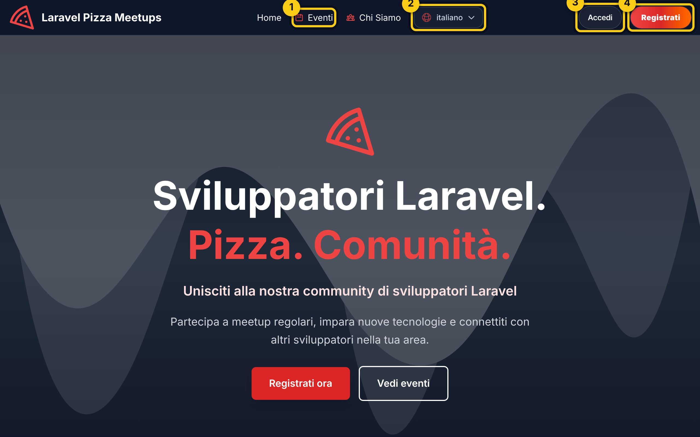
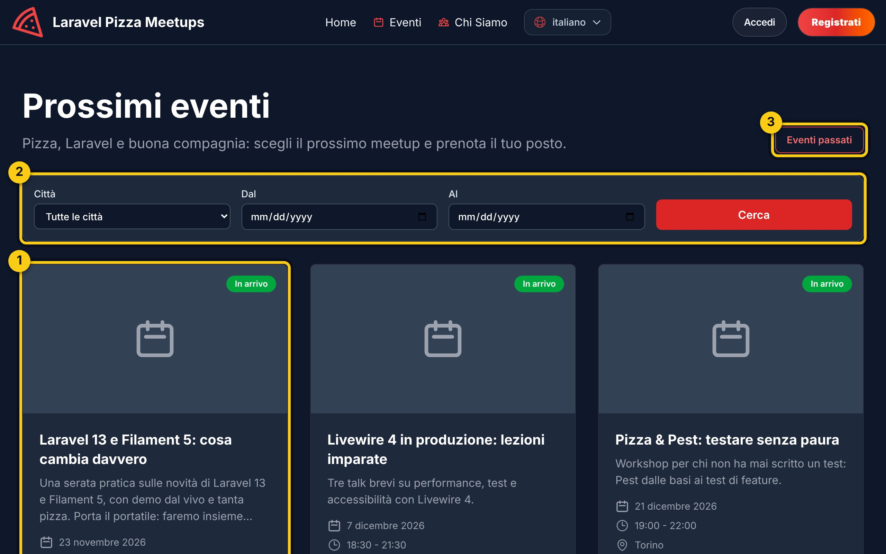
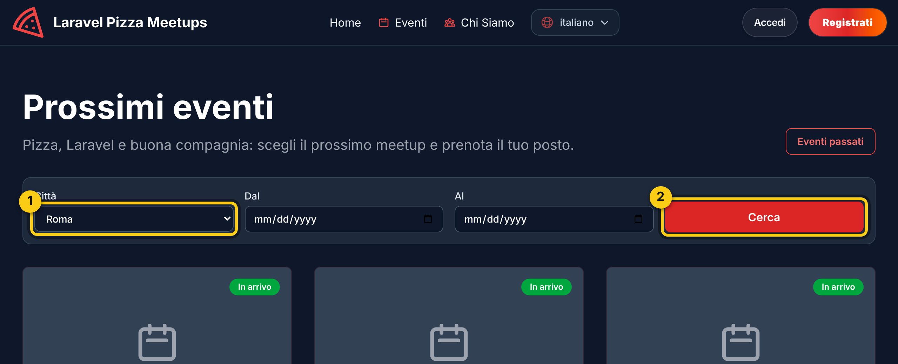
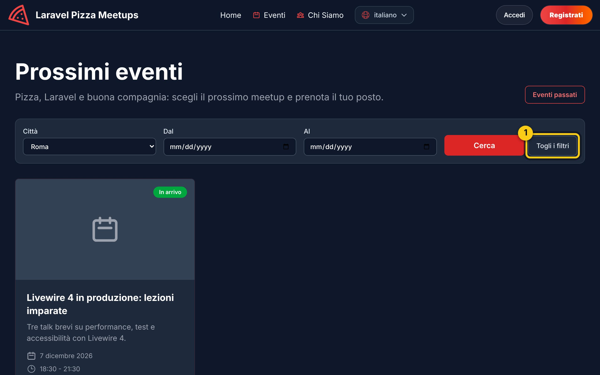
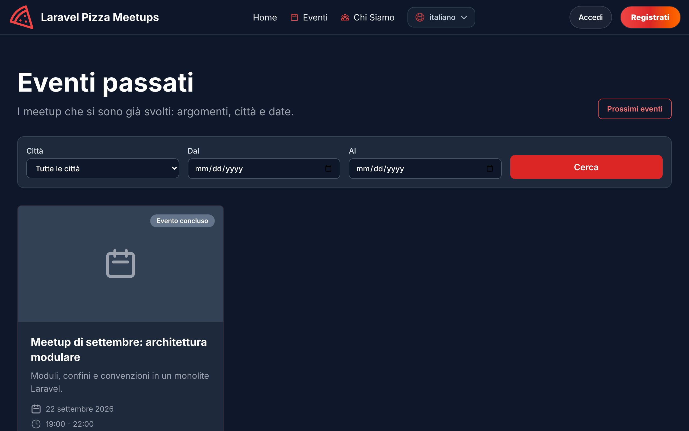
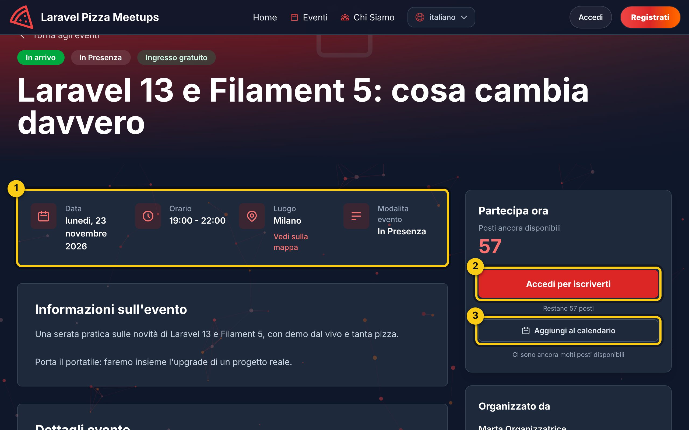
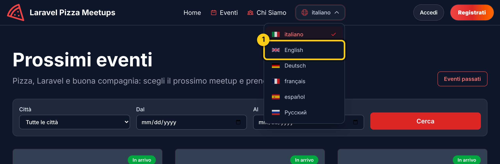
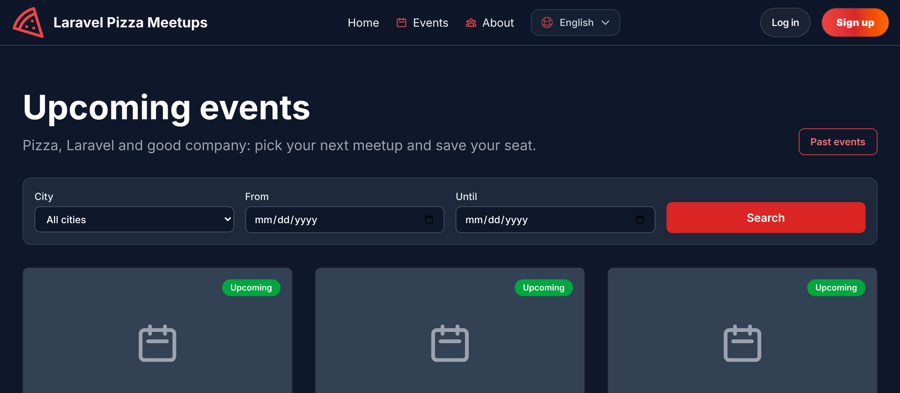
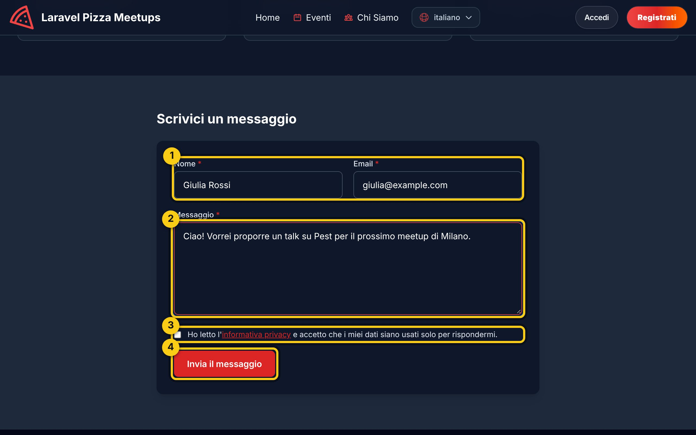

# 1. Visitatore: guardare gli eventi senza account

[← Torna all'indice](readme.md)

Sei un **visitatore** quando apri il sito senza aver fatto l'accesso. Puoi guardare tutto, cercare gli eventi e scrivere agli organizzatori. Per prenotare un posto serve un account (vedi il [capitolo 2](02-partecipante.md)).

## 1.1 La pagina iniziale

Apri il browser (Chrome, Firefox, Safari o Edge) e vai all'indirizzo del sito. Vedi la pagina iniziale.

In alto, nella barra scura, ci sono quattro cose importanti:

1. **Eventi**: apre l'elenco di tutti i meetup.
2. **Lingua** (il globo con il nome della lingua): cambia la lingua del sito.
3. **Accedi**: per entrare se hai già un account.
4. **Registrati**: per creare un account nuovo, gratis.

C'è anche **Chi siamo**, che racconta chi organizza i meetup. Scorrendo la pagina iniziale trovi subito i **prossimi tre eventi**.

## 1.2 Vedere l'elenco degli eventi

Clicca su **Eventi** (riquadro 1 dell'immagine sopra). Si apre l'elenco dei prossimi meetup, dal più vicino al più lontano. Ogni scheda mostra titolo, data, ora e città.

1. Clicca su una scheda per aprire i dettagli dell'evento.
2. La barra di **ricerca**: serve a trovare gli eventi di una città o di un periodo (vedi il punto 1.3).
3. **Eventi passati**: apre l'archivio dei meetup già fatti (punto 1.4).

## 1.3 Cercare per città o per data

Vuoi solo gli eventi vicino a te, o solo quelli di dicembre?

1. In **Città** scegli la città. L'elenco propone solo le città che hanno eventi in programma.
2. Se vuoi, scegli anche le date in **Dal** e **Al**, poi clicca **Cerca**.

L'elenco mostra solo gli eventi che corrispondono:

1. **Togli i filtri** riporta l'elenco completo.

Se nessun evento corrisponde, il sito te lo dice e ti propone di togliere i filtri.

> Suggerimento: l'indirizzo della pagina contiene la ricerca. Puoi copiarlo e mandarlo a un amico: vedrà lo stesso elenco.

## 1.4 Gli eventi passati

Dalla pagina Eventi clicca **Eventi passati**: trovi i meetup già svolti, dal più recente al più vecchio, con argomento, città e data. Anche qui puoi cercare per città o per data. Agli eventi passati non ci si può più iscrivere.

## 1.5 Leggere i dettagli di un evento

La pagina dell'evento racconta di cosa si parla, dove e quando.

1. Qui trovi **data, ora, luogo** e la modalità (in presenza o online).
2. Il pulsante **Accedi per iscriverti**: da visitatore non puoi ancora prenotare. Cliccandolo arrivi alla pagina di accesso; dopo l'accesso il sito ti riporta proprio qui.
3. **Aggiungi al calendario**: scarica un piccolo file (formato `.ics`). Aprilo e l'evento finisce nel calendario del telefono o del computer (Google Calendar, Outlook, Calendario di Apple).

Sopra il pulsante vedi quanti **posti** sono ancora liberi.

## 1.6 Cambiare lingua

Il sito parla italiano, inglese, tedesco, francese, spagnolo e russo.

1. Clicca sulla lingua in alto (il globo), poi sulla lingua che vuoi (per esempio **English**).

La stessa pagina si riapre nella nuova lingua:

> Nota: il contenuto degli eventi (titolo, descrizione) resta nella lingua in cui l'organizzatore lo ha scritto. Cambiano menu, pulsanti, date e messaggi.

## 1.7 Scrivere agli organizzatori

Hai una domanda, vuoi proporre un talk o ospitare un meetup? In fondo a ogni pagina clicca **Contatti**.

1. Scrivi il tuo **nome** e la tua **email**: la risposta arriverà lì.
2. Scrivi il **messaggio** (almeno qualche parola).
3. Spunta la casella della **privacy**: è obbligatoria e dice che i tuoi dati servono solo per risponderti.
4. Clicca **Invia il messaggio**. Compare la conferma "Messaggio inviato, grazie!".

> Per evitare lo spam si possono inviare al massimo 3 messaggi ogni 10 minuti.

## Cosa fare adesso?

Vuoi partecipare a un evento? Crea un account: continua con il [capitolo 2 – Partecipante](02-partecipante.md).
