# 2. Partecipante: iscriversi agli eventi

[← Torna all'indice](readme.md)

Sei un **partecipante** quando hai un account e hai fatto l'accesso. Puoi fare tutto quello che fa il [visitatore](01-visitatore.md) e in più prenotare il tuo posto agli eventi.

Ci sono due strade per iniziare:

- **la più veloce**: ti iscrivi a un evento e intanto crei l'account, scrivendo solo email e password (punto 2.1);
- **quella classica**: prima crei l'account con nome e cognome (punto 2.2), poi ti iscrivi agli eventi (punto 2.4).

## 2.1 Iscriversi a un evento in un solo passo

Apri l'evento che ti interessa dall'elenco **Eventi**. A destra c'è il riquadro **Partecipa ora**.

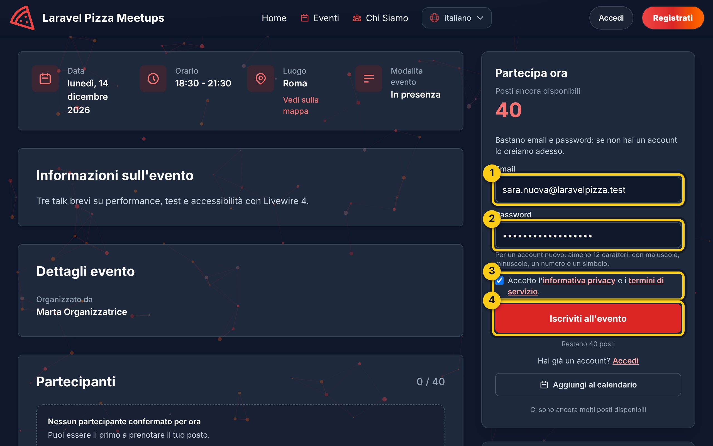

1. Scrivi la tua **email**.
2. Scegli una **password**: almeno 12 caratteri, con lettere maiuscole e minuscole, un numero e un simbolo (per esempio `PizzaMargherita!26`). Il suggerimento sotto il campo te lo ricorda.
3. Spunta la casella per accettare **informativa privacy** e **termini di servizio** (i link li aprono in una nuova scheda).
4. Clicca **Iscriviti all'evento**.

Fatto: il sito crea il tuo account, ti iscrive, ti fa entrare e ti mostra la conferma. In alto a destra compare il tuo nome: all'inizio è la parte della tua email prima della @ (puoi cambiarlo in **Modifica il profilo**, punto 2.7).

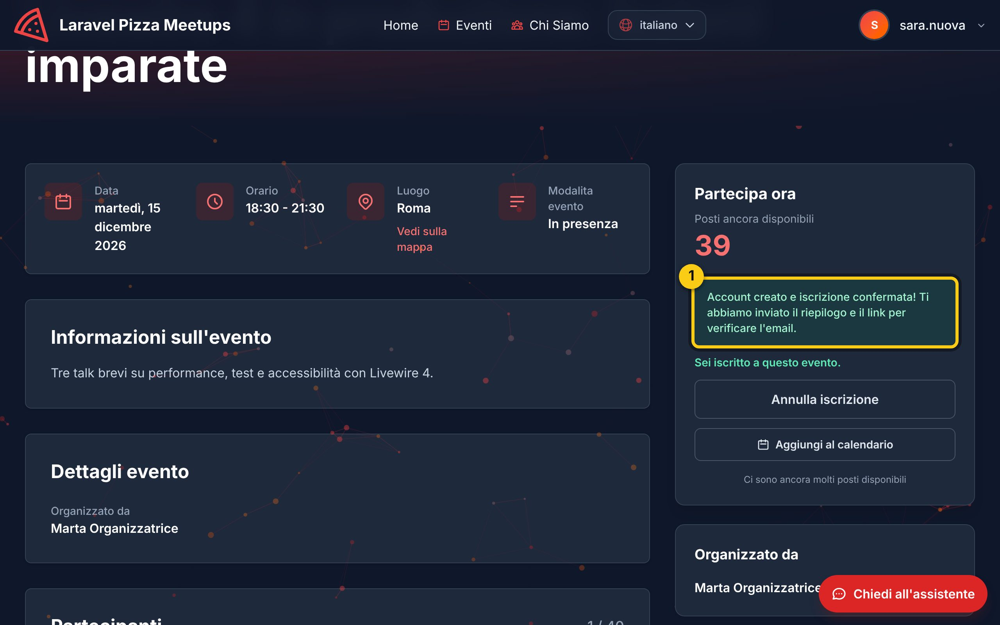

1. Il messaggio verde: account creato e iscrizione confermata.

Ti arrivano due email: la **conferma dell'iscrizione** (con il file per il calendario, vedi punto 2.4) e un link per **verificare l'indirizzo email**. Apri il link quando puoi: dimostra che l'email è davvero tua.

> **Hai già un account?** Puoi usare lo stesso riquadro: scrivi la tua email e la tua password di sempre e verrai iscritto. Se la password non è quella giusta il sito te lo dice e non salva niente: riprova, oppure clicca **Accedi** sotto il riquadro.

> Se un evento è al completo, il sito te lo dice **prima** di creare l'account.

## 2.2 Creare l'account (una volta sola)

Clicca su **Registrati** in alto a destra. Si apre il modulo di registrazione.

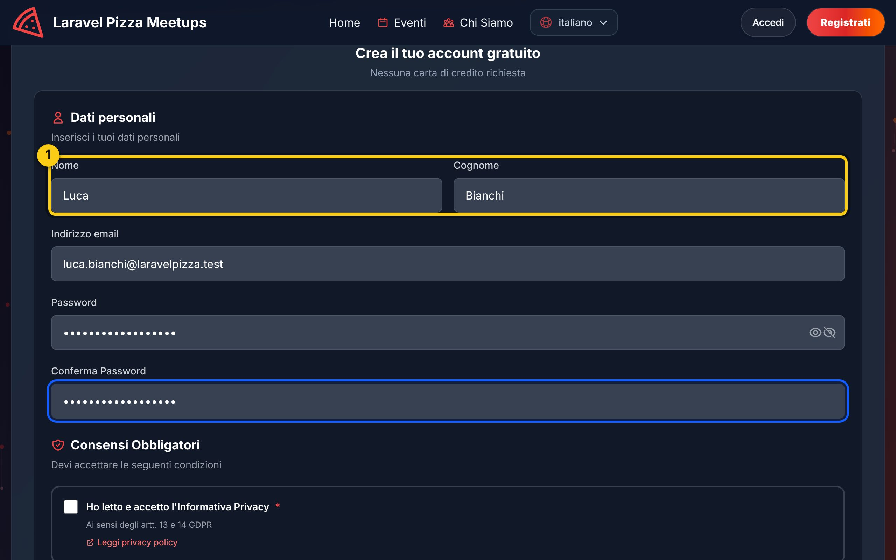

1. Scrivi **nome**, **cognome**, **email** e scegli una **password**. La password va scritta due volte, uguale, per essere sicuri che non ci siano errori di battitura. Deve avere almeno 12 caratteri, con lettere maiuscole e minuscole, un numero e un simbolo; il sito rifiuta anche le password già finite in furti di dati noti.

Scorri un po' più in basso:

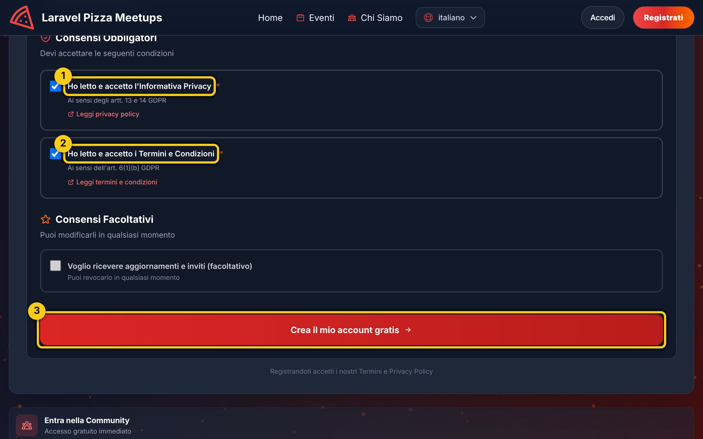

1. Spunta **Informativa Privacy** (obbligatoria): dici di aver letto come vengono trattati i tuoi dati.
2. Spunta **Termini e Condizioni** (obbligatoria).
3. Clicca **Crea il mio account**.

Fatto! Sei già dentro: il sito ti porta alla pagina **I tuoi eventi** e in alto a destra compare il tuo nome. La pagina è vuota perché non ti sei ancora iscritto a niente.

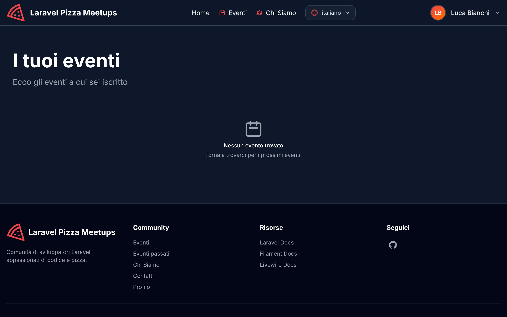

## 2.3 Accedere le volte successive

Le volte successive non serve registrarsi di nuovo: clicca **Accedi** in alto a destra.

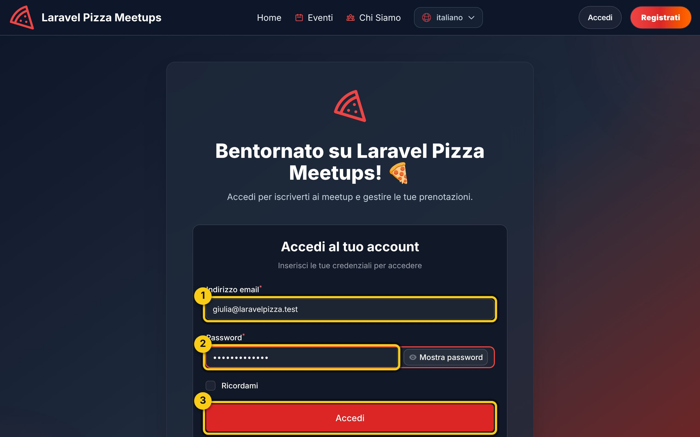

1. Scrivi la tua **email**.
2. Scrivi la tua **password**.
3. Clicca **Accedi**.

Se arrivi qui dal link **Accedi** nel riquadro di un evento, dopo l'accesso torni direttamente a quell'evento.

> Se sbagli la password 5 volte di fila il sito ti blocca per un minuto: è una protezione contro chi prova a indovinarla. Aspetta e riprova, oppure usa "Password dimenticata?".

### Hai dimenticato la password?

Nella pagina di accesso clicca **Password dimenticata?**.

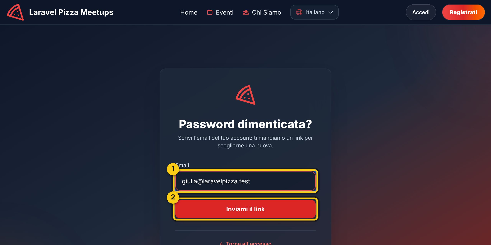

1. Scrivi l'**email** del tuo account.
2. Clicca **Inviami il link**.

Ti arriva un'email con il pulsante **Reimposta la password**: aprilo, scegli una nuova password (almeno 12 caratteri con maiuscole, minuscole, un numero e un simbolo, scritta due volte) e salva. Entri subito nel sito. Il link vale un'ora.

> Per proteggere gli account, il sito risponde nello stesso modo anche se l'email non è registrata: se l'email non arriva, controlla lo spam e di aver scritto l'indirizzo giusto.

Dopo l'accesso arrivi alla pagina **I tuoi eventi**, con il tuo nome in alto a destra:

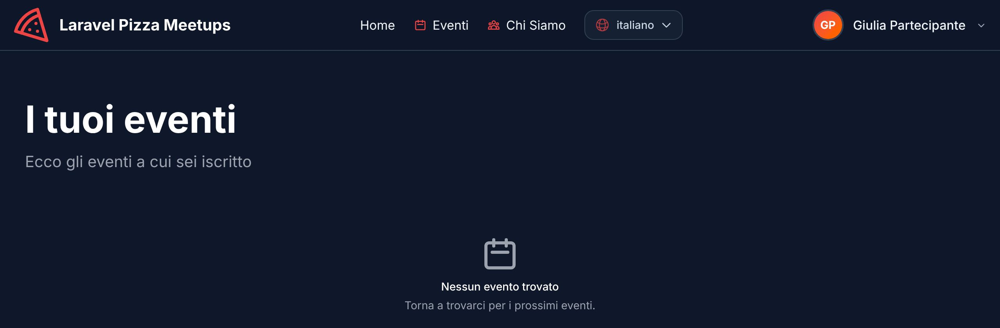

## 2.4 Iscriversi a un evento

Hai già fatto l'accesso? Apri un evento dall'elenco **Eventi** (come nel [capitolo 1](01-visitatore.md#12-vedere-lelenco-degli-eventi)): ti basta un clic.

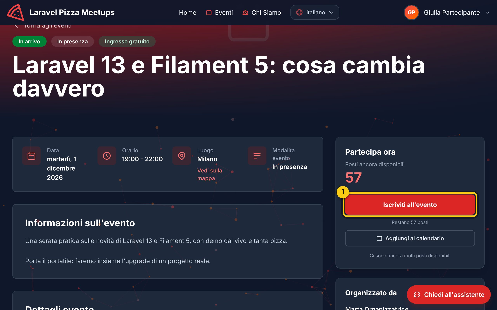

1. Clicca **Iscriviti all'evento**.

Il posto è tuo:

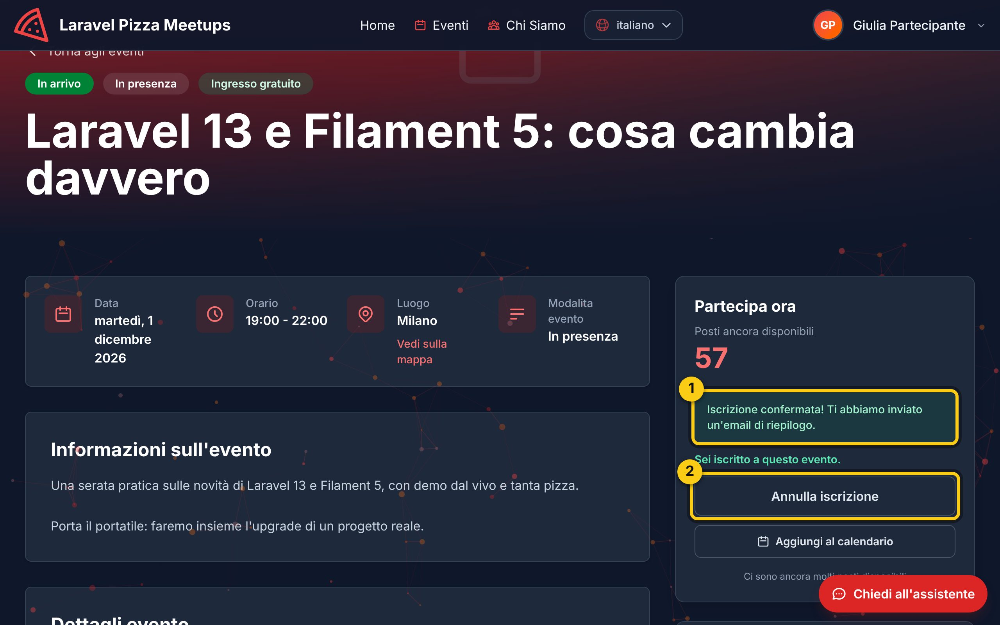

1. Il messaggio verde conferma l'iscrizione, e il numero di posti liberi scende di uno.
2. Se cambi idea, da qui puoi **annullare l'iscrizione**.

Pochi istanti dopo ricevi anche un'**email di conferma** con il riepilogo dell'evento:

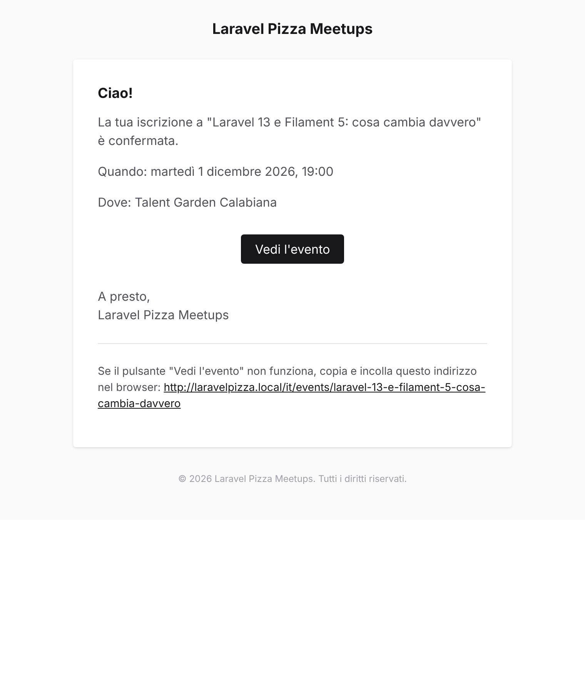

L'email ha un **allegato** (un file che finisce in `.ics`): aprilo e l'evento si aggiunge da solo al tuo calendario.

**Il giorno prima** dell'evento ricevi un'altra email, il **promemoria**, con data, luogo e lo stesso allegato. Se non puoi più venire, è il momento giusto per annullare e lasciare il posto a qualcun altro.

## 2.5 Annullare l'iscrizione

Non puoi più venire? Libera il posto per qualcun altro: apri l'evento e clicca **Annulla iscrizione** (riquadro 2 dell'immagine precedente). Il pulsante torna "Iscriviti all'evento".

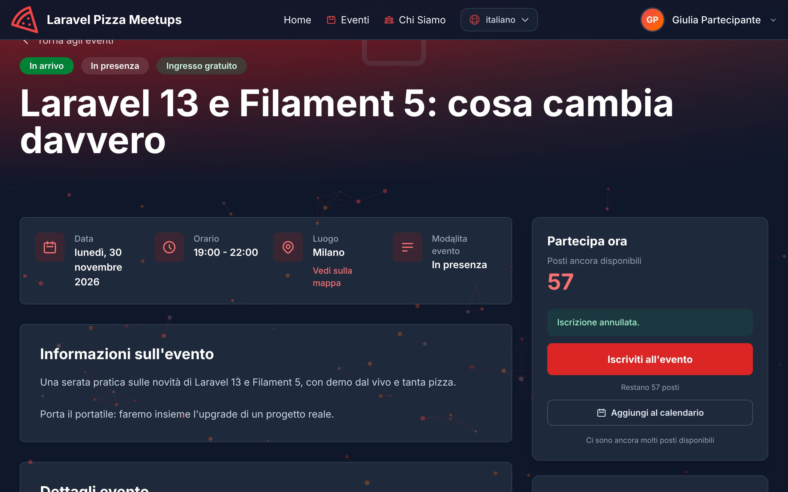

## 2.6 Il tuo menu personale

Clicca sul tuo **nome** in alto a destra: si apre il menu personale.

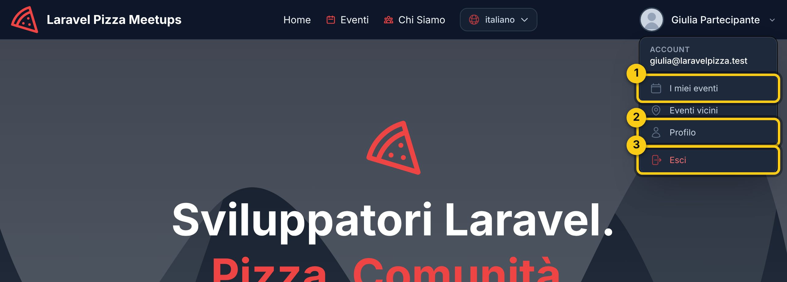

1. **I miei eventi**: gli eventi a cui sei iscritto.
2. **Profilo**: il tuo profilo pubblico, come lo vedono gli altri.
3. **Modifica il profilo**: cambia nome, biografia, foto, lingua e password (punto 2.7).
4. **Esci**: chiude la sessione. Fallo sempre se usi un computer condiviso.

C'è anche **Tutti gli eventi**, che apre l'elenco completo dei meetup. Finché non carichi una foto vedi un cerchio con le tue iniziali.

### I miei eventi

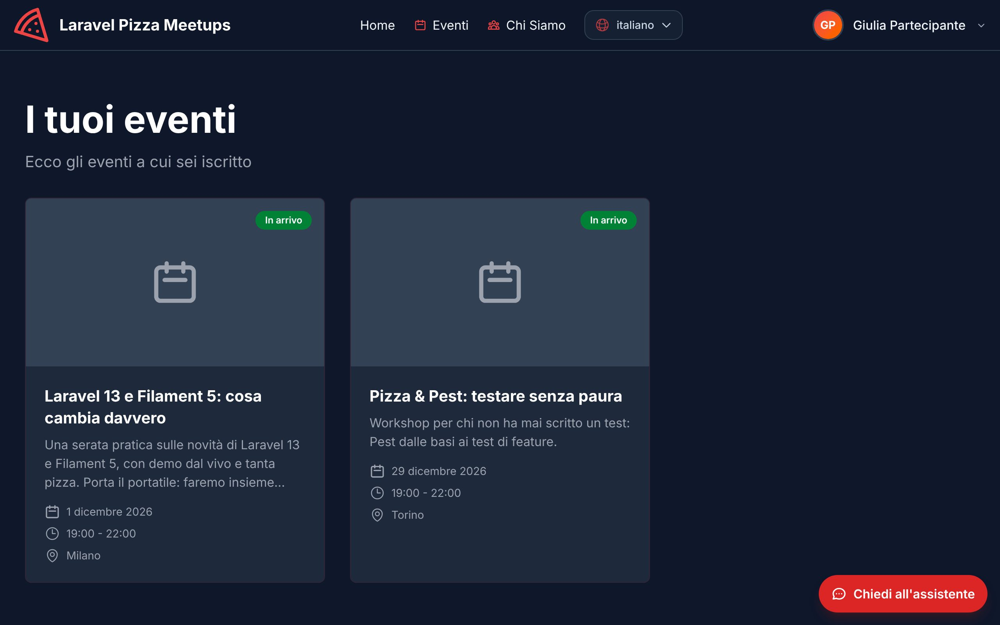

Qui trovi in ordine di data tutti gli eventi a cui sei iscritto. Un'etichetta colorata ti dice se l'evento è "In arrivo", "In corso" o "Concluso".

### Profilo

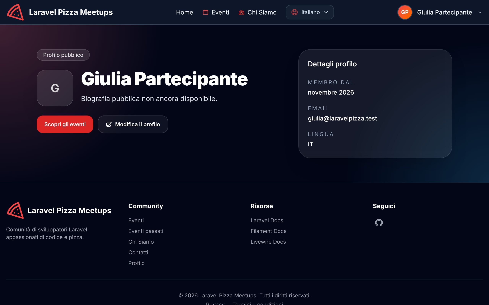

Il profilo è pubblico: gli altri vedono il tuo nome, la biografia e da quando sei iscritto. **La tua email la vedi solo tu**: agli altri non viene mostrata, nemmeno se sei tu a organizzare un evento.

## 2.7 Modificare il profilo

Dal menu personale clicca **Modifica il profilo** (oppure il pulsante con lo stesso nome sul tuo profilo). La pagina ha tre parti, ognuna con il suo pulsante: salvi solo quella che hai cambiato.

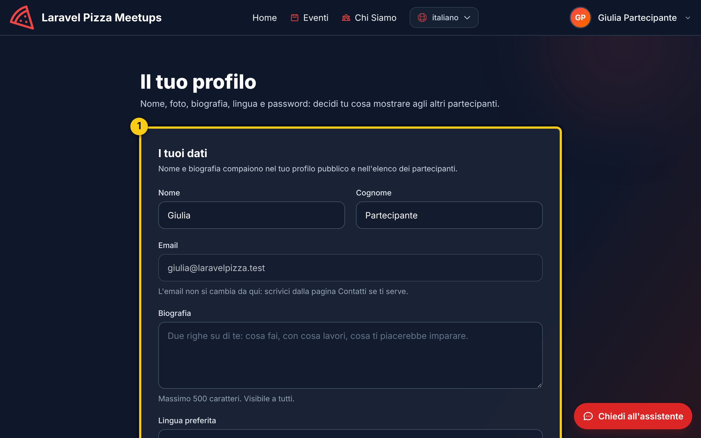

1. **I tuoi dati**: nome, cognome, una breve **biografia** (al massimo 500 caratteri, la vedono tutti) e la **lingua preferita**, cioè la lingua delle email che ti mandiamo e, per organizzatori e amministratori, del pannello di amministrazione. L'email non si può cambiare da qui: se ti serve, scrivici dalla pagina Contatti. Quando hai finito clicca **Salva i dati**: compare "Dati salvati." e il tuo nome in alto si aggiorna subito.

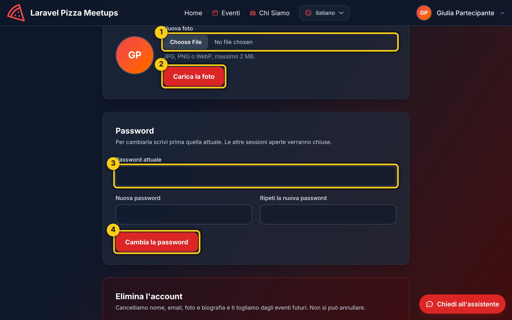

1. **Foto**: scegli un'immagine dal computer o dal telefono (JPG, PNG o WebP, al massimo 2 MB)...
2. ...e clicca **Carica la foto**. Se ci ripensi, **Togli la foto** torna alle iniziali.
3. **Password**: scrivi prima la password che usi adesso, poi due volte quella nuova (almeno 12 caratteri, con maiuscole, minuscole, un numero e un simbolo)...
4. ...e clicca **Cambia la password**. Per sicurezza, se avevi fatto l'accesso anche su altri dispositivi, lì dovrai rientrare con la nuova password.

### Eliminare l'account

In fondo alla stessa pagina c'è **Elimina l'account**. Clicca **Voglio eliminare l'account** e si apre il riquadro:

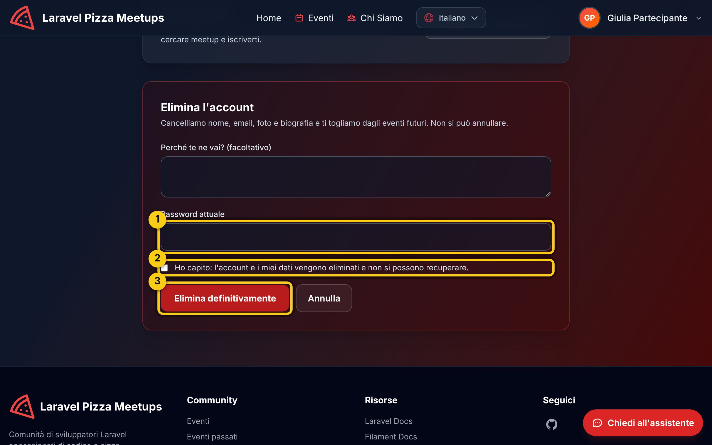

1. Scrivi la tua **password attuale** (se vuoi, sopra puoi dirci perché te ne vai).
2. Spunta la casella: conferma che hai capito che non si torna indietro.
3. Clicca **Elimina definitivamente**.

Cancelliamo subito nome, email, foto e biografia, liberiamo i tuoi posti negli eventi futuri e ti facciamo uscire. In alto compare "Account eliminato". Se un giorno vorrai tornare, basterà registrarti di nuovo.

## 2.8 Quando non puoi iscriverti

Il pulsante di iscrizione non c'è, o è grigio, in questi casi:

- **Posti esauriti**: tutti i posti sono stati presi. Riprova più tardi: se qualcuno annulla, il posto si libera.
- **Evento già iniziato o concluso**: le iscrizioni sono chiuse.
- **Sei già iscritto**: al posto di "Iscriviti" vedi "Annulla iscrizione".

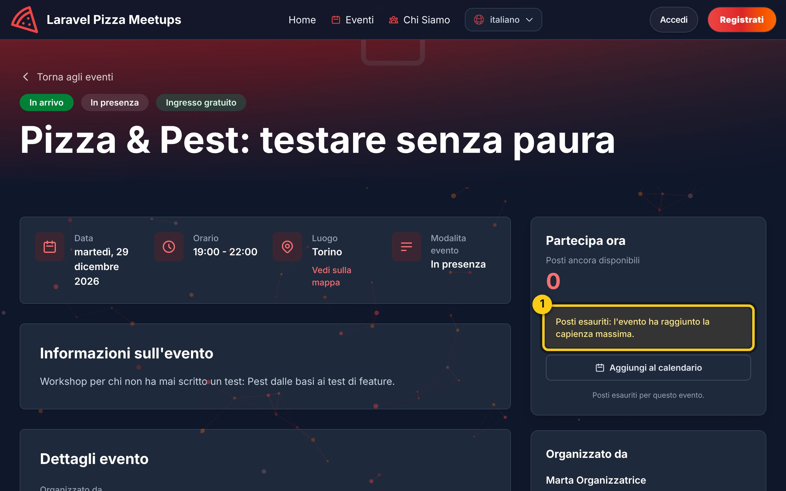

1. L'avviso **Posti esauriti**.

## 2.9 Chiedere all'assistente

Dopo l'accesso, in basso a destra in ogni pagina c'è il pulsante **Chiedi all'assistente**: una chat che trova gli eventi e ti iscrive, scrivendo come parleresti a una persona. Il pulsante c'è solo se il sito ha l'assistente attivo.

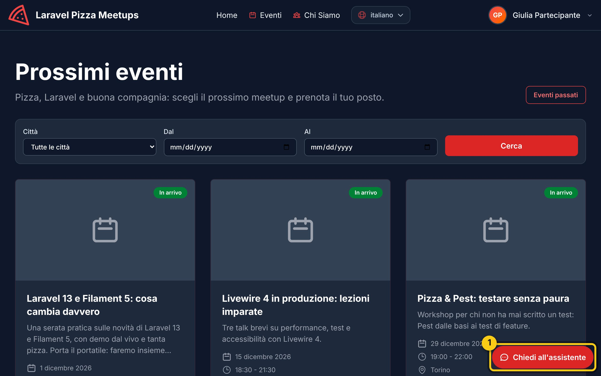

1. Clicca **Chiedi all'assistente**. Si apre la chat con qualche domanda già pronta da cliccare.

Scrivi una domanda, per esempio "Quali sono i prossimi meetup?", e premi **Invio**:

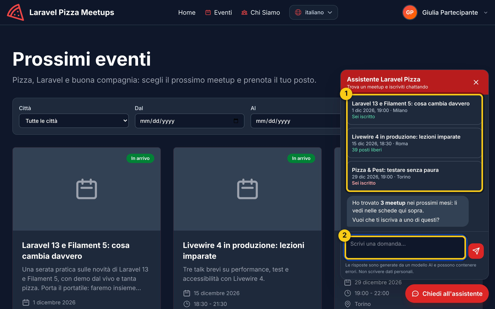

1. L'assistente mostra gli eventi come **schede**: titolo, data, città e posti liberi (oppure "Sei iscritto" o "Posti esauriti"). Clicca una scheda per aprire l'evento.
2. Qui scrivi la domanda successiva.

Chiedigli di iscriverti, per esempio "Iscrivimi a Livewire 4 in produzione". L'assistente **non fa niente da solo**: prima ti chiede conferma.

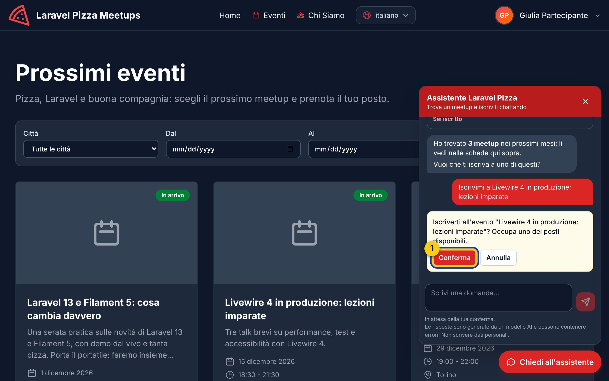

1. Clicca **Conferma** per iscriverti, oppure **Annulla**. Finché non scegli, non puoi scrivere altri messaggi.

Dopo la conferma l'iscrizione è fatta, come con il pulsante della pagina: ricevi la stessa email con il file per il calendario e la pagina aggiorna i posti liberi.

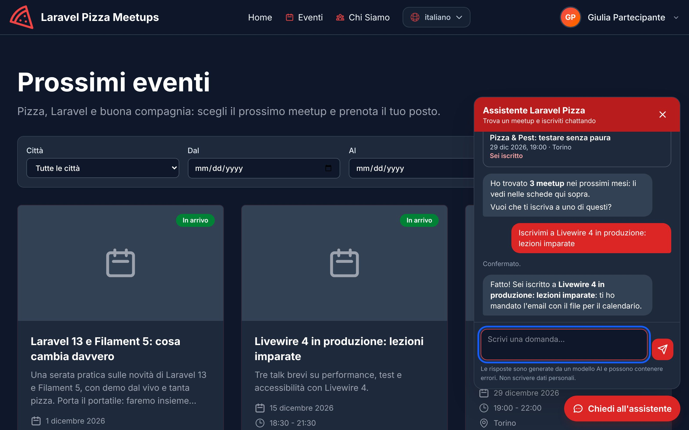

Allo stesso modo puoi chiedere "A quali eventi sono iscritto?" o "Annulla la mia iscrizione a…" (anche qui con conferma).

> Le risposte le scrive un modello di intelligenza artificiale e possono contenere errori: i dati delle schede (date, posti) invece vengono dal sito e sono quelli giusti. Non scrivere nella chat dati personali che non servono. Per chiudere la chat clicca la **X** o premi **Esc**.

## 2.10 Collegare il tuo assistente AI (Claude, Cursor…)

Usi già un assistente AI sul tuo computer, come Claude o Cursor? Puoi collegarlo al tuo account: cercherà i meetup e ti iscriverà con le stesse regole del sito. Serve un **token personale**, una specie di password solo per l'assistente.

In **Modifica il profilo** clicca **Collega un assistente AI**. Scrivi un nome per il token (per esempio "Claude Desktop") e clicca **Crea il token**:

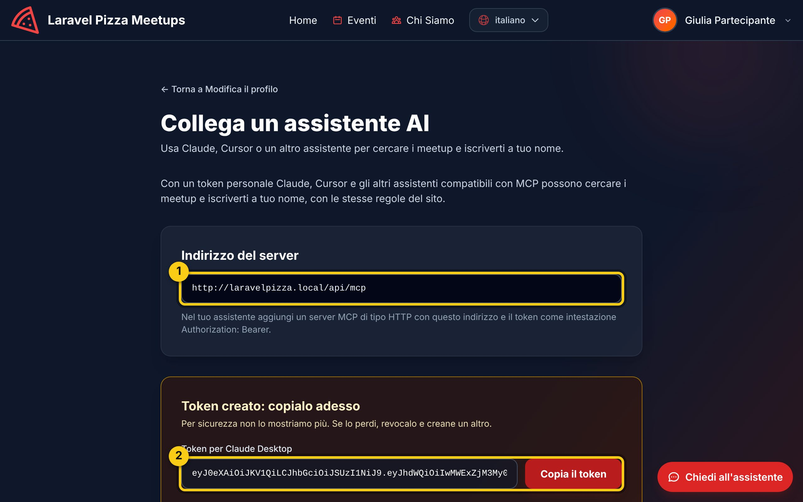

1. L'**indirizzo del server** da inserire nell'assistente.
2. Il **token**: clicca **Copia il token** e incollalo nell'assistente. **Si vede una volta sola**: se lo perdi, revocalo e creane un altro.
3. Un **esempio di configurazione** già pronto, con indirizzo e token, per gli assistenti che usano questo formato (Claude Desktop, Cursor).

Clicca **Fatto, l'ho copiato**. Sotto, in **Token attivi**, trovi tutti i tuoi token con la data di scadenza (6 mesi). **Revoca** blocca subito l'assistente che usa quel token: fallo se cambi computer o pensi che qualcuno l'abbia visto.

> Tratta il token come una password: chi lo ha può iscriverti e cancellare le tue iscrizioni.

[Continua con il capitolo 3 – Organizzatore →](03-organizzatore.md)
