# 2. Partecipante: iscriversi agli eventi

[← Torna all'indice](readme.md)

Sei un **partecipante** quando hai un account e hai fatto l'accesso. Puoi fare tutto quello che fa il [visitatore](01-visitatore.md) e in più prenotare il tuo posto agli eventi.

## 2.1 Creare l'account (una volta sola)

Clicca su **Registrati** in alto a destra. Si apre il modulo di registrazione.

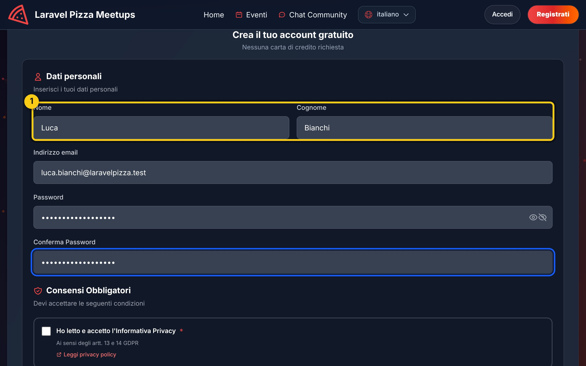

1. Scrivi **nome**, **cognome**, **email** e scegli una **password**. La password va scritta due volte, uguale, per essere sicuri che non ci siano errori di battitura. Usa almeno 8 caratteri, mescolando lettere e numeri.

Scorri un po' più in basso:

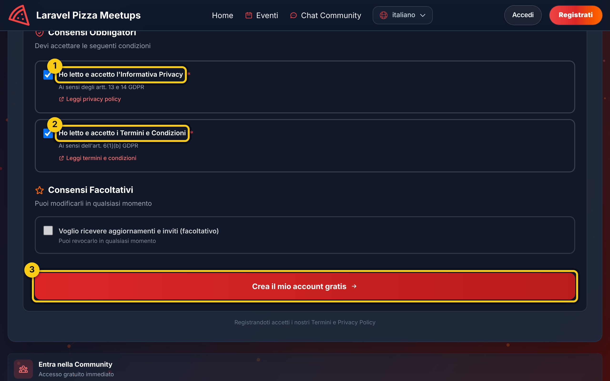

1. Spunta **Informativa Privacy** (obbligatoria): dici di aver letto come vengono trattati i tuoi dati.
2. Spunta **Termini e Condizioni** (obbligatoria).
3. Clicca **Crea il mio account**.

Fatto! Sei già dentro: il sito ti porta alla pagina **I tuoi eventi** e in alto a destra compare il tuo nome. La pagina è vuota perché non ti sei ancora iscritto a niente.

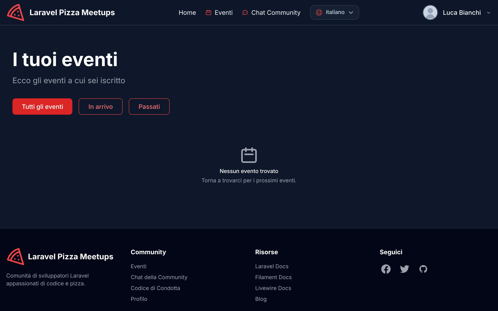

## 2.2 Accedere le volte successive

Le volte successive non serve registrarsi di nuovo: clicca **Accedi** in alto a destra.

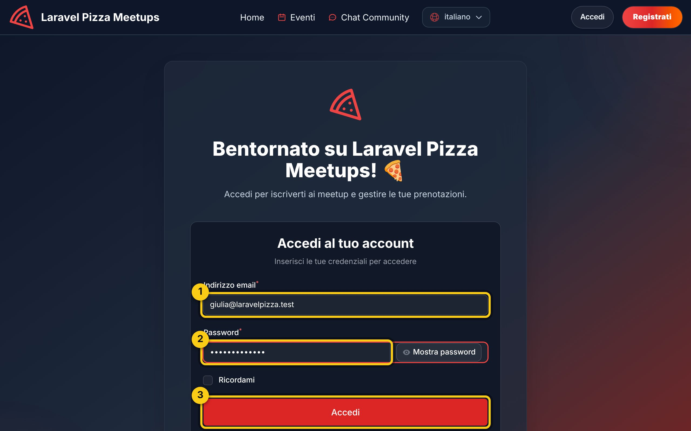

1. Scrivi la tua **email**.
2. Scrivi la tua **password**.
3. Clicca **Accedi**.

Se arrivi qui dal pulsante "Accedi per iscriverti" di un evento, dopo l'accesso torni direttamente a quell'evento.

> Se sbagli la password 5 volte di fila il sito ti blocca per un minuto: è una protezione contro chi prova a indovinarla. Aspetta e riprova, oppure usa "Password dimenticata?".

Dopo l'accesso arrivi alla pagina **I tuoi eventi**, con il tuo nome in alto a destra:

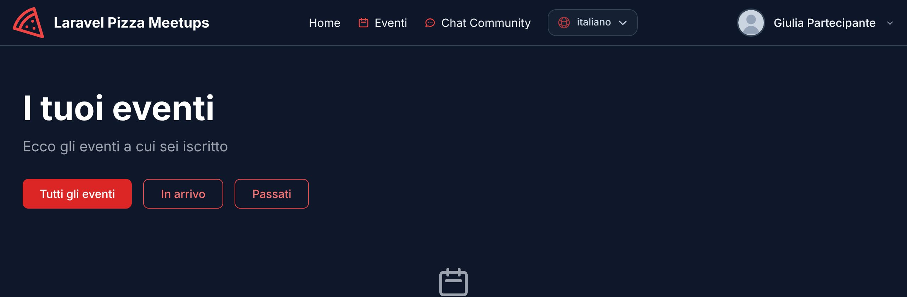

## 2.3 Iscriversi a un evento

Apri un evento dall'elenco **Eventi** (come nel [capitolo 1](01-visitatore.md#12-vedere-lelenco-degli-eventi)).

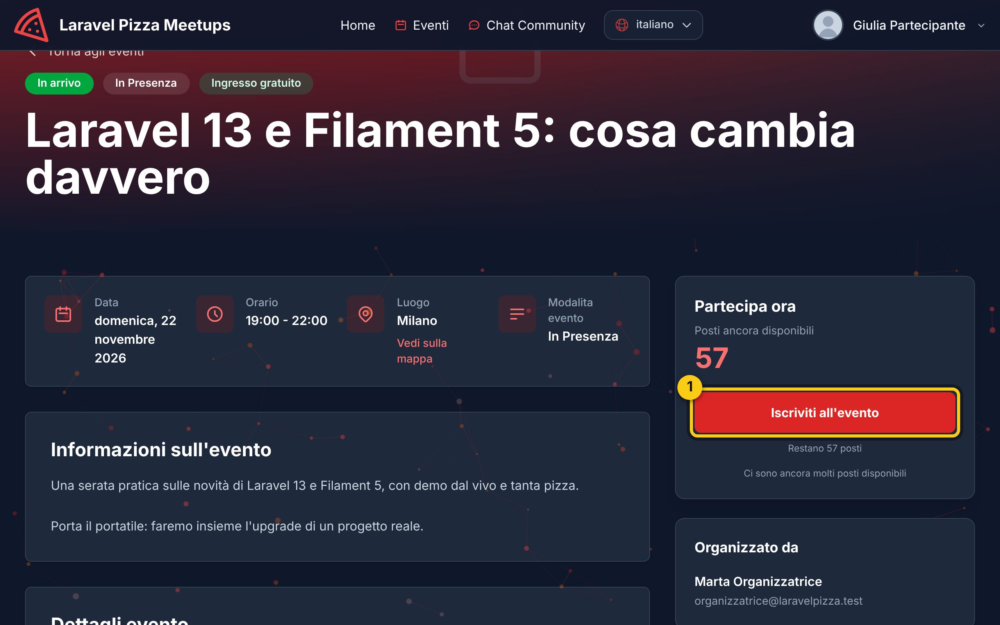

1. Clicca **Iscriviti all'evento**.

Il posto è tuo:

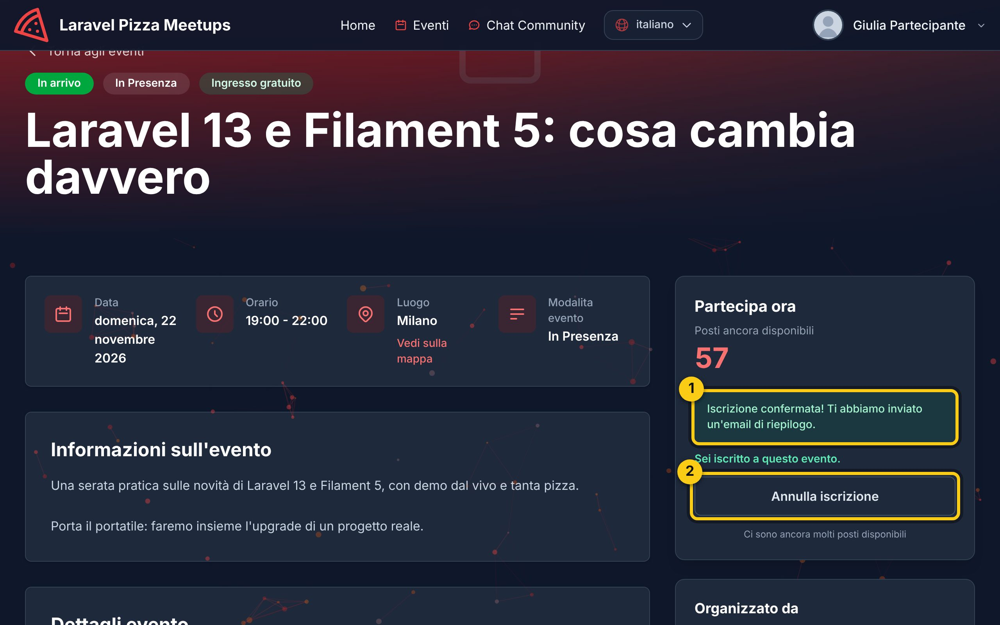

1. Il messaggio verde conferma l'iscrizione, e il numero di posti liberi scende di uno.
2. Se cambi idea, da qui puoi **annullare l'iscrizione**.

Pochi istanti dopo ricevi anche un'**email di conferma** con il riepilogo dell'evento:

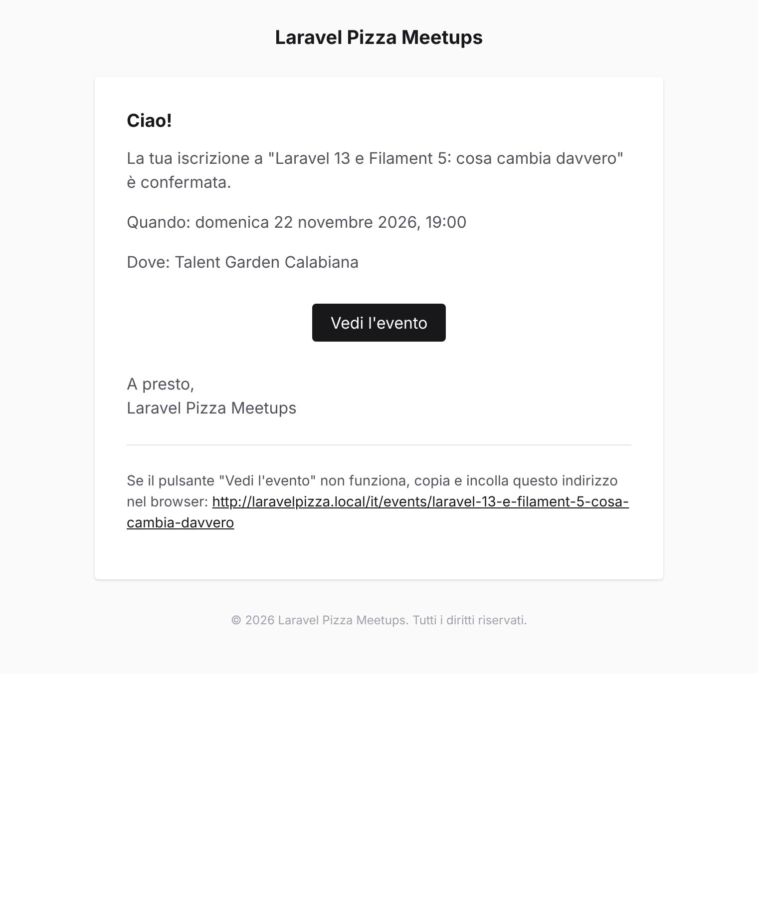

## 2.4 Annullare l'iscrizione

Non puoi più venire? Libera il posto per qualcun altro: apri l'evento e clicca **Annulla iscrizione** (riquadro 2 dell'immagine precedente). Il pulsante torna "Iscriviti all'evento".

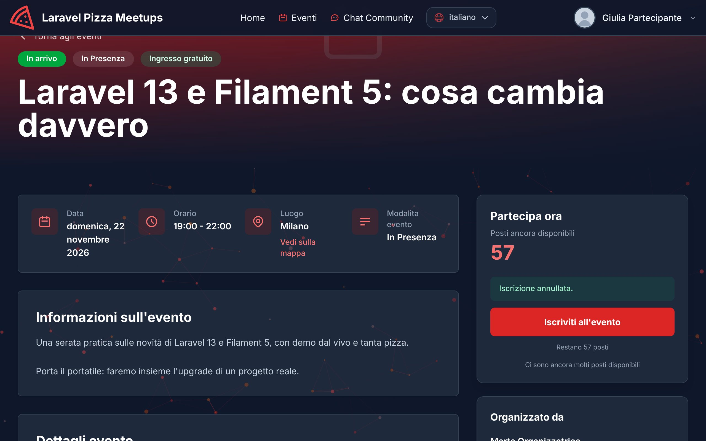

## 2.5 Il tuo menu personale

Clicca sul tuo **nome** in alto a destra: si apre il menu personale.

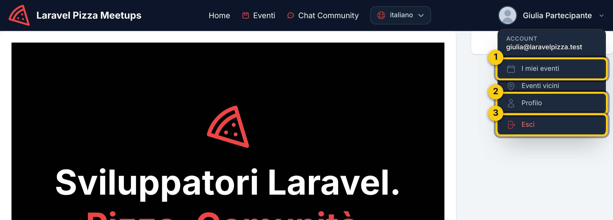

1. **I miei eventi**: gli eventi a cui sei iscritto.
2. **Profilo**: i tuoi dati.
3. **Esci**: chiude la sessione. Fallo sempre se usi un computer condiviso.

### I miei eventi

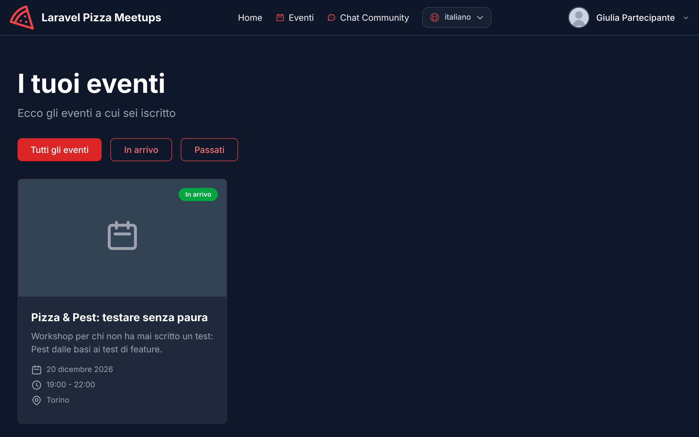

Qui trovi in ordine di data tutti gli eventi a cui sei iscritto. Un'etichetta colorata ti dice se l'evento è "In arrivo", "In corso" o "Concluso".

### Profilo

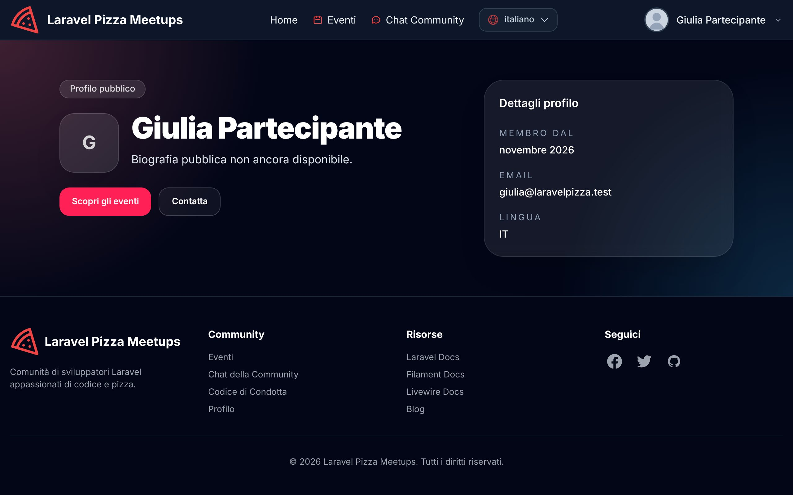

## 2.6 Quando non puoi iscriverti

Il pulsante di iscrizione non c'è, o è grigio, in questi casi:

- **Posti esauriti**: tutti i posti sono stati presi. Riprova più tardi: se qualcuno annulla, il posto si libera.
- **Evento già iniziato o concluso**: le iscrizioni sono chiuse.
- **Sei già iscritto**: al posto di "Iscriviti" vedi "Annulla iscrizione".

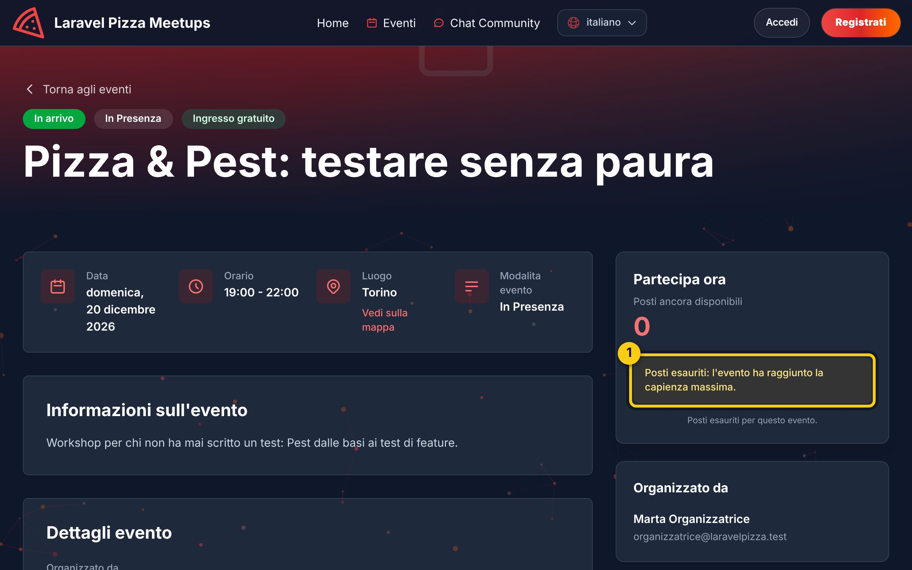

1. L'avviso **Posti esauriti**.

[Continua con il capitolo 3 – Organizzatore →](03-organizzatore.md)
