# 3. Organizzatore: creare e gestire gli eventi

[← Torna all'indice](readme.md)

Sei un **organizzatore** quando un amministratore ha dato al tuo account il permesso di gestire gli eventi. Gli eventi non si creano dal sito pubblico ma dal **pannello di amministrazione**, una zona riservata con un indirizzo diverso: aggiungi `/meetup/admin` all'indirizzo del sito (per esempio `https://laravelpizza.com/meetup/admin`).

> Non vedi il pannello, o ricevi "Accesso negato"? Il tuo account non ha ancora il permesso: chiedilo all'amministratore del sito.

## 3.1 Entrare nel pannello

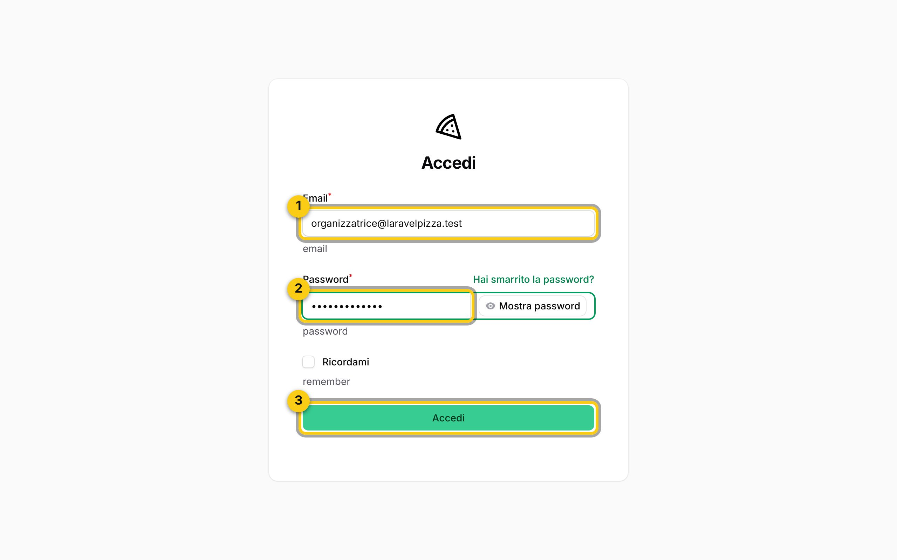

1. Scrivi la tua **email** (la stessa del sito).
2. Scrivi la tua **password**.
3. Clicca **Accedi**.

## 3.2 La bacheca

Dopo l'accesso apri **Meetup Dashboard**: i numeri principali e i prossimi appuntamenti.

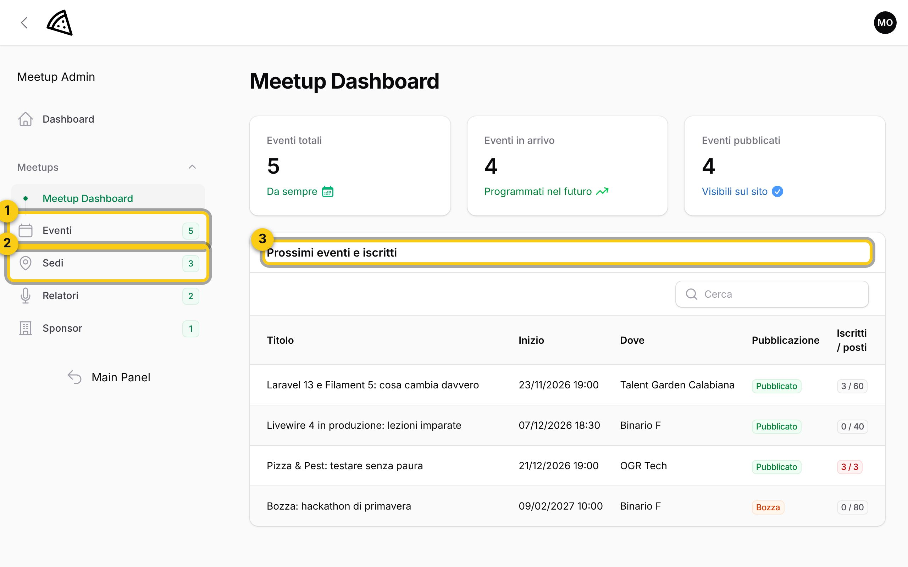

1. **Eventi** apre l'elenco completo degli eventi.
2. **Sedi**, **Relatori** e **Sponsor**: le anagrafiche da collegare agli eventi (vedi 3.7).
3. **Prossimi eventi e iscritti**: per ogni evento futuro quanti iscritti ci sono sui posti disponibili. Il numero diventa giallo quando l'evento è quasi pieno (80%) e rosso quando è pieno. Clicca sul titolo per modificare l'evento.

## 3.3 L'elenco degli eventi

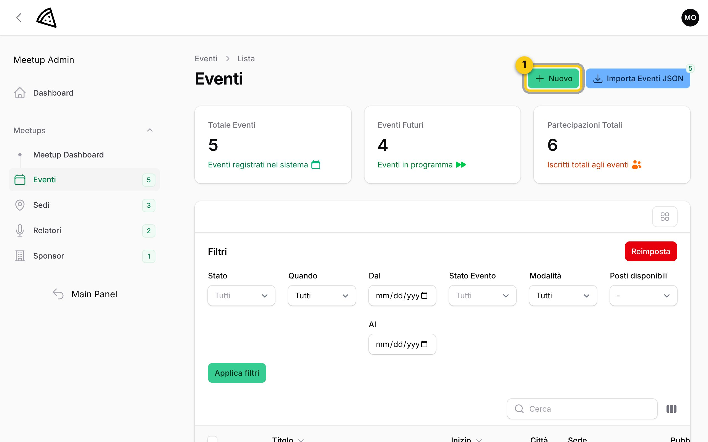

1. **Nuovo**: crea un evento.

In alto trovi i riquadri riassuntivi, sotto la tabella con tutti gli eventi (anche le bozze, che il pubblico non vede). La colonna **Iscritti** mostra "iscritti / posti". Con **Filtri** puoi vedere solo le bozze, solo gli eventi in arrivo o quelli passati, o cercare per date:

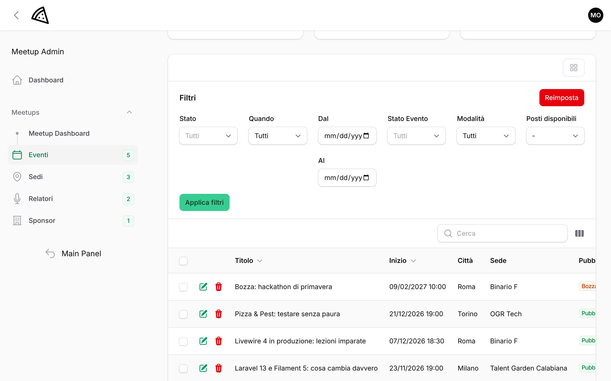

## 3.4 Creare un evento

Clicca **Nuovo**. Si apre il modulo.

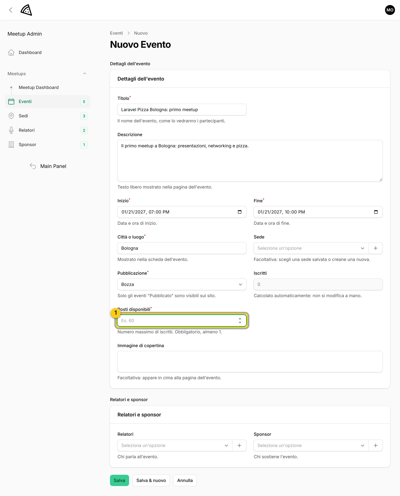

Compila i campi principali:

- **Titolo**: breve e chiaro, è la prima cosa che le persone leggono.
- **Descrizione**: di cosa si parla, a chi è rivolto, cosa portare.
- **Inizio** e **Fine**: data e ora. La fine deve venire dopo l'inizio.
- **Città o luogo**: la città, mostrata nella scheda dell'evento e usata dal filtro per città del sito.
- **Sede** (facoltativa): il locale preciso, scelto tra quelli salvati. Con il **+** accanto ne crei uno nuovo senza uscire dal modulo.
- **Posti disponibili** (riquadro 1): quante persone possono iscriversi. È **obbligatorio** e deve essere almeno 1.

Se dimentichi i posti disponibili, il sito non salva: il campo resta evidenziato e compare un avviso che chiede di compilarlo.

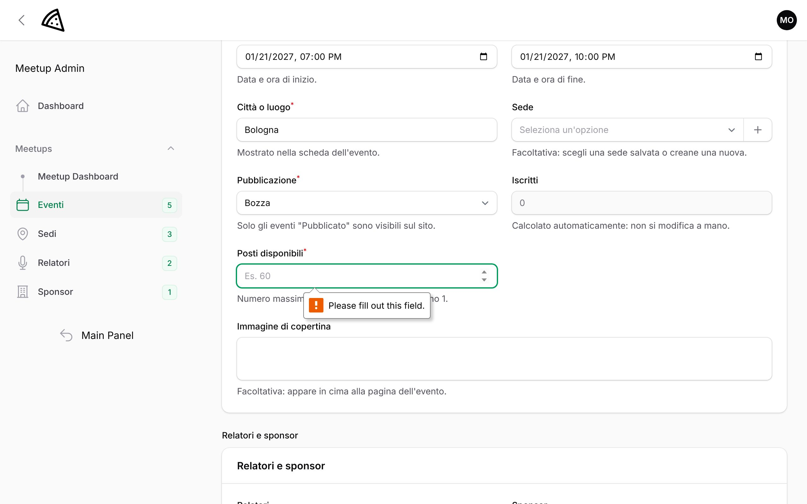

## 3.5 Pubblicare

Un evento nuovo nasce come **bozza**: lo vedi solo tu. Per mostrarlo a tutti:

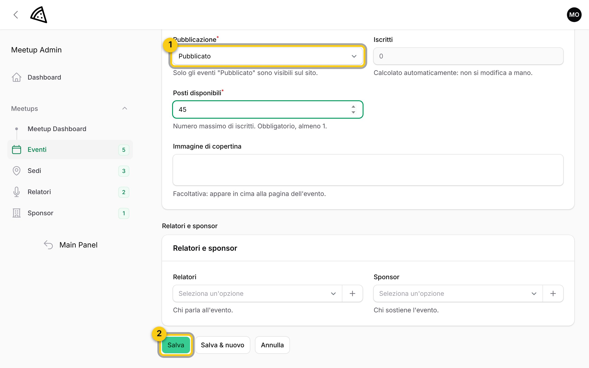

1. In **Pubblicazione** scegli **Pubblicato**.
2. Clicca **Salva**.

Il sito conferma con il messaggio **Salvato** in alto a destra e ti riporta all'elenco, dove il nuovo evento è già in tabella:

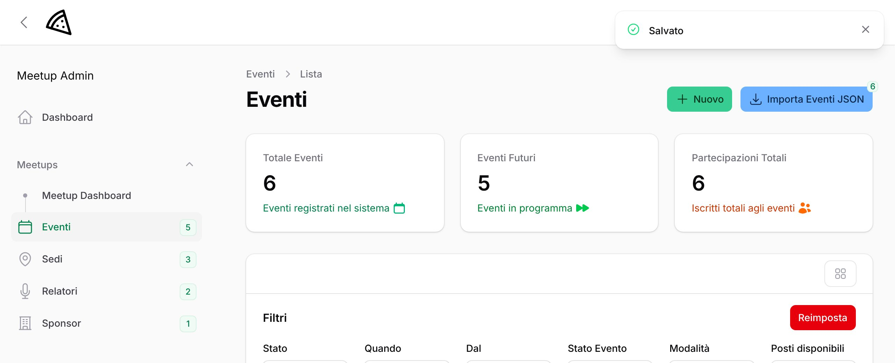

Da questo momento l'evento compare nell'elenco pubblico e le persone possono iscriversi. Il numero di iscritti si aggiorna da solo: non puoi modificarlo a mano.

## 3.6 Modificare o eliminare un evento

Dall'elenco eventi clicca sull'evento da cambiare. Modifica quello che serve e clicca **Salva**.

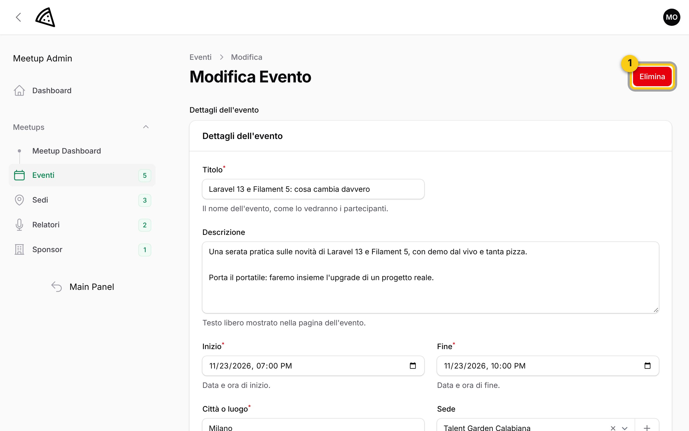

1. **Elimina** cancella l'evento.

Prima di eliminare, il sito chiede conferma e ti avvisa se ci sono persone iscritte:

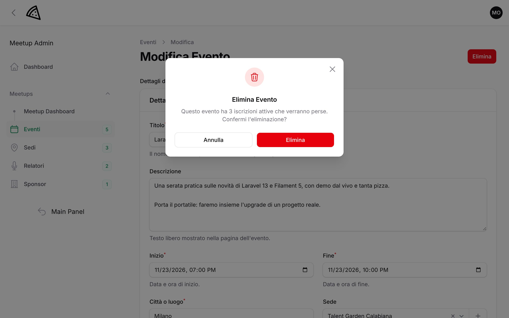

> Attenzione: l'eliminazione cancella anche tutte le iscrizioni a quell'evento e non si può annullare. Se l'evento è solo rinviato, è meglio cambiare la data invece di eliminarlo.

## 3.7 Relatori e sponsor

In fondo al modulo dell'evento c'è la sezione **Relatori e sponsor**.

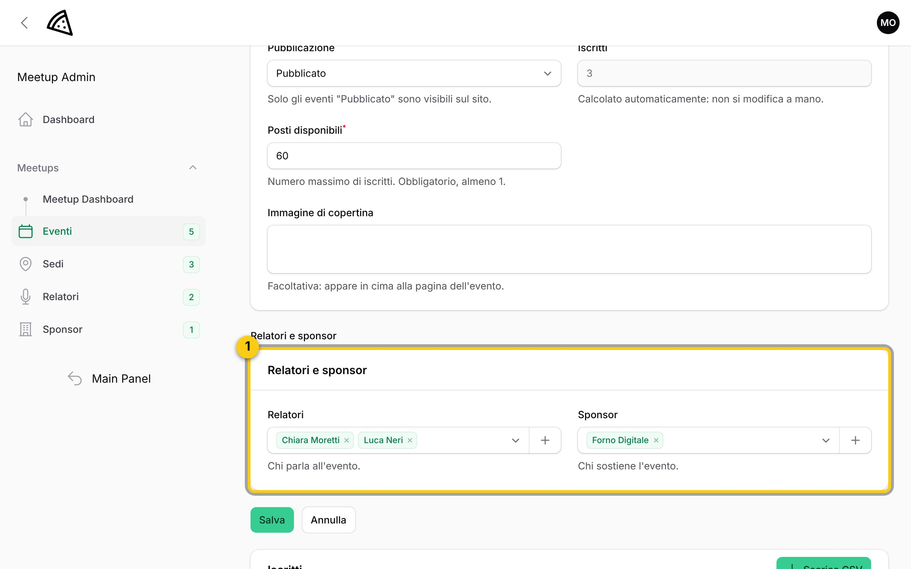

1. Scegli uno o più **relatori** e **sponsor** dagli elenchi. Inizia a scrivere il nome per trovarlo; con il **+** ne aggiungi uno nuovo. Poi clicca **Salva**.

Le anagrafiche complete (contatti, biografia, sito) si gestiscono dalle voci **Sedi**, **Relatori** e **Sponsor** del menu a sinistra:

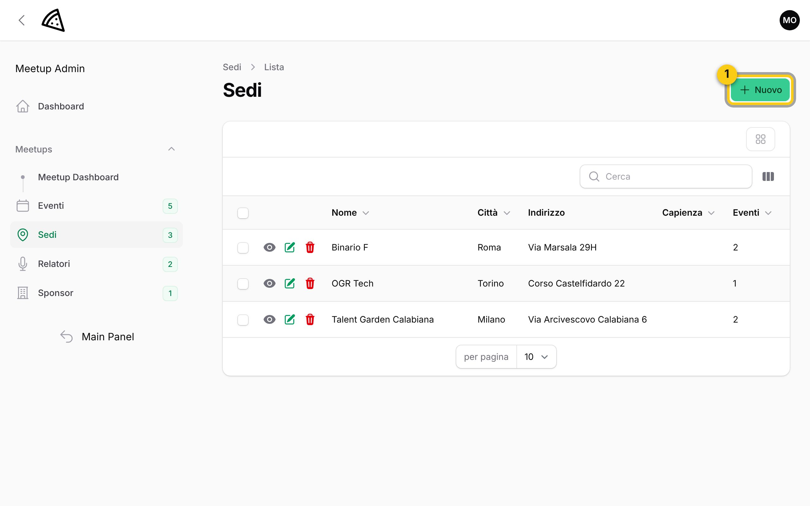

1. **Nuovo** aggiunge una sede (o un relatore, o uno sponsor nelle rispettive pagine). La colonna **Eventi** dice in quanti eventi è usata.

Se elimini una sede, gli eventi che la usavano restano e mostrano solo la città. Se elimini un relatore o uno sponsor, sparisce solo dagli eventi, gli eventi restano.

## 3.8 Chi si è iscritto

Apri un evento con **Modifica** e scorri in fondo alla pagina: trovi la tabella **Iscritti**.

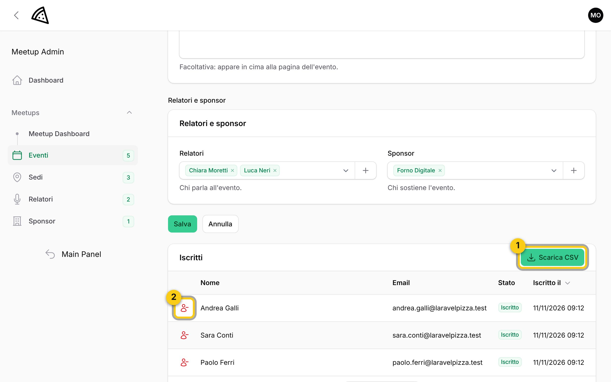

1. **Scarica CSV**: scarica l'elenco (nome, email, stato, data di iscrizione) in un file che si apre con Excel o LibreOffice. Utile per la lista all'ingresso.
2. L'icona rossa **annulla l'iscrizione** di quella persona, dopo una conferma: il posto torna libero. La persona non riceve un avviso automatico, quindi avvisala tu.

> Gli iscritti ricevono da soli l'email di conferma all'iscrizione e il promemoria il giorno prima dell'evento: non devi fare niente.

## Consigli pratici

- Prepara l'evento come **bozza**, ricontrollalo e pubblicalo solo quando è completo.
- Imposta i posti disponibili in base alla sala vera: il sito chiude da solo le iscrizioni quando sono finiti.
- Se cambi data o luogo dopo la pubblicazione, avvisa gli iscritti (puoi usare gli indirizzi del CSV): il sito non manda un'email automatica per le modifiche. Il promemoria del giorno prima userà comunque la data e il luogo aggiornati.
- I messaggi scritti dal modulo **Contatti** del sito arrivano all'indirizzo email configurato dall'amministratore.
