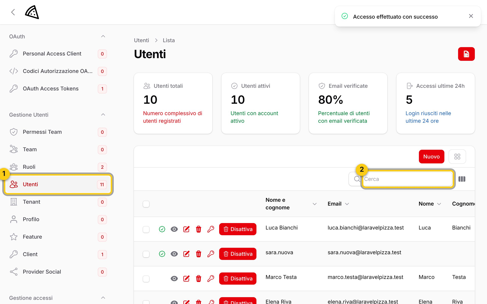
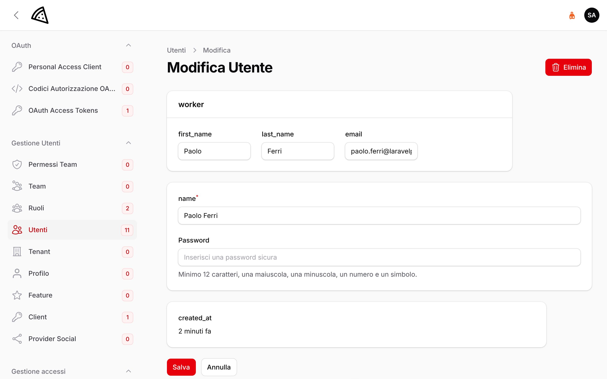
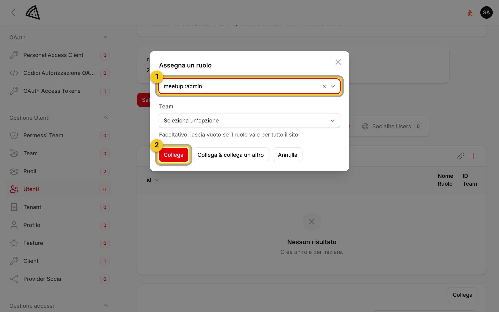
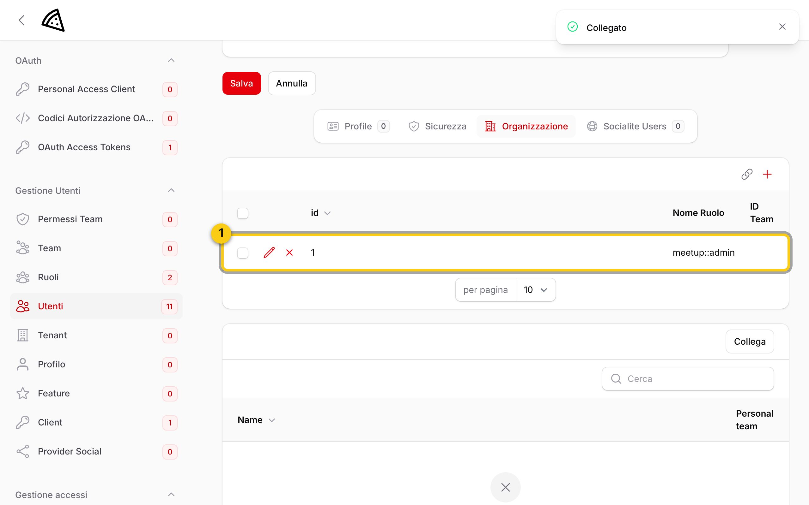
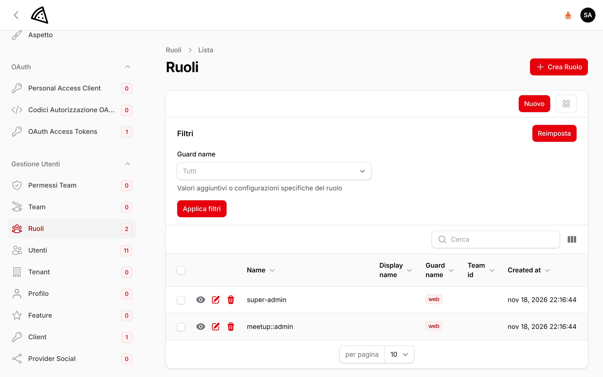

# 4. Amministratore: utenti e permessi

[← Torna all'indice](readme.md)

Sei un **amministratore** quando il tuo account ha il ruolo **super-admin**. È il ruolo di chi gestisce il sito, non i singoli eventi: decide chi può organizzare, controlla gli account e le impostazioni. Di solito gli amministratori sono una o due persone.

> Il pannello di amministrazione dà accesso a dati personali di tutti gli iscritti. Usalo solo per quello che serve, da un computer sicuro, ed esci sempre alla fine.

## 4.1 Entrare e trovare gli utenti

1. Accedi dal sito con **Accedi** (in alto a destra), con la tua email e la tua password, come un partecipante ([capitolo 2.3](02-partecipante.md#23-accedere-le-volte-successive)).
2. Poi apri l'indirizzo del sito seguito da `/user/admin/users` (per esempio `https://laravelpizza.com/user/admin/users`).

1. **Utenti** nel menu a sinistra: l'elenco di tutti gli account. In alto i riquadri dicono quanti sono, quanti sono attivi, quanti hanno verificato l'email e quanti accessi ci sono stati nelle ultime 24 ore.
2. **Cerca**: scrivi un nome o un'email per trovare subito una persona.
3. La **matita** apre la scheda della persona per modificarla.

Sulla stessa riga trovi anche l'occhio (**Vedi**), il cestino (**Elimina**), la chiave (**Cambia password**) e **Disattiva**: un account disattivato non può più entrare finché non lo riattivi.

## 4.2 Dare a qualcuno il ruolo di organizzatore

Per creare e gestire eventi una persona deve avere il ruolo **meetup::admin**. Prima deve avere un account sul sito (si registra da sola, [capitolo 2](02-partecipante.md)). Poi:

1. Nell'elenco **Utenti** cerca la persona e clicca la **matita** (punto 4.1).
2. Scorri fino alle schede in basso e apri **Organizzazione**.

1. La scheda **Organizzazione**: la prima tabella elenca i ruoli della persona (all'inizio è vuota).
2. L'icona a **catena** (**Collega**) apre la finestra per assegnare un ruolo.

1. Apri il primo menu (il ruolo), scrivi `meetup` e scegli **meetup::admin**. Lascia vuoto **Team**: il ruolo vale per tutto il sito.
2. Clicca **Collega**.

Compare il messaggio "Collegato" e il ruolo è nella tabella:

1. Il ruolo **meetup::admin**. Da adesso la persona entra nel pannello degli eventi (`/meetup/admin`, [capitolo 3](03-organizzatore.md)).

**Per togliere il ruolo** clicca la **X** (**Scollega**) sulla stessa riga: la persona resta iscritta al sito ma non entra più nel pannello.

> Il ruolo **super-admin** si può assegnare solo se lo hai già: un organizzatore non può farsi amministratore da solo.

## 4.3 I ruoli del sito

Nel menu a sinistra, **Ruoli** elenca i ruoli esistenti:

| Ruolo | Chi lo ha | Cosa può fare |
|---|---|---|
| *(nessuno)* | ogni persona registrata | iscriversi agli eventi, gestire il proprio profilo |
| `meetup::admin` | gli organizzatori | pannello `/meetup/admin`: eventi, sedi, relatori, sponsor, iscritti |
| `super-admin` | gli amministratori | tutti i pannelli, utenti e ruoli, impostazioni del sito |

Non rinominare né eliminare questi ruoli: il sito li riconosce dal nome.

## 4.4 Gli altri pannelli

Da amministratore puoi aprire anche altri pannelli tecnici, sempre aggiungendo il loro indirizzo dopo quello del sito. Quelli utili nel lavoro di tutti i giorni:

| Indirizzo | A cosa serve |
|---|---|
| `/meetup/admin` | gli eventi, come gli organizzatori ([capitolo 3](03-organizzatore.md)) |
| `/user/admin` | utenti, ruoli, accessi recenti, dispositivi |
| `/cms/admin` | testi del menu in alto e del piè di pagina |
| `/notify/admin` | modelli delle email e prove di invio |

Gli altri pannelli (`/xot/admin`, `/job/admin`, `/activity/admin`, …) servono a chi mantiene il sito tecnicamente: se non sei sicuro, non cambiare nulla.

## 4.5 Assistenti AI (per chi mantiene il sito)

Il sito può essere usato anche da assistenti AI come Claude o Cursor, per conto di una persona: cercano eventi, iscrivono e annullano le iscrizioni con le stesse regole del sito. Per collegare un assistente serve un **token personale** della persona, che per ora crea chi mantiene il sito; le istruzioni tecniche sono in `laravel/Modules/Meetup/docs/mcp-server.md`. Una pagina per crearlo da soli dal profilo è prevista.

## Note per chi mantiene il manuale

Le immagini di questo capitolo si catturano con lo stesso script degli altri (`tools/capture.cjs`): l'account `superadmin@laravelpizza.test` del database demo ha il ruolo super-admin.
