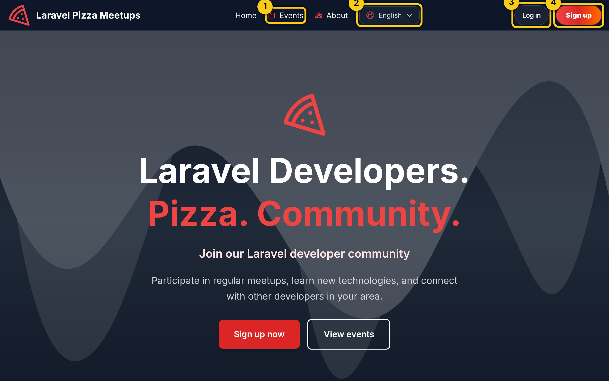
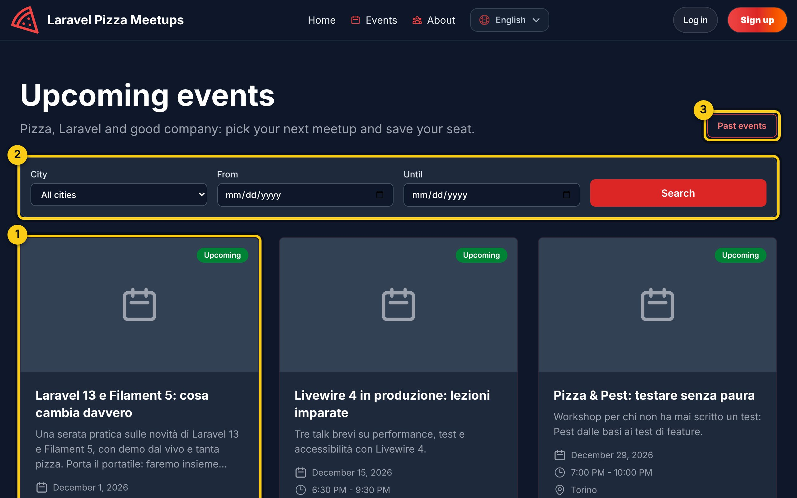
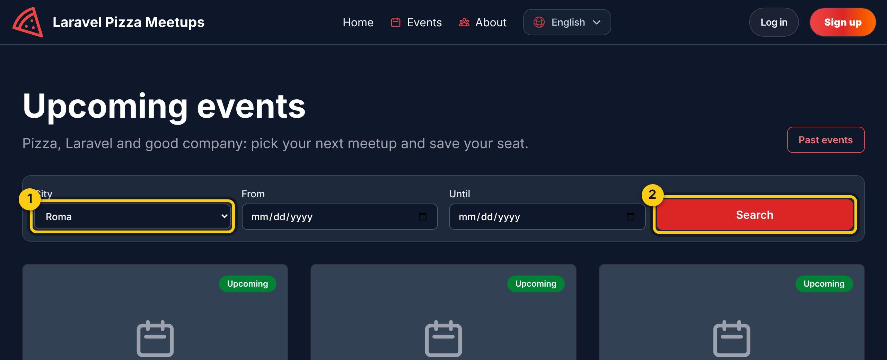
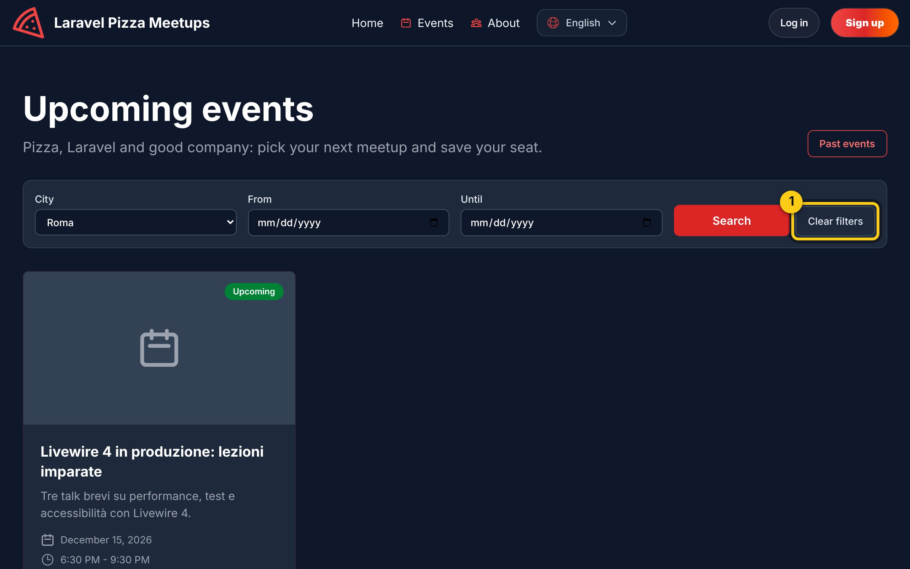
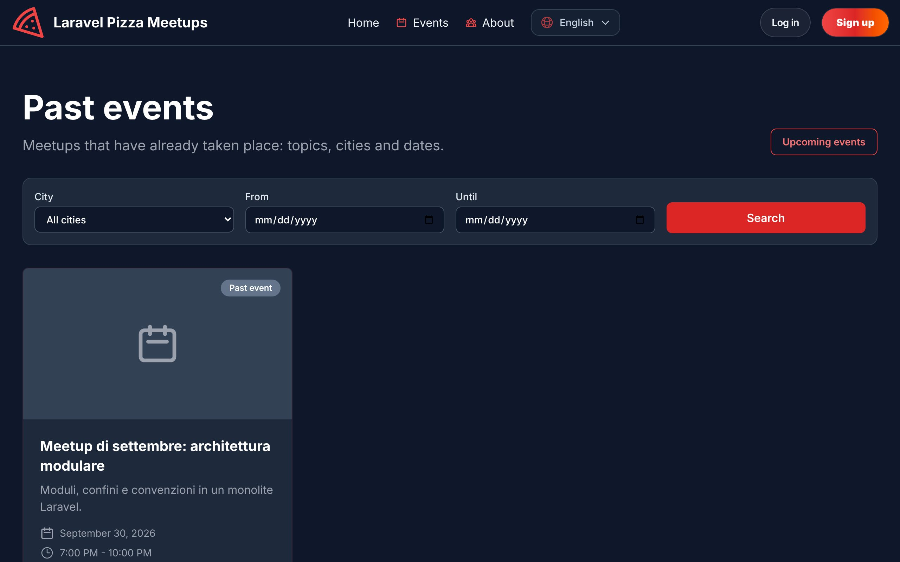
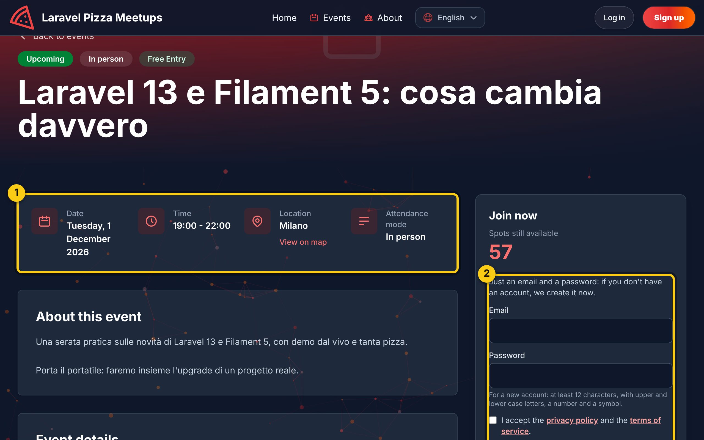
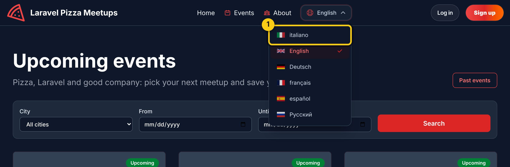
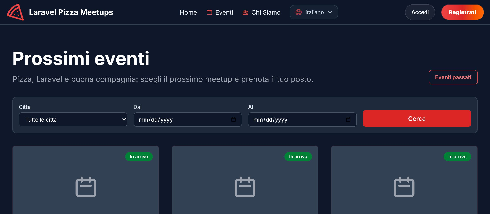
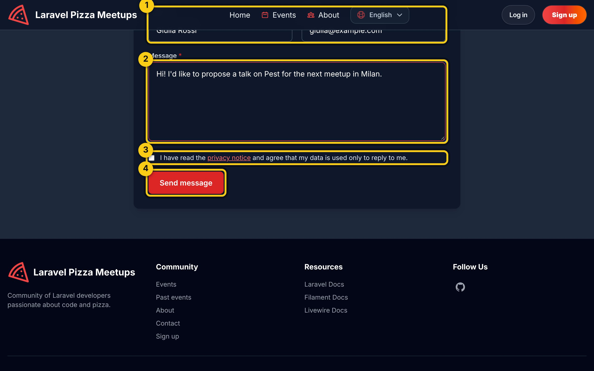

# 1. Visitor: browsing events without an account

[← Back to the contents](readme.md)

You are a **visitor** when you open the site without signing in. You can look at everything, search events and write to the organisers. To book a seat you need an account, but you can create it **at the same moment you register**, straight from the event page (section 1.5 and [chapter 2](02-participant.md#21-register-for-an-event-in-one-step)).

## 1.1 The home page

Open your browser (Chrome, Firefox, Safari or Edge) and go to the site's address. You see the home page.

At the top, in the dark bar, there are four important things:

1. **Events**: opens the list of all meetups.
2. **Language** (the globe with the language name): changes the site's language.
3. **Log in**: to sign in if you already have an account.
4. **Sign up**: to create a new account, for free.

There is also **About**, which tells you who organises the meetups. Scrolling down the home page you immediately find the **next three events**.

## 1.2 See the list of events

Click **Events** (box 1 in the picture above). The list of upcoming meetups opens, from the nearest to the furthest. Each card shows title, date, time and city.

1. Click a card to open the event details.
2. The **search** bar: finds the events in a city or in a period (see section 1.3).
3. **Past events**: opens the archive of meetups that already took place (section 1.4).

## 1.3 Search by city or date

Do you only want the events near you, or only the ones in December?

1. In **City** choose the city. The list only offers cities that have events planned.
2. If you like, also choose dates in **From** and **Until**, then click **Search**.

The list shows only the matching events:

1. **Clear filters** brings back the complete list.

If no event matches, the site tells you and suggests clearing the filters.

> Tip: the page address contains the search. You can copy it and send it to a friend: they will see the same list.

## 1.4 Past events

On the Events page click **Past events**: you find the meetups that already took place, from the most recent to the oldest, with topic, city and date. Here too you can search by city or date. You can no longer register for past events.

## 1.5 Read the details of an event

The event page tells you what it's about, where and when.

1. Here you find **date, time, place** and the attendance mode (in person or online).
2. The **Join now** box: as a visitor you can register right away by typing just your **email and a password**. If you don't have an account the site creates it at that moment; if you already have one, use your usual email and password. Step by step: [chapter 2, section 2.1](02-participant.md#21-register-for-an-event-in-one-step). Prefer to sign in first? Click **Log in** below the box: after signing in, the site brings you right back here.
3. **Add to calendar**: downloads a small file (`.ics` format). Open it and the event goes into your phone or computer calendar (Google Calendar, Outlook, Apple Calendar).

At the top of the box you see how many **seats** are still free.

## 1.6 Change language

The site speaks Italian, English, German, French, Spanish and Russian.

1. Click the language at the top (the globe), then the language you want (for example **italiano**).

The same page opens again in the new language:

> Note: the content of events (title, description) stays in the language the organiser wrote it in. Menus, buttons, dates and messages change.

> If you open an address without the language (for example `/events`), the site takes you to the same page in your browser's language, if it's one of those available; otherwise in Italian.

## 1.7 Write to the organisers

Do you have a question, want to propose a talk or host a meetup? At the bottom of every page click **Contact**.

1. Type your **name** and **email**: the answer will arrive there.
2. Write the **message** (at least a few words).
3. Tick the **privacy** box: it's required and says that your data is only used to answer you.
4. Click **Send message**. A confirmation appears.

> To prevent spam you can send at most 3 messages every 10 minutes.

## What next?

Want to attend an event? Continue with [chapter 2 – Participant](02-participant.md): the first section explains how to register in a single step.
