# 2. Participant: registering for events

[← Back to the contents](readme.md)

You are a **participant** when you have an account and you have signed in. You can do everything a [visitor](01-visitor.md) does and, in addition, book your seat at events.

There are two ways to start:

- **the quickest**: you register for an event and create your account at the same time, typing just email and password (section 2.1);
- **the classic one**: first you create the account with first and last name (section 2.2), then you register for events (section 2.4).

## 2.1 Register for an event in one step

Open the event you are interested in from the **Events** list. On the right there is the **Join now** box.

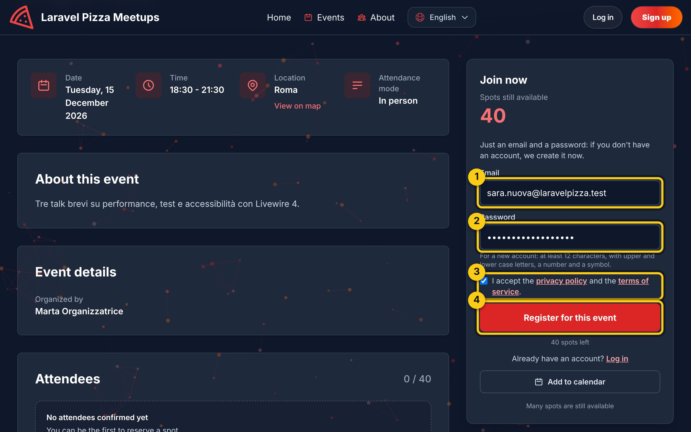

1. Type your **email**.
2. Choose a **password**: at least 12 characters, with upper and lower case letters, a number and a symbol (for example `PizzaMargherita!26`). The hint below the field reminds you.
3. Tick the box to accept the **privacy policy** and the **terms of service** (the links open them in a new tab).
4. Click **Register for this event**.

Done: the site creates your account, registers you, signs you in and shows you the confirmation. Your name appears at the top right: at first it's the part of your email before the @ (you can change it in **Edit profile**, section 2.7).

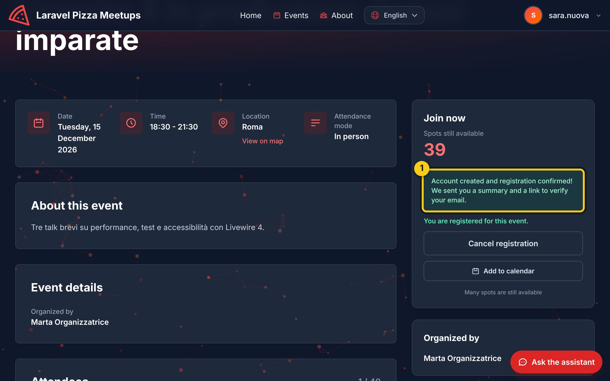

1. The green message: account created and registration confirmed.

You receive two emails: the **registration confirmation** (with the calendar file, see section 2.4) and a link to **verify your email address**. Open the link when you can: it proves that the email really is yours.

> **Already have an account?** You can use the same box: type your usual email and password and you will be registered. If the password is wrong the site tells you and saves nothing: try again, or click **Log in** below the box.

> If an event is full, the site tells you **before** creating the account.

## 2.2 Create your account (only once)

Click **Sign up** at the top right. The sign-up form opens.

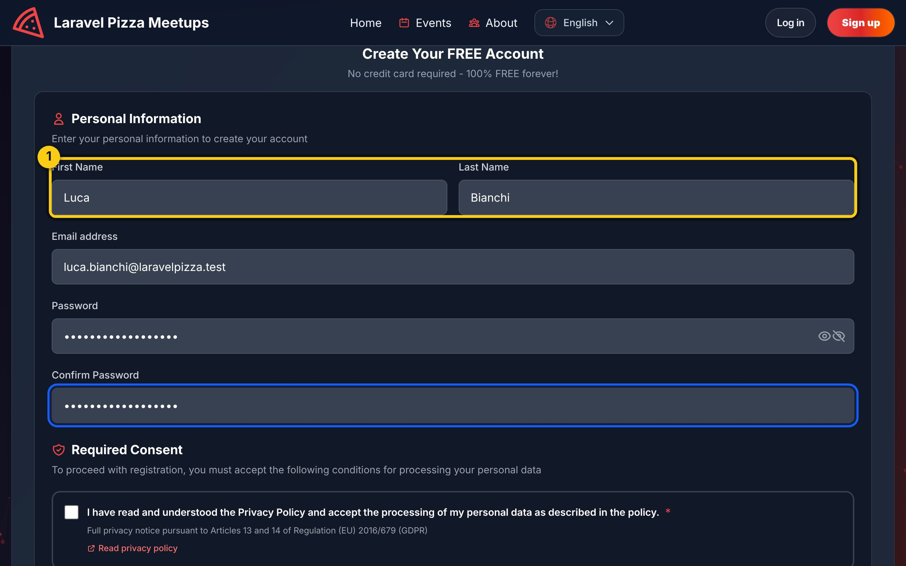

1. Type **first name**, **last name**, **email** and choose a **password**. The password is typed twice, the same, to make sure there are no typos. It must have at least 12 characters, with upper and lower case letters, a number and a symbol; the site also rejects passwords that appeared in known data breaches.

Scroll down a little:

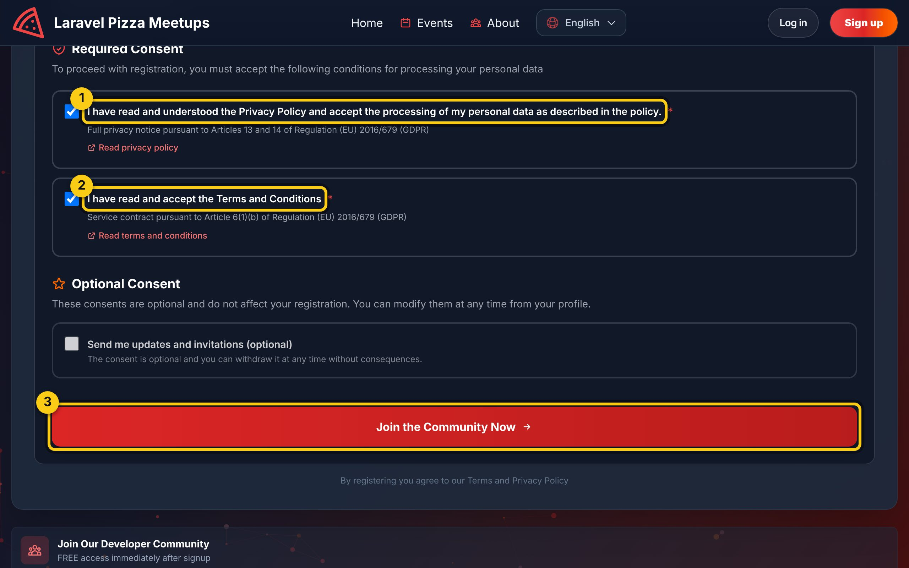

1. Tick **Privacy Policy** (required): you confirm you have read how your data is processed.
2. Tick **Terms and Conditions** (required).
3. Click **Join the Community Now**.

Done! You are already in: the site takes you to the **My events** page and your name appears at the top right. The page is empty because you haven't registered for anything yet.

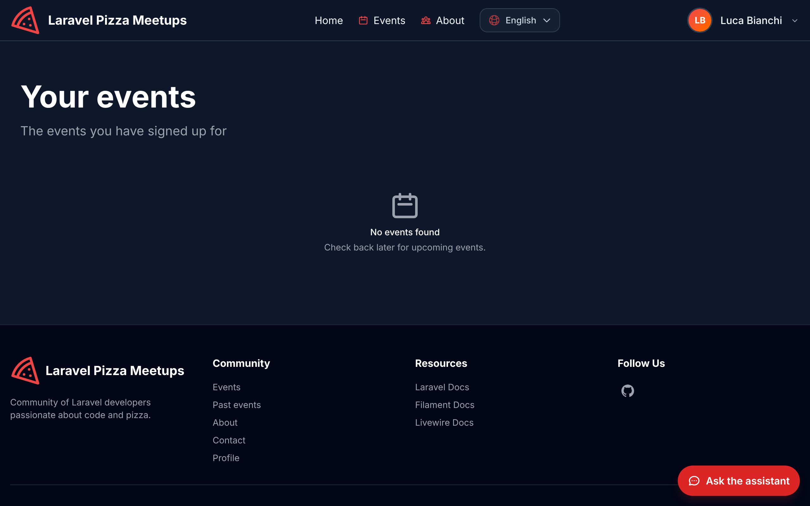

## 2.3 Sign in the following times

Next time there's no need to sign up again: click **Log in** at the top right.

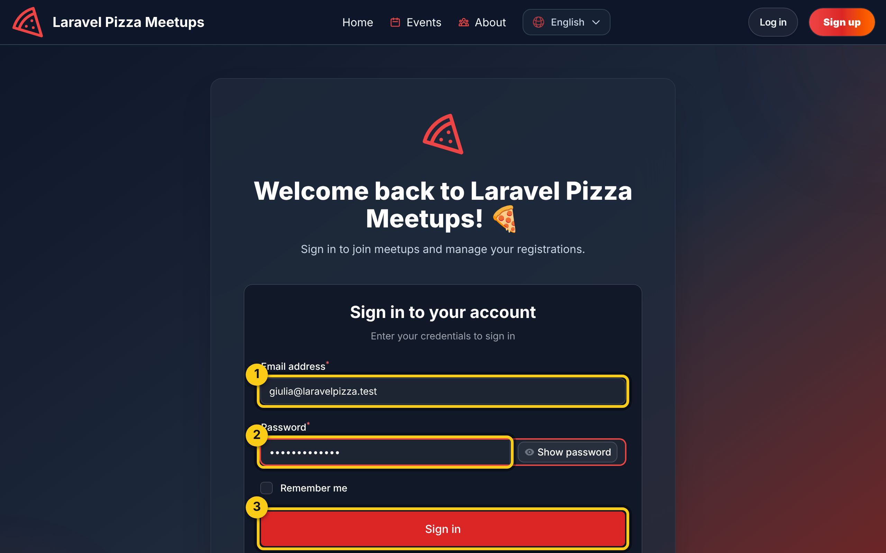

1. Type your **email**.
2. Type your **password**.
3. Click **Sign in**.

If you got here from the **Log in** link in an event's box, after signing in you go straight back to that event.

> If you get the password wrong 5 times in a row the site blocks you for one minute: it's a protection against people trying to guess it. Wait and try again, or use "Reset it".

### Forgot your password?

On the sign-in page click **Reset it**.

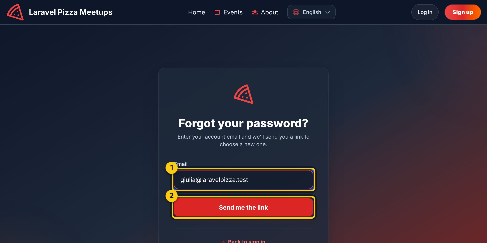

1. Type the **email** of your account.
2. Click **Send me the link**.

You receive an email with a **Reset password** button: open it, choose a new password (at least 12 characters with upper and lower case letters, a number and a symbol, typed twice) and save. You are signed in right away. The link is valid for one hour.

> To protect accounts, the site answers in the same way even if the email is not registered: if the email doesn't arrive, check your spam and that you typed the right address.

After signing in you land on the **My events** page, with your name at the top right:

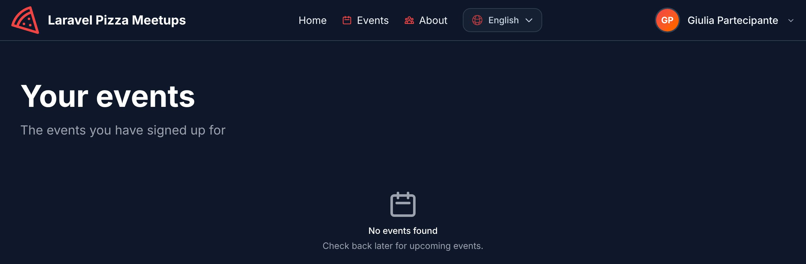

## 2.4 Register for an event

Already signed in? Open an event from the **Events** list (as in [chapter 1](01-visitor.md#12-see-the-list-of-events)): one click is enough.

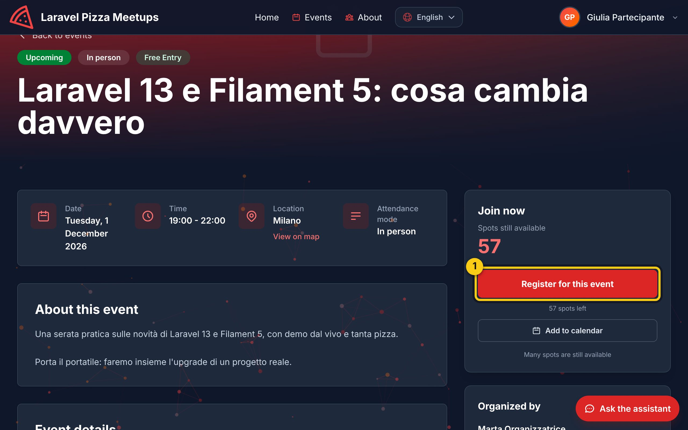

1. Click **Register for this event**.

The seat is yours:

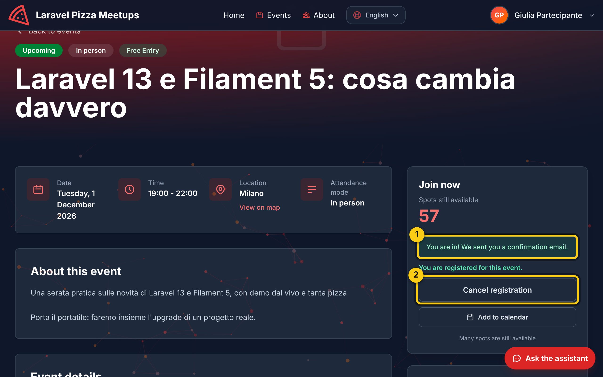

1. The green message confirms the registration, and the number of free seats goes down by one.
2. If you change your mind, you can **cancel the registration** from here.

A few moments later you also receive a **confirmation email** with a summary of the event:

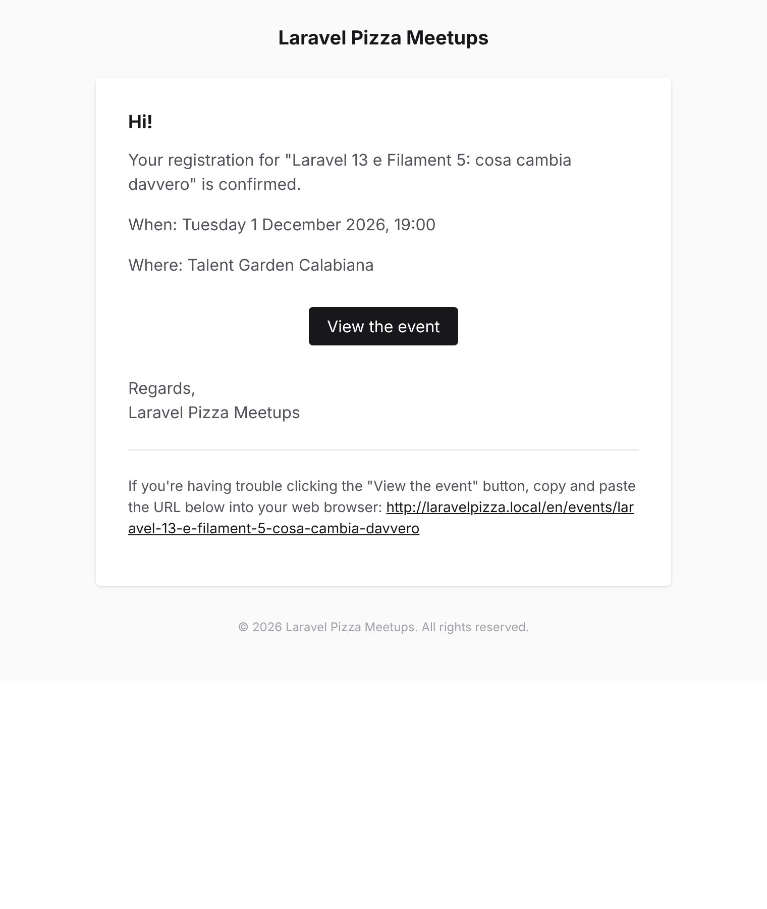

The email has an **attachment** (a file ending in `.ics`): open it and the event adds itself to your calendar. The email is written in your **preferred language** (section 2.7).

**The day before** the event you receive another email, the **reminder**, with date, place and the same attachment. If you can no longer come, it's the right moment to cancel and leave the seat to someone else.

## 2.5 Cancel a registration

Can't come any more? Free the seat for someone else: open the event and click **Cancel registration** (box 2 in the previous picture). The button goes back to "Register for this event".

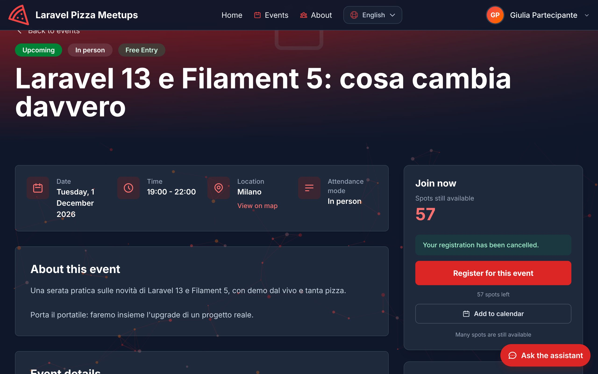

## 2.6 Your personal menu

Click your **name** at the top right: your personal menu opens.

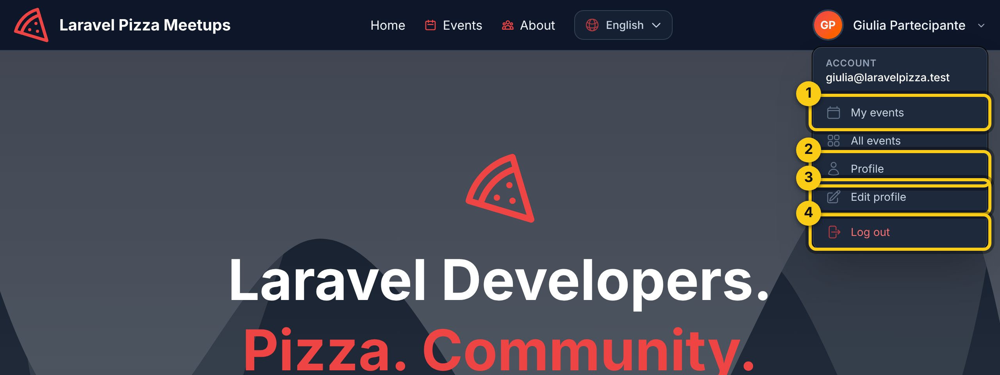

1. **My events**: the events you are registered for.
2. **Profile**: your public profile, as others see it.
3. **Edit profile**: change name, bio, photo, language and password (section 2.7).
4. **Log out**: ends the session. Always do it if you use a shared computer.

There is also **All events**, which opens the complete list of meetups. Until you upload a photo you see a circle with your initials.

### My events

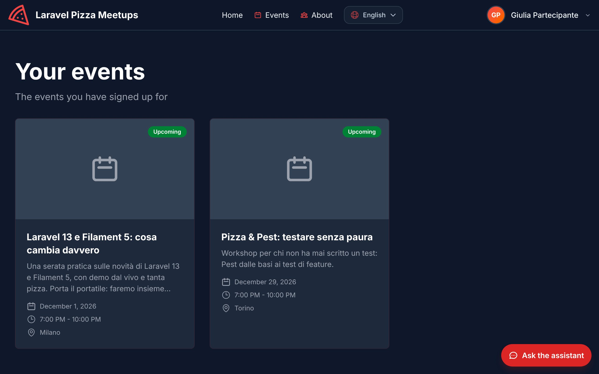

Here you find all the events you are registered for, in date order. A coloured label tells you whether the event is "Upcoming", "In progress" or "Ended".

### Profile

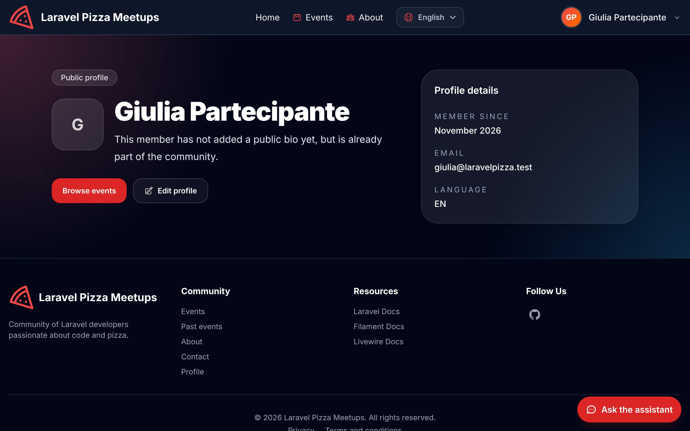

The profile is public: others see your name, your bio and since when you have been a member. **Only you can see your email**: it isn't shown to others, not even when you organise an event.

## 2.7 Edit your profile

From the personal menu click **Edit profile** (or the button with the same name on your profile). The page has three parts, each with its own button: you only save the one you changed.

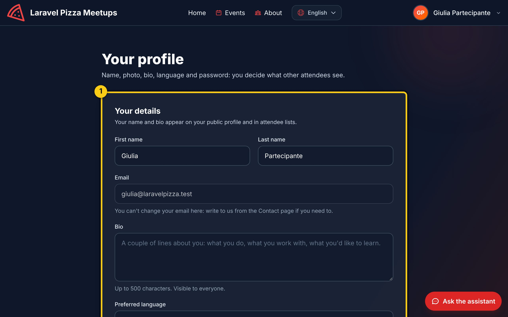

1. **Your details**: first name, last name, a short **bio** (at most 500 characters, everyone sees it) and the **preferred language**, that is the language of the emails we send you and, for organisers and administrators, of the admin panel. The email cannot be changed here: if you need to, write to us from the Contact page. When you are done click **Save details**: a confirmation appears and your name at the top updates right away.

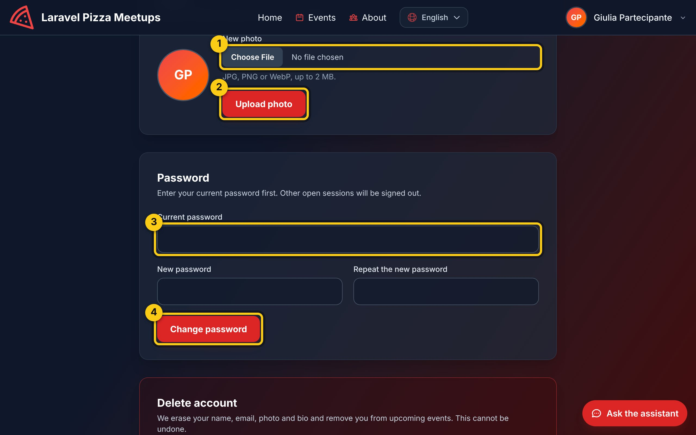

1. **Photo**: choose an image from your computer or phone (JPG, PNG or WebP, at most 2 MB)...
2. ...and click **Upload photo**. If you change your mind, **Remove photo** goes back to your initials.
3. **Password**: first type the password you use now, then the new one twice (at least 12 characters, with upper and lower case letters, a number and a symbol)...
4. ...and click **Change password**. For safety, if you were also signed in on other devices, you'll have to sign in again there with the new password.

### Delete your account

At the bottom of the same page there is **Delete account**. Click **I want to delete my account** and the box opens:

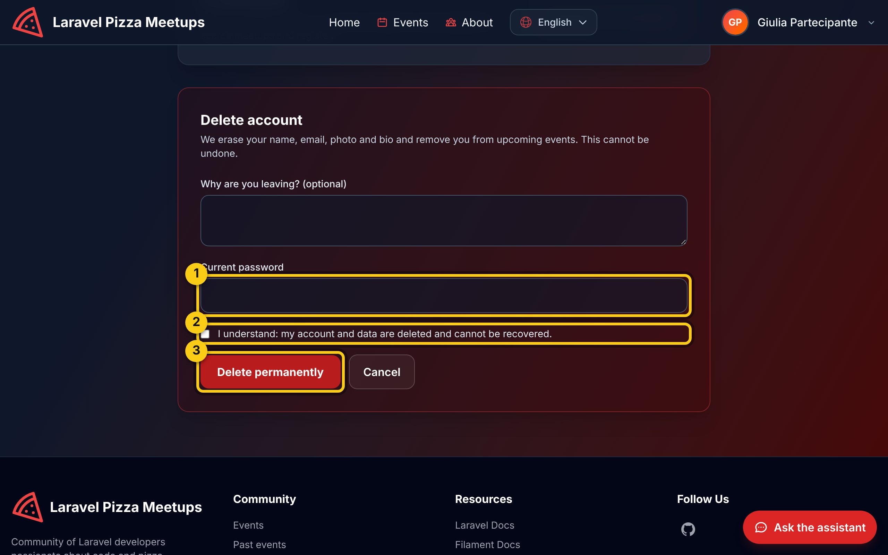

1. Type your **current password** (if you like, above it you can tell us why you are leaving).
2. Tick the box: you confirm you understand there is no going back.
3. Click **Delete permanently**.

We immediately delete name, email, photo and bio, free your seats in future events and sign you out. If one day you want to come back, just sign up again.

## 2.8 When you cannot register

The registration button is missing, or grey, in these cases:

- **Sold out**: all seats have been taken. Try again later: if someone cancels, the seat becomes free.
- **Event already started or over**: registrations are closed.
- **You are already registered**: instead of "Register" you see "Cancel registration".

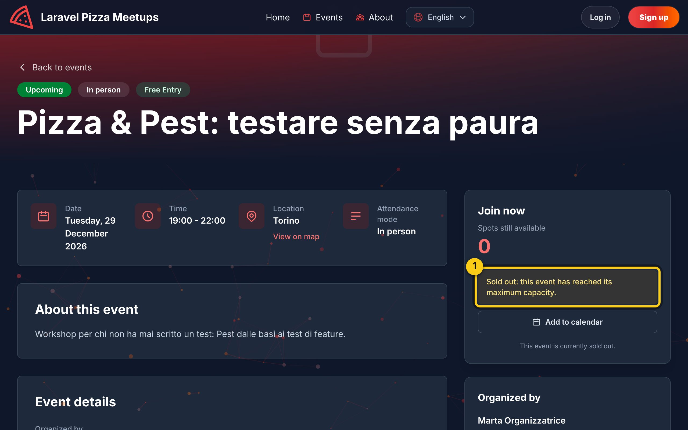

1. The **Sold out** notice.

## 2.9 Ask the assistant

After signing in, at the bottom right of every page there is the **Ask the assistant** button: a chat that finds events and registers you, written the way you would talk to a person. The button is only there if the site has the assistant enabled.

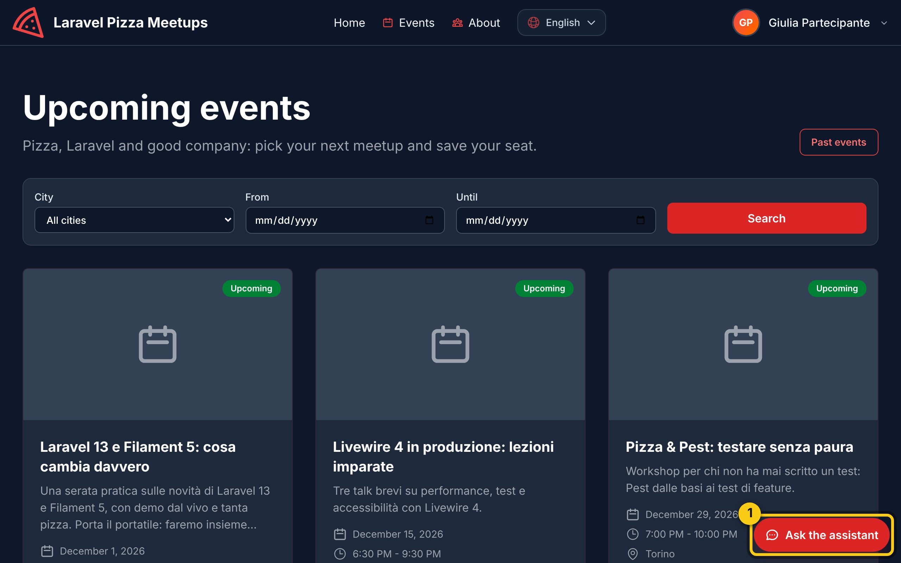

1. Click **Ask the assistant**. The chat opens with a few ready-made questions you can click.

Type a question, for example "What are the next meetups?", and press **Enter**:

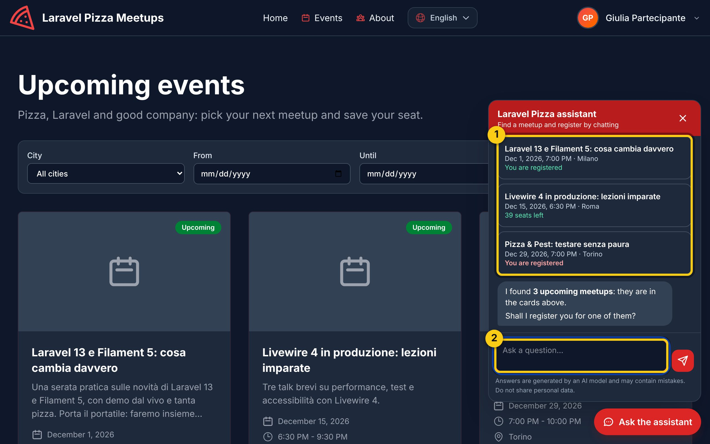

1. The assistant shows the events as **cards**: title, date, city and free seats (or "You are registered" or "Sold out"). Click a card to open the event.
2. Type your next question here.

Ask it to register you, for example "Register me for Livewire 4 in produzione". The assistant **does nothing on its own**: it asks you to confirm first.

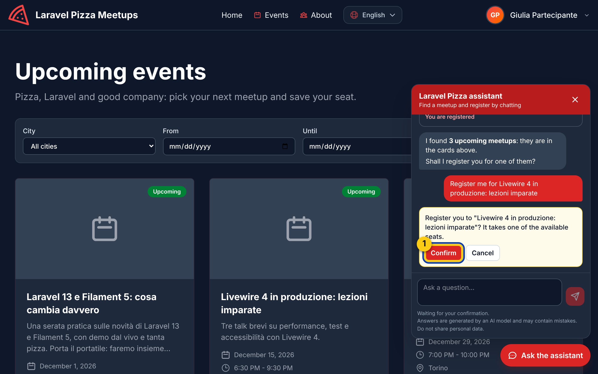

1. Click **Confirm** to register, or **Cancel**. Until you choose, you cannot send other messages.

After you confirm, the registration is done, just like with the button on the page: you receive the same email with the calendar file and the page updates the free seats.

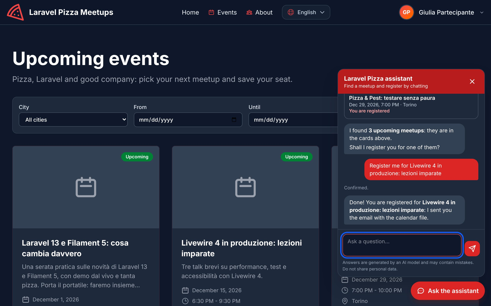

In the same way you can ask "Which events am I registered for?" or "Cancel my registration for…" (with a confirmation here too).

> The answers are written by an artificial intelligence model and may contain mistakes: the data in the cards (dates, seats) comes from the site and is correct. Don't type personal data the chat doesn't need. To close the chat click the **X** or press **Esc**.

## 2.10 Connect your own AI assistant (Claude, Cursor…)

Do you already use an AI assistant on your computer, such as Claude or Cursor? You can connect it to your account: it will search meetups and register you with the same rules as the site. You need a **personal token**, a kind of password just for the assistant.

In **Edit profile** click **Connect an AI assistant**. Type a name for the token (for example "Claude Desktop") and click **Create token**:

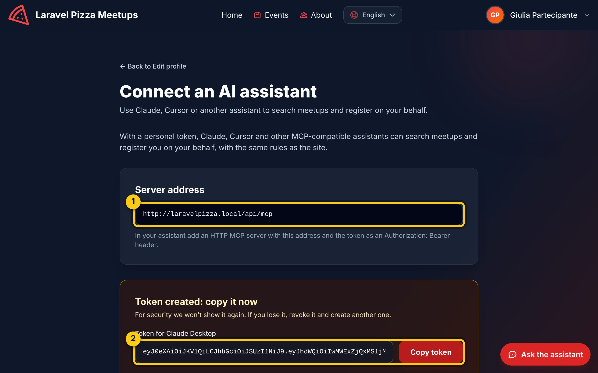

1. The **server address** to enter in the assistant.
2. The **token**: click **Copy token** and paste it in the assistant. **It is shown only once**: if you lose it, revoke it and create another one.
3. A ready-made **example configuration**, with address and token, for assistants that use this format (Claude Desktop, Cursor).

Click **Done, I copied it**. Below, in **Active tokens**, you find all your tokens with their expiry date (6 months). **Revoke** blocks the assistant using that token immediately: do it if you change computer or think someone saw it.

> Treat the token like a password: whoever has it can register you and cancel your registrations.

[Continue with chapter 3 – Organiser →](03-organiser.md)
