# 3. Organiser: creating and managing events

[← Back to the contents](readme.md)

You are an **organiser** when an administrator has given your account permission to manage events. Events are not created from the public site but from the **admin panel**, a reserved area at a different address: add `/meetup/admin` to the site's address (for example `https://laravelpizza.com/meetup/admin`).

> The admin panel is currently in **Italian**. In this chapter every label is written as it appears on screen, in Italian, followed by its meaning in English: for example **Salva** ("Save").

> You don't see the panel, or you get "Accesso negato" ("Access denied")? Your account doesn't have the permission yet: ask the site administrator (how they grant it is explained in [chapter 4](04-administrator.md#42-give-someone-the-organiser-role)).

## 3.1 Sign in to the panel

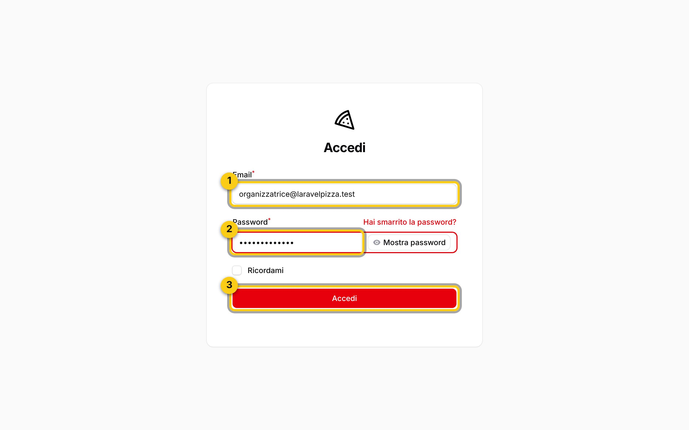

1. Type your **email** (the same as on the site).
2. Type your **password**.
3. Click **Accedi** ("Sign in").

## 3.2 The dashboard

After signing in the **Dashboard** opens: the key figures and the next appointments.

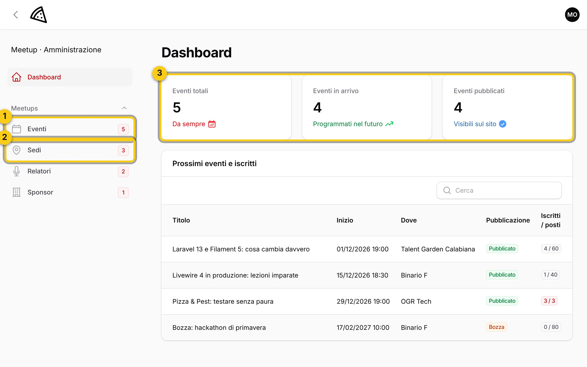

1. **Eventi** ("Events") opens the complete list of events.
2. **Sedi** ("Venues"), **Relatori** ("Speakers") and **Sponsor**: the records you link to events (see 3.7).
3. The three **tiles**: how many events you created in total, how many are upcoming and how many are published, that is visible on the site.

Below is the table **Prossimi eventi e iscritti** ("Upcoming events and attendees"): for each future event, how many people registered out of the seats available. The number turns yellow when the event is almost full (80%) and red when it's full. Click the title to edit the event.

## 3.3 The list of events

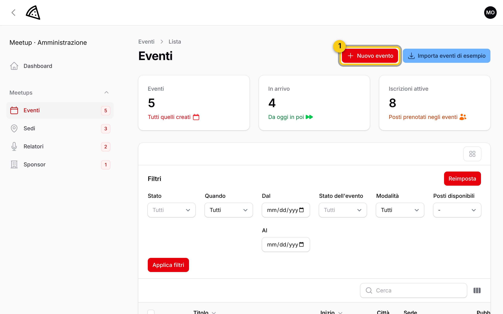

1. **Nuovo evento** ("New event"): creates an event.

At the top you find the summary tiles (events created, upcoming, seats already booked), below them the table with all the events (drafts too, which the public doesn't see). The **Iscritti** ("Attendees") column shows "attendees / seats". With **Filtri** ("Filters") you can see only drafts, only upcoming or past events, or search by dates:

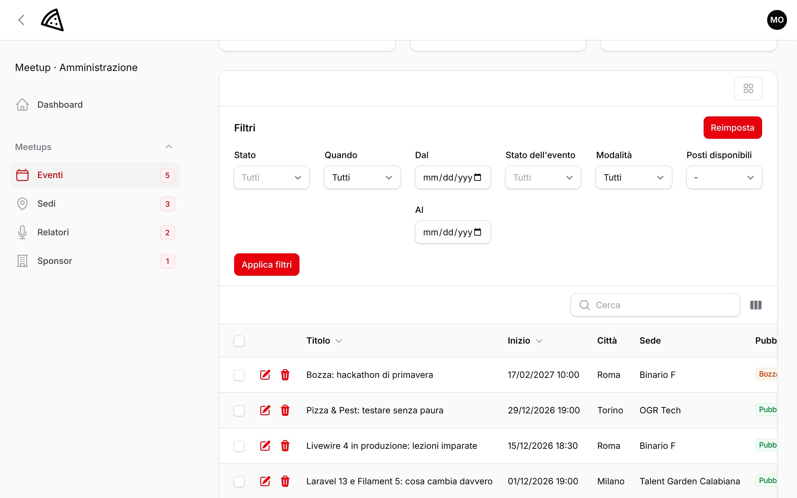

## 3.4 Create an event

Click **Nuovo evento** ("New event"). The form opens.

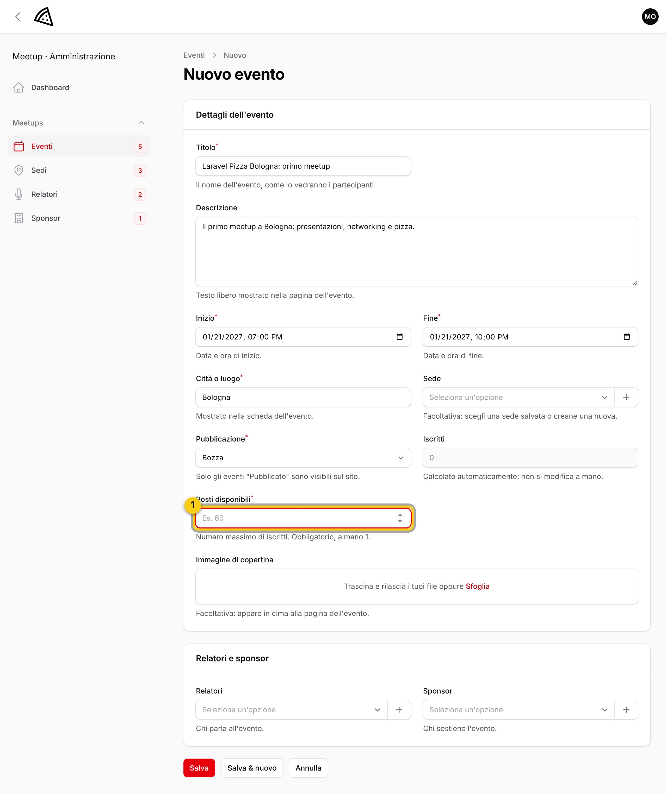

Fill in the main fields:

- **Titolo** ("Title"): short and clear, it's the first thing people read.
- **Descrizione** ("Description"): what it's about, who it's for, what to bring.
- **Inizio** and **Fine** ("Start" and "End"): date and time. The end must come after the start.
- **Città o luogo** ("City or place"): the city, shown on the event card and used by the site's city filter.
- **Sede** ("Venue", optional): the exact place, chosen among the saved ones. With the **+** next to it you create a new one without leaving the form.
- **Posti disponibili** ("Seats available", box 1): how many people can register. It's **required** and must be at least 1.

If you forget the seats available, the site doesn't save: the field stays highlighted and a notice asks you to fill it in.

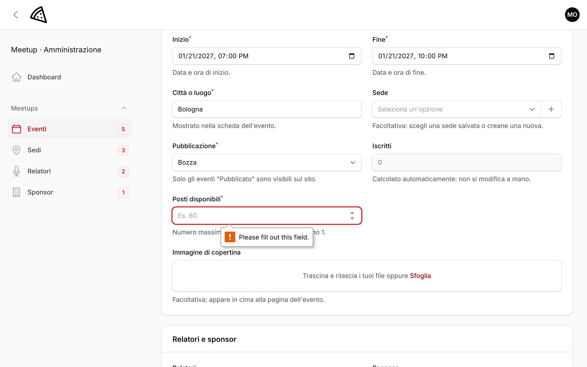

## 3.5 Publish

A new event starts as a **draft** (**Bozza**): only you see it. To show it to everyone:

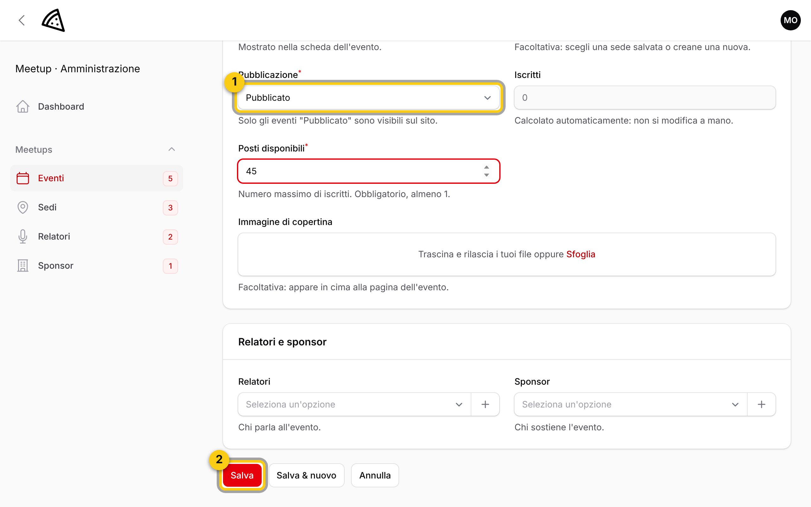

1. In **Pubblicazione** ("Publication") choose **Pubblicato** ("Published").
2. Click **Salva** ("Save").

The site confirms with the message **Salvato** ("Saved") at the top right and takes you back to the list, where the new event is already in the table:

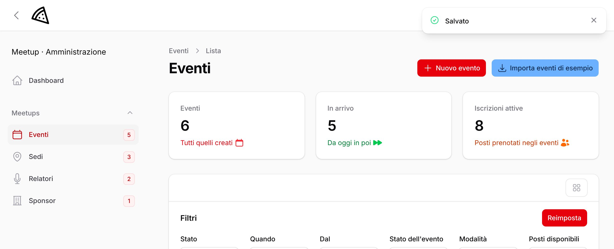

From now on the event appears in the public list and people can register. The number of attendees updates by itself: you can't change it by hand.

## 3.6 Edit or delete an event

From the event list click the event to change. Edit what you need and click **Salva** ("Save").

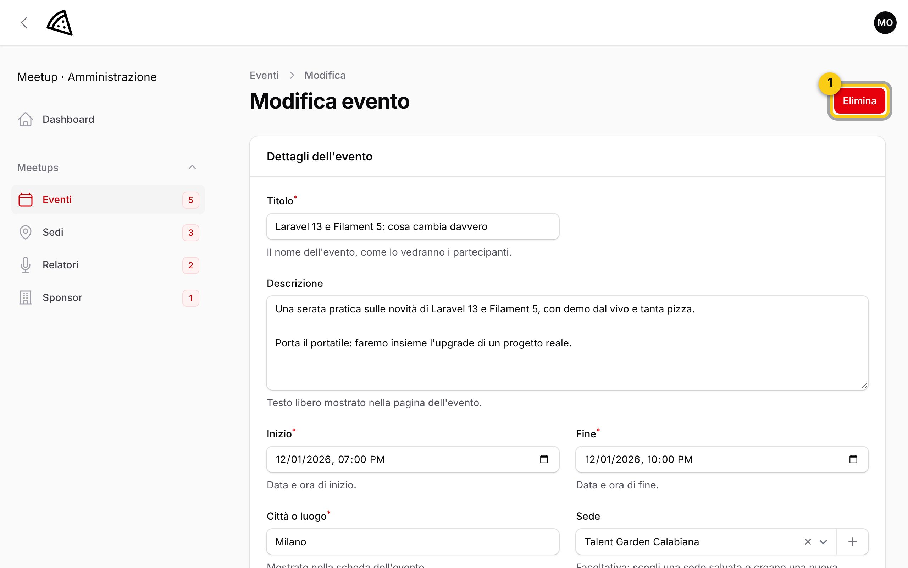

1. **Elimina** ("Delete") deletes the event.

Before deleting, the site asks for confirmation and warns you if people are registered:

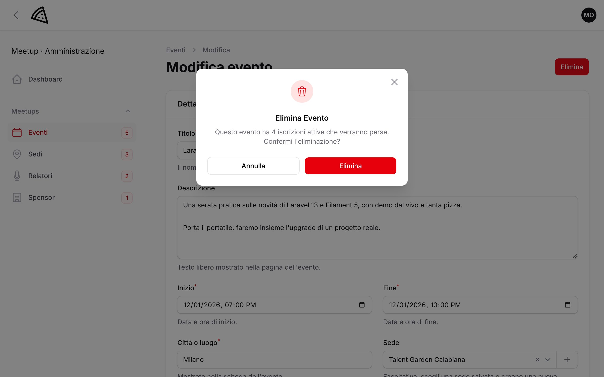

> Careful: deleting also removes all registrations for that event and cannot be undone. If the event is only postponed, change the date instead of deleting it.

## 3.7 Speakers and sponsors

At the bottom of the event form there is the section **Relatori e sponsor** ("Speakers and sponsors").

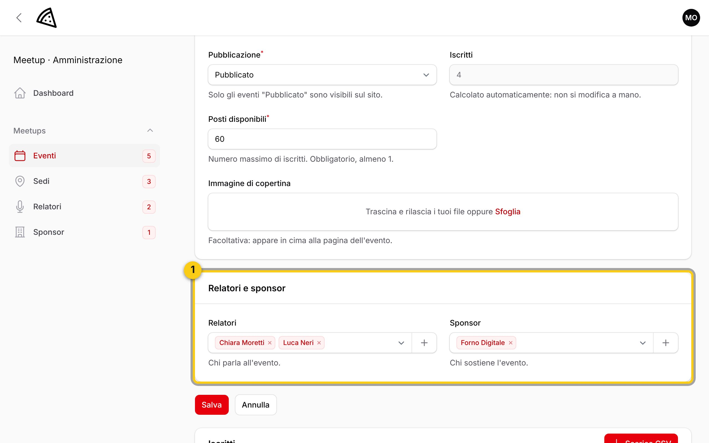

1. Choose one or more **speakers** and **sponsors** from the lists. Start typing the name to find it; with the **+** you add a new one. Then click **Salva** ("Save").

The full records (contacts, bio, website) are managed from the **Sedi**, **Relatori** and **Sponsor** items in the left menu:

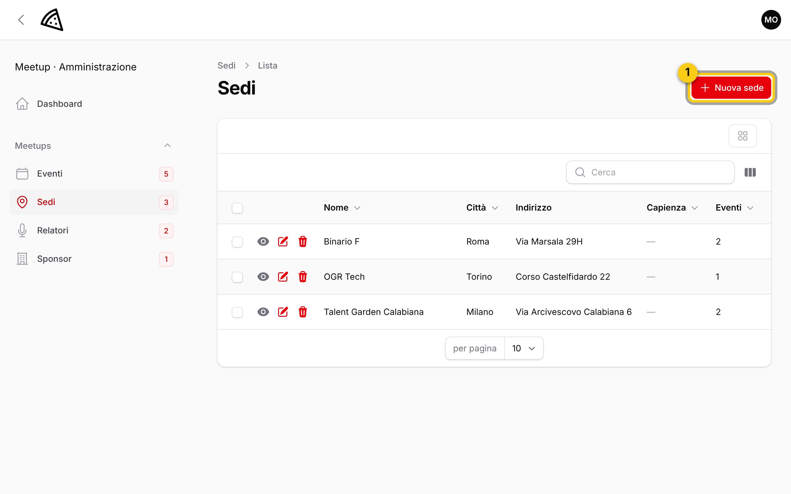

1. **Nuova sede** ("New venue") adds a venue (on the other pages the buttons are **Nuovo relatore**, "New speaker", and **Nuovo sponsor**, "New sponsor"). The **Eventi** column tells you how many events use it.

If you delete a venue, the events that used it remain and show only the city. If you delete a speaker or a sponsor, it only disappears from the events; the events remain.

## 3.8 Who registered

Open an event with **Modifica** ("Edit") and scroll to the bottom of the page: you find the **Iscritti** ("Attendees") table.

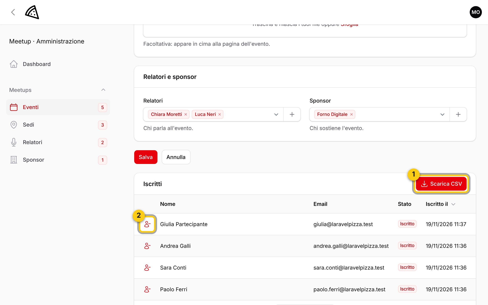

1. **Scarica CSV** ("Download CSV"): downloads the list (name, email, status, registration date) in a file that opens with Excel or LibreOffice. Useful for the list at the door.
2. The red icon **cancels that person's registration**, after a confirmation: the seat becomes free again. The person doesn't get an automatic notice, so let them know yourself.

> Attendees automatically receive the confirmation email when they register and the reminder the day before the event: you don't need to do anything.

## Practical tips

- Prepare the event as a **draft**, check it again and publish it only when it's complete.
- Set the seats available according to the real room: the site closes registrations by itself when they run out.
- If you change date or place after publishing, let the attendees know (you can use the addresses in the CSV): the site doesn't send an automatic email for changes. The reminder the day before will use the updated date and place anyway.
- Messages written in the site's **Contact** form arrive at the email address set by the administrator.

[Continue with chapter 4 – Administrator →](04-administrator.md)
