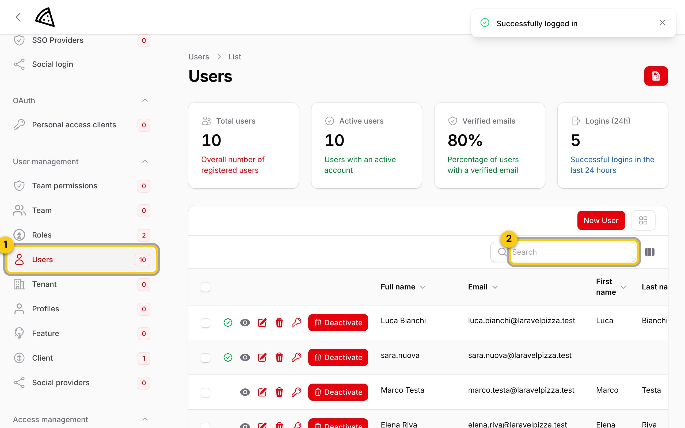
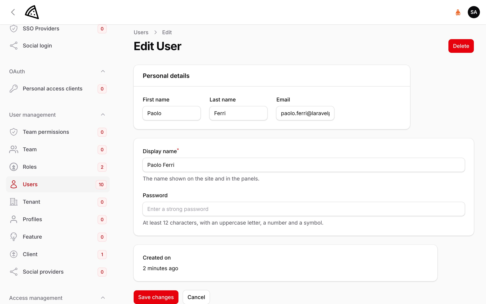
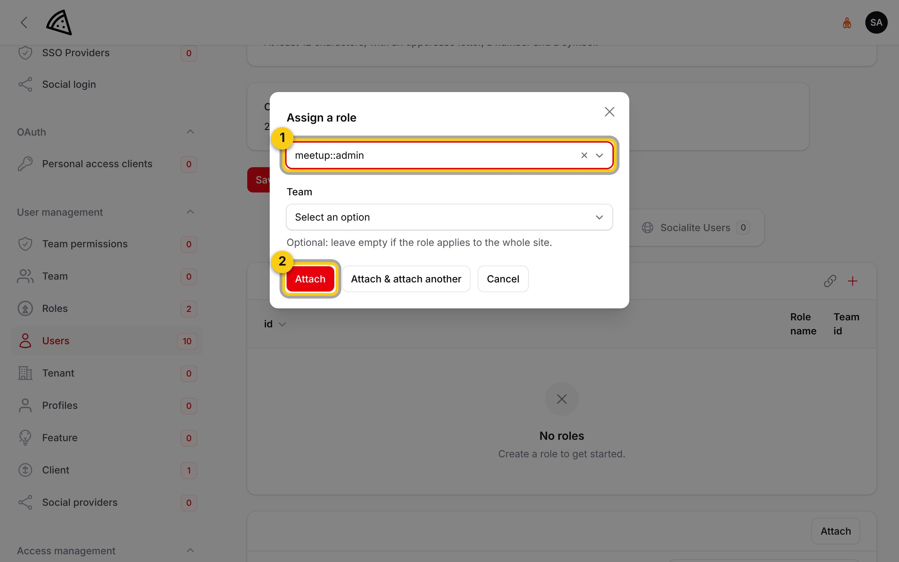
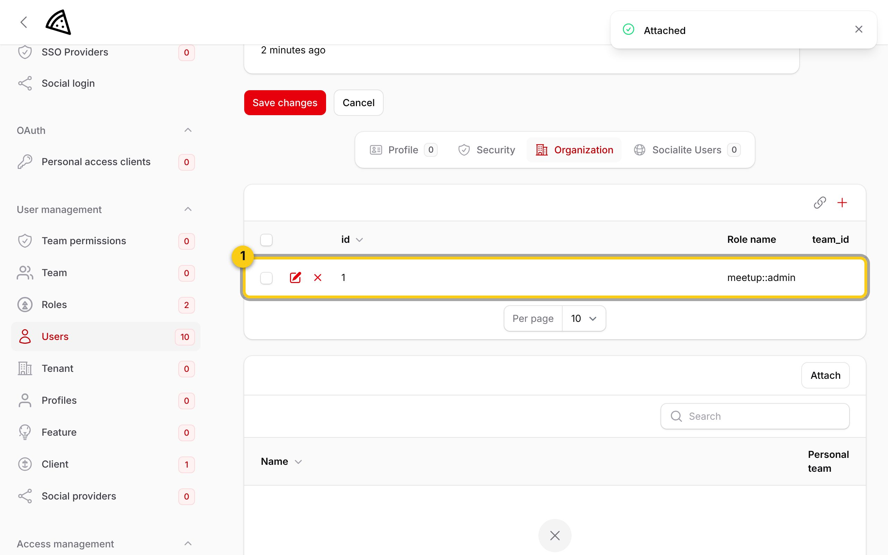
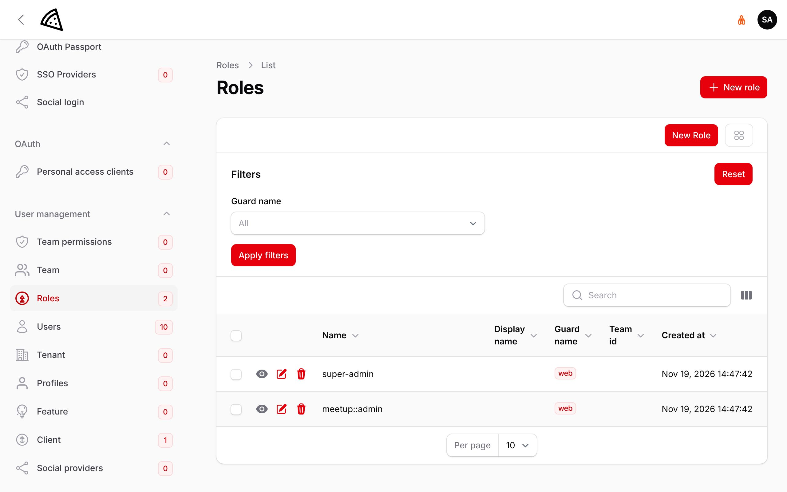

# 4. Administrator: users and permissions

[← Back to the contents](readme.md)

You are an **administrator** when your account has the **super-admin** role. It's the role of whoever runs the site, not the single events: they decide who can organise, and check accounts and settings. Usually there are one or two administrators.

> The panels speak your **preferred language** (Edit profile → Preferred language).

> The admin panel gives access to the personal data of all attendees. Use it only for what you need, from a secure computer, and always sign out at the end.

## 4.1 Sign in and find users

1. Sign in on the site with **Log in** (top right), with your email and password, like a participant ([chapter 2.3](02-participant.md#23-sign-in-the-following-times)).
2. Then open the site's address followed by `/user/admin/users` (for example `https://laravelpizza.com/user/admin/users`).

1. **Users** in the left menu: the list of all accounts. At the top the tiles say how many there are, how many are active, how many verified their email and how many sign-ins there were in the last 24 hours.
2. **Search**: type a name or an email to find a person immediately.
3. The **pencil** opens the person's record to edit it.

On the same row you also find the eye (**View**), the bin (**Delete**), the key (**Change password**) and **Deactivate**: a deactivated account can no longer sign in until you reactivate it.

## 4.2 Give someone the organiser role

To create and manage events a person needs the **meetup::admin** role. First they must have an account on the site (they sign up themselves, [chapter 2](02-participant.md)). Then:

1. In the **Users** list find the person and click the **pencil** (section 4.1).
2. Scroll down to the tabs at the bottom and open **Organization**.

1. The **Organization** tab: the first table lists the person's roles (at first it's empty).
2. The **chain** icon (**Attach**) opens the window to assign a role.

1. Open the first menu (the role), type `meetup` and choose **meetup::admin**. Leave **Team** empty: the role applies to the whole site.
2. Click **Attach**.

A confirmation appears and the role is in the table:

1. The **meetup::admin** role. From now on the person can enter the events panel (`/meetup/admin`, [chapter 3](03-organiser.md)).

**To remove the role** click the **X** (**Detach**) on the same row: the person stays registered on the site but can no longer enter the panel.

> The **super-admin** role can only be assigned by someone who already has it: an organiser cannot make themselves an administrator.

## 4.3 The site's roles

In the left menu, **Roles** lists the existing roles:

| Role | Who has it | What they can do |
|---|---|---|
| *(none)* | every registered person | register for events, manage their own profile, use the assistant |
| `meetup::admin` | organisers | panel `/meetup/admin`: events, venues, speakers, sponsors, attendees |
| `super-admin` | administrators | all panels, users and roles, site settings |

Don't rename or delete these roles: the site recognises them by name.

## 4.4 The other panels

As an administrator you can also open other technical panels, always by adding their address after the site's. The ones useful in everyday work:

| Address | What it's for |
|---|---|
| `/meetup/admin` | events, like the organisers ([chapter 3](03-organiser.md)) |
| `/user/admin` | users, roles, recent sign-ins, devices |
| `/cms/admin` | texts of the top menu and of the footer |
| `/notify/admin` | email templates and test sends |

The other panels (`/xot/admin`, `/job/admin`, `/activity/admin`, `/ai/admin`, …) are for whoever maintains the site technically: if you are not sure, don't change anything.

## 4.5 AI assistants

**On the site.** Signed-in participants can use the **Ask the assistant** chat ([chapter 2.9](02-participant.md#29-ask-the-assistant)). It only appears when whoever maintains the site has configured a free AI provider (Groq or OpenRouter); it registers people only after they confirm. Technical notes: `laravel/Modules/Meetup/docs/assistant.md`.

**From outside.** The site can also be used by AI assistants such as Claude or Cursor, on behalf of a person: they search events, register and cancel registrations with the same rules as the site. To connect an assistant you need a **personal token**, which each person creates and revokes from their profile ([chapter 2.10](02-participant.md#210-connect-your-own-ai-assistant-claude-cursor)); the technical instructions are in `laravel/Modules/Meetup/docs/mcp-server.md`.

## Notes for maintainers

The pictures of this chapter are captured by `tools/capture.cjs` with `MANUAL_LANG=en`: the script sets the preferred language of the demo accounts before opening the panels. The account `superadmin@laravelpizza.test` of the demo database has the super-admin role.
