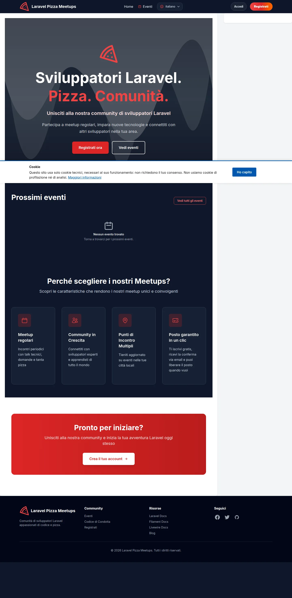
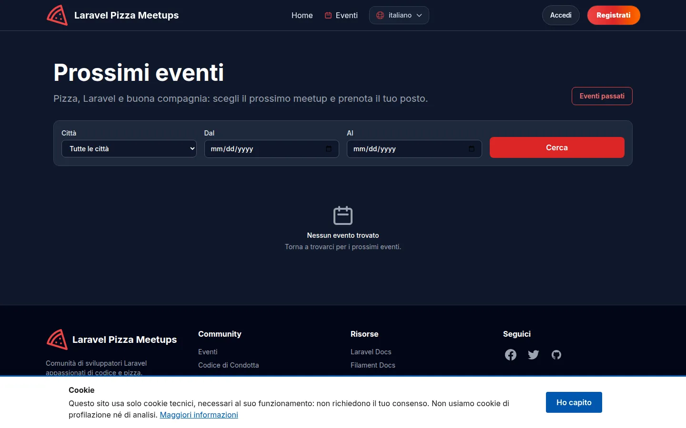
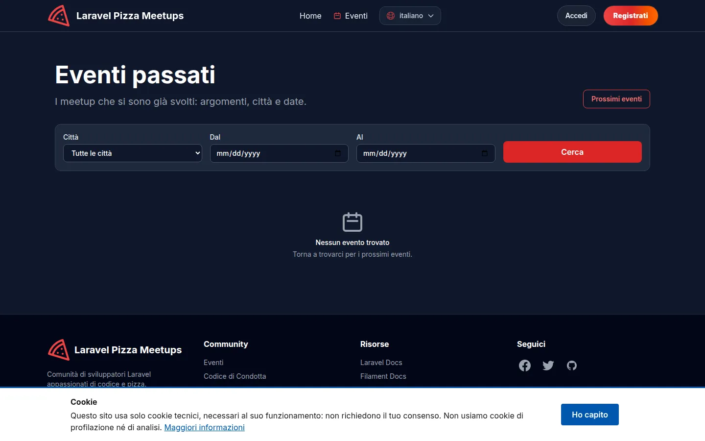
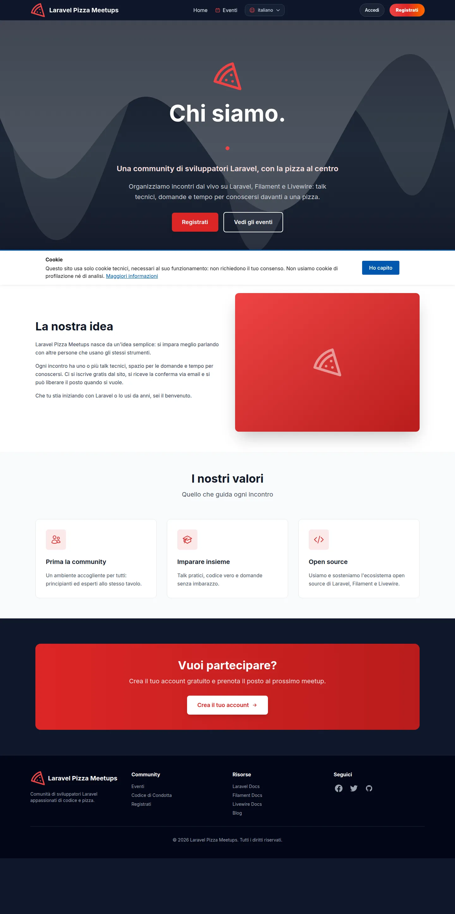
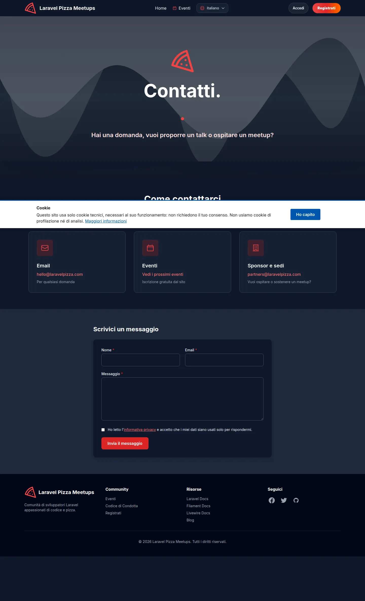
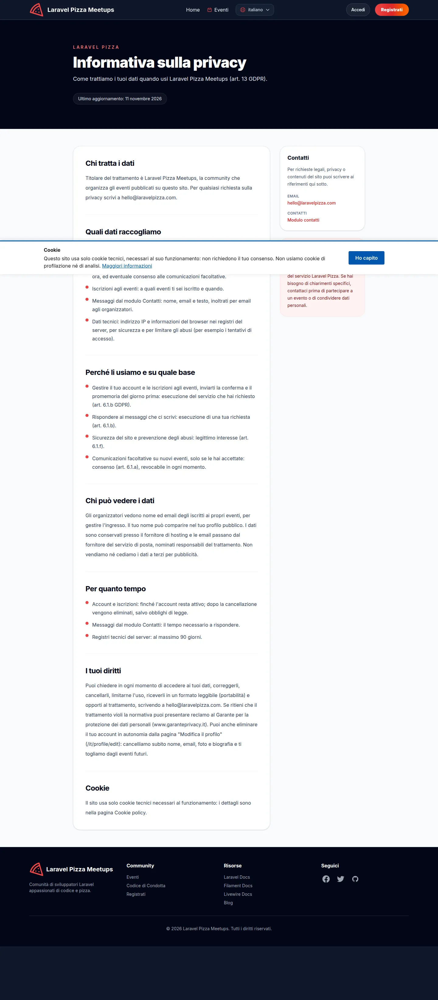
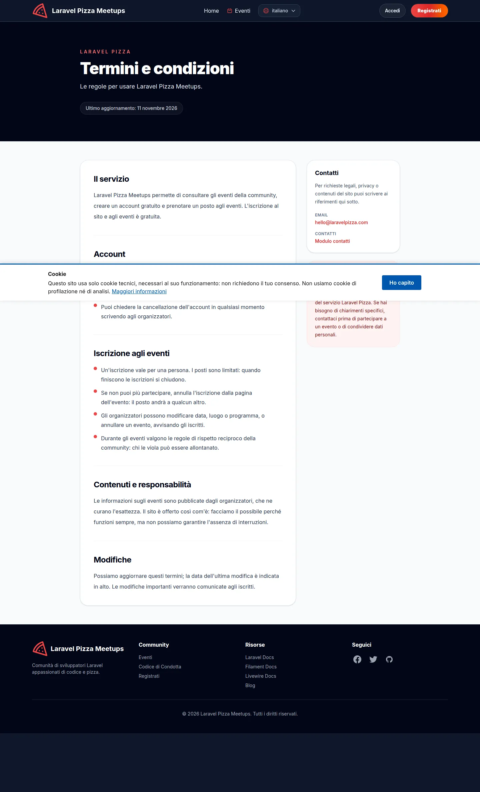
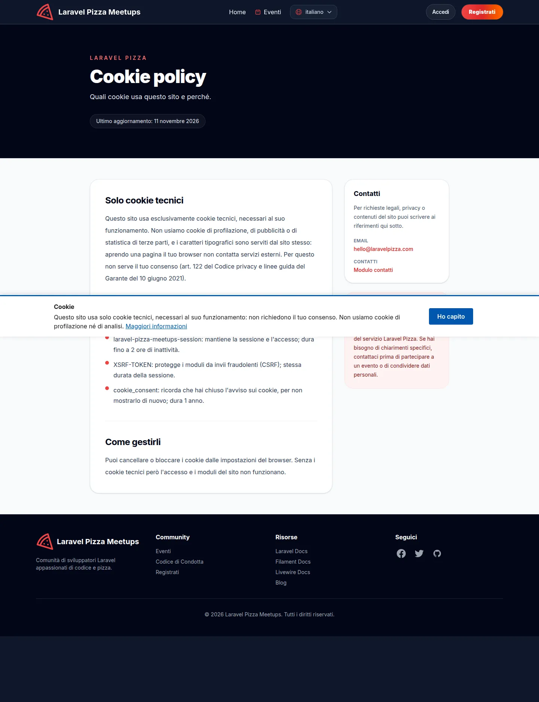

> Screenshot reali catturati il 25 novembre 2026 con
> `bashscripts/tools/docs/manual-screenshots.mjs Themes/Meetup` su `http://127.0.0.1:8000`
> (dev server, sola lettura, nessun login). Manifest: [screenshots.json](screenshots.json).
> Ogni immagine è stata aperta e controllata: è la UI reale del tema, non una pagina d'errore.



# Tema Meetup — front office pubblico

## Scopo

Il tema `Meetup` è la parte pubblica di Laravel Pizza Meetups: home, elenco eventi,
pagine istituzionali e pagine legali. Non richiede login. Il contenuto delle pagine
arriva da file JSON in `laravel/config/local/laravelpizza/database/content/pages/`
e da componenti Blade in `laravel/Themes/Meetup/resources/views/components/blocks/`.

## Accesso

- Pagine pubbliche sotto `/{locale}/...`. Locale verificati nell'HTML della home: `it`, `en`, `de`, `es`, `fr`, `ru`
  (selettore lingua nell'header, `components/sections/header/v1.blade.php`).
- `/` senza prefisso non è una pagina: il manuale usa sempre `/it/...`.
- Le pagine con `"auth": true` non sono fotografate in questo manuale (vedi "Non documentato").

## Attori

| Attore | Cosa può fare nelle pagine documentate |
|---|---|
| Visitatore (ospite) | Sfoglia home, eventi prossimi e passati, pagine «Chi siamo», «Contatti», informative legali. Usa il selettore lingua e il banner cookie. |

Gli organizzatori gestiscono gli eventi nel pannello Filament del modulo Meetup, non in questo tema.

## Pagine

### 1. Home — `/it` (`fo-home-it.webp`, pagina intera)


Sezioni nell'ordine visto nello screenshot, da `config/local/laravelpizza/database/content/pages/home.json`:

1. **Hero**: titolo «Sviluppatori Laravel. Pizza. Comunità.», sottotitolo, due pulsanti: «Registrati ora» e «Vedi eventi».
2. **Prossimi eventi** (blocco `events/list`, limite 3): nello stato di prova mostra «Nessun evento trovato», con il link «Vedi tutti gli eventi».
3. **Perché scegliere i nostri Meetups?** (blocco `features/grid`): quattro schede (Meetup regolari, Community in crescita, Punti di incontro multipli, Posto garantito in un clic).
4. **Pronto per iniziare?** (blocco `cta/banner`): pulsante «Crea il tuo account».
5. Footer condiviso: Community (Eventi, Codice di Condotta, Registrati), Risorse (Laravel Docs, Filament Docs, Livewire Docs, Blog), icone social.

### 2. Prossimi eventi — `/it/events` (`fo-events-it.webp`)



- Titolo «Prossimi eventi» e sottotitolo «Pizza, Laravel e buona compagnia…» (`events.json`, blocco `events/list`).
- Pulsante «Eventi passati» in alto a destra (porta a `/it/events/past`).
- Barra di ricerca con quattro campi: **Città** (menu, default «Tutte le città»), **Dal** e **Al** (date), pulsante **Cerca**.
- Lista eventi: nello stato di prova, «Nessun evento trovato — Torna a trovarci per i prossimi eventi».

### 3. Eventi passati — `/it/events/past` (`fo-events-past-it.webp`)



- Stessa barra di ricerca (Città, Dal, Al, Cerca), titolo «Eventi passati», descrizione da `events/past.json`.
- Pulsante «Prossimi eventi» per tornare all'elenco futuro.
- Nello stato di prova: «Nessun evento trovato».

### 4. Chi siamo — `/it/about` (`fo-about-it.webp`, pagina intera)



- Hero «Chi siamo.» con due pulsanti: «Registrati» e «Vedi gli eventi».
- «La nostra idea» (blocco `about/story`): tre paragrafi di testo.
- «I nostri valori» (blocco `about/values`): Prima la community, Imparare insieme, Open source.
- «Vuoi partecipare?» (blocco `cta/banner`): pulsante «Crea il tuo account».

### 5. Contatti — `/it/contact` (`fo-contact-it.webp`, pagina intera)



- Hero «Contatti.».
- Tre schede (blocco `contact/main`, dati in `contact.json`): Email `hello@laravelpizza.com`, Eventi (link a `/events`), Sponsor e sedi `partners@laravelpizza.com`.
- Modulo «Scrivici un messaggio» con i campi visibili: **Nome** (obbligatorio), **Email** (obbligatorio), **Messaggio** (obbligatorio), casella di accettazione dell'informativa privacy, pulsante **Invia il messaggio**.
- L'invio del modulo non è stato provato: le catture sono solo GET.

### 6. Informativa privacy — `/it/privacy` (`fo-privacy-it.webp`, pagina intera)



- Titolo «Informativa sulla privacy», sottotitolo «art. 13 GDPR», data «Ultimo aggiornamento: 11 novembre 2026».
- Sezioni (da `privacy.json`, blocco `legal/article`): Chi tratta i dati, Quali dati raccogliamo, Perché li usiamo e su quale base, Chi può vedere i dati, Per quanto tempo, I tuoi diritti, Cookie.
- Colonna laterale «Contatti» con email e link al modulo.

### 7. Termini e condizioni — `/it/terms` (`fo-terms-it.webp`, pagina intera)



- Titolo «Termini e condizioni», data di aggiornamento come sopra (`terms.json`).
- Sezioni visibili: Il servizio, Account, Iscrizione agli eventi, Contenuti e responsabilità, Modifiche.

### 8. Cookie policy — `/it/cookie-policy` (`fo-cookie-policy-it.webp`, pagina intera)



- Sezione «Solo cookie tecnici»: il sito non usa cookie di profilazione, pubblicità o statistica di terze parti.
- Elenco dei cookie tecnici: `laravel-pizza-meetups-session` (sessione, fino a 2 ore di inattività), `XSRF-TOKEN` (protezione CSRF), `cookie_consent` (ricorda la chiusura del banner, durata 1 anno).
- Sezione «Come gestirli»: cancellazione o blocco dal browser.

### Banner cookie

Compare in basso alla prima visita, con testo «Questo sito usa solo cookie tecnici…», link «Maggiori informazioni» e pulsante «Ho capito». Il banner è il componente `Modules/Gdpr/resources/views/cookie-consent/index.blade.php`, collegato a `ui/cookiebar.blade.php` del tema.

## Non documentato in questo manuale

- **Login e registrazione** (`/it/auth/login`, `/it/auth/register`): rispondono HTTP 200 ma non sono stati fotografati in questo set; il link «Accedi» dell'header porta a `/it/auth/login`.
- **Dettaglio evento** (`/it/events/{slug}`) e **I miei eventi** (`/it/events/my`): nel database di prova non ci sono eventi. `/it/events/my` redirige a `/it/auth/login` (verificato), quindi richiede login.
- **Profilo pubblico** (`/it/profile/{id}`): risponde 404 con l'id di prova `1`; serve un utente reale per verificarlo.
- Pagine con `"auth": true` e area utente.

## Difetti noti (con evidenza)

1. **Link CTA senza prefisso di lingua.** `home.json` (CTA «Registrati ora») e `about.json` (quattro CTA) usano `"url": "/auth/register"`. Il server risponde 302 a `/it/auth/register`: funziona, ma è fuori dalla regola `LaravelLocalization::localizeUrl()` di `CLAUDE.md` (sezione 0e). Non corretto: file di contenuto in `config/local/`, fuori dallo scope di questo agente.
2. **Alias `/events-near-me` a due salti.** `laravel/config/local/laravelpizza/seo.php:17` lo mappa su `events`. Verificato: `/events-near-me` → 302 `/it/events-near-me` → 200 `/it/events`. Non è un 301 diretto.
3. **Date in formato US nell'interfaccia italiana.** Nei campi «Dal» e «Al» (`fo-events-it.webp`, `fo-events-past-it.webp`) il segnaposto è `mm/dd/yyyy`. Dipende dal browser; non corretto.
4. **Immagine di «La nostra idea» è un segnaposto.** In `fo-about-it.webp` il riquadro a destra è rosso con il logo, senza fotografia. Contenuto da completare, non corretto.
5. **Banner cookie sopra il contenuto nelle catture a pagina intera.** In `fo-home-it.webp`, `fo-contact-it.webp` e altre, il banner fisso copre una parte della pagina (per esempio il titolo «Come contattarci»). È un effetto della cattura: il banner resta fisso nel punto dello schermo. Il tool non lo nasconde.

## Dati di esempio

Nessuno. Il database di sviluppo non ha eventi: le liste mostrano lo stato vuoto reale (catture `fo-events-*.webp`).

## Rigenerare gli screenshot

```bash
MANUAL_SHOT_SERVE=127.0.0.1:8000 node bashscripts/tools/docs/manual-screenshots.mjs Themes/Meetup
```

Manifest: [screenshots.json](screenshots.json). Il tool fallisce su HTTP ≥ 400, redirect al login o pagina senza CSS.

## Vedi anche

- [Guida per ruolo del tema](../manuale-utente/readme.md)
